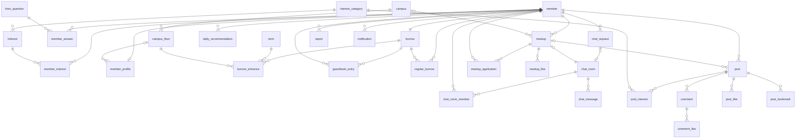

# 디굴디굴 DB 설계

[서비스 명세](../spec/README.md)를 바탕으로 한 테이블 설계다. DB는 MySQL이다. 테이블과 칼럼까지 정했고, 글자 수가 명세에 없는 칼럼의 길이와 조회용 인덱스는 구현하면서 정한다.

## 문서 목록

| 문서 | 테이블 |
|---|---|
| [계정 · 프로필 · 관심사 · 질문](account.md) | `member`, `member_profile`, `member_suspension`, `interest_category`, `interest`, `member_interest`, `intro_question`, `member_answer` |
| [들판 · 땅굴 입구 · 방명록 · 단골 · 추천](burrow.md) | `term`, `campus`, `campus_floor`, `burrow`, `burrow_entrance`, `guestbook_entry`, `regular_burrow`, `recommend_setting`, `recommend_setting_question`, `daily_recommendation`, `daily_recommendation_member` |
| [채팅](chat.md) | `chat_request`, `chat_room`, `chat_room_member`, `chat_message` |
| [모임](meetup.md) | `meetup`, `meetup_application`, `meetup_like` |
| [커뮤니티 · 신고](community.md) | `post`, `post_image`, `post_interest`, `comment`, `post_like`, `comment_like`, `post_bookmark`, `report` |
| [알림 · 공지](notification.md) | `notification`, `notification_setting`, `push_subscription`, `notice` |

테이블은 모두 38개다. 인증 코드와 비밀번호 재설정 링크는 DB가 아니라 임시 저장소(Redis)에 둔다.

## 설계 원칙: 저장하는 것과 화면에 그리는 것을 나눈다

명세는 화면을 기준으로 쓰여 있다. 화면에 보이는 값을 그대로 칼럼으로 옮기지 않고 셋으로 나눈다.

| 구분 | 뜻 | 예 | DB |
|---|---|---|---|
| 저장 | 사용자가 입력했거나 실제로 일어난 사실 | 닉네임, 고른 관심사, 참여 신청과 그 시각, 메시지 본문 | 칼럼으로 둔다 |
| 계산 | 저장된 값에서 그때그때 만들어 내려주는 값 | 좋아요 수, 안 읽은 수, "모집 완료" 배지, 겹치는 관심사, 땅굴 무드 | 두지 않는다 |
| 화면 | 프론트엔드가 가진 고정 자원과 표현 | 가구 · 두더지 그림, 들판 지도와 자리 번호마다의 화면 위치, 안내 문구, 견본 방 | 관계없다 |

- 각 문서의 끝에 "저장하지 않는 것"을 적는다. 계산하는 값은 무엇에서 계산하는지를 함께 적는다.
- 성능 때문에 계산 값을 칼럼으로 둬야 하면 그 사실을 문서에 드러내 적는다.
- 같은 사실을 두 곳에 저장하지 않는다. 어쩔 수 없이 겹치면 어느 쪽이 기준인지 적는다.

## 이름과 공통 규칙

- 테이블과 칼럼 이름은 영어 소문자와 밑줄(snake_case)로 쓴다. 테이블 이름은 단수형이다. 사용자는 `member`다(계정은 `member`, 프로필은 `member_profile`).
- PK는 `id`(BIGINT, 자동 증가)다. 다만 두 테이블을 잇기만 하는 테이블은 두 FK를 묶어 PK로 쓰고, 한 사람에 하나뿐인 테이블은 `member_id`를, 순서가 있는 딸린 테이블은 부모의 FK와 순번을 묶어 PK로 쓴다.
- FK 칼럼은 `가리키는 테이블_id`로 쓴다(예: `member_id`). 뜻을 드러내야 하면 역할을 쓴다(예: `host_id`, `author_id`).
- 시각은 DATETIME이고 이름은 `…_at`으로 끝난다. 줄이 만들어진 시각은 `created_at`이다. "했는지"는 참/거짓 대신 한 시각으로 저장한다(예: `canceled_at`이 있으면 취소됨).
- 상태와 종류는 영어 대문자 코드를 VARCHAR로 저장한다(예: `PENDING`). MySQL의 ENUM 타입은 쓰지 않는다.
- 글자 수가 명세에 있는 칼럼은 그 길이를 쓴다(예: `VARCHAR(50)`). 명세에 없으면 길이를 비워 두고 구현할 때 정한다.
- 인덱스는 UNIQUE처럼 규칙을 지키는 데 필요한 것만 적었다. 조회 속도를 위한 인덱스는 구현하면서 더한다.

## 전체 관계

딸린 작은 테이블 8개(`member_suspension`, `recommend_setting`, `recommend_setting_question`, `daily_recommendation_member`, `post_image`, `notification_setting`, `push_subscription`, `notice`)는 그림에서 뺐다. 영역별 그림은 각 문서에 있다.

## 설계하며 정한 것

2026-11-15에 하나씩 정했다. 바꾸려면 이 표와 해당 문서를 함께 고친다.

| 번호 | 무엇을 | 정한 것 |
|---|---|---|
| G1 | 이름 규칙 | snake_case, 테이블은 단수형, 사용자는 `member` |
| G2 | PK | BIGINT 자동 증가 |
| G3 | 개수와 요약 값(좋아요 수, 댓글 수, 확정 인원, 찜 수, 대화방의 마지막 메시지) | 칼럼으로 두지 않고 조회할 때 센다. 필요해지면 그때 칼럼을 더한다 |
| G4 | 그림이 프론트엔드에 있는 값 목록(모임 카테고리, 가구, 두더지 아이템, 탈퇴 사유) | 테이블을 두지 않고 고른 값의 코드만 저장한다 |
| G5 | 탈퇴한 사용자 | `member` 줄은 남기고 로그인 값을 비운다. 프로필 줄은 지운다 |
| A1 | 계정과 프로필 | `member`(계정)와 `member_profile`(프로필)로 나눈다 |
| A2 | Mattermost ID | 저장하고 한 계정만 쓰게 한다 |
| A3 | 인증 코드와 비밀번호 재설정 링크 | DB가 아니라 임시 저장소(Redis)에 둔다 |
| B1 | 땅굴 | `burrow` 테이블을 둔다. 땅굴은 들판 위에 자리를 가진 장소다 |
| B2 | 땅굴 무드 | 저장하지 않고 대표 관심사의 대분류에서 정한다 |
| B3 | 프로필의 캠퍼스 · 층 | `member_profile`에 저장하고 기준으로 삼는다. 이번 학기 입구를 여기에 맞춘다 |
| B4 | 들판에서 땅굴의 자리 | 자리 번호(`slot`)만 저장한다. 그 자리가 화면의 어디인지와 그리는 일은 프론트엔드가 맡는다 |
| H1 | 대화 요청의 만료(5일) | 상태로 저장하지 않고 보낸 시각에서 계산한다. 필요해지면 그때 바꾼다 |
| H2 | 대화 안의 안내 줄 | 메시지로 저장한다(`chat_message.type`). 문구는 저장하지 않는다 |
| H3 | 메시지 속 모임 카드 | 본문에 링크만 저장하고 카드는 그릴 때 만든다 |
| M1 | 모집 상태 | 저장하지 않고 인원과 시각에서 계산한다. 취소만 `canceled_at`으로 저장한다 |
| M2 | 참여 신청 | 한 사람이 한 모임에 한 줄. 다시 신청하면 그 줄을 "신청 대기"로 되돌린다 |
| M3 | 삭제한 모임 | 줄은 남기고 `deleted_at`을 채운다 |
| C1 | 신고 | 한 테이블에 대상 종류, 대상 id, 처리 상태를 둔다 |
| C2 | 조회수 | 글에 숫자만 저장한다 |
| C3 | 답글의 "@닉네임" | 상대를 사용자 참조로 저장한다 |
| N1 | 알림의 제목과 설명 | 저장하지 않고 종류 · 대상 · 일으킨 사람에서 만든다 |

## 아직 다루지 않은 것

- 관리자 화면에 필요한 값(신고 처리 결과, 정지의 나머지 규칙, 새 학기를 여는 방법)은 [명세의 보류한 결정](../spec/open-issues.md)이라 최소한만 두었다.
- 파일(글 사진)을 어디에 올리는지, 실시간(메시지, 알림 점)을 어떻게 보내는지는 DB 설계가 아니라 구현 방식이다.
