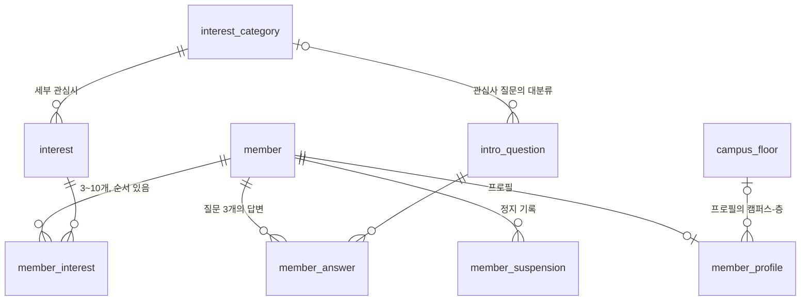

# 계정 · 프로필 · 관심사 · 질문

계정, 프로필, 관심사, 자기소개 질문과 답변을 저장한다. 계정(`member`)과 프로필(`member_profile`)은 테이블을 나눈다. 명세는 [02 로그인 · 회원가입](../spec/02-auth.md), [03 온보딩](../spec/03-onboarding.md), [04 내 땅굴](../spec/04-my-burrow.md), [10 설정 · 계정](../spec/10-settings.md)이다. 이름 규칙과 공통 칼럼은 [README](README.md)를 따른다.

## `member` 계정

로그인과 가입 단계에 쓰는 값이다. 다른 테이블이 사람을 가리킬 때는 이 테이블의 `id`를 쓴다(`member_id`, `author_id` 등).

| 칼럼 | 타입 | 필수 | 설명 |
|---|---|---|---|
| `id` | BIGINT | ✓ | PK |
| `email` | VARCHAR | | 로그인 이메일. 이메일로 가입한 계정에만 있다. UNIQUE |
| `password_hash` | VARCHAR | | 비밀번호(해시). Google로만 가입한 계정은 비어 있다 |
| `google_sub` | VARCHAR | | 연동한 Google 계정의 식별 값. UNIQUE |
| `google_email` | VARCHAR | | 연동한 Google 이메일. "연동됨" 화면에 보여준다 |
| `mattermost_id` | VARCHAR | | SSAFY 인증에 쓴 Mattermost ID. UNIQUE |
| `ssafy_verified_at` | DATETIME | | SSAFY 인증을 마친 시각. 비어 있으면 로그인 뒤 회원가입 3으로 보낸다 |
| `terms_agreed_at` | DATETIME | | 이용약관 · 개인정보 수집·이용에 동의한 시각(둘 다 필수라 시각 하나) |
| `onboarded_at` | DATETIME | | 온보딩을 마친 시각("관심사 확정"). 비어 있으면 로그인 뒤 온보딩으로 보낸다 |
| `role` | VARCHAR(10) | ✓ | `USER` / `ADMIN`. 관리자는 DB에서 직접 켠다 |
| `status` | VARCHAR(10) | ✓ | `ACTIVE` / `WITHDRAWN` 탈퇴 |
| `withdrawn_at` | DATETIME | | 탈퇴한 시각 |
| `withdraw_reason` | VARCHAR(30) | | 탈퇴 사유 코드(선택). 관리자가 DB에서 직접 확인한다 |
| `created_at` | DATETIME | ✓ | 계정이 만들어진 시각 |
| `updated_at` | DATETIME | ✓ | |

- 계정은 이메일 가입이면 회원가입 2(비밀번호)를 마칠 때, Google 가입이면 Google 로그인을 마칠 때 만든다. 그 뒤 단계에서 값을 채운다.
- 탈퇴하면 줄은 남기고 `status`를 `WITHDRAWN`으로 바꾸며, 이메일 · 비밀번호 · Google · Mattermost ID를 비운다. 프로필 줄(`member_profile`)은 지운다. 남는 글 · 댓글 · 메시지 · 방명록 글 · 지난 모임 기록은 이 줄을 가리키고, 화면은 "탈퇴한 사용자"와 기본 두더지로 보여준다.

## `member_profile` 프로필

남에게 보이는 값이다. 계정과 1:1이다. 땅굴은 `burrow`([들판 · 땅굴](burrow.md))에 따로 있다.

| 칼럼 | 타입 | 필수 | 설명 |
|---|---|---|---|
| `member_id` | BIGINT | ✓ | PK. FK → `member` |
| `nickname` | VARCHAR(12) | | 닉네임. 최대 12자, 중복 불가(UNIQUE). 온보딩 1에서 정한다 |
| `generation` | SMALLINT | ✓ | 기수. SSAFY 인증에 쓴 값이라 바꿀 수 없다 |
| `campus_floor_id` | BIGINT | ✓ | 프로필의 캠퍼스-층. FK → `campus_floor`. 이 값이 기준이고, 이번 학기의 `burrow_entrance`를 여기에 맞춘다 |
| `intro` | VARCHAR(150) | | 자기소개. 최대 150자 |
| `mole_head` | VARCHAR(30) | | 두더지 머리 아이템 코드. 비어 있으면 "없음" |
| `mole_face` | VARCHAR(30) | | 얼굴 아이템 코드 |
| `mole_neck` | VARCHAR(30) | | 목 아이템 코드 |
| `mole_hand` | VARCHAR(30) | | 손 아이템 코드 |
| `updated_at` | DATETIME | ✓ | |

- 프로필 줄은 회원가입 3(SSAFY 인증)에서 기수와 캠퍼스 · 층을 정할 때 만든다. 닉네임과 두더지는 온보딩 1에서 채운다.
- 남의 땅굴, 글 작성자, 프로필 팝업처럼 다른 사람을 보여줄 때는 이 테이블만 읽는다. 로그인 값이 든 `member`는 읽지 않는다.
- 실명, 사진, 반은 받지 않는다.

## `member_suspension` 계정 정지

| 칼럼 | 타입 | 필수 | 설명 |
|---|---|---|---|
| `id` | BIGINT | ✓ | PK |
| `member_id` | BIGINT | ✓ | 정지된 계정. FK → `member` |
| `reason` | VARCHAR | ✓ | 사유. 로그인할 때 팝업에 보여준다 |
| `starts_at` | DATETIME | ✓ | 정지 시작 |
| `ends_at` | DATETIME | ✓ | 정지 끝. 기간을 정해서 한다(예: 7일) |
| `lifted_at` | DATETIME | | 관리자가 풀어 준 시각 |
| `created_at` | DATETIME | ✓ | |

- 관리자 화면과 정지의 나머지 규칙은 [보류한 결정](../spec/open-issues.md)이라 최소한만 두었다. 정해지면 칼럼(조치한 관리자, 근거가 된 신고)을 더한다.

## 인증 코드 · 비밀번호 재설정 링크 (DB에 두지 않는다)

잠깐 쓰고 버리는 값이라 MySQL이 아니라 임시 저장소(Redis)에 둔다. 만료 시간이 지나면 저절로 사라진다.

| 값 | 무엇을 기억하나 | 만료 |
|---|---|---|
| 이메일 인증 코드 | 보낸 이메일 주소, 숫자 6자리 코드, 마지막으로 보낸 시각(재전송 간격 제한) | 유효 시간은 명세에 없음 |
| SSAFY(Mattermost) 인증 코드 | 계정, Mattermost ID, 기수, 숫자 6자리 코드, 마지막으로 보낸 시각 | 유효 시간은 명세에 없음 |
| 비밀번호 재설정 링크 | 계정, 링크 값 | 30분. 한 번 쓰면 지운다. 다시 보내면 이전 링크를 지운다 |

## `interest_category` 관심사 대분류 · `interest` 세부 관심사

운영자가 DB에서 직접 관리하는 목록이다(관리 화면 없음).

| 테이블 | 칼럼 | 설명 |
|---|---|---|
| `interest_category` | `id`, `name`, `sort_order` | 분야 11개. 커뮤니티 글의 태그와 관심사 질문의 연결에 쓴다 |
| `interest` | `id`, `interest_category_id`, `name`, `sort_order` | 사람이 고르는 관심사, 땅굴 가구, 겹치는 관심사에 쓴다 |

## `member_interest` 사용자의 관심사

| 칼럼 | 타입 | 필수 | 설명 |
|---|---|---|---|
| `member_id` | BIGINT | ✓ | FK → `member` |
| `interest_id` | BIGINT | ✓ | FK → `interest` |
| `sort_order` | TINYINT | ✓ | 고른 순서. 1번이 대표 관심사 |
| `furniture` | VARCHAR(30) | ✓ | 이 관심사에 놓은 가구 코드. 처음에는 그 관심사의 기본 가구 |

- PK(`member_id`, `interest_id`). 한 사람에 3 ~ 10개.
- 관심사 하나에 가구 하나라서 가구를 이 테이블에 함께 둔다. 관심사를 빼면 가구도 사라진다.

## `intro_question` 자기소개 질문 · `member_answer` 답변

| 테이블 | 칼럼 | 설명 |
|---|---|---|
| `intro_question` | `id`, `type`, `interest_category_id`, `content`, `created_at` | `type`은 `INTEREST` 관심사 / `TMI`. 관심사 질문이면 대분류를 가리킨다. 관리자가 추가 · 수정하고, 숨기거나 지우지 않는다 |
| `member_answer` | `member_id`, `slot`, `intro_question_id`, `answer` | PK(`member_id`, `slot`). `slot`은 1 ~ 3. `answer`는 10 ~ 50자. 질문을 다시 고르면 그 자리의 질문을 바꾸고 답변을 새로 쓴다 |

## 저장하지 않는 것

**계산해서 내려주는 값**

| 값 | 무엇에서 계산하나 |
|---|---|
| 대표 관심사 | `member_interest`에서 `sort_order`가 1인 것 |
| 땅굴 무드(벽 · 바닥) | 대표 관심사가 속한 `interest_category` |
| 땅굴 이름("닉네임의 땅굴"), 관심사 가구 수 | `member_profile.nickname`, `member_interest` 줄 수 |
| 가입 방법(이메일 / Google로만), Google 연동 상태 | `password_hash`, `google_sub`가 있는지 |
| 지금 정지 중인지, 정지 안내의 남은 기간 | `member_suspension`의 기간과 `lifted_at` |
| 로그인 뒤 갈 곳(회원가입 3 / 온보딩 / 내 땅굴) | `ssafy_verified_at`, `onboarded_at` |
| 분야 팝업의 "많이 고르는 취향" / "통하는 취향" | 관심사별 `member_interest` 줄 수 |
| 겹치는 관심사 | 두 사람의 `member_interest` |
| 인증 코드의 남은 시간 | 임시 저장소(Redis)에 남은 만료 시간 |

**프론트엔드가 갖는 것**

- 두더지와 아이템 그림, 가구 그림과 방 안의 자리, 무드별 벽 · 바닥 그림, 분야 아이콘과 한 줄 안내
- 견본 방(팀이 만들어 둔 예시 방)의 내용 전체, 비로그인이 구경한 방 수
- 온보딩 진행 표시, 글자 수 표시, 안내 문구

## 명세에 없어 구현 단계로 넘기는 것

- 내 정보 수정에서 관심사를 넣고 뺄 때의 순서 규칙, 뺀 관심사에 딸린 질문 · 답변의 처리(남은 검토 항목 44)
- 이메일 길이, 닉네임에 쓸 수 있는 문자, 인증 코드의 유효 시간과 재전송 간격
- 같은 이메일의 Google 계정과 이메일 계정의 관계
