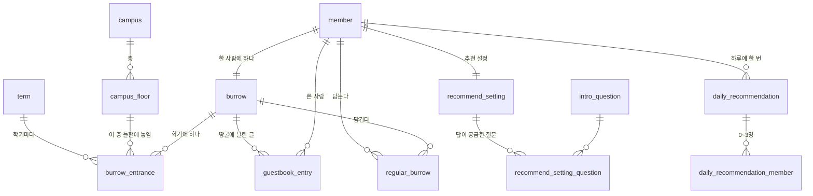

# 들판 · 땅굴 입구 · 방명록 · 단골 · 추천

학기와 캠퍼스-층, 땅굴과 땅굴 입구, 방명록, 단골, 오늘의 추천 친구를 저장한다. 명세는 [00 공통 19](../spec/00-common.md), [04 내 땅굴](../spec/04-my-burrow.md), [05 탐색 · 방문](../spec/05-explore-visit.md)이다. 이름 규칙과 공통 칼럼은 [README](README.md)를 따른다.

## `term` 학기 · `campus` 캠퍼스 · `campus_floor` 캠퍼스-층

운영자가 DB에서 직접 관리하는 목록이다(관리 화면 없음, 값은 임시).

| 테이블 | 칼럼 | 설명 |
|---|---|---|
| `term` | `id`, `year`, `half`, `opened_at` | `half`는 1 상반기 / 2 하반기. UNIQUE(`year`, `half`). 가장 최근에 열린 학기가 "이번 학기"다. 지난 학기도 닫지 않는다 |
| `campus` | `id`, `name`, `sort_order` | 예: 서울 · 대전 · 부울경 · 구미 · 광주 |
| `campus_floor` | `id`, `campus_id`, `floor` | 캠퍼스마다 층 목록이 다르다. UNIQUE(`campus_id`, `floor`) |

- 들판(서버)은 테이블로 두지 않는다. 들판은 `term` 하나와 `campus_floor` 하나의 짝이고, 들판만의 값이 없다.
- 새 학기를 여는 방법(직접 / 날짜에 자동)은 [보류한 결정](../spec/open-issues.md)이다. 어느 쪽이든 `term`에 줄이 생긴다.

## `burrow` 땅굴

땅굴은 한 사람에 하나인 방이면서, 들판 위에 자리를 가진 장소다. 방명록 글, 단골, 입구가 땅굴을 가리킨다.

| 칼럼 | 타입 | 필수 | 설명 |
|---|---|---|---|
| `id` | BIGINT | ✓ | PK |
| `member_id` | BIGINT | ✓ | 주인. FK → `member`. UNIQUE(한 사람에 하나) |
| `created_at` | DATETIME | ✓ | 땅굴을 만든 시각(온보딩에서 땅굴을 만들 때) |

- 방 안의 모습(가구, 벽 · 바닥)은 이 테이블에 저장하지 않는다. 주인의 관심사와 고른 가구([계정 · 프로필](account.md)의 `member_interest`)로 그린다.
- 들판에서의 자리는 학기마다 다르므로 `burrow_entrance`가 갖는다.

## `burrow_entrance` 땅굴 입구

들판 하나(학기 + 캠퍼스-층)에 놓인 땅굴의 구멍이다. 화면에서 서로 구분되는 땅굴 하나하나가 이 테이블의 한 줄이다.

| 칼럼 | 타입 | 필수 | 설명 |
|---|---|---|---|
| `id` | BIGINT | ✓ | PK |
| `burrow_id` | BIGINT | ✓ | 땅굴. FK → `burrow` |
| `term_id` | BIGINT | ✓ | 학기. FK → `term` |
| `campus_floor_id` | BIGINT | ✓ | 그 학기에 고른 캠퍼스-층. FK → `campus_floor` |
| `slot` | INT | ✓ | 그 들판 안에서의 자리 번호. 한 번 정해지면 바뀌지 않는다 |
| `created_at` | DATETIME | ✓ | 놓인 시각 |

- 땅굴 하나는 한 학기에 입구 하나: UNIQUE(`burrow_id`, `term_id`). 한 들판에서 자리는 겹치지 않는다: UNIQUE(`term_id`, `campus_floor_id`, `slot`).
- 입구가 생기는 때: 온보딩에서 땅굴을 만들 때(회원가입에서 고른 캠퍼스-층의 이번 학기 들판), 새 학기 안내의 "이 층으로 정하기", "나중에 하기"를 누른 사람이 내 정보 수정에서 캠퍼스 · 층을 저장할 때.
- 자리 번호는 서버가 그 들판에 땅굴이 놓인 순서대로 준다. 이번 학기 안에서 캠퍼스 · 층을 바꾸면 이 줄의 `campus_floor_id`를 바꾸고 새 들판의 다음 자리 번호를 준다. 지난 학기의 줄은 그대로 둔다.
- DB는 "어느 들판의 몇 번 자리"까지만 안다. 그 자리가 화면의 어디인지, 구멍을 어떻게 그리는지는 프론트엔드가 맡는다. 좌표는 저장하지 않는다.

## `guestbook_entry` 방명록 글

| 칼럼 | 타입 | 필수 | 설명 |
|---|---|---|---|
| `id` | BIGINT | ✓ | PK |
| `burrow_id` | BIGINT | ✓ | 글이 달린 땅굴. FK → `burrow` |
| `author_id` | BIGINT | ✓ | 쓴 사람. FK → `member`. 주인은 자기 땅굴에 쓸 수 없다 |
| `content` | VARCHAR(50) | ✓ | 본문. 50자 안 |
| `created_at` | DATETIME | ✓ | 쓴 시각. 최신순 정렬과 7일 자동 삭제의 기준 |

- 고칠 수 없다. 지우면 줄을 지운다. 쓴 지 7일이 지난 글은 조회에서 빼고 정리한다.
- 신고 대상이다(`report.target_type` = `GUESTBOOK`, [커뮤니티 · 신고](community.md)).

## `regular_burrow` 단골

| 칼럼 | 타입 | 필수 | 설명 |
|---|---|---|---|
| `member_id` | BIGINT | ✓ | 담은 사람. FK → `member` |
| `burrow_id` | BIGINT | ✓ | 담긴 땅굴. FK → `burrow` |
| `created_at` | DATETIME | ✓ | 담은 시각 |

- PK(`member_id`, `burrow_id`). 상대의 수락이 없고 상대에게 알리지 않는다.

## `recommend_setting` 추천 설정 · `recommend_setting_question`

| 테이블 | 칼럼 | 설명 |
|---|---|---|
| `recommend_setting` | `member_id`(PK), `use_interest`, `use_same_question`, `use_affiliation`, `updated_at` | 한 사람에 한 벌. 조건(관심사 / 같은 질문에 답한 사람 / 캠퍼스 · 기수 · 층)을 켜고 끈다. 저장되어 다음 날에도 그대로다 |
| `recommend_setting_question` | `member_id`, `intro_question_id` | PK(둘 다). "답이 궁금한 질문"으로 고른 질문들 |

- 조건의 정확한 모양(켜고 끄기인지, 값을 고르는지)이 명세에 없어 가장 단순한 모양으로 두었다. 추천 화면을 구현할 때 맞춘다.

## `daily_recommendation` 오늘의 추천 · `daily_recommendation_member`

| 테이블 | 칼럼 | 설명 |
|---|---|---|
| `daily_recommendation` | `id`, `member_id`, `recommended_on` | 추천을 받은 날. UNIQUE(`member_id`, `recommended_on`)으로 하루 한 번을 지킨다 |
| `daily_recommendation_member` | `daily_recommendation_id`, `sort_order`, `target_member_id` | PK(`daily_recommendation_id`, `sort_order`). 추천된 사람 0 ~ 3명 |

- 같은 날 다시 누르면 같은 사람들을 보여줘야 해서 결과를 저장한다. 카드의 내용(관심사, 질문과 답변)은 저장하지 않고 그 사람의 지금 프로필에서 읽는다.

## 저장하지 않는 것

**계산해서 내려주는 값**

| 값 | 무엇에서 계산하나 |
|---|---|
| 들판에 놓인 입구 목록, 층의 "비어 있음" | 그 `term`과 `campus_floor`의 `burrow_entrance` |
| 이번 학기의 캠퍼스 · 층을 아직 고르지 않은 사람(새 학기 안내를 띄울지) | 이번 학기의 `burrow_entrance`가 있는지 |
| "탐색"을 누르면 나갈 들판 | 그 땅굴의 가장 최근 학기 `burrow_entrance` |
| 방노트(자기소개, 관심사, 질문과 답변) | 주인의 `member_profile`, `member_interest`, `member_answer` |
| 남은 방명록 글 수, 단골 수 | `guestbook_entry`, `regular_burrow` 줄 수 |
| 오늘 추천을 이미 받았는지 | 오늘 날짜의 `daily_recommendation`이 있는지 |
| 추천 대상(이번 학기 들판에 땅굴이 있는 사람) | 이번 학기의 `burrow_entrance` |

**프론트엔드가 갖는 것**

- 들판 지도 그림과 자리 번호마다의 화면 위치, 구멍의 생김새, 들판에서 내 두더지가 서 있는 곳, 지금 보고 있는 들판
- 우체통의 깃발과 편지 표현, 학기와 캠퍼스-층의 표기("2026 하반기 서울-2층"), 안내 문구

## 명세에 없어 구현 단계로 넘기는 것

- 탈퇴한 사람의 입구 자리, 떠난 자리를 다시 쓰는지
- 추천에서 "하루"가 바뀌는 시각, 지난 날의 추천 결과를 얼마나 보관하는지
- 탈퇴할 때 그 사람이 받은 방명록 글과 남이 담은 단골의 처리
