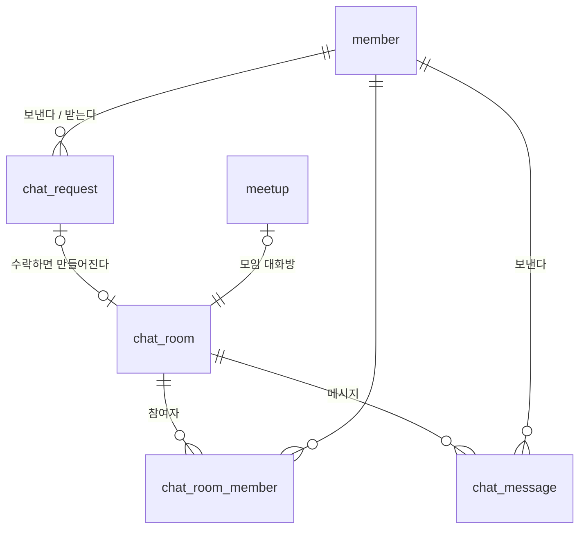

# 채팅

대화 요청, 대화방, 메시지를 저장한다. 명세는 [06 채팅](../spec/06-chat.md)과 [05 탐색 · 방문](../spec/05-explore-visit.md)의 대화 요청이다. 이름 규칙과 공통 칼럼은 [README](README.md)를 따른다.

## `chat_request` 대화 요청

| 칼럼 | 타입 | 필수 | 설명 |
|---|---|---|---|
| `id` | BIGINT | ✓ | PK |
| `sender_id` | BIGINT | ✓ | 보낸 사람. FK → `member` |
| `receiver_id` | BIGINT | ✓ | 받는 사람(땅굴 주인). FK → `member` |
| `message` | VARCHAR(50) | | 요청 메시지. 50자 안 |
| `status` | VARCHAR(20) | ✓ | `PENDING` 답변 기다리는 중 / `ACCEPTED` 수락 / `REJECTED` 거절 / `CANCELED` 취소 |
| `chat_room_id` | BIGINT | | 수락으로 만들어진 대화방. FK → `chat_room` |
| `created_at` | DATETIME | ✓ | 보낸 시각. 카드에 보여주고 만료 5일의 기준이 된다 |
| `responded_at` | DATETIME | | 수락 · 거절 · 취소한 시각 |

- 만료는 상태로 저장하지 않는다. `created_at`에서 5일이 지난 `PENDING` · `REJECTED` 요청은 조회에서 뺀다.
- 거절은 보낸 사람에게 알리지 않는다. 보낸 사람 쪽 조회는 `REJECTED`도 만료 전까지 "답변 기다리는 중"으로 내려준다.
- 한 사람이 같은 상대에게 보낸 살아 있는 요청(`PENDING`, 만료 전의 `REJECTED`)은 하나뿐이다. 상대가 먼저 보낸 살아 있는 요청이 있으면 새 요청을 만들지 않는다(토스트로 안내).
- 탈퇴하면 그 사람이 보내거나 받은 요청을 지운다.

## `chat_room` 대화방

| 칼럼 | 타입 | 필수 | 설명 |
|---|---|---|---|
| `id` | BIGINT | ✓ | PK |
| `type` | VARCHAR(10) | ✓ | `DIRECT` 1:1 / `MEETUP` 모임 |
| `meetup_id` | BIGINT | | 모임 대화방이면 그 모임. FK → `meetup`, UNIQUE |
| `notice` | TEXT | | 모임 대화방의 공지. 하나만 두고 주최자가 쓴다 |
| `created_at` | DATETIME | ✓ | 만들어진 시각. 1:1은 요청을 수락한 때, 모임은 모임을 등록한 때 |

- 1:1 대화방은 요청이 수락될 때 만든다. 한 사람이 나간 뒤 다시 요청해 수락되면 새 대화방을 만든다. 그래서 같은 두 사람 사이에 대화방이 여러 개일 수 있다.

## `chat_room_member` 대화방 참여자

| 칼럼 | 타입 | 필수 | 설명 |
|---|---|---|---|
| `chat_room_id` | BIGINT | ✓ | FK → `chat_room` |
| `member_id` | BIGINT | ✓ | FK → `member` |
| `joined_at` | DATETIME | ✓ | 들어온 시각 |
| `left_at` | DATETIME | | 나간 시각. 값이 있으면 그 사람의 대화 목록에서 빠진다 |
| `last_read_message_id` | BIGINT | | 마지막으로 읽은 메시지. 안 읽은 수를 세는 기준 |

- PK(`chat_room_id`, `member_id`).
- 1:1은 두 사람이다. 모임 대화방은 주최자와 참여 확정자이고, 참여 취소 · 내보내기 · 탈퇴 때 `left_at`을 채운다.

## `chat_message` 메시지

| 칼럼 | 타입 | 필수 | 설명 |
|---|---|---|---|
| `id` | BIGINT | ✓ | PK. 대화방 안에서 보낸 순서 |
| `chat_room_id` | BIGINT | ✓ | FK → `chat_room` |
| `type` | VARCHAR(20) | ✓ | `TEXT` 사람이 쓴 메시지 / 안내 줄: `ACCEPTED` 대화 요청을 수락함 · `JOINED` 모임에 참여함 · `LEFT` 대화방을 나감 · `WITHDRAWN` 탈퇴함 |
| `sender_id` | BIGINT | ✓ | `TEXT`는 보낸 사람, 안내 줄은 그 일을 한 사람. FK → `member` |
| `content` | TEXT | | 본문. `TEXT`일 때 필수이고 빈 메시지는 없다. 안내 줄은 비운다 |
| `created_at` | DATETIME | ✓ | 보낸 시각(안내 줄은 그 일이 일어난 시각) |

- 메시지는 고치거나 지우지 않는다. 읽은 사람 목록도 저장하지 않는다(읽음 표시 없음).
- 대화 안의 안내 줄("수락했어요", "모임에 참여했어요", "대화방을 나갔습니다", "탈퇴했습니다")도 이 테이블에 한 줄로 저장한다. 그 일이 일어날 때 서버가 넣는다. 문구는 저장하지 않고, 프론트엔드가 `type`과 그 사람의 닉네임으로 만든다. 대화를 보여줄 때는 이 테이블을 시간순으로 읽기만 하면 된다.
- 보낸 사람이 탈퇴해도 메시지는 남는다.
- 첨부는 무엇을 붙일 수 있는지가 명세에 없어 테이블을 두지 않았다. 정해지면 더한다.

## 저장하지 않는 것

**계산해서 내려주는 값**

| 값 | 무엇에서 계산하나 |
|---|---|
| 요청의 만료 여부, "요청 N" | `chat_request.created_at`과 `status` |
| 방문자 뷰의 버튼("대화 요청하기" / "요청 보냄" / "대화하기") | 두 사람 사이의 `chat_request`와 `chat_room_member` |
| 안 읽은 수 | `last_read_message_id` 뒤에 온 `TEXT` 메시지 수(안내 줄은 세지 않는다) |
| 대화 목록의 마지막 메시지와 시각 | 그 방의 가장 최근 `chat_message` |
| 대화 목록의 이름과 그림 | 1:1은 상대의 `member_profile`, 모임은 `meetup.title` |
| 읽기 전용인지 | 1:1에서 상대의 `left_at` 또는 상대 `member`의 탈퇴 여부 |
| 메시지 속 모임 카드 | 본문에 든 모임 링크에서 모임을 찾아 이름 · 일시 · 인원을 읽는다 |
| 두 사람의 겹치는 관심사 | 두 사람의 `member_interest` |

**프론트엔드가 갖는 것**

- 찻방 그림과 두더지가 앉는 자리, 메시지의 좌우 배치
- 대화 요청 팝업의 빠른 멘트 문구, 안내 줄과 토스트의 문구

## 명세에 없어 구현 단계로 넘기는 것

- 메시지 글자 수 한도, 첨부의 종류 · 크기 · 개수
- 둘 다 나간 1:1 대화방, 삭제된 모임의 대화방을 지우는지
- 거절된 요청을 보낸 사람이 취소할 수 있는지
