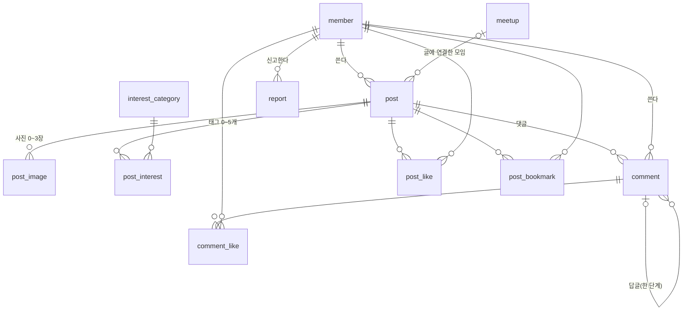

# 커뮤니티 · 신고

글, 댓글, 좋아요, 저장, 신고를 저장한다. 명세는 [08 커뮤니티](../spec/08-community.md)다. 이름 규칙과 공통 칼럼은 [README](README.md)를 따른다.

## `post` 글

| 칼럼 | 타입 | 필수 | 설명 |
|---|---|---|---|
| `id` | BIGINT | ✓ | PK |
| `author_id` | BIGINT | ✓ | 작성자. FK → `member` |
| `category` | VARCHAR(20) | ✓ | `PROMOTION` 모임 홍보 / `REVIEW` 모임 후기 / `FREE` 자유 |
| `title` | VARCHAR(50) | ✓ | 제목. 최대 50자. 검색 대상 |
| `content` | VARCHAR(1000) | ✓ | 본문. 최대 1000자. 검색 대상 |
| `meetup_id` | BIGINT | | 연결한 모임. "모임 홍보"면 필수. FK → `meetup` |
| `status` | VARCHAR(10) | ✓ | `PUBLIC` 공개 / `HIDDEN` 가려짐 / `DELETED` 삭제 |
| `view_count` | INT | ✓ | 조회수. 글을 열 때마다 1 올린다 |
| `created_at` | DATETIME | ✓ | 작성 시각. "최신순" 정렬 |
| `edited_at` | DATETIME | | 내용을 고친 시각. 값이 있으면 "수정됨" |

- 가려짐은 신고자 수로 계산하지 않고 `status`로 저장한다. 관리자가 복구하면 `PUBLIC`으로 되돌리기 때문이다.
- 글을 지우면 `status`를 `DELETED`로 바꾸고, 달린 댓글 · 답글도 `DELETED`로 바꾼다. 삭제된 글을 링크나 알림으로 열면 "삭제된 글이에요"를 보여줘야 하므로 줄은 남긴다.

## `post_image` 글 사진

| 칼럼 | 타입 | 필수 | 설명 |
|---|---|---|---|
| `id` | BIGINT | ✓ | PK |
| `post_id` | BIGINT | ✓ | FK → `post` |
| `sort_order` | TINYINT | ✓ | 순서 1 ~ 3. 1번이 대표 사진 |
| `image_url` | VARCHAR | ✓ | 올린 파일의 위치 |

- 글 하나에 최대 3장. 파일 형식과 용량, 저장소는 구현 단계에서 정한다.

## `post_interest` 글의 관심사 태그

| 칼럼 | 타입 | 필수 | 설명 |
|---|---|---|---|
| `post_id` | BIGINT | ✓ | FK → `post` |
| `interest_category_id` | BIGINT | ✓ | 관심사 대분류. FK → `interest_category` |

- PK(`post_id`, `interest_category_id`). 글 하나에 최대 5개. 세부 관심사가 아니라 대분류를 가리킨다.

## `comment` 댓글 · 답글

| 칼럼 | 타입 | 필수 | 설명 |
|---|---|---|---|
| `id` | BIGINT | ✓ | PK |
| `post_id` | BIGINT | ✓ | FK → `post` |
| `author_id` | BIGINT | ✓ | 작성자. FK → `member` |
| `parent_id` | BIGINT | | 답글이면 부모 댓글. FK → `comment`. 답글의 답글도 같은 부모를 가리킨다(한 단계) |
| `mention_member_id` | BIGINT | | 답글에 다시 답할 때의 상대("@닉네임"). FK → `member` |
| `content` | VARCHAR(300) | ✓ | 내용. 최대 300자 |
| `status` | VARCHAR(10) | ✓ | `PUBLIC` / `HIDDEN` / `DELETED` |
| `created_at` | DATETIME | ✓ | 작성 시각. 등록순 정렬 |
| `edited_at` | DATETIME | | 고친 시각. 값이 있으면 "수정됨" |

- 댓글을 지우면 달린 답글도 함께 `DELETED`가 된다. 가려진 댓글은 자리에 안내 문구로 보이고 답글은 그대로다.

## `post_like` 글 좋아요 · `comment_like` 댓글 좋아요 · `post_bookmark` 저장

세 테이블은 모양이 같다. 누르면 줄을 넣고 다시 누르면 지운다.

| 테이블 | 칼럼 | 설명 |
|---|---|---|
| `post_like` | `post_id`, `member_id`, `created_at` | PK(`post_id`, `member_id`). `created_at`은 "최근 7일 동안 받은 좋아요"에 쓴다 |
| `comment_like` | `comment_id`, `member_id`, `created_at` | PK(`comment_id`, `member_id`) |
| `post_bookmark` | `post_id`, `member_id`, `created_at` | PK(`post_id`, `member_id`). `created_at`은 "11월 9일 저장" 표시와 저장한 순서 정렬에 쓴다 |

- 탈퇴하면 그 사람의 좋아요와 저장을 지운다.

## `report` 신고

| 칼럼 | 타입 | 필수 | 설명 |
|---|---|---|---|
| `id` | BIGINT | ✓ | PK |
| `reporter_id` | BIGINT | ✓ | 신고한 사람. FK → `member` |
| `target_type` | VARCHAR(20) | ✓ | 대상 종류: `POST` 글 / `COMMENT` 댓글 / `MEMBER` 사용자 / `GUESTBOOK` 방명록 글 |
| `target_id` | BIGINT | ✓ | 대상의 id. `target_type`에 따라 가리키는 테이블이 다르다 |
| `reason` | VARCHAR(20) | ✓ | `SPAM` 스팸·홍보 / `ABUSE` 욕설·비하·괴롭힘 / `OBSCENE` 음란물 / `ETC` 기타 |
| `detail` | VARCHAR(100) | | "기타"일 때의 내용. 최대 100자 |
| `status` | VARCHAR(20) | ✓ | 신고의 처리 상태. 처음 값은 `RECEIVED` 접수 |
| `created_at` | DATETIME | ✓ | 신고 시각 |

- 같은 대상은 한 번만 신고한다: UNIQUE(`reporter_id`, `target_type`, `target_id`).
- 글 · 댓글은 서로 다른 3명째 신고가 들어올 때 대상의 `status`를 `HIDDEN`으로 바꾼다. 사용자와 방명록 글은 자동 조치가 없다.
- 신고한 사람에게 그 글 · 댓글이 접혀 보이는 것은 이 테이블에 그 사람의 줄이 있는지로 판단한다.
- 처리 상태의 나머지 값과 처리 흐름은 관리자 화면을 정할 때 정한다([명세의 보류한 결정](../spec/open-issues.md)).

## 저장하지 않는 것

**계산해서 내려주는 값**

| 값 | 무엇에서 계산하나 |
|---|---|
| 좋아요 수, 댓글 수(댓글 + 답글), 저장 수 | `post_like`, `comment`, `post_bookmark` 줄 수 |
| 인기 점수, 이번 주 인기 글 TOP5 | 최근 7일의 좋아요 + 댓글 + 저장 수 |
| 많이 이야기하는 관심사 | 최근 7일 글의 `post_interest` |
| 본문 미리보기, 목록 카드의 썸네일 | `content`의 앞부분, 1번 사진 |
| "수정됨", 상대 시간("방금", "N시간 전") | `edited_at`, `created_at` |
| 내가 좋아요 · 저장했는지 | 내 `post_like`, `post_bookmark` 줄이 있는지 |
| 내 활동의 개수(내가 쓴 글, 댓글 단 글, 저장한 글) | `post`, `comment`, `post_bookmark` |
| "내 관심사만" | 내 `member_interest`가 속한 대분류와 `post_interest` |
| 작성자 표시("탈퇴한 사용자" 포함) | `member`의 상태 |

**프론트엔드가 갖는 것**

- 사진이 없을 때 보여주는 관심사 일러스트, 신고 팝업과 안내 화면의 문구
- 검색어, 탭 · 필터 · 정렬 선택

## 명세에 없어 구현 단계로 넘기는 것

- 인기순 정렬이 TOP5처럼 최근 7일만 세는지
- 글을 지울 때 사진 파일, 좋아요, 저장, 신고 줄을 함께 지우는지
- 글에 연결한 모임이 삭제 · 취소될 때의 처리(남은 검토 항목 60)
- 관리자가 복구한 글이 다시 가려지는 조건
