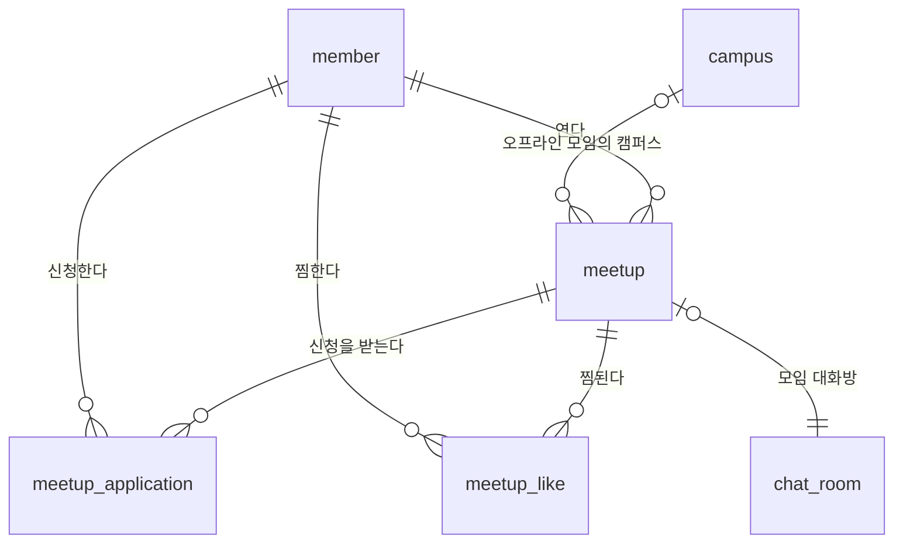

# 모임

모임, 참여 신청, 찜을 저장한다. 명세는 [07 모임](../spec/07-meetup.md)이다. 이름 규칙과 공통 칼럼은 [README](README.md)를 따른다.

## `meetup` 모임

| 칼럼 | 타입 | 필수 | 설명 |
|---|---|---|---|
| `id` | BIGINT | ✓ | PK |
| `host_id` | BIGINT | ✓ | 주최자. FK → `member` |
| `category` | VARCHAR(20) | ✓ | 카테고리 코드(스터디 / 프로젝트 / 운동 / 취미 · 문화 / 식사 · 카페 / 게임 / 기타, 임시 목록) |
| `title` | VARCHAR | ✓ | 모임 이름. 검색 대상 |
| `description` | TEXT | | 소개. 검색 대상 |
| `capacity` | INT | ✓ | 정원. 2 ~ 50, 주최자 포함 |
| `supplies` | VARCHAR | | 준비물 |
| `accepts_message` | BOOLEAN | ✓ | 신청할 때 "주최자에게 남길 말"을 받을지 |
| `starts_at` | DATETIME | ✓ | 시작 일시(날짜 + 시작 시간) |
| `ends_at` | DATETIME | | 끝나는 일시. `starts_at`보다 뒤 |
| `recruit_deadline_at` | DATETIME | | 모집 마감 일시. 비우면 시작할 때까지 받는다. 만든 뒤에는 바꿀 수 없다 |
| `mode` | VARCHAR(10) | ✓ | 만나는 방식: `OFFLINE` / `ONLINE` |
| `campus_id` | BIGINT | | 오프라인이면 필수, 온라인이면 비움. FK → `campus` |
| `place` | VARCHAR | | 오프라인의 장소(주소 찾기 또는 직접 입력) |
| `place_detail` | VARCHAR | | 오프라인의 상세 주소 |
| `platform` | VARCHAR | | 온라인의 플랫폼 이름(Zoom / Discord / Gather / 직접 입력) |
| `join_url` | VARCHAR | | 온라인의 접속 링크. 참여 확정자에게만 내려준다 |
| `canceled_at` | DATETIME | | 주최자가 취소한 시각. 값이 있으면 "취소됨" |
| `deleted_at` | DATETIME | | 주최자가 삭제한 시각 |
| `created_at` | DATETIME | ✓ | 등록 시각. "최신등록순" 정렬 |
| `updated_at` | DATETIME | ✓ | |

- 모임 대화방은 모임을 등록할 때 함께 만든다. 연결은 `chat_room.meetup_id`가 갖는다([채팅](chat.md)).
- 글자 수 제한(이름, 소개, 준비물, 장소)은 명세에 없다. 구현 단계에서 정한다.

## `meetup_application` 참여 신청

| 칼럼 | 타입 | 필수 | 설명 |
|---|---|---|---|
| `id` | BIGINT | ✓ | PK |
| `meetup_id` | BIGINT | ✓ | FK → `meetup` |
| `member_id` | BIGINT | ✓ | 신청자. FK → `member` |
| `status` | VARCHAR(20) | ✓ | `PENDING` 신청 대기 / `WITHDRAWN` 신청 취소 / `REJECTED` 미승인 / `CONFIRMED` 참여 확정 / `CANCELED` 참여 취소 / `KICKED` 내보내짐 |
| `message` | VARCHAR | | 주최자에게 남길 말 |
| `created_at` | DATETIME | ✓ | 신청 시각 |
| `status_changed_at` | DATETIME | ✓ | 상태가 마지막으로 바뀐 시각 |

- 한 사람은 한 모임에 한 줄만 가진다: UNIQUE(`meetup_id`, `member_id`).
- 주최자는 이 테이블에 넣지 않는다. 주최자는 `meetup.host_id`다.
- 다시 신청할 수 있는 것은 줄이 없거나 `WITHDRAWN`일 때뿐이다. `REJECTED`, `CANCELED`, `KICKED`는 다시 신청할 수 없다.
- 자동 미승인(모집 마감 시각, 마감이 없으면 시작 시각에 `PENDING` → `REJECTED`)은 알림을 보내야 하므로 그 시각에 실제로 상태를 바꾼다. 실행 방법(예약 작업)은 구현 단계에서 정한다.
- 탈퇴하면 그 사람의 예정 모임 신청은 `PENDING` → `WITHDRAWN`, `CONFIRMED` → `CANCELED`로 바꾼다.

## `meetup_like` 찜

| 칼럼 | 타입 | 필수 | 설명 |
|---|---|---|---|
| `meetup_id` | BIGINT | ✓ | FK → `meetup` |
| `member_id` | BIGINT | ✓ | FK → `member` |
| `vacancy_alert` | BOOLEAN | ✓ | 빈자리 알림 받기 |
| `created_at` | DATETIME | ✓ | 찜한 시각 |

- PK(`meetup_id`, `member_id`). 찜을 풀면 줄을 지운다. 탈퇴하면 그 사람의 찜을 지운다.

## 저장하지 않는 것

**계산해서 내려주는 값**

| 값 | 무엇에서 계산하나 |
|---|---|
| 모집 상태(모집 중 / 모집 완료 / 지난 모임 / 취소됨) | `canceled_at`, `starts_at`, `recruit_deadline_at`, 확정 인원과 `capacity` |
| 확정 인원 | 주최자 1명 + `CONFIRMED`인 신청 수 |
| 남은 자리, "N자리 남았어요" | `capacity` − 확정 인원 |
| 찜 수(인기순 정렬) | `meetup_like` 줄 수 |
| 신청 대기 수, 알림 팝업의 "모임 참여 요청" 수 | `PENDING`인 신청 수 |
| 보는 사람의 상태(미신청 / 신청 대기 / 미승인 / 참여 확정 / 주최자), 다시 신청할 수 있는지 | `meetup.host_id`, 그 사람의 `meetup_application.status` |
| 내 모임의 탭 분류와 탭 옆 숫자, 캘린더, 이번 달 요약 | 내 신청, 내가 연 모임, 내 찜, `starts_at` |
| D-day, "오늘 / 이번 주 / 이번 주말" 기간 | `starts_at`과 오늘 날짜 |
| 나와 관심사가 겹치는 참여자 수 | 참여자와 나의 `member_interest` |

**프론트엔드가 갖는 것**

- 모임 대표 이미지(표지판 그림), 카테고리별 카드 색과 캘린더 라벨 색
- 만들기 화면의 미리보기 카드, 행동 카드와 팝업의 안내 문구
- 검색어, 필터 · 정렬 선택, "N개씩 보기", 페이지 번호

## 명세에 없어 구현 단계로 넘기는 것

- 모임이 취소될 때 남아 있던 신청(`PENDING`, `CONFIRMED`)의 상태를 바꾸는지
- "모임 일정 임박" 알림을 보내는 시각
- 내 모임의 "확인 필요 알림"에서 "새"의 기준
