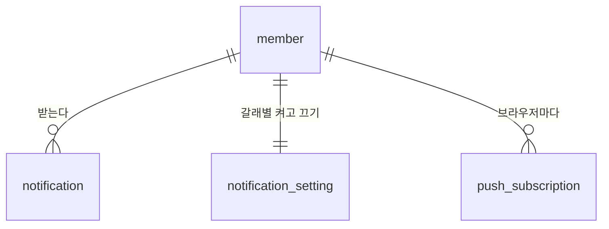

# 알림 · 공지

알림, 알림 설정, 브라우저 푸시, 공지사항을 저장한다. 명세는 [09 알림](../spec/09-notification.md), [10 설정 · 계정](../spec/10-settings.md), [00 공통 2](../spec/00-common.md)다. 이름 규칙과 공통 칼럼은 [README](README.md)를 따른다.

## `notification` 알림

| 칼럼 | 타입 | 필수 | 설명 |
|---|---|---|---|
| `id` | BIGINT | ✓ | PK |
| `member_id` | BIGINT | ✓ | 받는 사람. FK → `member` |
| `type` | VARCHAR(40) | ✓ | 알림 종류 코드(아래 표의 21가지) |
| `target_type` | VARCHAR(20) | ✓ | 누르면 갈 곳의 종류: `MEETUP` / `CHAT_ROOM` / `CHAT_REQUEST` / `POST` / `GUESTBOOK` / `NOTICE` |
| `target_id` | BIGINT | | 갈 곳의 id. `target_type`에 따라 가리키는 테이블이 다르다. `GUESTBOOK`은 내 땅굴이라 비운다 |
| `actor_id` | BIGINT | | 알림을 일으킨 사람(댓글 단 사람, 신청한 사람 등). FK → `member` |
| `read_at` | DATETIME | | 읽은 시각. 비어 있으면 안 읽음 |
| `created_at` | DATETIME | ✓ | 생긴 시각. 최신순 정렬과 30일의 기준 |

- 알림의 제목과 보조 설명은 저장하지 않는다. `type`, 대상, `actor_id`에서 그때그때 만든다.
- 원본이 사라져도 알림 줄은 남는다. 대상이 삭제 표시됐거나 없으면 누를 때 안내 화면으로 보낸다.
- 지울 수 없고 읽음 처리만 한다. 30일이 지난 알림은 조회에서 빼고 정리한다.
- 알림 설정에서 끈 갈래(모임 / 채팅 / 커뮤니티 / 땅굴 / 공지)의 알림은 줄을 만들지 않는다.

**알림 종류**

| 갈래 | 종류 | 받는 사람 | 대상 |
|---|---|---|---|
| 모임 | 참여 신청 받음 | 주최자 | `MEETUP` |
| 모임 | 신청 수락 / 신청 미승인 / 모임에서 내보내짐 | 신청한 사람 | `MEETUP` |
| 모임 | 참여 취소 | 주최자 | `MEETUP` |
| 모임 | 모임 정보 수정 / 모임 취소 | 신청자와 참여자 | `MEETUP` |
| 모임 | 모임 삭제 | 신청 대기자 | `MEETUP` |
| 모임 | 빈자리 생김 | 빈자리 알림을 켠 사람 | `MEETUP` |
| 모임 | 모임 일정 임박 | (명세에 없음) | `MEETUP` |
| 채팅 | 새 메시지 | 대화방의 다른 참여자 | `CHAT_ROOM` |
| 채팅 | 대화 요청 | 요청을 받은 사람 | `CHAT_REQUEST` |
| 채팅 | 대화 요청 수락 | 요청을 보낸 사람 | `CHAT_ROOM` |
| 커뮤니티 | 내 글에 댓글 / 내 글 좋아요 / 내 글이 신고로 가려짐 | 글을 쓴 사람 | `POST` |
| 커뮤니티 | 내 댓글의 답글 / 댓글 · 답글 좋아요 | 댓글을 쓴 사람 | `POST` |
| 땅굴 | 방명록 새 글 | 땅굴 주인 | `GUESTBOOK` |
| 땅굴 | 방노트 | (명세에 없음, 남은 검토 항목 56) | |
| 공지 | 서비스 공지 | 모든 사용자 | `NOTICE` |

## `notification_setting` 알림 설정

| 칼럼 | 타입 | 필수 | 설명 |
|---|---|---|---|
| `member_id` | BIGINT | ✓ | PK. FK → `member` |
| `meetup_on` | BOOLEAN | ✓ | 모임 알림. 기본 켜짐 |
| `chat_on` | BOOLEAN | ✓ | 채팅 알림 |
| `community_on` | BOOLEAN | ✓ | 커뮤니티 알림 |
| `burrow_on` | BOOLEAN | ✓ | 땅굴 알림 |
| `notice_on` | BOOLEAN | ✓ | 공지 알림 |
| `browser_push_on` | BOOLEAN | ✓ | 브라우저 알림 받기 |

## `push_subscription` 브라우저 푸시를 보낼 곳

| 칼럼 | 타입 | 필수 | 설명 |
|---|---|---|---|
| `id` | BIGINT | ✓ | PK |
| `member_id` | BIGINT | ✓ | FK → `member` |
| `endpoint` | VARCHAR | ✓ | 브라우저가 준 푸시 주소. UNIQUE |
| `push_keys` | VARCHAR | ✓ | 푸시 암호화에 쓰는 키 |
| `created_at` | DATETIME | ✓ | |

- 한 사람이 브라우저 여러 개에서 허용할 수 있어 줄이 여러 개다. 정확한 칼럼은 푸시를 구현할 때 맞춘다.

## `notice` 공지사항

| 칼럼 | 타입 | 필수 | 설명 |
|---|---|---|---|
| `id` | BIGINT | ✓ | PK |
| `category` | VARCHAR(10) | ✓ | `NOTICE` 공지 / `UPDATE` 업데이트 / `EVENT` 이벤트 |
| `title` | VARCHAR | ✓ | 제목 |
| `content` | TEXT | ✓ | 본문 |
| `created_at` | DATETIME | ✓ | 올린 시각. 최신순 정렬 |

- 관리자가 올린다. 읽기만 한다(댓글 · 좋아요 없음).

## 저장하지 않는 것

**계산해서 내려주는 값**

| 값 | 무엇에서 계산하나 |
|---|---|
| 알림의 제목과 보조 설명 | `type`과 대상(모임 이름, 글 제목 등), `actor_id`의 닉네임 |
| 알림의 갈래(모임 / 채팅 / 커뮤니티 / 땅굴 / 공지) | `type` |
| GNB 알림 아이콘의 빨간 점 | `read_at`이 비어 있는 알림이 있는지 |
| 알림 팝업의 "모임 참여 요청" 수, "대화 요청" 수 | `meetup_application`, `chat_request` |
| 공지사항 전체 건수 | `notice` 줄 수 |

**프론트엔드가 갖는 것**

- 종류별 아이콘과 색, 읽지 않음 점, 빈 상태 문구("새 알림이 없어요")

## 명세에 없어 구현 단계로 넘기는 것

- "새 메시지" 알림을 메시지마다 만드는지 대화방마다 하나로 묶는지
- "모임 일정 임박"을 언제 보내는지, "방노트" 알림이 무엇인지(남은 검토 항목 56)
- 공지 알림을 모든 사용자에게 줄로 만드는 방법
