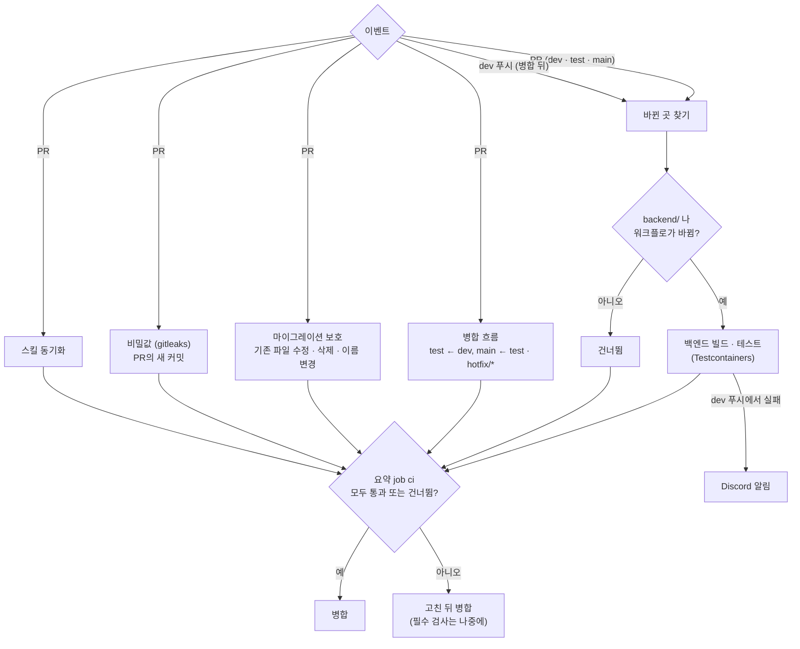

# KAN-26 CI 구성 및 브랜치 보호

- Jira: [KAN-26](https://it-ting.atlassian.net/browse/KAN-26)
- 브랜치: `chore/infra/KAN-26-pr-ci`

## 계획

### 목표

PR마다 GitHub Actions가 빌드 · 테스트와 저장소 규칙을 기계로 검사해, 깨진 코드와 규칙 위반을 병합 전에 보이게 한다. KAN-26 가운데 브랜치 보호(`protect-main-dev`)와 PR Discord 알림은 이미 끝났고, 이번에는 CI와 `test` 브랜치를 한다.

범위 밖:
- 테스트 서버 자동 배포: KAN-63
- 린트 · 포매터: 코드 규칙(KAN-4)을 정한 뒤
- 프론트엔드 검사(린트, 타입 검사, 빌드): `frontend/`가 생기는 KAN-25에서 같은 워크플로에 더한다
- Docker 이미지 빌드 검사: Dockerfile이 생기는 KAN-63에서 더한다

### 정한 것

| # | 질문 | 정한 답 | 정한 사람 |
|---|---|---|---|
| 1 | 검사할 것 | 백엔드 빌드 · 테스트, 병합 흐름, 병합된 마이그레이션 수정, 비밀값, 스킬 동기화 | 사용자 (2026-11-23) |
| 2 | 넣지 않을 것 | 코드 스타일(KAN-4 전), 커밋 서명(규칙 세트가 이미 막음), API 문서와 코드 일치(Codex 리뷰) | 대화 (2026-11-23) |
| 3 | 커밋 메시지 검사 | 하지 않는다. KAN-26 설명에 있던 항목이지만 뺀다. 커밋 규칙은 지금처럼 `docs/commit-convention.md`와 리뷰로 지킨다 | 사용자 (2026-11-23) |
| 4 | 브랜치 이름 검사 | 하지 않는다. 문서와 리뷰로 지킨다 | 사용자 (2026-11-23) |
| 5 | 워크플로 모양 | `ci.yml` 하나에 검사별 job을 두고 마지막 요약 job `ci`로 모은다. 필수 검사로 걸 때도 `ci` 하나만 건다. 경로 조건으로 건너뛴 워크플로를 필수 검사로 두면 PR이 "대기"에서 끝나지 않기 때문이다. 기존 `agent-skills-sync.yml`은 여기로 합친다 | 사용자 (2026-11-23) |
| 6 | 백엔드 빌드를 돌리는 때 | `backend/**`나 워크플로 파일이 바뀐 PR만. 문서만 바꾼 PR은 건너뛴다 | 사용자 (2026-11-23) |
| 7 | 병합 흐름 | `test`로 가는 PR은 `dev`에서만, `main`으로 가는 PR은 `test`나 `hotfix/*`에서만 받는다(`docs/branch-strategy.md`) | 사용자 (2026-11-23) |
| 8 | 비밀값 검사(CI) | gitleaks(v8.30.1) CLI로 PR의 새 커밋만 검사한다. 기본 규칙에 Discord · Mattermost 웹후크 URL 규칙을 더한다(`.gitleaks.toml`). 조직 저장소에서 `gitleaks-action`은 라이선스 키가 필요해 CLI를 쓴다. 푸시 뒤에 도는 안전망이다 | 사용자 (2026-11-23) |
| 9 | GitHub 비밀값 스캔 | 사용자가 Settings → Code security에서 Secret scanning과 Push protection을 켠다(지금 꺼져 있음, 공개 저장소라 무료). 켠 뒤 웹후크 URL도 잡는지 가짜 값으로 확인하는 법을 `docs/ci.md`에 적는다 | 사용자 (2026-11-23) |
| 10 | 마이그레이션 보호 | PR이 기준 브랜치에 이미 있는 `backend/src/main/resources/db/migration/*` 파일을 고치거나 지우거나 이름을 바꾸면 실패한다. 새 파일은 통과. 테스트 전용 마이그레이션은 매번 새 DB라 뺀다 | 사용자 (2026-11-23) |
| 11 | 병합 뒤 검사 | `dev`에 푸시(병합)될 때도 백엔드 빌드를 돌리고, 실패하면 기존 `DISCORD_WEBHOOK_PR_URL`로 알린다 | 사용자 (2026-11-23) |
| 12 | `test` 브랜치 | 이 PR이 병합되면 Claude가 최신 `dev`에서 `test`를 만들어 푸시하고, 사용자가 규칙 세트에 `test`를 더한다 | 사용자 (2026-11-23) |
| 13 | 필수 검사 | 지금은 걸지 않는다. 빠르게 개발하는 동안 빌드 시간만큼 병합을 기다리게 하지 않으려는 것이다. CI는 돌고 결과는 보이며, 실패하면 고친 뒤 병합한다. 몇 주 써 보고, 늦어도 KAN-63 자동 배포 전에 사용자가 규칙 세트에 `ci`를 더한다(처음 결정 2026-11-23을 바꿈) | 사용자 (2026-11-24) |
| 14 | 백엔드 테스트 환경 | Testcontainers로 실제 MySQL · Redis. GitHub 러너(`ubuntu-latest`)에 Docker가 있다 | `AGENTS.md` |
| 15 | 비용 | 공개 저장소라 GitHub Actions 표준 러너가 무료다 | 확인 (2026-11-23) |

### 이번에 정할 것 (확인 부탁)

없음. 모두 위 "정한 것"으로 옮겼다.

### 만들 것

| 파일 | 내용 |
|---|---|
| `.github/workflows/ci.yml` | `pull_request`(`dev` · `test` · `main`)와 `dev` 푸시. job: 바뀐 곳 찾기 → 백엔드 빌드(JDK 25, Gradle 캐시, 실패 시 테스트 보고서 올림) · 병합 흐름 · 마이그레이션 보호 · 비밀값 · 스킬 동기화 → 요약 `ci`. 같은 PR의 이전 실행은 취소. `dev` 푸시에서는 백엔드 빌드만 돌리고 실패하면 Discord 알림 |
| `.github/workflows/agent-skills-sync.yml` | 지운다(`ci.yml`로 합침) |
| `scripts/ci/check-merge-flow.sh` | 병합 흐름(기준 · 원본 브랜치) 검사 |
| `scripts/ci/check-migrations.sh` | 기준 브랜치에 있던 마이그레이션 파일의 수정 · 삭제 · 이름 변경 검사 |
| `.gitleaks.toml` | 기본 규칙 + 웹후크 URL 규칙 |
| `docs/ci.md` | 검사 목록, 실패했을 때 고치는 법, 로컬에서 돌리는 법, 규칙 세트에 필수 검사 넣기와 비밀값 스캔 켜기(사용자 할 일) |
| `docs/branch-strategy.md` | `test` 브랜치, 필수 검사 `ci`, CI가 막는 병합 흐름 |
| `AGENTS.md` | 저장소 지도에 `scripts/ci/`, 완료 기준에 "CI 통과" |

### 테스트

API를 바꾸지 않으므로 통합 테스트는 늘지 않는다.

| 확인 | 정상 | 실패 |
|---|---|---|
| 병합 흐름 스크립트 | 아무 브랜치 → `dev`, `dev` → `test`, `test` → `main`, `hotfix/be/KAN-1-x` → `main` | `chore/be/KAN-1-x` → `test`, `dev` → `main` → 실패 |
| 마이그레이션 스크립트 | 새 마이그레이션 파일 추가 → 통과 | 기존 `V1__…` 수정 · 삭제 → 실패 |
| gitleaks | 이 브랜치 → 통과 | 가짜 Discord 웹후크 URL이 든 임시 파일(커밋하지 않음)을 `gitleaks dir`로 → 잡힘 |
| 워크플로 전체 | 이 PR에서 `ci`가 초록 | 스크립트 실패 시 요약 `ci`가 빨강(위 실패 경우를 로컬로 확인) |
| 기존 빌드 | `./gradlew build` 통과 | |

스크립트는 로컬에서 위 경우로 돌려 보고, 워크플로는 이 PR의 실제 실행으로 확인한다. 실패 경우를 보려고 일부러 깨진 PR을 열지는 않는다(PR을 열면 Discord 알림이 간다).

## 결과

### 한눈에 보기

### 바꾼 것

| 파일 | 내용 |
|---|---|
| `.github/workflows/ci.yml` | 새 워크플로. job 7개(바뀐 곳 찾기, 백엔드 빌드 · 테스트, 병합 흐름, 마이그레이션 보호, 비밀값, 스킬 동기화, 요약 `ci`). 같은 PR의 이전 실행 취소, Gradle 캐시는 `dev`에서만 씀, 실패 시 테스트 보고서 올림, `dev` 푸시 실패 시 Discord |
| `.github/workflows/agent-skills-sync.yml` | 지움(`ci.yml`의 스킬 동기화 job으로 합침) |
| `scripts/ci/check-merge-flow.sh` | 병합 흐름 검사 |
| `scripts/ci/check-migrations.sh` | 마이그레이션 보호 검사(`git diff --name-status -M 기준...HEAD`에서 추가 말고 다른 것이 있으면 실패) |
| `.gitleaks.toml` | 기본 규칙 + Discord · Mattermost 웹후크 URL 규칙 |
| `docs/ci.md` | 검사 목록, 실패했을 때 고치는 법, 비밀값이 잡혔을 때, 로컬에서 돌리는 법, 관리자가 처음 한 번 할 일 |
| `docs/branch-strategy.md` | 기준 브랜치별로 받는 원본 브랜치 표, 규칙 세트에 `test`, `ci`가 실패하면 고친 뒤 병합, 긴급 수정 절 |
| `AGENTS.md` | 저장소 지도에 `docs/ci.md`, `ci.yml` · `scripts/ci/`, 완료 기준에 "`ci`가 실패하면 고친 뒤 병합", 스킬 동기화 검사 이름 |
| `README.md` | 스킬 동기화 검사 이름, 문서 목록에 CI |

### 확인한 것

- 병합 흐름 스크립트: `feature/be/KAN-1-x` → `dev`, `dev` → `test`, `test` → `main`, `hotfix/be/KAN-1-x` → `main` 통과. `chore/be/KAN-1-x` → `test`, `dev` → `main` 실패(종료 코드 1)
- 마이그레이션 스크립트(scratchpad의 임시 저장소): 새 파일 추가 통과, `V1__init.sql` 수정 · 삭제 · 이름 변경 실패, 테스트 전용 마이그레이션 수정 통과, 기준 브랜치가 앞서 간 경우 통과. 이 브랜치(`origin/dev` 기준) 통과
- gitleaks v8.30.1(체크섬 확인): 무작위 값으로 만든 가짜 Discord · Mattermost 웹후크 URL을 `gitleaks dir`로 → 두 규칙 모두 잡음. 새로 만든 파일 → 없음
- 워크플로 전체: PR #39의 첫 실행에서 job 7개 모두 통과. 백엔드 빌드 · 테스트 5분 17초, 나머지는 각 10초 이내. gitleaks는 체크섬 확인 뒤 PR의 커밋 1개를 검사
- `./gradlew build` 통과. 테스트 375개, 실패 0(백엔드 코드는 바꾸지 않음)
- 로컬 코드 리뷰: P0 0건, P1 1건 고침(긴급 수정 절이 병합 흐름 검사와 어긋남)

### 계획과 달라진 점

- gitleaks 기본 설정은 `abcdef…`, `example.com`처럼 뻔한 자리 표시 값을 예시로 보고 건너뛴다. 처음 가짜 값이 잡히지 않아 알았다. `docs/ci.md`의 Push protection 확인법에 "값은 무작위로 만든다"를 적었다.
- 저장소 전체 이력을 gitleaks로 돌리면 `generic-api-key` 2건이 나온다(`PushPublicKeyTests.java`, `docs/api/10-settings.md`의 웹 푸시 공개 키 예시). 비밀값이 아니고 CI는 PR의 새 커밋만 보므로 허용 목록에 넣지 않았다. 그 줄을 다시 고쳐 잡히면 `gitleaks:allow` 주석을 단다(`docs/ci.md`).
- 바뀐 곳 찾기는 외부 액션(paths-filter) 없이 `git diff`로 했다. `dev` 푸시에서도 같은 경로 조건을 써서, 문서만 병합되면 빌드를 건너뛴다.
- `docs/branch-strategy.md`의 "긴급 수정" 절이 핫픽스를 `test`에도 바로 반영하라고 해서 정한 것 7과 어긋났다. `dev`로 PR을 올리고, `test`에는 다음 `dev` → `test` PR로 들어가게 고쳤다(로컬 리뷰에서 찾음).
- 구현 뒤 사용자가 "빠르게 개발해야 하는데 병목이 되지 않을까" 다시 검토했다. 정한 것 13을 바꿔 필수 검사 `ci`는 나중에 걸기로 했다. `docs/ci.md`의 "나중에 할 일", `docs/branch-strategy.md`, `AGENTS.md`를 그에 맞췄다.
- 워크플로 문법 검사 도구(actionlint)는 로컬에서 돌리지 못했다. 이 PR의 실제 실행으로 확인한다.

### 남은 일

- 병합 뒤 Claude: 최신 `dev`에서 `test` 브랜치를 만들어 푸시
- 병합 뒤 관리자: Secret scanning · Push protection 켜기, 규칙 세트에 `test` 더하기(`docs/ci.md`의 "처음 한 번")
- 나중에 관리자: 필수 검사 `ci` 걸기(늦어도 KAN-63 전, `docs/ci.md`의 "나중에 할 일")
- KAN-63: Docker 이미지 빌드 검사를 `ci.yml`에 더함
- KAN-25: 프론트엔드 검사를 `ci.yml`에 더함

### 검토 순서

1. `docs/ci.md`
2. `.github/workflows/ci.yml`
3. `scripts/ci/check-merge-flow.sh`, `scripts/ci/check-migrations.sh`
4. `.gitleaks.toml`
5. `docs/branch-strategy.md`, `AGENTS.md`, `README.md`
