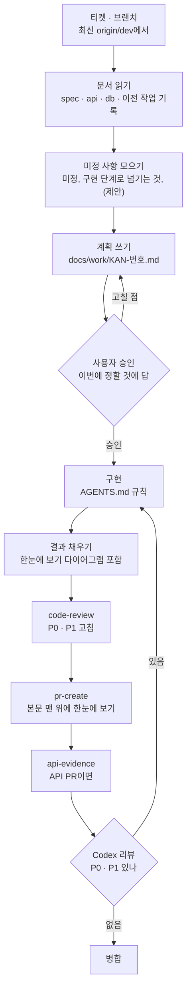

# KAN-35 작업 계획서 · 완료 보고서 방식과 그동안 정한 규칙을 하네스에 넣기

- Jira: [KAN-35](https://it-ting.atlassian.net/browse/KAN-35)
- 브랜치: `docs/common/KAN-35-work-plan-harness`

## 계획

### 목표

그동안 Claude의 메모에만 있던 일하는 규칙을 하네스(`AGENTS.md`, 스킬)에 넣는다. 사람, Claude Code, Codex가 같은 규칙으로 일하게 한다.

| 규칙 | 지금 있는 곳 | 넣을 곳 |
|---|---|---|
| 작업 계획서 → 승인 → 구현 → 결과(`docs/work/KAN-<번호>.md`) | 메모, 사례 4개(KAN-24 · 36 · 37 · 38) | `AGENTS.md`, 템플릿, 새 스킬 `work-plan` |
| 미정 사항은 시작 전에 한꺼번에 묻고, 정해진 것은 묻지 않고 진행 | 메모 | `AGENTS.md`, `work-plan` |
| 다이어그램 "한눈에 보기"(흐름도 늘, 시퀀스, ERD) | 메모, KAN-38 사례 | 템플릿, `work-plan`, `pr-create` 본문 형식 |
| 로그인 없는 API는 `SecurityConfig.PUBLIC_API`에 더함, 로그인한 사용자는 `@AuthenticationPrincipal Long userId` | 코드 주석 | `AGENTS.md` 백엔드 코드, 리뷰 기준 |
| 세션 · Redis를 쓰는 테스트도 Testcontainers(`redis:7.4`) | 코드 | `AGENTS.md` 완료 기준 |

범위 밖:
- Claude만 하는 일은 넣지 않는다. Codex 리뷰 뒤 Claude가 병합하는 것, GitHub 이미지 업로드를 사용자 Chrome으로 하는 것.
- 코드는 바꾸지 않는다.

### 정한 것

| # | 질문 | 정한 답 | 정한 사람 |
|---|---|---|---|
| 1 | 계획서 · 보고서를 어디에 두나 | 저장소 `docs/work/KAN-<번호>.md` 한 파일에 계획과 결과 | 사용자 (KAN-24) |
| 2 | 계획 승인 전에 구현하나 | 하지 않는다 | 사용자 (KAN-24) |
| 3 | 미정 사항 | 시작 전에 모아 한꺼번에 묻고, 정해진 것은 묻지 않고 진행 | 사용자 (2026-11-22) |
| 4 | 다이어그램 | 기능 작업의 결과 절과 PR 본문에 "한눈에 보기". 흐름도는 늘, 순서가 중요하면 시퀀스, 테이블을 바꾸면 ERD | 사용자 (2026-11-22) |
| 5 | 로그인 없는 주소 | 허용 목록에 적은 것만. 나머지 `/api/**`는 로그인 필요 | 사용자 (KAN-38) |
| 6 | 계획은 어디서 검토하나(아래 A) | 로컬 파일을 읽고 대화에서 승인. Draft PR은 쓰지 않는다 | 사용자 (2026-11-22) |
| 7 | 리뷰 기준(아래 C) | P0 · P1 둘 다 더한다 | 사용자 (2026-11-22) |

### 이번에 정할 것 (2026-11-22 정함)

| # | 무엇 | 제안 | 까닭 |
|---|---|---|---|
| A | 계획은 어디서 검토하나 | **로컬 파일을 읽고 대화에서 승인**한다(KAN-36 ~ 38에서 실제로 한 방식). Draft PR은 쓰지 않는다 | 처음(KAN-24)에는 계획만 커밋해 Draft PR로 보자고 했지만, 그 뒤 세 번 모두 로컬 파일로 승인했고 더 빨랐다. 계획은 결과와 함께 PR에 남으니 기록도 남는다 |
| B | 계획서를 쓰는 작업 | 코드나 설정을 바꾸는 기능 · 설정 티켓. 문서만 바꾸는 작업과 한두 줄 고치는 작업은 뺀다 | KAN-24 결정 그대로 |
| C | 리뷰 기준 | P0에 "로그인이 필요한 API가 `PUBLIC_API`에 들어 있다"를 더한다. P1에 "로그인 없이 불러야 하는 API가 `PUBLIC_API`에 없다"를 더한다 | 앞의 것은 권한 검사가 빠지는 것이고, 뒤의 것은 명세와 다르게 `401`이 나는 것이다 |
| D | 다이어그램이 없는 PR | 리뷰 지적 대상에는 넣지 않는다. `work-plan`과 `pr-create`가 넣게 한다 | 리뷰는 동작과 문서의 어긋남만 본다는 원칙을 지킨다 |

### 만들 것

| 파일 | 내용 |
|---|---|
| `docs/work/_template.md` | 계획(목표, 범위, 정한 것, 이번에 정할 것, 만들 것, 테스트)과 결과(한눈에 보기, 바꾼 것, 확인한 것, 계획과 달라진 점, 남은 일, 검토 순서). 절마다 무엇을 쓰는지 한 줄 안내 |
| `.agents/skills/work-plan/SKILL.md` | 새 스킬. 티켓 · 브랜치 확인 → 문서 읽기 → 미정 사항 모으기 → 계획 쓰기 → 승인 받기 → 구현 → 결과 채우기(다이어그램 포함) → `pr-create` |
| `.agents/skills/pr-create/SKILL.md` | 본문 형식에 `## 한눈에 보기`(Mermaid)와 작업 기록 링크. 기능 PR이면 넣고, 그려지는지 확인 |
| `AGENTS.md` | 작업 전에 읽을 문서 표, 반드시 지킬 것(계획 승인 전 구현 금지, 미정 사항 먼저 묻기), 백엔드 코드(로그인 규칙), 완료 기준(Redis 테스트, 한눈에 보기), 스킬 표, 리뷰 기준(C) |
| `.claude/skills/` | `bash scripts/sync-agent-skills.sh`로 복사 |
| `README.md` | AI 에이전트 절의 스킬 목록에 `work-plan` |

### 확인 방법

- 문서만 바꾸는 작업이라 빌드는 생략한다.
- `.agents/skills`와 `.claude/skills`가 같은지(`diff -r`). CI `agent-skills-sync`가 같은 것을 본다.
- 링크와 파일 이름이 맞는지.
- 템플릿이 KAN-38 작업 기록의 절과 맞는지.

## 결과

### 한눈에 보기

기능 · 설정 티켓 하나가 시작부터 병합까지 지나가는 길이다. 사람이 정하는 곳은 마름모다.

### 바꾼 것

| 파일 | 내용 |
|---|---|
| `docs/work/_template.md` | 새 템플릿. 계획(목표, 범위 밖, 정한 것, 이번에 정할 것, 만들 것, 테스트)과 결과(한눈에 보기, 바꾼 것, 확인한 것, 계획과 달라진 점, 남은 일, 검토 순서). 다이어그램을 고르는 기준을 주석으로 |
| `.agents/skills/work-plan/SKILL.md` | 새 스킬. 언제 쓰나, 하지 말 것(승인 전 구현 금지, 정해진 것 다시 묻지 않기, 미정 사항 혼자 정하지 않기, 계획만 따로 커밋 · Draft PR 하지 않기), 절차 8단계, 끝났는지 확인 |
| `.agents/skills/pr-create/SKILL.md` | 본문 형식에 작업 기록 링크와 `### 한눈에 보기`. 그림으로 그려지는지 확인, 끝났는지 확인에 한 줄 |
| `AGENTS.md` | 저장소 지도에 `docs/work/`, 작업 전에 읽을 문서에 "기능 · 설정 티켓 시작", 반드시 지킬 것에 계획 승인 · 미정 사항 먼저 묻기, 백엔드 코드에 로그인 규칙 4줄, 완료 기준에 Redis 테스트 · 한눈에 보기, 스킬 표에 `work-plan`, 리뷰 기준 P0 · P1에 `PUBLIC_API` |
| `README.md` | AI 에이전트 절에 스킬을 쓰는 순서 |
| `.claude/skills/` | `bash scripts/sync-agent-skills.sh`로 복사 |

### 확인한 것

- 문서만 바꾼 작업이라 빌드는 생략했다.
- `diff -r .agents/skills .claude/skills`: 차이 없음
- 템플릿의 절이 `docs/work/KAN-38.md`의 절과 같다.
- 새로 적은 경로(`global/security/SecurityConfig`, `auth/service/SessionService`, `TestcontainersConfiguration`)가 dev의 코드에 있다.

### 계획과 달라진 점

- `AGENTS.md`의 "코드를 바꾼 모든 작업"에서 "Testcontainers로 MySQL을 띄우므로"를 "MySQL과 Redis를"로 함께 고쳤다.

### 남은 일

- 예전 작업 기록(KAN-24 · 36 · 37)에는 "한눈에 보기"가 없다. 고치지 않고 둔다.

### 검토 순서

1. `AGENTS.md`
2. `.agents/skills/work-plan/SKILL.md`
3. `docs/work/_template.md`
4. `.agents/skills/pr-create/SKILL.md`, `README.md`
