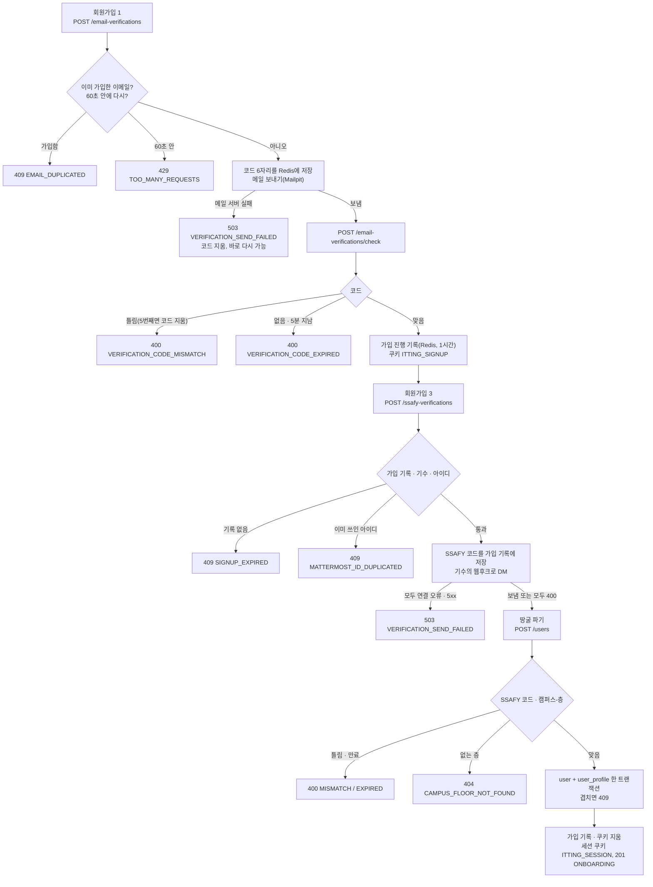
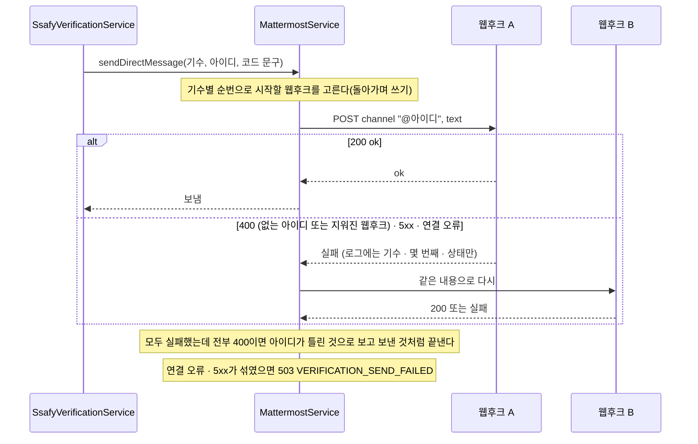

# KAN-39 02 로그인 ②: 이메일 가입(이메일 인증 · SSAFY 인증 · 계정 만들기)

- Jira: [KAN-39](https://it-ting.atlassian.net/browse/KAN-39)
- 브랜치: `feature/be/KAN-39-email-signup`

## 계획

### 목표

이메일로 가입하는 API 4개를 만든다. 가입을 마치면 계정과 프로필이 생기고 바로 로그인된다.

- `POST /api/v1/email-verifications` ([API 명세](../api/02-auth.md#post-apiv1email-verifications))
- `POST /api/v1/email-verifications/check` ([API 명세](../api/02-auth.md#post-apiv1email-verificationscheck))
- `POST /api/v1/ssafy-verifications` ([API 명세](../api/02-auth.md#post-apiv1ssafy-verifications))
- `POST /api/v1/users` ([API 명세](../api/02-auth.md#post-apiv1users))

범위 밖:
- Google 가입(가입 진행 기록의 가입 방법이 Google인 경우)은 ④에서 한다. 이번 `POST /api/v1/users`는 이메일 가입 기록만 처리한다.
- 실제 메일 발송 서비스(SMTP 계정)는 배포할 때 정한다. 이번에는 설정으로 받을 수 있게만 한다.

### 정한 것

| # | 질문 | 정한 답 | 정한 사람 |
|---|---|---|---|
| 1 | 인증 코드 | 숫자 6자리, 유효 5분, 재전송 간격 60초. 이메일 · SSAFY 같다 | 사용자 (2026-11-22) |
| 2 | 코드를 틀리면 | 5번 틀리면 코드를 지운다. 그 뒤는 `VERIFICATION_CODE_EXPIRED`. 새 코드를 저절로 보내지 않는다 | 사용자 (2026-11-22) |
| 3 | 가입 진행 기록 | Redis에 1시간. 쿠키 `ITTING_SIGNUP`으로 찾는다 | Claude, 반대 없음 (2026-11-22) |
| 4 | 메일 | 개발은 Mailpit(compose에 추가). 실제 SMTP는 `.env`로 받게만 | 사용자 (2026-11-22) |
| 5 | Mattermost 발송 | 팀원 계정의 Incoming Webhook으로 `channel: "@<mattermostId>"`에 DM. 웹후크 URL은 `.env`에 사용자가 넣는다 | 사용자 (2026-11-22), 시험으로 확인함 |
| 6 | 기수와 서버 | 15기와 16기는 Mattermost 서버가 다르다. 웹후크를 기수별로 받는다 | 사용자 (2026-11-22) |
| 7 | 웹후크 여러 개 | 기수마다 여러 개를 돌아가며 쓴다. 한 웹후크가 실패하면 같은 기수의 다음 웹후크로 다시 보낸다 | 사용자 (2026-11-22) |
| 8 | 한글 | 서버가 보내는 본문은 UTF-8로 고정하고 테스트로 확인한다. Windows 터미널의 curl은 한글이 깨졌다 | Claude (2026-11-22 시험) |
| 9 | 보내기가 모두 실패할 때(A) | `503 VERIFICATION_SEND_FAILED`. 만든 코드는 지우고 재전송 간격도 세지 않는다 | 사용자 (2026-11-22) |
| 10 | 웹후크가 `400`을 줄 때(B) | 다음 웹후크로 넘긴다. 같은 기수의 웹후크가 모두 `400`이면 "아이디가 틀림"으로 보고 명세대로 성공으로 답한다. 연결 오류 · `5xx`로 끝나면 `503` | 사용자 (2026-11-22) |
| 11 | 비밀번호 길이(C) | **8자 이상 20자 이하**. 넘으면 `400 INVALID_INPUT`. 명세 00 공통 9도 고친다 | 사용자 (2026-11-22) |
| 12 | 웹후크 오류 응답 | 본문에 웹후크 키가 들어 있으므로 로그에 남기지 않는다. 상태 코드와 몇 번째 웹후크인지만 남긴다 | Claude (2026-11-22 시험) |

### 이번에 정할 것 (2026-11-22 모두 승인)

| # | 무엇 | 제안 | 까닭 |
|---|---|---|---|
| A ~ C | 위 "정한 것" 9 ~ 11로 옮겼다 | | |
| D | Mattermost 아이디 모양 | 앞뒤 공백과 앞의 `@`를 떼고 소문자로 바꾼다. 영문 소문자 · 숫자 · `.` · `-` · `_` 3 ~ 22자가 아니면 `400 INVALID_INPUT` | Mattermost 아이디 규칙과 같다. 대소문자만 다른 아이디로 두 번 가입하지 못하게 한다 |
| E | 웹후크 설정 이름 | `.env`의 `MATTERMOST_WEBHOOK_URLS_15`, `MATTERMOST_WEBHOOK_URLS_16`(쉼표로 여러 개) → 서버 설정 `itting.mattermost.webhooks.<기수>` | 기수가 늘면 줄 하나를 더한다 |
| F | 기수에 웹후크가 하나도 없을 때 | 서버는 뜨게 둔다. 그 기수로 보낼 때 A와 같이 `503`, 서버 로그에 경고 | 로컬에서 웹후크 없이도 다른 API를 개발할 수 있게 한다 |
| G | 돌아가며 쓰는 순서 | 서버 메모리의 기수별 순번. 서버를 다시 띄우면 처음부터 | 서버 한 대에서는 충분하다. 여러 대가 되면 Redis 순번으로 바꾼다 |
| H | 메일 | Spring Mail. 보내는 주소는 설정 `itting.mail.from`(local `no-reply@itting.local`). 제목 "[디굴디굴] 이메일 인증 코드", 본문은 코드와 "5분 안에 입력해 주세요" | |
| I | Mattermost 메시지 | "[디굴디굴] SSAFY 인증 코드는 123456입니다. 5분 안에 입력해 주세요." 받는 사람에게 웹후크를 만든 팀원 이름으로 보이므로 첫머리에 서비스 이름을 넣는다 | |
| J | 가입 쿠키 | `ITTING_SIGNUP`, `HttpOnly`, `Secure`, `SameSite=Lax`, `Path=/api/v1`, `Max-Age` 1시간. 값은 무작위 32바이트. 계정을 만들면 지운다 | 세션 쿠키와 같은 보안 속성 |
| K | 이메일 | 앞뒤 공백을 떼고 그대로 저장한다. 인증 코드는 소문자로 바꾼 이메일로 찾는다 | DB는 대소문자를 가리지 않고 비교한다(KAN-38). 코드도 같게 맞춘다 |
| L | 로그인 없이 부를 주소 | 네 API를 `PUBLIC_API`에 더한다. `/api/v1/users`는 `POST`만 연다(나중의 다른 사람 프로필 조회 같은 주소는 로그인 필요) | 허용 목록을 메서드별로 적을 수 있게 고친다 |
| M | `CAMPUS_FLOOR_NOT_FOUND` | 캠퍼스 영역의 `CampusErrorCode`에 둔다 | 04 · 05에서도 같은 코드를 쓴다 |
| N | 값이 겹칠 때(동시에 가입) | DB UNIQUE 위반을 칼럼별로 `EMAIL_DUPLICATED`, `MATTERMOST_ID_DUPLICATED`로 바꾼다 | 명세의 "저장하다 값이 겹치면" |

### 만들 것

| 파일 | 내용 |
|---|---|
| `compose.yaml`, `.env.example` | Mailpit(SMTP `1025`, 화면 `8025`, `127.0.0.1`에만), 웹후크 이름 `MATTERMOST_WEBHOOK_URLS_15` · `_16`(값은 비움) |
| `build.gradle` | `spring-boot-starter-mail` |
| `application*.yml` | 메일 서버, 보내는 주소, 웹후크, 코드 유효 시간 · 재전송 간격 · 틀린 횟수 · 가입 기록 시간 |
| `auth/service/` | 인증 코드 저장소(Redis), 가입 진행 기록 저장소(Redis), 메일 보내기, Mattermost 보내기(돌아가며 · 넘기기), 이메일 인증 · SSAFY 인증 · 가입 서비스 |
| `auth/controller/` | `EmailVerificationController`, `SsafyVerificationController`, `UserController`(`POST /users`) |
| `auth/dto/` | 요청 · 응답 record, 비밀번호 규칙 검증 |
| `auth/domain/AuthErrorCode` | `EMAIL_DUPLICATED`, `VERIFICATION_CODE_MISMATCH`, `VERIFICATION_CODE_EXPIRED`, `SIGNUP_EXPIRED`, `MATTERMOST_ID_DUPLICATED`, `VERIFICATION_SEND_FAILED`(A) |
| `campus/domain/CampusErrorCode` | `CAMPUS_FLOOR_NOT_FOUND` |
| `user/domain/` | `User`, `UserProfile`을 만드는 메서드 |
| `global/security/SecurityConfig` | 허용 목록을 메서드별로(L) |
| 문서 | `docs/api/02-auth.md`(A · B · C · D · 구현하며 정한 것), `docs/spec/00-common.md` 9(비밀번호 20자 이하), `docs/db/account.md`(인증 코드 · 가입 기록의 실제 값), `README.md`(Mailpit 화면 주소) |

### 테스트

메일은 Testcontainers로 Mailpit을 띄워 실제로 받은 메일을 확인한다. Mattermost는 테스트 안에 작은 HTTP 서버를 띄워 웹후크를 흉내 낸다(받은 JSON 확인, 실패 흉내).

| API | 정상 | 실패 |
|---|---|---|
| `POST /email-verifications` | `201` + `expiresAt`, Mailpit에 한글 메일 도착, 60초 뒤 다시 보내면 새 코드 | 형식 오류 `400`, 이미 가입한 이메일 `409 EMAIL_DUPLICATED`, 60초 안에 다시 `429`, 메일 서버 실패 `503`(A) |
| `POST /email-verifications/check` | 맞는 코드면 `200` + `ITTING_SIGNUP` 쿠키, 같은 코드 재사용 불가 | 틀림 `VERIFICATION_CODE_MISMATCH`, 5번 틀리면 맞는 코드도 `VERIFICATION_CODE_EXPIRED`, 보낸 적 없음 · 5분 지남 `EXPIRED` |
| `POST /ssafy-verifications` | `201` + `expiresAt`, 웹후크가 `@아이디`와 한글 문구를 받음, 웹후크를 돌아가며 씀, 첫 웹후크 실패(`400` · `5xx`) 시 다음으로, 모두 `400`이면 성공 | 쿠키 없음 · 1시간 지남 `409 SIGNUP_EXPIRED`, 기수 목록에 없는 기수 · 아이디 모양 `400`, 이미 쓰인 아이디 `409`, 60초 안 `429`, 모든 웹후크 실패 `503` |
| `POST /users` | `201` + `userId` · `ONBOARDING`, `user` · `user_profile` 저장, 세션 쿠키로 `/me` 성공, 가입 쿠키 지움 | 쿠키 없음 `409 SIGNUP_EXPIRED`, SSAFY 코드 안 보냄 · 틀림 · 5회, 비밀번호 규칙 · 20자 넘음 · 동의 `false` `400`, 없는 캠퍼스-층 `404`, 그 사이 같은 이메일 · 아이디로 가입 `409` |

## 결과

### 한눈에 보기

이메일 가입의 세 단계다. 마름모에서 응답이 갈린다. 계정은 마지막 단계에서만 DB에 생긴다.

SSAFY 인증 코드를 Mattermost로 보내는 순서다. 웹후크 두 개(A, B)인 기수의 예다.

테이블은 바꾸지 않았다(`user`, `user_profile`은 KAN-38의 V3). 인증 코드와 가입 진행 기록은 Redis에 둔다(`docs/db/account.md`).

### 바꾼 것

| 파일 | 내용 |
|---|---|
| `compose.yaml`, `.env.example`, `README.md` | Mailpit(SMTP 1025, 화면 8025), 웹후크 이름 `MATTERMOST_WEBHOOK_URLS_15` · `_16` |
| `build.gradle` | `spring-boot-starter-mail` |
| `application*.yml` | `itting.verification`(5분 · 60초 · 5번 · 1시간), `itting.mail.from`, `itting.mattermost.webhooks`, local의 Mailpit · 웹후크, test · prod의 환경 변수 안내 |
| `auth/controller/` | `EmailVerificationController`, `SsafyVerificationController`, `SignupController`(`POST /users`) |
| `auth/service/` | `EmailVerificationService`, `SsafyVerificationService`, `SignupService`, `VerificationMailService`, `MattermostService`(돌아가며 · 넘기기 · 모두 400이면 성공), `SignupCookieService`, `VerificationCodeGenerator`, `VerificationProperties` |
| `auth/repository/` | `EmailVerificationRepository`, `SignupRepository`(Redis), `VerificationScripts`(확인 · 보낼 자리 잡기를 한 번에 하는 Lua 스크립트). 만료와 재전송 간격은 저장한 시각과 서버 시계로 본다 |
| `auth/domain/` | `VerificationCode`, `SignupRecord`, `SignupMethod`, `AuthErrorCode`에 7개 |
| `auth/dto/` | 요청 · 응답 record, `ValidPassword`(8 ~ 20자, 쓸 수 있는 문자, 영문 · 숫자 · 특수기호) |
| `campus/domain/CampusErrorCode` | `CAMPUS_FLOOR_NOT_FOUND` |
| `user/service/UserService` | 계정 + 프로필 한 트랜잭션, UNIQUE 위반을 칼럼별 409로 |
| `user/domain/`, `user/repository/` | `User.createByEmail`, `UserProfile.create`, `existsByEmail`, `existsByMattermostId` |
| `global/security/SecurityConfig` | 허용 목록을 메서드별로(`PublicApi`). 새 API 4개, `/users`는 `POST`만 |
| `global/error/` | `BusinessException.invalidInput(field, message)`. 서비스에서도 `fields`를 줄 수 있다 |
| `generation/service/GenerationService` | `isAvailable(generation)` |
| 문서 | `docs/api/02-auth.md`(인증 코드 · 가입 기록 값, 보내기 실패 `503`, Mattermost로 보내는 방법, 입력 모양을 먼저 보는 순서, 구현하며 정한 것), `docs/spec/00-common.md` 9(20자 이하), `docs/db/account.md`(Redis 값), `docs/api-convention.md`(상태 코드 `503`) |

### 확인한 것

- `./gradlew build` 통과. 테스트 101개(기존 61 + 새 40)
  - `EmailVerificationApiTests`(12): 같은 이메일로 동시에 5번 보내면 1번만 201 · 메일 1통, 틀린 확인이 동시에 와도 기록이 망가지지 않고 EXPIRED,  201 · 만료 시각 · Mailpit에 한글 메일, 60초 안 429 · 지난 뒤 새 코드만 맞음, 형식 400, 이미 가입 409(대소문자 무관), 맞으면 200 · 가입 쿠키 속성 · 재사용 불가, 대소문자 무관 확인, 4번 틀려도 통과, 5번 틀리면 EXPIRED(재전송 간격은 유지), 없음 · 5분 지남 EXPIRED, 코드 형식 400
  - `SsafyVerificationApiTests`(15): 같은 가입에서 동시에 5번 보내면 1번만 201 · DM 1번, 틀린 확인이 동시에 와도 EXPIRED이고 새 코드로 가입 완료,  고른 기수 웹후크로 `@아이디`와 한글 문구, 아이디 정리(공백 · `@` · 대문자), 돌아가며 쓰기, 500이면 다음으로, 400이면 다음으로, 모두 400이면 성공, 500 · 연결 오류면 503이고 바로 다시 가능, 웹후크 없음 503, 쿠키 없음 · 1시간 지남 409, 기수 · 아이디 형식 400, 이미 쓰인 아이디 409, 60초 안 429, 이메일 인증을 다시 하면 이전 기록 무효
  - `SignupApiTests`(11): 코드를 다른 아이디 · 기수로 다시 보내면 확인한 코드의 아이디 · 기수로 가입,  계정 · 프로필 저장(비밀번호 해시, 역할, 상태, 시각) · 201 ONBOARDING · 세션으로 `/me` · 이메일 로그인 · 가입 쿠키 지움 · 기록 재사용 불가, 쿠키 없음 409, SSAFY 코드 없음 · 5분 지남 EXPIRED, 틀림 · 5번 틀리면 EXPIRED, 비밀번호 규칙 5가지, 비밀번호 없음 400, 동의 false 400, 없는 층 · 지운 층 404, 그 사이 같은 이메일 · 같은 아이디 409
  - `EmailSendFailureTests`(1): 메일 서버에 닿지 못하면 503이고 다시 불러도 429가 아니라 503
  - `SecurityConfigTests`(+1): `/api/v1/users`는 `POST`만 로그인 없이 부른다
- 테스트는 실제 Mattermost로 보내지 않는다. 모든 기수의 웹후크를 테스트용 가짜 서버(`FakeMattermost`)로 덮어쓴다.
- `git merge-tree --write-tree HEAD origin/dev`: 충돌 없음
- 로컬 코드 리뷰: P0 0건, P1 0건
- Codex 리뷰 P1 2건 고침: 코드 확인과 틀린 횟수 갱신 · 삭제, 재전송 간격 확인과 보낸 시각 기록을 각각 Redis Lua 스크립트 하나로 묶었다(`VerificationScripts`). 동시 요청이 와도 하나만 보내고, 망가진 기록(`attempts`만 남은 해시)이 생기지 않는다
- Codex 재리뷰 P1 1건 고침: 계정에 저장하는 Mattermost ID · 기수를 가입 기록에서 따로 읽지 않고, 코드를 확인하는 스크립트가 그 순간 함께 읽어 돌려준 값을 쓴다. 확인 직후 코드를 다른 아이디로 다시 보내도 어긋나지 않는다

### 계획과 달라진 점

- `POST /api/v1/ssafy-verifications`와 `POST /api/v1/users`는 가입 진행 기록을 찾기 전에 입력값의 모양부터 본다(Bean Validation이 서비스보다 먼저 돈다). `docs/api/02-auth.md`의 순서를 고쳤다.
- 운영 프로필은 메일 서버 주소(`SPRING_MAIL_HOST`)가 없으면 서버가 뜨지 않는다. 스프링 부트가 주소가 있을 때만 메일 발송기를 만들기 때문이다. 운영 설정 안내와 `ItTingApplicationTests`의 Prod에 적었다.
- 서비스에서도 `fields`가 있는 `400 INVALID_INPUT`을 줄 수 있게 `BusinessException.invalidInput`을 더했다(기수 목록에 없는 기수).
- Codex 리뷰(P1 2건)로 Redis 처리를 Lua 스크립트로 바꿨다. SSAFY 코드는 맞아도 지우지 않는다. 계정을 만들다 겹침 · 없는 층으로 실패하면 같은 코드로 다시 시도할 수 있고, 가입을 마치면 가입 기록째 지운다.

### 남은 일

- 로컬에서 실제 DM을 보내려면 `.env`의 시험용 `MATTERMOST_WEBHOOK_URL_1`을 그 웹후크의 기수에 맞춰 `MATTERMOST_WEBHOOK_URLS_15`나 `_16`으로 옮긴다. 시험 중 오류 응답에 키가 드러난 웹후크는 실제로 쓰기 전에 다시 만든다.
- 기수별로 웹후크를 몇 개, 누가 만들지는 팀이 정한다.
- 운영의 메일 서버(SMTP)는 배포할 때 정한다. 메일 서버가 응답하지 않으면 헬스체크가 `DOWN`이 된다.
- Google 가입(가입 방법 GOOGLE)은 ④에서 한다.

### 검토 순서

1. `docs/api/02-auth.md`, `docs/spec/00-common.md`, `docs/db/account.md`, `docs/api-convention.md`
2. `SecurityConfig`(허용 목록)
3. `EmailVerificationController` → `EmailVerificationService` → `EmailVerificationRepository`, `VerificationMailService`
4. `SsafyVerificationController` → `SsafyVerificationService` → `SignupRepository`, `MattermostService`
5. `SignupController` → `SignupService` → `UserService`
6. 테스트: `support/`(가짜 Mattermost, Mailpit, `SignupSteps`) → `EmailVerificationApiTests`, `SsafyVerificationApiTests`, `SignupApiTests`, `EmailSendFailureTests`
