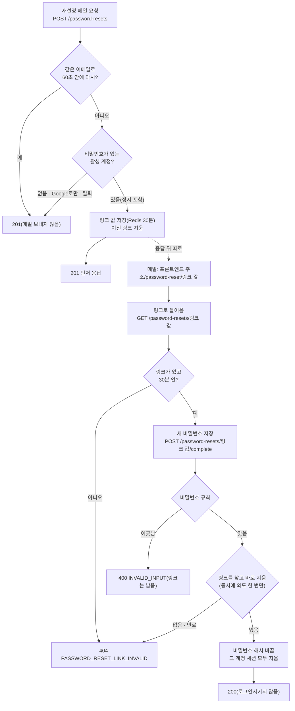

# KAN-41 02 로그인 ③: 비밀번호 재설정

- Jira: [KAN-41](https://it-ting.atlassian.net/browse/KAN-41)
- 브랜치: `feature/be/KAN-41-password-reset`

## 계획

### 목표

비밀번호를 잊은 사람이 메일의 링크로 새 비밀번호를 정하는 API 3개를 만든다.

- `POST /api/v1/password-resets` ([API 명세](../api/02-auth.md#post-apiv1password-resets))
- `GET /api/v1/password-resets/{token}` ([API 명세](../api/02-auth.md#get-apiv1password-resetstoken))
- `POST /api/v1/password-resets/{token}/complete` ([API 명세](../api/02-auth.md#post-apiv1password-resetstokencomplete))

범위 밖:
- 로그인한 사람의 비밀번호 변경(`PATCH /api/v1/me/password`)은 10 설정에서 한다. 비밀번호 규칙(`ValidPassword`)은 같이 쓴다.

### 정한 것

| # | 질문 | 정한 답 | 정한 사람 |
|---|---|---|---|
| 1 | 링크 | 30분, 한 번만. 다시 보내면 이전 링크는 무효. 비밀번호를 바꾸면 링크를 지운다 | 명세 |
| 2 | 가입 여부 | 어떤 이메일을 넣어도 같은 `201`. 계정이 없거나 Google로만 가입했으면 아무것도 하지 않는다 | 명세 · API 명세 |
| 3 | 비밀번호를 바꾼 뒤 | 그 계정의 로그인 세션을 모두 지운다. 로그인시키지 않는다 | API 명세 |
| 4 | 링크 주소 | `{itting.frontend-url}/password-reset/{token}` | Claude, 반대 없음 (2026-11-22) |
| 5 | 비밀번호 규칙 | 8자 이상 20자 이하(KAN-39에서 정함, `ValidPassword`) | 사용자 (2026-11-22) |
| 6 | 메일 | ②의 Mailpit · Spring Mail을 쓴다 | KAN-39 |
| 7 | 너무 자주 요청할 때(A) | 같은 이메일로 60초 안이면 메일만 보내지 않고 같은 `201` | 사용자 (2026-11-22) |
| 8 | 메일을 보내는 때(B) | 응답을 먼저 주고 메일은 따로(비동기). 실패는 서버 로그에만 | 사용자 (2026-11-22) |

### 이번에 정할 것 (2026-11-22 모두 승인)

| # | 무엇 | 제안 | 까닭 |
|---|---|---|---|
| A | 너무 자주 요청할 때 | 같은 이메일로 60초 안에 다시 요청하면 **메일을 보내지 않고 똑같이 `201`**로 답한다. `429`로 답하지 않는다 | `429`는 계정이 있을 때만 나므로 가입 여부가 드러난다. 그렇다고 제한이 없으면 남의 메일함에 재설정 메일을 마구 보낼 수 있다 |
| B | 메일을 보내는 때 | **응답을 먼저 주고 메일은 따로 보낸다**(비동기). 보내지 못하면 서버 로그에만 남긴다 | 계정이 있을 때만 메일을 보내느라 응답이 늦으면, 응답 시간으로 가입 여부가 드러난다. 명세도 "메일을 보냈는지는 알리지 않는다" |
| C | 링크 값(`token`) | 무작위 32바이트(Base64 URL). Redis `itting:password-reset:<token>` → 계정 id, 30분. 계정마다 마지막 링크를 따로 적어 다시 보내면 이전 것을 지운다 | 추측할 수 없게 한다 |
| D | 메일 문구 | 제목 "[디굴디굴] 비밀번호 재설정", 본문에 링크와 "30분 동안 한 번만 쓸 수 있어요", 요청하지 않았으면 무시 | |
| E | 정지된 계정 | 재설정은 된다. 로그인은 여전히 `ACCOUNT_SUSPENDED`다 | 명세에 없다. 막으면 정지 여부가 드러난다 |
| F | 세션 지우기 | Spring Session의 계정 id 색인(KAN-38)으로 그 계정의 세션을 모두 찾아 지운다 | |
| G | 링크 확인 · 완료가 동시에 | 링크를 지우는 것과 계정을 찾는 것을 Redis에서 한 번에 한다(`GETDEL`). 같은 링크로 두 번 바꿀 수 없다 | KAN-39의 Codex 지적과 같은 종류를 미리 막는다 |
| H | 로그인 없이 부를 주소 | `POST /password-resets`, `GET /password-resets/*`, `POST /password-resets/*/complete` | |
| I | 프론트 주소 설정 | `itting.frontend-url`. local `http://localhost:3000`, test · prod는 `ITTING_FRONTEND_URL` | ④ Google 로그인도 같이 쓴다 |

### 만들 것

| 파일 | 내용 |
|---|---|
| `auth/controller/PasswordResetController` | API 3개 |
| `auth/service/PasswordResetService`, `PasswordResetMailService` | 링크 만들기 · 메일(비동기) · 확인 · 완료 |
| `auth/repository/PasswordResetRepository` | Redis 링크, 계정별 마지막 링크, 요청 간격 |
| `auth/service/SessionService` | 계정의 세션 모두 지우기 |
| `user/domain/User`, `user/service/UserService` | 비밀번호 바꾸기 |
| `auth/domain/AuthErrorCode` | `PASSWORD_RESET_LINK_INVALID`(404) |
| `global/security/SecurityConfig` | 허용 목록 3개 |
| `application*.yml` | `itting.frontend-url`, 링크 30분, 요청 간격 60초 |
| 문서 | `docs/api/02-auth.md`(A · B · G, 구현하며 정한 것), `docs/db/account.md`(Redis 값) |

### 테스트

| API | 정상 | 실패 |
|---|---|---|
| `POST /password-resets` | `201`, Mailpit에 링크 메일(주소 · 30분 문구), 다시 보내면 이전 링크 무효 | 형식 `400`. 없는 이메일 · Google로만 가입 · 탈퇴는 같은 `201`이고 메일 없음. 60초 안 다시 요청은 같은 `201`이고 메일 1통만 |
| `GET /password-resets/{token}` | 유효하면 `200`, 확인만 하고 지우지 않음 | 없음 · 30분 지남 · 쓴 링크 · 다시 보내 무효가 된 링크 `404 PASSWORD_RESET_LINK_INVALID` |
| `POST /password-resets/{token}/complete` | `200`, 새 비밀번호로 로그인되고 이전 비밀번호는 `LOGIN_FAILED`, 다른 기기 세션 모두 무효, 같은 링크 다시 `404` | 규칙 어긋남 `400`(링크는 남음), 없는 링크 `404`, 같은 링크로 동시에 두 번이면 한 번만 성공 |

## 결과

### 한눈에 보기

비밀번호 재설정의 흐름이다. 마름모에서 갈린다. 요청 단계는 어떤 경우에도 같은 `201`이라 가입 여부가 드러나지 않는다.

새로 만든 테이블은 없다. 링크와 요청 간격은 Redis에 둔다(`docs/db/account.md`).

### 바꾼 것

| 파일 | 내용 |
|---|---|
| `auth/controller/PasswordResetController` | API 3개 |
| `auth/service/PasswordResetService` | 요청(간격 · 계정 확인 · 링크 · 비동기 메일), 확인, 완료(링크 소비 · 비밀번호 · 세션). 메일은 가상 스레드 실행기로 응답 뒤에 보낸다 |
| `auth/repository/PasswordResetRepository` | 링크 만들기(이전 링크 지우기)와 쓰기(찾고 지우기)를 Lua 스크립트로 한 번에. 요청 간격은 KAN-39의 `RESERVE_SEND` 스크립트 |
| `auth/service/VerificationMailService` | 재설정 메일. 인증 코드 메일과 보내는 부분을 합쳤다 |
| `auth/service/SessionService` | `endAll(userId)`: 계정 id 색인으로 모든 기기의 세션을 지운다 |
| `user/domain/User`, `user/service/UserService` | `changePassword` |
| `auth/domain/AuthErrorCode` | `PASSWORD_RESET_LINK_INVALID`(404) |
| `auth/dto/` | `PasswordResetRequest`, `PasswordResetCompleteRequest`(`ValidPassword`) |
| `global/config/FrontendProperties` | `itting.frontend-url`. 없으면 서버가 뜨지 않는다. ④ Google 로그인도 쓴다 |
| `global/security/SecurityConfig` | `POST /password-resets`, `GET /password-resets/*`, `POST /password-resets/*/complete` |
| `application*.yml` | 링크 30분, 요청 간격 60초, local의 프론트엔드 주소, test · prod의 `ITTING_FRONTEND_URL` 안내 |
| 문서 | `docs/api/02-auth.md`(요청 간격 · 비동기 메일 · 링크 주소 · 정지 계정 · 링크를 찾고 바로 지움), `docs/db/account.md`(Redis 값) |

### 확인한 것

- `./gradlew build` 통과. 테스트 111개(기존 101 + 새 10)
  - `PasswordResetApiTests`(10): 가입한 이메일이면 201과 링크 메일(제목 · 주소 · 30분 문구), 없는 이메일 · Google로만 · 탈퇴도 같은 201이고 메일 없음, 형식 400, 60초 안 재요청은 같은 201이지만 메일 1통 · 지나면 새 링크만 유효, 저장하면 새 비밀번호로만 로그인 · 두 기기 모두 로그아웃 · 링크 재사용 404, 규칙 어긋남 400이고 링크 남음, 30분 지난 링크 404, 없는 링크 404, 같은 링크로 동시에 5번 저장하면 1번만 200, 정지된 계정도 메일 받음
  - `SecurityConfigTests`: 재설정 주소는 적은 메서드 · 모양만 로그인 없이 열린다
- `git merge-tree --write-tree HEAD origin/dev`: 충돌 없음
- 로컬 코드 리뷰: P0 0건, P1 0건. 허용 목록 주석을 `*`에 맞게 고쳤다

### 계획과 달라진 점

- 메일을 보낼 실행기를 스프링 빈에서 받지 않고 서비스 안에 가상 스레드 실행기로 만들었다. 스프링 세션도 실행기 빈을 만들어 어느 것이 주입될지 모호하기 때문이다.
- 프론트엔드 주소의 기본값(`localhost`)은 local 프로필에만 두고, 다른 프로필은 없으면 서버가 뜨지 않게 했다. 운영의 링크가 `localhost`를 가리키지 않게 한다.
- 링크를 쓴 뒤 그 사이 계정이 탈퇴했으면 `404 PASSWORD_RESET_LINK_INVALID`로 답한다(링크는 지워진다).

### 남은 일

- 로그인한 사람의 비밀번호 변경(`PATCH /api/v1/me/password`)은 10 설정에서 `ValidPassword`와 `UserService.changePassword`를 다시 쓴다.
- 운영의 메일 서버와 프론트엔드 주소는 배포할 때 정한다.

### 검토 순서

1. `docs/api/02-auth.md`, `docs/db/account.md`
2. `PasswordResetController` → `PasswordResetService` → `PasswordResetRepository`
3. `SessionService.endAll`, `UserService.changePassword`, `VerificationMailService`
4. `SecurityConfig`, `FrontendProperties`
5. `PasswordResetApiTests`
