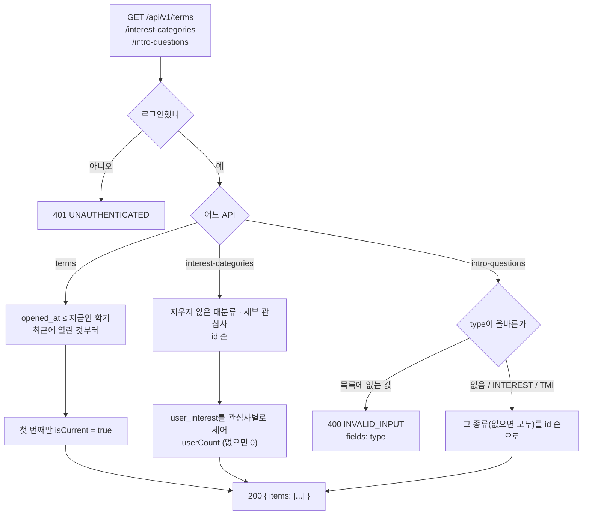
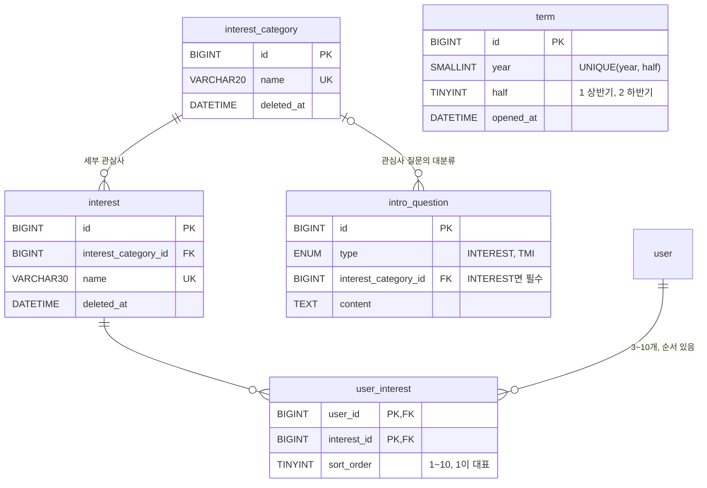

# KAN-43 [BE] 00 목록: 학기 · 관심사 · 자기소개 질문

- Jira: [KAN-43](https://it-ting.atlassian.net/browse/KAN-43)
- 브랜치: `feature/be/KAN-43-common-lists`

## 계획

### 목표

온보딩(03), 내 땅굴(04), 탐색(05), 커뮤니티(08)가 함께 쓰는 목록 API 3개와 그 테이블을 만든다.

- `GET /api/v1/terms` ([API 명세](../api/00-common.md#get-apiv1terms))
- `GET /api/v1/interest-categories` ([API 명세](../api/00-common.md#get-apiv1interest-categories))
- `GET /api/v1/intro-questions` ([API 명세](../api/00-common.md#get-apiv1intro-questions))

범위 밖:
- 관심사 · 답변을 저장하는 API와 `user_answer` 테이블: 03 온보딩(KAN-44)
- 온보딩을 마치지 않은 계정(`ONBOARDING_INCOMPLETE`), 새 학기를 고르지 않은 계정(`NEW_TERM_INCOMPLETE`)을 막는 장치: 03 · 05에서 만든다. 이번 API 3개는 로그인만 확인한다(아래 I)
- 새 학기를 여는 방법(직접 / 날짜에 자동): 명세의 [보류한 결정](../spec/open-issues.md) 그대로 둔다
- 프로필 팝업 `GET /api/v1/users/{userId}/profile`: KAN-45

### 정한 것

| # | 질문 | 정한 답 | 정한 사람 |
|---|---|---|---|
| 1 | 응답 모양 · 주는 순서 · 에러 | `docs/api/00-common.md` 그대로. 학기는 열린 것만 최근 순, 관심사 · 질문은 id 순, `type`이 틀리면 `400 INVALID_INPUT` | API 명세 |
| 2 | 관심사 목록 | 대분류 12개 · 세부 관심사 90개, 명세 [00 공통 5](../spec/00-common.md#5-관심사-태그)의 표 | 명세 |
| 3 | `userCount` | 저장된 `user_interest` 줄 수. 아무도 안 골랐으면 0 | API 명세 |
| 4 | 이번 학기 | 열린 학기 가운데 `opened_at`이 가장 최근인 것 | DB 설계 |
| 5 | 로그인 | 세 API 모두 로그인 필요. `PUBLIC_API`에 넣지 않는다 | API 명세 |
| 6 | 마이그레이션 이름 | `V<yyyyMMdd>_<HHmm>__<설명>.sql` | 사용자 (KAN-42) |
| 7 | 자기소개 질문 비율 | 관심사 질문 60%, TMI 질문 40% | 명세 [11 관리자](../spec/11-admin.md) |

### 이번에 정할 것 (2026-11-23 모두 승인)

| # | 무엇 | 제안 | 까닭 |
|---|---|---|---|
| A | 만들 테이블 | `term`, `interest_category`, `interest`, `user_interest`, `intro_question`. `user_answer`는 03에서 | `userCount`를 세려면 `user_interest`가 있어야 한다. 03은 이 테이블에 쓰기만 하면 된다 |
| B | 관심사 이름 칼럼 | 대분류 `VARCHAR(20) NOT NULL UNIQUE`, 세부 `VARCHAR(30) NOT NULL UNIQUE`(전체에서 유일). 대분류 이름에 이모지는 넣지 않는다("음식·음료") | 가장 긴 이름이 7자 · 12자. 관심사 태그는 대분류 없이 이름만 보여서 겹치면 구분이 안 된다. 아이콘은 프론트엔드가 갖는다(API 명세) |
| C | 관심사를 넣는 순서 | 명세 표의 순서대로 넣어 id 순 = 표 순서(음식·음료 = 1, 맛집탐방 = 1) | API가 id 순으로 주므로 화면이 명세 표와 같아진다 |
| D | 학기 칼럼 | `year SMALLINT NOT NULL`, `half TINYINT NOT NULL CHECK (half IN (1, 2))`, `UNIQUE(year, half)` | `user_profile.generation`처럼 작은 정수 |
| E | 학기 첫 값 | **2026 하반기 하나**를 넣고 `opened_at`은 2026-07-01 00:00(한국 시간). 다음 학기는 열 방법이 정해지면 마이그레이션으로 더한다 | 학기가 없으면 03 온보딩이 땅굴 입구를 놓을 들판이 없다 |
| F | 자기소개 질문 첫 값 | 명세 · Figma 어디에도 문구가 없다. **Claude가 초안 40개**(대분류마다 관심사 질문 2개 = 24개, TMI 16개)를 마이그레이션으로 넣는다. 초안은 아래 [부록](#부록-자기소개-질문-초안)에 있다. 고칠 것은 지금 말해 주거나, 병합 뒤라면 새 마이그레이션으로 고친다 | 온보딩 3의 "추천"은 대분류마다 관심사 질문 2개가 있어야 채워진다. 비워 두면 03을 시험할 수 없다 |
| G | 질문 칼럼 | `type ENUM('INTEREST','TMI') NOT NULL`, `content TEXT NOT NULL`(DB 설계대로), `CHECK`로 `INTEREST`면 대분류 필수 · `TMI`면 비움 | DB 설계의 "`INTEREST`일 때 필수"를 DB가 지키게 |
| H | 패키지 | `term`, `interest`(대분류 · 세부 · `user_interest`), `question` | 이미 `campus`, `generation`이 00 안에서 대상별로 나뉘어 있다 |
| I | "온보딩 중에도", "새 학기를 고르기 전에도" | 막는 장치가 아직 없으니 이번에는 로그인만 확인한다. 03 · 05에서 장치를 만들 때 이 세 주소를 통과 목록에 넣는다(티켓 KAN-44 · 46 설명에 적어 둔다) | 지금 만들면 판단할 테이블(`burrow_entrance`)이 없다 |

### 만들 것

| 파일 | 내용 |
|---|---|
| `db/migration/V20261123_0012__create_term_interest_question.sql` | 테이블 5개, 학기 1개, 대분류 12 · 세부 90, 질문 40 |
| `term/{domain,repository,service,controller,dto}` | `Term`, `GET /terms` |
| `interest/{domain,repository,service,controller,dto}` | `InterestCategory`, `Interest`, `UserInterest`, `GET /interest-categories`(고른 사람 수는 `GROUP BY` 한 번) |
| `question/{domain,repository,service,controller,dto}` | `IntroQuestion`, `IntroQuestionType`, `GET /intro-questions?type=` |
| 문서 | `docs/db/account.md` · `burrow.md`의 미정 칸, `docs/api/00-common.md`의 "구현 단계로 넘기는 것" |

### 테스트

| API | 정상 | 실패 |
|---|---|---|
| `GET /api/v1/terms` | 열린 학기 + 아직 안 열린 학기를 넣음 → 열린 것만 최근 순, 첫 번째만 `isCurrent` | 로그인 없이 → `401 UNAUTHENTICATED` |
| `GET /api/v1/interest-categories` | 12개 · 90개, id 순, 지운 줄 빠짐, 두 사람이 고른 관심사의 `userCount` = 2 | 로그인 없이 → `401 UNAUTHENTICATED` |
| `GET /api/v1/intro-questions` | 전체, `type=TMI`만, `INTEREST`의 `interestCategoryId` | `type=FOO` → `400 INVALID_INPUT`, 로그인 없이 → `401` |

## 부록: 자기소개 질문 초안

관심사 질문 24개(대분류마다 2개):

| 대분류 | 질문 |
|---|---|
| 음식·음료 | 요즘 가장 자주 가는 맛집이나 카페는? / 누군가에게 꼭 해 주고 싶은 나만의 요리는? |
| 스포츠 | 운동을 시작하게 된 계기는? / 같이 해 보고 싶은 운동은? |
| 문화생활 | 최근에 본 것 중 가장 기억에 남는 작품은? / 몇 번이고 다시 보고 싶은 작품은? |
| 게임 | 요즘 빠져 있는 게임은? / 같이 하자고 권하고 싶은 게임은? |
| 음악·댄스 | 요즘 가장 많이 듣는 노래는? / 꼭 가 보고 싶은 공연이나 무대는? |
| 아웃도어 | 가장 기억에 남는 여행지는? / 다음에 꼭 가 보고 싶은 곳은? |
| 외국어·자기계발 | 요즘 새로 배우고 있는 것은? / 올해 꼭 이루고 싶은 목표는? |
| 책·글 | 인생 책이나 인생 웹툰은? / 요즘 읽고 있는 것은? |
| 사진·영상 | 가장 아끼는 사진 한 장에 담긴 이야기는? / 꼭 찍어 보고 싶은 장면은? |
| 미술·수공예 | 직접 만들어 본 것 가운데 가장 뿌듯한 것은? / 도전해 보고 싶은 만들기는? |
| 덕질·수집 | 가장 아끼는 소장품은? / 덕질을 시작하게 된 계기는? |
| 반려동물·식물 | 함께 사는 반려동물이나 식물을 소개해 주세요 / 키워 보고 싶은 동물이나 식물은? |

TMI 질문 16개:

1. 최근에 산 것 가운데 가장 잘 산 것은?
2. 아침형 인간? 저녁형 인간?
3. 나만 아는 우리 동네 숨은 명소는?
4. 스트레스를 푸는 나만의 방법은?
5. 요즘 가장 자주 먹는 메뉴는?
6. 내 MBTI가 딱 맞다고 느낀 순간은?
7. 휴일 하루를 마음대로 쓸 수 있다면?
8. 어릴 때 꿈은?
9. 요즘 나를 웃게 하는 것은?
10. 가장 좋아하는 계절과 그 까닭은?
11. SSAFY에서 가장 기억에 남는 순간은?
12. 개발하면서 생긴 나만의 습관은?
13. 나를 한 단어로 표현한다면?
14. 요즘 휴대폰에서 가장 많이 쓰는 앱은?
15. 최근에 새로 알게 된 재미있는 사실은?
16. 다른 사람이 잘 모르는 나의 반전 매력은?

## 결과

### 한눈에 보기

새로 만든 테이블은 다섯 개 모두이고, 이 API는 읽기만 한다. `user`는 이미 있는 테이블(V3)이고 `user_interest`가 참조만 한다.

### 바꾼 것

| 파일 | 내용 |
|---|---|
| `db/migration/V20261123_0012__create_term.sql` | `term`, 학기 2026 하반기 |
| `db/migration/V20261123_0036__create_interest.sql` | `interest_category`, `interest`, `user_interest`, 대분류 12 · 세부 관심사 90 |
| `db/migration/V20261123_0037__create_intro_question.sql` | `intro_question`(대분류를 참조하므로 관심사보다 뒤), 질문 40 |
| `term/` | `Term`, `TermRepository`, `TermService`(시계 기준으로 열린 학기), `TermController`, `TermListResponse` |
| `interest/` | `InterestCategory`, `Interest`, `UserInterest`(복합 키, 03이 쓸 `create`), 저장소 3개 + `InterestUserCount`, `InterestService`, `InterestCategoryController`, `InterestCategoryListResponse` |
| `question/` | `IntroQuestion`, `IntroQuestionType`, `IntroQuestionRepository`, `IntroQuestionService`, `IntroQuestionController`, `IntroQuestionListResponse` |
| 테스트 | `TermApiTests` 4, `InterestCategoryApiTests` 5, `IntroQuestionApiTests` 5 |
| `docs/db/account.md`, `docs/db/burrow.md` | 미정 칸(이름 · 학기 칼럼 타입), CHECK, 처음 값 |
| `docs/api/00-common.md` | 응답 예시를 실제 처음 값으로, "구현하며 정한 것" 절 추가, 넘긴 것에서 순서 항목 뺌 |

### 확인한 것

- `./gradlew build` 통과. 테스트 128개(기존 114 + 새 14)
- `git merge-tree --write-tree HEAD origin/dev`: 충돌 없음
- 로컬 코드 리뷰: P0 0건, P1 0건. 학기를 여는 시각과 같은 순간을 "열림"으로 셈을 API 명세 문구에 맞춤
- 첫 빌드에서 새 테스트 3건 실패(테스트의 JSON 비교 방식과 기대 예외 타입 잘못). 테스트만 고침
- Swagger 호출 결과 6건(API마다 정상 1, 실패 1)을 PR #26 본문 "호출 결과"에 넣음

### 계획과 달라진 점

- 마이그레이션 번호가 계획의 `V20261122_2348`에서 실제로 파일을 만든 시각 `V20261123_0012`로 바뀌었다(KAN-42 규칙).
- 계획은 마이그레이션 하나였으나, Codex 리뷰 P1(한 마이그레이션은 자기 영역의 테이블만)에 따라 학기 · 관심사 · 질문 세 파일로 나눴다. 질문은 관심사 대분류를 참조하므로 관심사보다 뒤의 시각이다.
- `user_interest.sort_order`에 `CHECK (1 ~ 10)`를 더했다. 계획에는 없었고 DB 설계의 "3 ~ 10개, 1이 대표"를 DB가 지키게 한 것이다.
- 계획 I에서 "KAN-44 · 46 설명에 적는다"고 했으나, 막는 장치는 이미 KAN-44의 "함께 할 것"이라 KAN-44 설명에만 적었다. 이 PR이 만든 테이블 목록도 함께 적었다.
- `docs/api/00-common.md`의 관심사 · 질문 응답 예시를 실제 처음 값(id)으로 바꿨다.
- 호출 결과를 찍다가 Swagger 응답 예시(`@Schema(example)`)의 질문이 `TMI`인데 대분류 id가 있는 것을 보고, 세 API의 예시를 실제 처음 값으로 맞췄다.

### 남은 일

- 온보딩 · 새 학기를 마치지 않은 계정을 막는 장치와 그때 세 API를 통과시키는 것: KAN-44
- 다음 학기를 여는 방법(보류한 결정). 정해지기 전에는 새 마이그레이션으로 학기를 더한다
- 자기소개 질문 문구는 초안이다. 팀이 고치면 새 마이그레이션으로 바꾼다

### 검토 순서

1. `docs/api/00-common.md`의 "구현하며 정한 것", `docs/db/account.md` · `burrow.md`
2. 마이그레이션 `V20261123_0012__create_term.sql`, `V20261123_0036__create_interest.sql`, `V20261123_0037__create_intro_question.sql`(특히 질문 초안)
3. `term` → `interest` → `question` 패키지(컨트롤러 → 서비스 → 저장소 → 엔티티)
4. 테스트 3개
