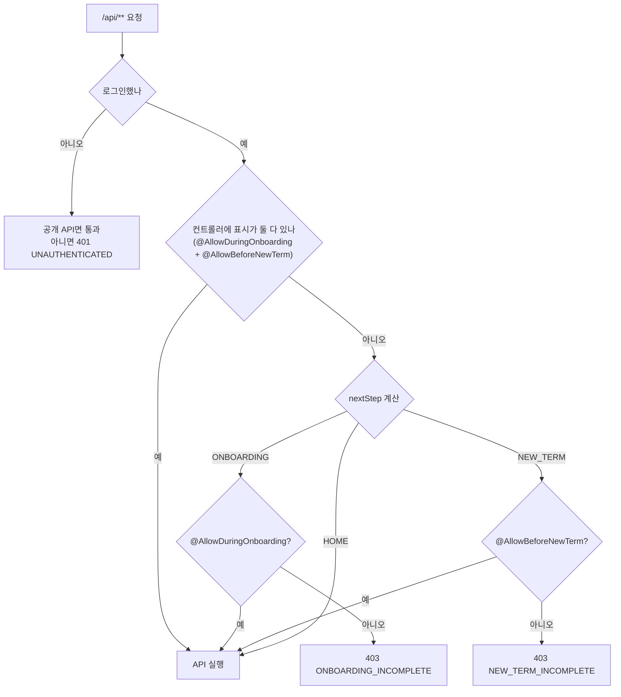
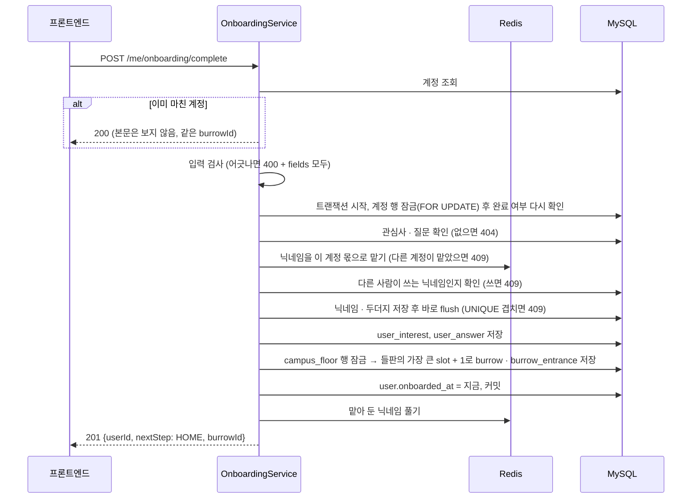
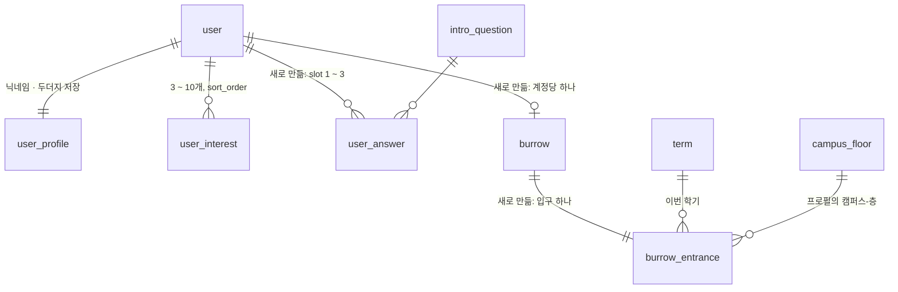

# KAN-44 [BE] 03 온보딩: 닉네임 확인 · 온보딩 확정

- Jira: [KAN-44](https://it-ting.atlassian.net/browse/KAN-44)
- 브랜치: `feature/be/KAN-44-onboarding`

## 계획

### 목표

온보딩에서 정한 닉네임 · 두더지 · 관심사 · 자기소개를 저장하고 땅굴을 만든다. 함께 `nextStep`의 `NEW_TERM`을 계산하고, 온보딩이나 새 학기 선택을 마치지 않은 계정이 다른 API를 부르지 못하게 막는다.

- `POST /api/v1/nicknames/check` ([API 명세](../api/03-onboarding.md#post-apiv1nicknamescheck))
- `POST /api/v1/me/onboarding/complete` ([API 명세](../api/03-onboarding.md#post-apiv1meonboardingcomplete))
- `nextStep`의 `NEW_TERM`, `403 ONBOARDING_INCOMPLETE` · `403 NEW_TERM_INCOMPLETE` ([API 명세](../api/02-auth.md#다음에-갈-화면))

범위 밖:
- 새 학기에 땅굴을 옮기는 `POST /api/v1/me/burrow/move`: KAN-46. 이번에는 `NEW_TERM`을 계산하고 막기만 한다
- 내 정보 수정에서 닉네임을 바꿀 때 맡아 둔 닉네임을 지우는 일: KAN-45. 이번에는 지우는 메서드만 만든다
- 온보딩 3의 추천 질문 고르기(API 명세 "구현 단계로 넘기는 것" 2번): 프론트엔드가 고른다. 서버 일이 아니다
- 땅굴 무드, 가구, 미리보기: 프론트엔드가 그린다(API 명세)

### 정한 것

| # | 질문 | 정한 답 | 정한 사람 |
|---|---|---|---|
| 1 | 요청 · 응답 · 에러 | `docs/api/03-onboarding.md` 그대로. 닉네임 확인은 `200`과 `expiresAt`, 확정은 처음이면 `201`, 다시 부르면 `200`이고 `data`는 `{userId, nextStep: HOME, burrowId}` | API 명세 |
| 2 | 저장하는 때 | 확정 API 한 번에 한 트랜잭션으로. 그 전에는 DB에 아무것도 남기지 않는다 | DB 설계 A4 |
| 3 | 다시 부른 확정 | `onboarded_at`이 있으면 본문을 보지 않고 지금 값으로 `200`. 계정 행을 잠근 뒤 다시 확인해 땅굴이 둘 생기지 않게 한다 | API 명세, DB 설계 |
| 4 | 닉네임 맡아 두기 | Redis에 5분. 다른 계정이 맡았으면 `409 NICKNAME_DUPLICATED`, 한 계정은 하나만, 같은 닉네임을 다시 확인하면 5분을 새로 센다, 저장하면 지운다 | API 명세 |
| 5 | 두더지 아이템 코드 | 영어 대문자 · 숫자 · 밑줄, 30자 이하. 모양만 본다. "없음"은 `null` | API 명세 |
| 6 | 관심사 · 답변 | 관심사 3 ~ 10개, 겹치지 않음, 지우지 않은 세부 관심사, 순서대로 `sort_order` 1부터. 답변 정확히 3개, 질문 겹치지 않음, 10 ~ 50자, 순서대로 `slot` 1 ~ 3. 관심사 질문이 내 관심사의 대분류인지는 보지 않는다 | API 명세 |
| 7 | `nextStep` | `onboarded_at`이 없으면 `ONBOARDING`. 있으면 내 땅굴 입구의 `term_id`가 이번 학기인지 보고 아니면 `NEW_TERM`, 맞으면 `HOME` | API 명세 02 |
| 8 | 이번 학기 | 열린 학기 가운데 `opened_at`이 가장 최근인 것 | DB 설계, KAN-43 |
| 9 | 테이블 | `user_answer`(`PK(user_id, slot)`, `UNIQUE(user_id, intro_question_id)`), `burrow`(`user_id` UNIQUE), `burrow_entrance`(`burrow_id` UNIQUE, `UNIQUE(term_id, campus_floor_id, slot)`) | DB 설계 |
| 10 | 여러 영역을 한 API에서 쓰는 것 | 확정 API는 프로필 · 관심사 · 답변 · 땅굴 · 입구 · 계정을 함께 쓴다. API 명세의 "확정 API 하나로 저장"과 DB 설계 A4에 까닭이 적혀 있다 | API 명세 |
| 11 | 마이그레이션 이름 | `V<yyyyMMdd>_<HHmm>__<설명>.sql`, 영역마다 파일 하나 | 사용자 (KAN-42, KAN-43) |

### 이번에 정할 것 (2026-11-23 모두 승인)

| # | 무엇 | 제안 | 까닭 |
|---|---|---|---|
| A | 닉네임에 쓸 수 있는 문자와 공백 | 앞뒤 공백은 지우고 본다. 지운 뒤 1 ~ 12자이고 **한글(완성된 글자) · 영어 · 숫자만** 쓴다. 가운데 공백, 특수문자, 이모지, `ㅋㅋ` 같은 낱자는 `400 INVALID_INPUT`. 영어 대소문자는 같은 닉네임으로 본다(`Mole`이 있으면 `mole`은 `409`) | 다른 사람에게 보이는 이름이라 흉내 내기 쉬운 공백 · 특수문자를 막는다. 대소문자는 DB 정렬 규칙(`utf8mb4_0900_ai_ci`)이 이미 같은 값으로 보므로 맡아 두기도 같게 맞춘다 |
| B | 막을 때 통과시키는 API | **온보딩 중**: 02 로그인 API 전부(로그아웃, `GET /me` 등), 로그인 없이 부르는 API, 닉네임 확인, 확정, 학기 · 관심사 · 질문 목록. **새 학기 고르기 전**: 02 로그인 API 전부, 로그인 없이 부르는 API, 학기 · 관심사 · 질문 목록(이사 API는 KAN-46에서 더함). 나머지는 각각 `403`. `docs/api/00-common.md` 표의 세 목록을 "필요(온보딩 중에도 · 새 학기를 고르기 전에도)"로 고친다 | KAN-43과 티켓 설명에서 세 목록은 "막지 않는다"고 했는데 표에는 한쪽만 적혀 있다. 셋 다 읽기만 하는 기준 목록이라 열어도 문제가 없다 |
| C | 막는 방법 | 컨트롤러에 `@AllowDuringOnboarding`, `@AllowBeforeNewTerm`을 붙인 API만 통과시키고, 붙이지 않은 API는 모두 막는다(로그인한 요청에만). `AGENTS.md`의 로그인 규칙에 한 줄 더한다 | 새 API를 만들 때 잊어도 막히는 쪽이 안전하다. 문서의 "온보딩 중에도"와 이름을 맞춰 찾기 쉽게 한다 |
| D | 열린 학기가 하나도 없을 때 확정 | 아무것도 저장하지 않고 `500 INTERNAL_ERROR`, 서버 로그에 남긴다. 이때 `nextStep`은 온보딩을 마쳤으면 `HOME` | 2026 하반기가 마이그레이션에 들어 있어 운영에서는 생기지 않는다. 입구는 학기가 꼭 있어야 하므로 만들 수 없다 |
| E | 입구 자리 번호 | 그 들판(학기 + 캠퍼스-층)의 가장 큰 번호 + 1. 빈 자리는 다시 쓰지 않는다. 동시에 확정하면 그 캠퍼스-층 행을 잠가(`SELECT ... FOR UPDATE`) 차례로 번호를 준다. KAN-46 이사도 같은 잠금을 쓴다 | DB 설계의 "놓인 순서대로". 잠그면 번호가 겹치지 않아 다시 고를 일이 없다. 같은 층의 확정만 줄을 서므로 느려질 일이 적다 |
| F | 닉네임 확인을 너무 자주 부를 때 | 이번에는 제한하지 않는다 | 로그인한 사람만 부르고, Redis 조회 한 번이라 가볍다. 문제가 보이면 그때 더한다 |
| G | 패키지 | `onboarding`(확정 API), `user`(닉네임 확인 · 맡아 두기, `NICKNAME_DUPLICATED`), `burrow`(`Burrow`, `BurrowEntrance`), `question`(`UserAnswer`, KAN-43의 `UserInterest`가 `interest`에 있는 것과 같게). 막는 장치는 `global/security` | 닉네임 확인은 04 내 정보 수정도 쓴다. 에러 코드 `INTEREST_NOT_FOUND`는 `interest`, `INTRO_QUESTION_NOT_FOUND`는 `question`에 둔다 |

### 만들 것

| 파일 | 내용 |
|---|---|
| `db/migration/V20261123_<시각>__create_user_answer.sql` | `user_answer`. `slot IN (1,2,3)`, 답변 길이 CHECK |
| `db/migration/V20261123_<시각>__create_burrow.sql` | `burrow`, `burrow_entrance` |
| `question/domain/UserAnswer`, `question/domain/IntroQuestionErrorCode` | 답변 엔티티, `INTRO_QUESTION_NOT_FOUND` |
| `interest/domain/InterestErrorCode` | `INTEREST_NOT_FOUND` |
| `burrow/{domain,repository}` | `Burrow`, `BurrowEntrance`, 들판의 가장 큰 자리 번호 조회 |
| `user/{controller,service,repository,dto}` | `POST /nicknames/check`, Redis 맡아 두기(Lua 스크립트로 한 번에 확인 · 풀기 · 맡기), `UserErrorCode.NICKNAME_DUPLICATED` |
| `onboarding/{controller,service,dto}` | `POST /me/onboarding/complete`. 계정 잠금 → 완료 확인 → 입력 검사 → 관심사 · 질문 확인 → 맡아 두기 확인 → 저장 → 커밋 뒤 맡아 둔 닉네임 지우기 |
| `auth/service/NextStepService` | `NEW_TERM` 계산. `GET /me`와 로그인(`POST /sessions`)이 이것을 쓴다 |
| `global/security/{AllowDuringOnboarding,AllowBeforeNewTerm,AccountStepInterceptor}` | 막는 장치. `AuthErrorCode`에 `ONBOARDING_INCOMPLETE`, `NEW_TERM_INCOMPLETE` |
| 기존 컨트롤러 | 02 로그인 API, 캠퍼스 · 기수, 학기 · 관심사 · 질문 목록에 위 표시를 붙인다 |
| 문서 | `docs/api/03-onboarding.md`(구현 단계 항목, 닉네임 규칙), `docs/api/00-common.md`(B), `docs/api/02-auth.md`(KAN-38에서 미룬 `NEW_TERM`), `docs/db/account.md` · `burrow.md`, `AGENTS.md`(C) |

### 테스트

| API | 정상 | 실패 |
|---|---|---|
| `POST /api/v1/nicknames/check` | 쓸 수 있음 → `200`과 `expiresAt`. 같은 닉네임을 다시 확인 → `200`. 다른 닉네임을 확인하면 앞의 것이 풀려 다른 사람이 쓸 수 있음. 내 지금 닉네임 → `200` | 다른 계정이 맡음 · 쓰는 중 · 대소문자만 다름 → `409 NICKNAME_DUPLICATED`. 13자, 특수문자, 빈 값 → `400 INVALID_INPUT`. 로그인 없이 → `401` |
| `POST /api/v1/me/onboarding/complete` | 처음 → `201`, DB에 프로필 · 관심사 순서 · 답변 자리 · 땅굴 · 입구(이번 학기, 내 캠퍼스-층, 자리 1) · `onboarded_at`, 맡아 둔 닉네임 지워짐. 다시 부름(본문이 틀려도) → `200`과 같은 `burrowId`. 같은 층에서 둘이 확정 → 자리 1 · 2 | 관심사 2개 + 짧은 답변 → `400`과 `fields` 둘. 지운 관심사 → `404 INTEREST_NOT_FOUND`. 없는 질문 → `404 INTRO_QUESTION_NOT_FOUND`. 다른 계정이 맡은 · 쓰는 닉네임 → `409 NICKNAME_DUPLICATED`, 아무것도 저장 안 됨. 열린 학기 없음 → `500`. 로그인 없이 → `401` |
| 막는 장치 | 온보딩 중에 관심사 목록 · `GET /me` → `200`. 새 학기 고르기 전에 학기 목록 → `200` | 온보딩 중에 표시 없는 API(테스트용 컨트롤러) → `403 ONBOARDING_INCOMPLETE`. 새 학기 고르기 전에 닉네임 확인 · 표시 없는 API → `403 NEW_TERM_INCOMPLETE` |
| `GET /api/v1/me`, 로그인 | 확정 뒤 `HOME`. 더 늦게 연 학기를 넣으면 `NEW_TERM` | |

## 결과

### 한눈에 보기

로그인한 요청이 지나가는 길(막는 장치):

온보딩 확정의 순서:

새로 만든 테이블은 `user_answer`, `burrow`, `burrow_entrance`다. `user`, `user_profile`, `user_interest`, `intro_question`, `interest`, `term`, `campus_floor`는 이미 있던 테이블이다(`user_profile` · `user` · `user_interest`는 쓰기, 나머지는 읽기와 참조).

### 바꾼 것

| 파일 | 내용 |
|---|---|
| `db/migration/V20261123_1353__create_user_answer.sql` | `user_answer`. `PK(user_id, slot)`, `UNIQUE(user_id, intro_question_id)`, slot 1 ~ 3과 답변 10 ~ 50자 CHECK |
| `db/migration/V20261123_1354__create_burrow.sql` | `burrow`(`user_id` UNIQUE), `burrow_entrance`(`burrow_id` UNIQUE, `UNIQUE(term_id, campus_floor_id, slot)`, `slot >= 1`) |
| `burrow/{domain,repository,service}` | `Burrow`, `BurrowEntrance`, `BurrowService.createBurrow`(캠퍼스-층 잠금 → 가장 큰 번호 + 1). KAN-46 이사도 같은 잠금을 쓴다 |
| `question/domain/{UserAnswer,IntroQuestionErrorCode}`, `question/repository/UserAnswerRepository` | 답변 엔티티, `INTRO_QUESTION_NOT_FOUND` |
| `interest/domain/InterestErrorCode` | `INTEREST_NOT_FOUND` |
| `user/{controller,service,repository,dto}` | `POST /nicknames/check`, `NicknameHoldRepository`(Lua로 확인 · 풀기 · 맡기를 한 번에), `@Nickname` 규칙, `UserErrorCode.NICKNAME_DUPLICATED`. `User.completeOnboarding`, `UserProfile.completeOnboarding`, 계정 잠금 조회 |
| `onboarding/{controller,service,dto}` | `POST /me/onboarding/complete`. 완료 여부를 본 뒤 입력 검사, 한 트랜잭션으로 저장, 커밋 뒤 맡아 둔 닉네임 풀기 |
| `auth/service/NextStepService`, `auth/domain/NextStep` | `NEW_TERM` 계산. `NextStep.of`를 없애고 로그인 · 내 계정이 이 서비스를 쓴다 |
| `term/{repository,service}` | 이번 학기 id 조회 |
| `global/security/{AllowDuringOnboarding,AllowBeforeNewTerm,AccountStepInterceptor,AccountStepConfig}` | 막는 장치. `AuthErrorCode`에 `ONBOARDING_INCOMPLETE`, `NEW_TERM_INCOMPLETE` |
| 기존 컨트롤러 11개 | 02 로그인 API, 캠퍼스 · 기수, 학기 · 관심사 · 질문 목록에 두 표시 |
| `global/error/BusinessException` | `invalidInput(List)` 더함(어긋난 필드 여럿) |
| 테스트 | `OnboardingApiTests`, `OnboardingConcurrencyTests`, `NicknameApiTests`, `AccountStepApiTests`, 지원 `OnboardingSteps`, `AccountStepSampleController` |
| 문서 | `docs/api/03-onboarding.md`(닉네임 규칙, 200, 입구 번호, 구현하며 정한 것), `00-common.md`(세 목록 둘 다 허용), `02-auth.md`(막는 범위, `NEW_TERM`), `docs/db/account.md` · `burrow.md`, `AGENTS.md`(표시 규칙과 리뷰 P1 한 줄) |

### 확인한 것

- `./gradlew build` 통과. 테스트 169개(기존 128 + 새 41)
- 동시성: 같은 층에서 4명이 동시에 확정해도 자리 번호가 겹치지 않음, 같은 계정이 동시에 두 번 확정해도 땅굴 하나(`OnboardingConcurrencyTests`, 실제 커밋)
- `git merge-tree --write-tree HEAD origin/dev`: 충돌 없음
- 로컬 코드 리뷰: P0 0건, P1 0건
- Codex 리뷰(PR #29): P1 2건 고침(답변 길이를 문자 단위로, 확정이 닉네임을 맡은 뒤 저장)

### 계획과 달라진 점

- **입구 번호를 정하는 읽기도 잠그는 읽기로**: 캠퍼스-층 행만 잠그면 MySQL의 반복 읽기 때문에 트랜잭션이 처음 읽은 때의 값으로 가장 큰 번호를 볼 수 있다. 가장 큰 번호도 `FOR UPDATE`로 읽어 지금 커밋된 값을 보게 했다.
- **닉네임 겹침을 미리 한 번 더 본다**: 계획은 DB UNIQUE로만 알아채는 것이었다. 저장 전에 `existsBy...`로 먼저 보고, 그 사이 끼어든 경우만 UNIQUE로 잡는다. 결과(`409`)는 같다.
- **확정을 다시 부를 때 계정이 없거나 탈퇴했으면 `401 UNAUTHENTICATED`**: 문서에 없던 경우라 `GET /me`와 같게 했다.
- **새 학기를 고르지 않은 계정의 온보딩 API**: 표시 규칙대로 닉네임 확인과 확정 모두 `403 NEW_TERM_INCOMPLETE`다. 확정을 다시 부르는 것은 방금 온보딩을 마친 사람이라 이번 학기에 있으므로 실제로는 생기지 않는다. `02-auth.md`에 "온보딩 API도 부를 수 없다"고 적었다.
- **입력 오류의 `fields` 순서**: 여러 개일 때 `field` 이름 순으로 준다. 테스트와 문서가 같은 결과를 보게 하려는 것이다.

PR #29의 Codex 리뷰 P1 2건을 고쳤다.

- **답변 길이를 문자 단위로 센다**: `@Size`는 UTF-16 단위라 이모지 5개(10단위)가 검사를 통과한 뒤 DB의 `CHAR_LENGTH` CHECK에 걸려 `500`이 났다. `global/validation/CodePointLength`로 DB와 같이 문자 수로 센다. 이모지 5개는 `400`, 30개는 저장된다.
- **확정이 닉네임을 맡은 뒤 저장한다**: 확정이 맡아 두기를 보기만 해서, 저장하고 커밋하기 전 사이에 다른 계정이 같은 닉네임을 확인해 `200`을 받고 나중에 `409`를 받을 수 있었다. 확정도 닉네임 확인과 같은 Lua 스크립트로 맡은 뒤 DB를 보고, 커밋한 뒤 푼다. 저장에 실패하면 맡은 채로 두고 5분 뒤 풀린다.

### 남은 일

- 새 학기 이사 `POST /api/v1/me/burrow/move`(KAN-46): `@AllowBeforeNewTerm`을 붙이고, 입구 번호는 `BurrowService`와 같은 잠금을 쓴다
- 내 정보 수정의 닉네임 변경(KAN-45): 같은 `@Nickname` 규칙, 저장 전 `NicknameService.assertNotHeldByOther`, 저장 뒤 `release`. `docs/api/04-my-burrow.md`의 닉네임 설명도 이 규칙으로 맞춘다
- Swagger 호출 스크린샷과 응답 텍스트는 PR을 만들 때 남긴다(스킬 `api-evidence`)

### 검토 순서

1. `docs/api/03-onboarding.md`의 닉네임 규칙 · 구현하며 정한 것, `docs/api/02-auth.md`의 막는 범위
2. 마이그레이션 2개 → `burrow/domain`, `question/domain/UserAnswer`
3. `global/security/AccountStepInterceptor` → `auth/service/NextStepService`
4. `user/controller/NicknameController` → `NicknameService` → `NicknameHoldRepository`(Lua)
5. `onboarding/controller/OnboardingController` → `OnboardingService` → `burrow/service/BurrowService`
6. 테스트: `OnboardingApiTests`, `NicknameApiTests`, `AccountStepApiTests`, `OnboardingConcurrencyTests`
