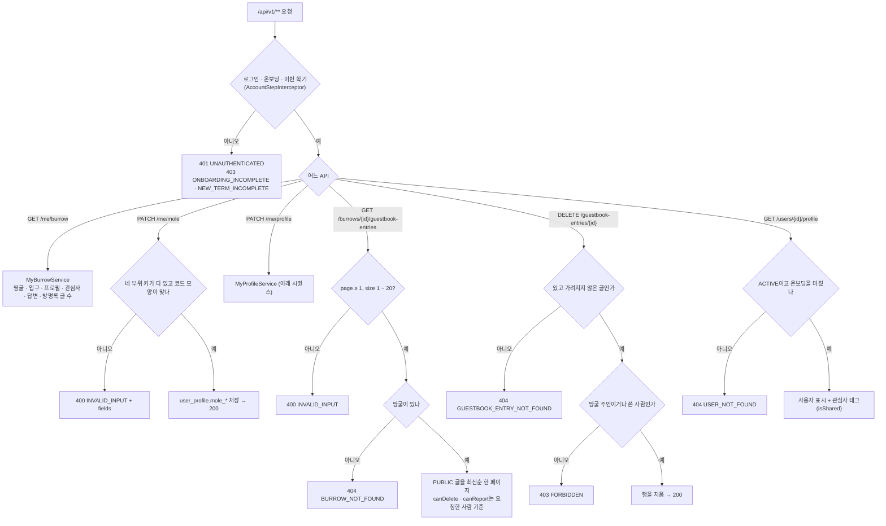
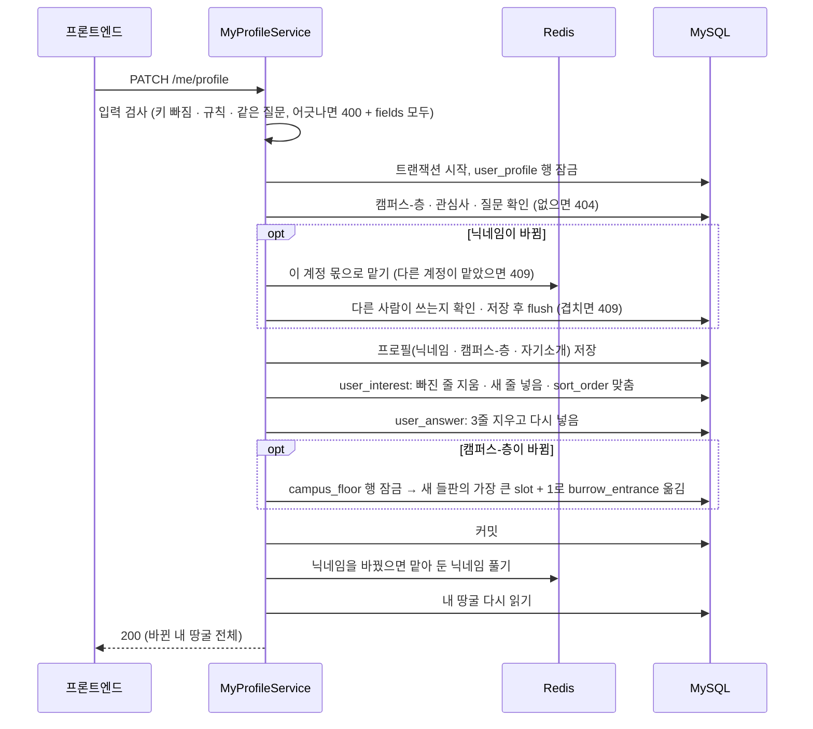
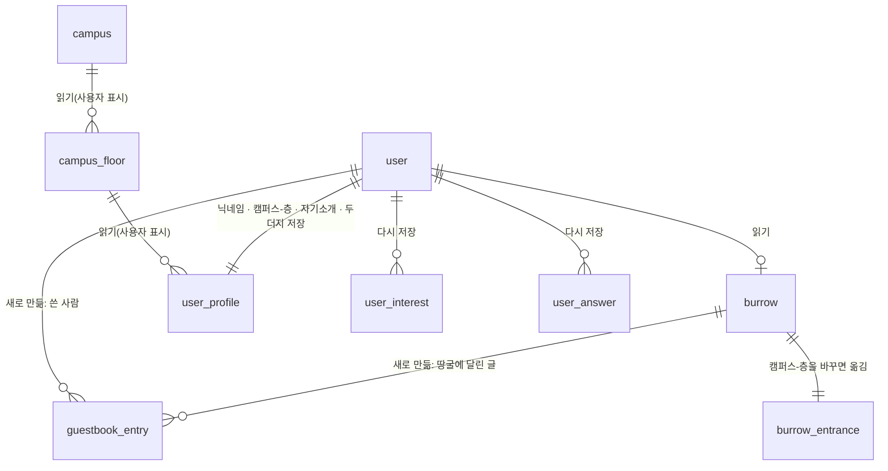

# KAN-45 [BE] 04 내 땅굴 + 00 프로필 팝업

- Jira: [KAN-45](https://it-ting.atlassian.net/browse/KAN-45)
- 브랜치: `feature/be/KAN-45-my-burrow`

## 계획

### 목표

내 땅굴을 보여 주고, 두더지와 내 정보를 바꾸고, 방명록을 읽고 지우는 API와 다른 사람의 프로필 팝업 API를 만든다. 방명록 테이블 `guestbook_entry`를 이 작업에서 만든다.

- `GET /api/v1/me/burrow` ([API 명세](../api/04-my-burrow.md#get-apiv1meburrow))
- `PATCH /api/v1/me/mole` ([API 명세](../api/04-my-burrow.md#patch-apiv1memole))
- `PATCH /api/v1/me/profile` ([API 명세](../api/04-my-burrow.md#patch-apiv1meprofile))
- `GET /api/v1/burrows/{burrowId}/guestbook-entries` ([API 명세](../api/04-my-burrow.md#get-apiv1burrowsburrowidguestbook-entries))
- `DELETE /api/v1/guestbook-entries/{guestbookEntryId}` ([API 명세](../api/04-my-burrow.md#delete-apiv1guestbook-entriesguestbookentryid))
- `GET /api/v1/users/{userId}/profile` ([API 명세](../api/00-common.md#get-apiv1usersuseridprofile))

범위 밖:
- 방명록 쓰기 `POST`: 05 탐색 ② 티켓. 이번에는 테이블과 엔티티만 만들고, 테스트는 저장소로 글을 직접 넣는다
- 단골(`regular_burrow`) 테이블: 05 탐색 티켓. `regularCount`는 테이블이 생길 때까지 0으로 준다(아래 B)
- 방명록 신고 · 가리기(08), 새 글 알림(09), 탈퇴할 때 방명록 정리(10): 각 티켓. 이번에는 `status`가 `HIDDEN`인 글을 빼고 보여 주는 것까지만 한다
- 프로필 사진 올리기: 명세의 보류한 결정. `profileImageUrl`은 저장된 값(지금은 늘 `null`)을 그대로 준다

### 정한 것

| # | 질문 | 정한 답 | 정한 사람 |
|---|---|---|---|
| 1 | 요청 · 응답 · 에러 | `docs/api/04-my-burrow.md`, `docs/api/00-common.md` 그대로 | API 명세 |
| 2 | 막는 범위 | 여섯 API 모두 표시를 붙이지 않는다. 온보딩 중이면 `403 ONBOARDING_INCOMPLETE`, 새 학기를 고르기 전이면 `403 NEW_TERM_INCOMPLETE` | API 명세, KAN-44 |
| 3 | 저장 API가 받는 값 | 두더지는 네 부위, 내 정보는 다섯 값을 모두 받는다. 키가 하나라도 빠지면 `400 INVALID_INPUT`이고 `fields`에 빠진 것을 담는다. `null`은 "없음"(두더지) · "비움"(자기소개)이다 | API 명세 |
| 4 | 닉네임 규칙 | 온보딩과 같다(`@Nickname`: 앞뒤 공백 지움, 한글 · 영어 · 숫자 1 ~ 12자, 대소문자 무시). 지금 닉네임과 다를 때만 `NicknameService.holdForSave` → DB 겹침 확인 → 저장 → 커밋 뒤 `release` | KAN-44 A, 남은 일 |
| 5 | 두더지 아이템 코드 | 영어 대문자 · 숫자 · 밑줄, 30자 이하. 모양만 본다 | KAN-44, API 명세 03 |
| 6 | 관심사 · 답변 | 온보딩과 같은 검사(관심사 3 ~ 10개 · 겹침 없음 · 지우지 않은 것, 답변 정확히 3개 · 질문 겹침 없음 · 10 ~ 50자 문자 단위). 관심사 질문이 내 관심사의 대분류인지 보지 않는다 | API 명세, KAN-44 |
| 7 | 캠퍼스-층을 바꿀 때 입구 | 이번 학기의 새 층 들판으로 옮긴다. 자리 번호는 KAN-44와 같이 그 캠퍼스-층 행을 잠근 뒤 가장 큰 번호 + 1, 빈 번호는 다시 쓰지 않는다. 그래서 API 명세 8번의 "번호를 다시 골라 저장"은 생기지 않는다(문서를 고친다) | DB 설계, KAN-44 E |
| 8 | 여러 테이블을 한 API에서 쓰는 것 | `PATCH /me/profile`은 프로필 · 관심사 · 답변 · 입구를 한 트랜잭션으로 쓴다. 명세 04 내 정보 수정 2(저장하면 땅굴이 새 들판으로 옮겨짐)와 API 명세의 "캠퍼스-층을 저장할 때"에 정해져 있다 | 명세, API 명세 |
| 9 | 방명록 목록 · 삭제 | 최신순(`created_at` 늦은 것, 같으면 id 큰 것), 한 페이지 5개, `HIDDEN`은 목록 · 글 수 · 삭제에서 뺀다. 주인은 모든 글, 쓴 사람은 자기 글만 지운다. 아니면 `403 FORBIDDEN` | API 명세 |
| 10 | 프로필 팝업 | `ACTIVE`이고 온보딩을 마친 사람만. 탈퇴 · 가입 중 · 없는 사람은 `404 USER_NOT_FOUND`. 자기 자신은 `isShared`가 모두 `false` | API 명세 00 |
| 11 | `guestbook_entry` 테이블 | DB 설계 그대로(`content VARCHAR(50)`, `status ENUM('PUBLIC','HIDDEN')`, `created_at` · `updated_at`). 미정 칸 없음 | DB 설계 |
| 12 | 마이그레이션 이름 | `V<yyyyMMdd>_<HHmm>__create_guestbook_entry.sql` | KAN-42 |

### 이번에 정할 것 (2026-11-23 모두 제안대로 승인)

| # | 무엇 | 제안 | 까닭 |
|---|---|---|---|
| A | 방명록 목록의 `page` · `size` 범위 (API 명세 "구현 단계로 넘기는 것" 1) | `page`는 1 이상, `size`는 1 ~ 20. 어긋나면 `400 INVALID_INPUT`과 `fields`. 글이 있는 페이지를 넘으면 `items: []`와 실제 `totalItems` · `totalPages`로 `200` | 화면은 5개씩만 쓴다. 너무 큰 `size`로 한 번에 다 읽지 못하게 막고, 마지막 글을 지운 뒤 지금 페이지를 다시 불러도 오류가 나지 않게 한다 |
| B | 단골 수 `regularCount` | `regular_burrow` 테이블이 생길 때(05 탐색 티켓)까지 늘 `0`을 준다. 응답 모양은 명세 그대로 두고, 그 티켓에서 세는 코드로 바꾼다(코드에 표시) | 남의 영역 테이블을 이 PR에서 미리 만들지 않는다. 지금은 단골을 담는 API가 없어 실제 값도 0이다 |
| C | 자기소개의 공백 | 앞뒤 공백을 지운다. 지운 뒤 비면 `null`로 저장한다(공백만 보낸 것도 "비움"). 줄바꿈은 그대로 둔다. 150자는 답변처럼 문자 단위로 센다(이모지 1자) | 공백뿐인 자기소개가 "아직 작성한 자기소개가 없어요" 대신 빈 칸으로 보이지 않게 한다. 답변과 세는 법을 맞춘다 |
| D | 패키지 | `burrow`: 내 땅굴 조회(`MyBurrowController` · `MyBurrowService`), 입구 옮기기(`BurrowService.moveEntrance`). `user`: 두더지 · 내 정보 저장(`MyProfileController`), 프로필 팝업(`UserProfileController`), 함께 쓰는 사용자 표시(`UserSummaryResponse` · `UserSummaryService`, 결과에서 KAN-51의 `UserDisplay*`로 바꿈). `interest`: 관심사 태그(`InterestTagResponse`). `guestbook`: 방명록 엔티티 · 목록 · 삭제, `GuestbookErrorCode`(`GUESTBOOK_ENTRY_NOT_FOUND`). `BURROW_NOT_FOUND`는 `burrow`의 `BurrowErrorCode`, `USER_NOT_FOUND`는 `UserErrorCode` | 저장 대상이 `user_profile`인 API는 `user`에, 땅굴을 읽는 API는 `burrow`에 둔다. 사용자 표시는 방명록 · 모임 · 채팅이 모두 쓰므로 한 곳에서 만든다 |

### 만들 것

| 파일 | 내용 |
|---|---|
| `db/migration/V20261123_<시각>__create_guestbook_entry.sql` | `guestbook_entry`. FK `burrow_id` → `burrow`, `author_id` → `user`. 목록용 인덱스 `(burrow_id, status, created_at, id)` |
| `guestbook/{domain,repository,service,controller,dto}` | `GuestbookEntry`, `GuestbookEntryStatus`, 목록 · 삭제 API, `GuestbookErrorCode` |
| `burrow/{controller,service,dto}` | `GET /me/burrow`, `MyBurrowResponse`(내 정보 저장의 응답도 같다), `BurrowService.moveEntrance`(KAN-44의 잠금 재사용), `BurrowErrorCode.BURROW_NOT_FOUND` |
| `user/{controller,service,dto}` | `PATCH /me/mole`, `PATCH /me/profile`, `GET /users/{userId}/profile`, `UserSummaryService`(여러 계정을 한 번에 읽어 사용자 표시를 만든다, 탈퇴한 사람 처리), `UserErrorCode.USER_NOT_FOUND`. `UserProfile`에 두더지 · 내 정보 바꾸는 메서드 |
| `interest/{dto,service}` | `InterestTagResponse`, 한 사람의 관심사를 순서대로 읽고 `isShared`를 계산 |
| 요청 DTO | 키가 빠졌는지 알아내는 방법: Jackson의 필수 속성(`@JsonProperty(required = true)`)으로 빠진 키를 `400`과 `fields`로 낸다. `null`은 통과시킨다 |
| 문서 | `docs/api/04-my-burrow.md`(A, B, C, 닉네임 규칙 링크, 8번 잠금, 구현하며 정한 것), `docs/db/burrow.md`(`guestbook_entry` 인덱스 · 만든 마이그레이션) |

`PATCH /me/profile`의 순서: 입력 검사 → 트랜잭션 시작, 프로필 행 잠금(같은 사람의 저장을 한 줄로) → 캠퍼스-층 · 관심사 · 질문 확인(`404`) → 닉네임이 바뀌었으면 맡기 · 겹침 확인(`409`) → 프로필 저장 후 flush(UNIQUE 겹침 `409`) → 관심사 · 답변 바꾸기 → 캠퍼스-층이 바뀌었으면 입구 옮기기 → 커밋 → 맡아 둔 닉네임 풀기 → 내 땅굴 응답.

관심사 · 답변을 바꿀 때는 지금 줄을 지우고 새로 넣는다. 답변은 `UNIQUE(user_id, intro_question_id)`가 있어 1번과 2번 자리의 질문을 서로 바꾸면 한 줄씩 고치는 도중에 겹치기 때문이다. 관심사는 API 명세 표("빠진 줄은 지우고, 새 것은 만들고, `sort_order`를 맞춘다")와 결과가 같도록, 남는 관심사의 줄은 지우지 않고 `sort_order`만 고친다.

### 테스트

| API | 정상 | 실패 |
|---|---|---|
| `GET /api/v1/me/burrow` | 온보딩을 마친 계정 → `200`, 관심사 순서 · 답변 자리 · 입구 · 방명록 글 수(가려진 글 뺌) · `regularCount` 0 | 로그인 없이 → `401`. 온보딩 중 → `403 ONBOARDING_INCOMPLETE` |
| `PATCH /api/v1/me/mole` | 네 부위 저장, `null`인 부위는 비움 → `200`과 저장한 값, DB 확인 | 키 하나 빠짐 → `400`과 `fields`. 소문자 코드 → `400`. 로그인 없이 → `401` |
| `PATCH /api/v1/me/profile` | 모든 값 바꿈 → `200`, 관심사 순서 · 답변 · 자기소개 · 닉네임 저장, 맡아 둔 닉네임 풀림. 캠퍼스-층을 바꿈 → 입구가 새 들판의 다음 자리로. 같은 캠퍼스-층 → 입구 그대로. 1 · 2번 답변의 질문을 서로 바꿈 → 저장됨. 공백뿐인 자기소개 → `null` | 키 빠짐 · 관심사 2개 · 같은 질문 둘 → `400`과 `fields`. 없는 캠퍼스-층 → `404 CAMPUS_FLOOR_NOT_FOUND`. 지운 관심사 → `404 INTEREST_NOT_FOUND`. 없는 질문 → `404 INTRO_QUESTION_NOT_FOUND`. 다른 사람이 쓰는 · 맡아 둔 닉네임 → `409 NICKNAME_DUPLICATED`, 아무것도 바뀌지 않음 |
| `GET /api/v1/burrows/{burrowId}/guestbook-entries` | 주인이 봄 → 최신순, 모든 글 `canDelete` · `canReport` 참. 방문자가 봄 → 자기 글만 `canDelete` 참 · `canReport` 거짓. 탈퇴한 작성자 → `isWithdrawn` 참. 가려진 글 빠짐. 2페이지 · 빈 땅굴 · 마지막 페이지 넘김 | 없는 땅굴 → `404 BURROW_NOT_FOUND`. `size` 21 · `page` 0 → `400` |
| `DELETE /api/v1/guestbook-entries/{guestbookEntryId}` | 주인이 지움 · 쓴 사람이 지움 → `200`, 줄이 없어짐 | 다른 사람 → `403 FORBIDDEN`. 없는 글 · 가려진 글 → `404 GUESTBOOK_ENTRY_NOT_FOUND` |
| `GET /api/v1/users/{userId}/profile` | 다른 사람 → `200`, 겹치는 관심사만 `isShared` 참. 자기 자신 → 모두 거짓 | 없는 · 탈퇴한 · 온보딩 중인 사람 → `404 USER_NOT_FOUND` |

## 결과

### 한눈에 보기

API 여섯 개가 지나가는 길:

내 정보 저장의 순서:

새로 만든 테이블은 `guestbook_entry` 하나다. 나머지는 이미 있던 테이블이다. `user_profile` · `user_interest` · `user_answer` · `burrow_entrance`는 쓰고, 그 밖의 테이블은 읽기만 한다.

### 바꾼 것

| 파일 | 내용 |
|---|---|
| `db/migration/V20261123_1550__create_guestbook_entry.sql` | `guestbook_entry`. FK 2개, 목록 인덱스 `(burrow_id, status, created_at, id)` |
| `guestbook/{domain,repository,service,controller,dto}` | `GuestbookEntry`, `GuestbookEntryStatus`, `GuestbookErrorCode`, 목록 · 삭제 API |
| `burrow/controller/MyBurrowController`, `burrow/service/MyBurrowService`, `burrow/dto/MyBurrowResponse` | `GET /me/burrow`. 내 정보 저장의 응답도 이것으로 만든다 |
| `burrow/service/BurrowService`, `burrow/domain/{BurrowEntrance,BurrowErrorCode}` | `moveEntrance`(KAN-44의 잠금을 `nextSlot`으로 묶어 함께 씀), `BURROW_NOT_FOUND` |
| `user/controller/{MyProfileController,UserProfileController}` | `PATCH /me/mole`, `PATCH /me/profile`, `GET /users/{userId}/profile` |
| `user/service/{MyProfileService,UserProfileService}` | 두더지 · 내 정보 저장, 프로필 팝업. 사용자 표시는 KAN-51이 만든 `UserDisplayService` · `UserDisplayResponse`를 쓴다 |
| `user/dto/*`, `user/repository/UserProfileRepository`, `user/domain/{UserProfile,UserErrorCode}` | 요청 · 응답 DTO, `KeyRequiredStringDeserializer`(키가 빠진 것과 `null`을 구분), 프로필 잠금, `USER_NOT_FOUND`. 두더지 저장의 응답은 `UserDisplayResponse.Mole` |
| `interest/{dto/InterestTagResponse,service/InterestTagService}`, `interest/repository/UserInterestRepository`, `interest/domain/UserInterest` | 관심사 태그와 `isShared`, 순서 바꾸기 |
| `question/repository/{UserAnswerRepository,UserAnswerRow}` | 답변 조회(질문 문구와 함께), 한 사람의 답변 바로 지우기 |
| 테스트 | `MyBurrowApiTests`(5), `MyProfileApiTests`(16), `GuestbookApiTests`(13), `UserProfileApiTests`(5), 지원 `Members` |
| 문서 | `docs/api/04-my-burrow.md`(A · B · C, 닉네임 규칙 링크, 8번 잠금, 구현하며 정한 것), `docs/db/burrow.md`(`guestbook_entry` 마이그레이션 · 인덱스, 빈 자리 번호의 뜻) |

### 확인한 것

- `./gradlew build` 통과. 테스트 232개(dev 193 + 새 39)
- `git merge-tree --write-tree HEAD origin/dev`: 충돌 없음
- 로컬 코드 리뷰: P0 0건, P1 0건

### 계획과 달라진 점

- **키가 빠진 것을 알아내는 방법**: 계획은 Jackson의 필수 속성(`@JsonProperty(required = true)`)이었다. 이 방법은 빠진 키를 첫 번째 하나만 알려 준다. 그래서 키가 빠지거나 `null`일 수 있는 값(두더지 네 부위, `intro`)을 `Optional`로 받고, 전용 역직렬화기 `KeyRequiredStringDeserializer`로 키가 빠지면 `null`, `"키": null`이면 빈 `Optional`로 읽는다. 빠진 키는 Bean Validation의 `@NotNull`이 다른 오류와 함께 `fields`에 모두 담는다. 처음에는 Jackson 전역 설정(`use-null-for-missing-reference-values`)으로 했는데, 먼저 병합된 KAN-51(#32)이 필드마다 역직렬화기를 붙이는 방식이라 그쪽에 맞췄다.
- **사용자 표시를 KAN-51의 `UserDisplay*`로 맞춤**: 계획의 `UserSummaryResponse` · `UserSummaryService`와 KAN-51의 `UserDisplayResponse` · `UserDisplayService`가 같은 일을 했다. 먼저 병합되는 쪽에 맞추기로 사용자와 정해(2026-11-23), dev를 이 브랜치에 병합하고 이쪽 것을 지웠다. JSON 모양은 같아 응답은 바뀌지 않는다.
- **빈 자리 번호의 뜻을 문서에 분명히 적음**: KAN-44의 규칙은 "가장 큰 번호 + 1"이다. 그래서 가운데 빈 번호는 다시 쓰지 않지만, 가장 큰 번호의 땅굴이 떠나면 그 번호는 다음 땅굴이 받는다. 테스트를 쓰다 확인했고, `docs/db/burrow.md`에 이 뜻을 적었다. 동작은 바꾸지 않았다.
- **답변을 지운 뒤 영속성 컨텍스트를 비운다**: 지운 답변이 컨텍스트에 남아 있으면 같은 자리의 새 답변이 INSERT가 아니라 UPDATE로 나간다. 그래서 프로필 · 관심사를 고친 뒤 마지막에 지운다.
- **내 정보 저장의 입력 검사는 서비스가 한다**: 온보딩 확정과 같은 방식이다. 세 질문이 서로 다른지까지 함께 보고 `fields`에 모두 담으려는 것이다. 두더지 저장은 컨트롤러의 `@Valid`로 검사한다.

### 남은 일

- 단골 수 `regularCount`: 05 탐색 티켓에서 `regular_burrow`를 만들면 `MyBurrowService.countRegulars`를 실제로 세게 바꾼다(코드에 TODO)
- 방명록 쓰기(05), 신고로 가리기(08), 새 글 알림(09), 탈퇴할 때 받은 글 지우기(10)
- KAN-54(알림)도 `UserDisplayResponse` · `UserDisplayService`를 따로 만들고 있다(2026-11-23 확인). dev의 것(KAN-51)으로 맞춰야 한다
- Swagger 호출 스크린샷과 응답 텍스트는 PR을 만들 때 남긴다(스킬 `api-evidence`)

### 검토 순서

1. `docs/api/04-my-burrow.md`의 바뀐 곳과 "구현하며 정한 것", `docs/db/burrow.md`의 `guestbook_entry`
2. 마이그레이션 → `guestbook/domain`
3. `interest/service/InterestTagService`(함께 쓰는 부품), `user/dto/KeyRequiredStringDeserializer`
4. `burrow/controller/MyBurrowController` → `MyBurrowService`
5. `user/controller/MyProfileController` → `MyProfileService` → `burrow/service/BurrowService.moveEntrance`
6. `guestbook/controller/GuestbookController` → `GuestbookService`, `user/controller/UserProfileController` → `UserProfileService`
7. 테스트: `MyProfileApiTests`, `GuestbookApiTests`, `MyBurrowApiTests`, `UserProfileApiTests`
