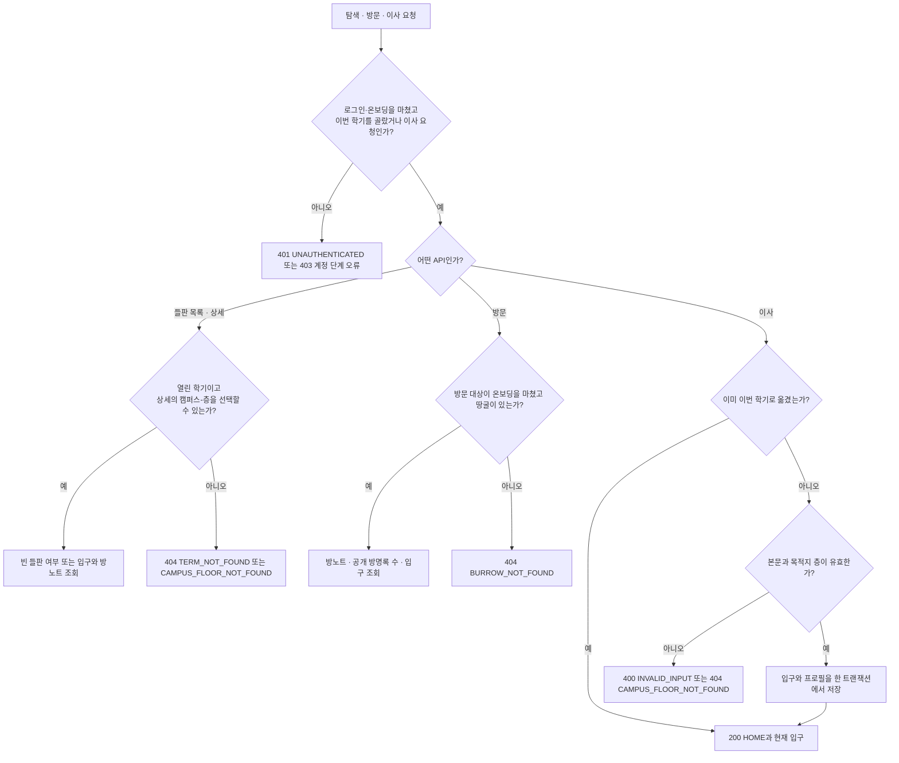
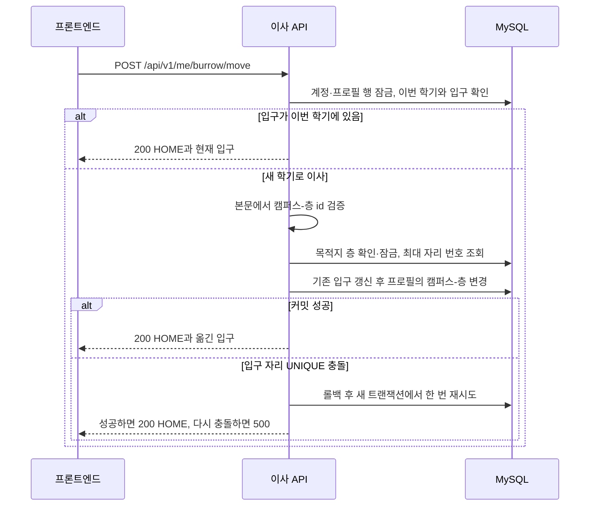

# KAN-46 [BE] 05 탐색 ① – 들판 · 새 학기 이사 · 남의 땅굴

- [Jira KAN-46](https://it-ting.atlassian.net/browse/KAN-46)
- 브랜치 `feature/be/KAN-46-explore-fields`

## 계획

### 목표

학기별 탐색과 땅굴 방문에 필요한 값을 제공한다. 지난 학기 계정은 이번 학기의 캠퍼스-층으로 이사한 뒤 서비스를 계속 이용할 수 있다.

- `GET /api/v1/terms/{termId}/fields`로 선택 가능한 층과 빈 들판 여부를 조회한다. [API 명세](../api/05-explore-visit.md#get-apiv1termstermidfields)
- `GET /api/v1/terms/{termId}/fields/{campusFloorId}`로 들판의 입구와 방노트에 필요한 값을 조회한다. [API 명세](../api/05-explore-visit.md#get-apiv1termstermidfieldscampusfloorid)
- `POST /api/v1/me/burrow/move`로 이번 학기 들판으로 이사한다. [API 명세](../api/05-explore-visit.md#post-apiv1meburrowmove)
- `GET /api/v1/users/{userId}/burrow`로 방문 화면과 방노트에 필요한 값을 조회한다. [API 명세](../api/05-explore-visit.md#get-apiv1usersuseridburrow)

단골 저장 · 오늘의 추천 · 방명록 쓰기는 KAN-47, 대화 요청과 대화방은 KAN-55 · KAN-56 범위다. 새 학기를 여는 운영 기능은 서비스 명세에서 보류 중이다. 이번 작업은 기존 테이블을 사용한다. [KAN-47](https://it-ting.atlassian.net/browse/KAN-47) · [KAN-55](https://it-ting.atlassian.net/browse/KAN-55) · [KAN-56](https://it-ting.atlassian.net/browse/KAN-56) · [서비스 명세](../spec/open-issues.md)

### 정한 것

| # | 무엇 | 정한 내용 | 근거 |
|---|---|---|---|
| 1 | 학기 선택과 들판 목록 | `opened_at`이 현재 시각 이하인 학기만 조회한다. 최근에 열린 학기가 이번 학기이며 열린 시각이 같으면 id가 큰 학기가 먼저다. 이전 학기도 조회할 수 있다. 층 목록과 순서는 `GET /api/v1/campuses`와 맞추고 내 입구도 `isEmpty` 판단에 포함한다. | [탐색 API](../api/05-explore-visit.md#get-apiv1termstermidfields), [공통 API](../api/00-common.md#get-apiv1campuses), [KAN-43](KAN-43.md) |
| 2 | 들판 상세 | 입구를 `slot` 오름차순으로 한 번에 준다. 내 입구도 포함하며 내 관심사의 `isShared`는 모두 `false`다. 정지 계정의 입구는 보이고 탈퇴 계정의 입구는 빠진다. 질문과 답변은 `slot` 순으로 준다. | [탐색 API](../api/05-explore-visit.md#get-apiv1termstermidfieldscampusfloorid) |
| 3 | 접근 권한 | 네 API 모두 로그인이 필요하다. 새 학기를 고르기 전에는 이사 API만 부를 수 있고, 온보딩을 마치기 전에는 네 API 모두 막힌다. | [탐색 API](../api/05-explore-visit.md#새-학기를-고르지-않은-계정), [KAN-44](KAN-44.md) |
| 4 | 이사와 재호출 | 이미 이번 학기에 이사했다면 요청 본문을 읽지 않고 현재 입구로 `200 HOME`을 반환한다. 최초 이사는 기존 입구와 프로필의 캠퍼스-층을 한 트랜잭션에서 바꾼다. 땅굴 id가 유지돼 방명록과 땅굴 모습도 유지된다. | [이사 API](../api/05-explore-visit.md#post-apiv1meburrowmove), [DB 설계](../db/burrow.md#burrow_entrance) |
| 5 | 이사의 잠금과 자리 번호 | 같은 계정의 쓰기는 프로필 행 잠금으로 직렬화하고 그 뒤 입구를 조회한다. 목적지 층 행을 잠그는 `BurrowService.moveEntrance`를 재사용해 입구를 먼저 옮긴 뒤 프로필을 바꾼다. 새 자리는 목적지의 현재 최대 `slot` + 1이다. 명세의 자리 충돌 재시도가 필요하면 롤백이 끝난 뒤 새 트랜잭션에서 다시 배정한다. | [KAN-44](KAN-44.md), [KAN-45](KAN-45.md), [이사 API](../api/05-explore-visit.md#post-apiv1meburrowmove) |
| 6 | 방문할 수 있는 땅굴 | 온보딩을 마친 주인의 땅굴을 조회한다. 정지 계정이나 지난 학기 들판에 남은 땅굴도 방문할 수 있다. 탈퇴자, 미온보딩 계정, 없는 땅굴은 `404 BURROW_NOT_FOUND`다. 방명록은 공개 글 수를 준다. 자기 땅굴이면 `isMine: true`, `isRegular: false`, `chat.status: NONE`으로 응답한다. | [방문 API](../api/05-explore-visit.md#get-apiv1usersuseridburrow), [KAN-45](KAN-45.md) |

#### 이번에 정한 것 (2026-11-24 사용자 승인)

| # | 무엇 | 정한 내용 |
|---|---|---|
| A | 탐색 방노트에 표시할 자기소개 | 들판 상세의 `items[].intro`에 주인의 자기소개를 넣고 비어 있으면 `null`을 준다. API 명세의 필드 표와 예시도 고친다. |
| B | 단골 · 채팅이 병합되기 전 방문 응답 | `isRegular: false`, `chat: {"status":"NONE","chatRoomId":null}`을 준다. KAN-47이 단골, KAN-55 · KAN-56이 요청·대화방 상태를 연결한다. |
| C | 입구가 많은 들판 | 입구를 한 번에 주고 사용자 표시 · 자기소개 · 관심사 · 답변을 묶어서 조회한다. 응답 크기가 문제가 되면 분할 조회를 검토한다. |
| D | 최초 이사의 오류와 재시도 | 본문이 없거나 형식이 틀리면 `400 INVALID_INPUT`이다. `campusFloorId`가 빠지거나 `null`이면 `fields`에 해당 이름을 주고, 유효한 id 형식이지만 대상 층이 없거나 삭제됐다면 `404 CAMPUS_FLOOR_NOT_FOUND`다. 열린 학기나 프로필·땅굴·입구가 없으면 기존 온보딩·내 땅굴 조회와 같이 로그를 남기고 `500 INTERNAL_ERROR`로 처리한다. 입구 자리 UNIQUE가 충돌하면 한 번 다시 배정하고 다시 실패하면 롤백 후 `500 INTERNAL_ERROR`로 답한다. |

### 만들 것

| 파일·영역 | 내용 |
|---|---|
| `burrow/controller`, `burrow/service`, `burrow/dto` | 들판 목록·상세, 새 학기 이사, 방문 API를 추가한다. 이사에 `@AllowBeforeNewTerm`을 붙인다. 이번 학기 여부를 확인한 뒤 필요한 경우에만 이사 본문을 읽고 DTO를 검증한다. |
| `burrow/repository`, `term/service`, `campus`, `interest`, `question` | 열린 학기, 표시 가능한 층, 들판의 입구를 읽는다. `UserDisplayService`, 관심사 태그의 겹침 규칙, 답변 조회를 재사용하고 들판 카드의 값은 여러 계정에 대해 묶어서 읽는다. 방문 응답에는 기존 공개 방명록 개수 조회를 쓴다. |
| `burrow/service/BurrowService`, `user/domain/UserProfile` | 입구를 옮기는 기존 잠금과 프로필 행 잠금을 재사용한다. 이사는 입구와 프로필의 캠퍼스-층만 바꾸고 함께 커밋한다. |
| `docs/api/05-explore-visit.md` | 승인된 응답 필드, 임시 값, 이사 입력 오류와 재시도 규칙을 문서와 예시에 반영한다. |

### 테스트

| API | 정상 | 실패 |
|---|---|---|
| `GET /api/v1/terms/{termId}/fields` | 빈 층과 입구가 있는 층을 순서대로 반환. 내 입구만 있는 층도 `isEmpty: false`. 삭제된 캠퍼스와 층 제외. | 존재하지 않거나 미래에 열리는 학기는 `404 TERM_NOT_FOUND`. |
| `GET /api/v1/terms/{termId}/fields/{campusFloorId}` | 이번·지난 학기, 빈 들판, 입구 정렬, 내 입구와 정지 계정의 입구, 관심사 겹침과 질문 순서 확인. | 없는 학기는 `404 TERM_NOT_FOUND`, 없는 층은 `404 CAMPUS_FLOOR_NOT_FOUND`, 새 학기 선택 전은 `403 NEW_TERM_INCOMPLETE`. |
| `POST /api/v1/me/burrow/move` | `NEW_TERM`에서 이사하고 `HOME`으로 바뀜. 이전 들판에서 입구가 빠지고 방명록과 땅굴 id는 유지됨. 같은 계정의 재호출은 본문이 비었거나 잘못돼도 기존 입구를 반환. 같은 계정 또는 여러 계정의 동시 요청도 테스트. | 로그인 전 `401 UNAUTHENTICATED`, 온보딩 전 `403 ONBOARDING_INCOMPLETE`, 최초 본문 오류 `400 INVALID_INPUT`, 없는 층과 삭제된 층은 `404 CAMPUS_FLOOR_NOT_FOUND`. 실패 뒤 기존 입구와 프로필이 유지되는지 확인. |
| `GET /api/v1/users/{userId}/burrow` | 다른 사람과 내 땅굴, 정지 계정과 지난 학기 입구, 공개 방명록 수와 관심사 겹침 확인. | 존재하지 않는 계정, 탈퇴 계정, 미온보딩 계정은 `404 BURROW_NOT_FOUND`. |

실제 MySQL·Redis를 쓰는 Testcontainers에서 통합 테스트를 실행하고 `backend/gradlew.bat build`를 확인한다. PR을 만들 때 Swagger UI 호출 화면과 같은 요청의 상태 코드·응답 본문을 남긴다.

## 결과

### 한눈에 보기

### 바꾼 것

| 파일·영역 | 내용 |
|---|---|
| `burrow/controller`, `burrow/service`, `burrow/dto` | 들판 목록·상세, 이사와 방문 API를 추가했다. 이사에만 `@AllowBeforeNewTerm`을 붙였고 이사 재호출은 본문을 읽지 않는다. |
| `burrow/repository`, `campus`, `term`, `interest`, `question` | 열린 학기와 선택 가능한 층을 확인한다. 들판 상세의 사용자 표시·자기소개·관심사·답변을 여러 계정에 대해 묶어서 읽는다. |
| `user/domain/UserProfile` | 새 학기로 옮길 때 프로필의 캠퍼스-층만 바꾼다. 자리 배정과 입구 이동은 기존 `BurrowService`가 맡는다. |
| `docs/api/05-explore-visit.md` | 들판 상세의 `intro`, 방문 응답의 임시 상태, 최초 이사의 입력 오류와 자리 충돌 응답을 반영했다. |

### 확인한 것

- `backend/gradlew.bat build`가 통과했다. 테스트 393개(기존 375개, 신규 18개)가 모두 통과했다.
- 통합 테스트에서 현재·지난 학기의 들판, 방노트, 공개 방명록 수, 입력 오류와 계정 단계별 접근을 확인했다.
- 같은 계정이 서로 다른 두 층을 동시에 골라도 한 번만 옮기고, 네 계정이 같은 층을 골라도 서로 다른 자리를 받는다. 두 경우 모두 실제 커밋 뒤 입구와 프로필이 일치했다.
- 생성된 OpenAPI 문서에서 방문 대상 `userId`와 이사 요청의 `campusFloorId`를 입력할 수 있다.
- 최신 `origin/dev`를 기준으로 로컬 코드 리뷰를 했다. P0 0건, P1 0건이다.

### 계획과 달라진 점

- 이사는 프로필 행 잠금에 앞서 이미 온보딩에서 쓰는 계정 행 잠금을 잡는다. 활성 상태를 확인한 뒤에만 입구와 프로필을 옮긴다.

### 남은 일

- KAN-47에서 방문 응답의 `isRegular`와 내 땅굴의 `regularCount`를 저장된 단골 정보에 연결한다. KAN-55 · KAN-56에서 방문 응답의 `chat`을 요청과 대화방 상태에 연결한다.
- Swagger 호출 화면과 상태 코드·응답 본문은 `api-evidence` 절차에 따라 PR을 연 뒤 남긴다.

### 검토 순서

1. 탐색 API에서 들판 상세의 `intro`, 이사 입력과 응답, 방문 응답의 임시 값
2. `BurrowMoveController` → `BurrowMoveService` → 기존 `BurrowService.moveEntrance`
3. `BurrowExploreController` → `BurrowExploreService` → 들판 입구와 관심사·답변 조회
4. `BurrowExploreApiTests`, `BurrowMoveApiTests`, `BurrowMoveConcurrencyTests`
