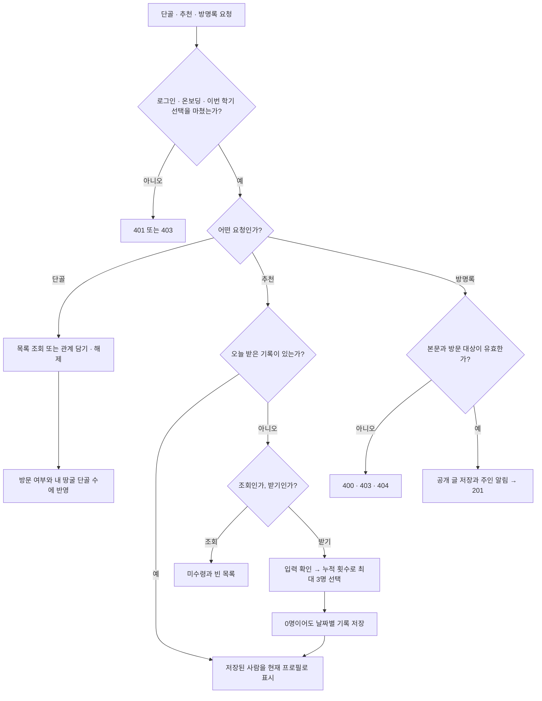
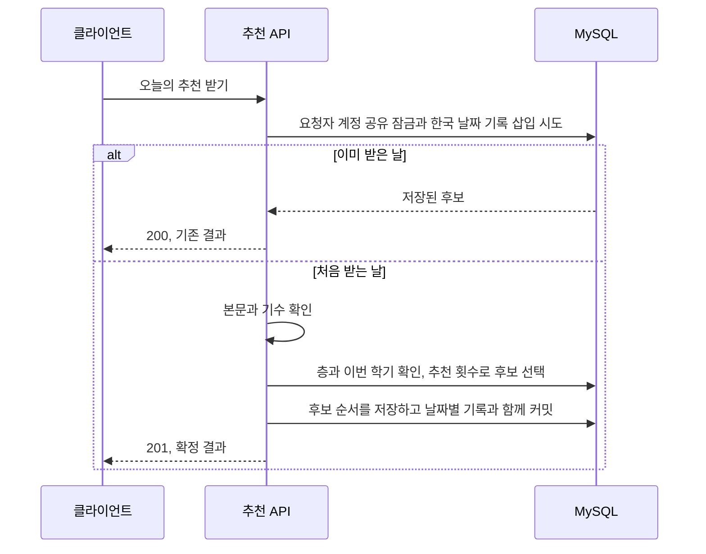
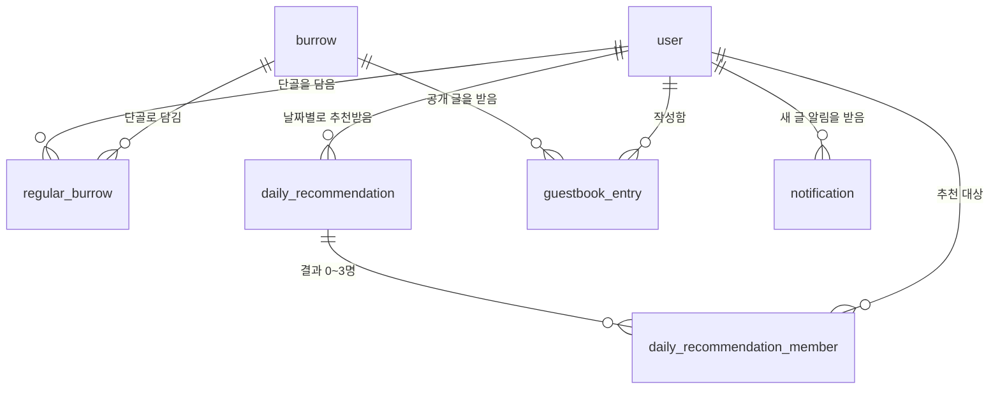

# KAN-47 [BE] 05 탐색 ② – 단골 · 오늘의 추천 · 방명록 쓰기

- [Jira KAN-47](https://it-ting.atlassian.net/browse/KAN-47)
- 브랜치 `feature/be/KAN-47-burrow-social`

## 계획

### 목표

탐색 화면에서 단골 땅굴을 관리하고, 하루에 한 번 방문할 친구를 추천받고, 다른 사람의 땅굴에 방명록을 남길 수 있게 한다.

- `GET /api/v1/me/regular-burrows`, `PUT /api/v1/burrows/{burrowId}/regular`, `DELETE /api/v1/burrows/{burrowId}/regular`를 추가한다. [단골 API](../api/05-explore-visit.md#get-apiv1meregular-burrows)
- `GET /api/v1/me/daily-recommendation`, `POST /api/v1/me/daily-recommendation`을 추가한다. [추천 API](../api/05-explore-visit.md#get-apiv1medaily-recommendation)
- `POST /api/v1/burrows/{burrowId}/guestbook-entries`를 추가한다. [방명록 쓰기 API](../api/05-explore-visit.md#post-apiv1burrowsburrowidguestbook-entries)
- [방문 응답](../api/05-explore-visit.md#get-apiv1usersuseridburrow)의 `isRegular`와 [내 땅굴 응답](../api/04-my-burrow.md#get-apiv1meburrow)의 `regularCount`를 저장된 단골 관계에 연결한다.

프론트엔드 화면과 추천 버튼의 빨간 점, 대화 요청·채팅 상태 연결, 방명록 신고와 회원 탈퇴 API는 각각의 티켓 범위다. KAN-45에서 제공한 방명록 목록·삭제의 기존 동작을 유지한다. [서비스 명세](../spec/05-explore-visit.md) · [KAN-45](KAN-45.md) · [KAN-46](KAN-46.md)

### 정한 것

| # | 무엇 | 정한 내용 | 근거 |
|---|---|---|---|
| 1 | 접근 권한 | 여섯 API는 로그인, 온보딩 완료, 이번 학기 선택이 필요하다. 요청자의 ID는 세션에서 받는다. | [탐색 API](../api/05-explore-visit.md), [API 공통 규칙](../api-convention.md#로그인) |
| 2 | 단골 | 본인이 담은 땅굴을 최근에 담은 순으로 한 번에 보여준다. 담기와 해제는 반복해도 성공하며 단골 알림을 보내지 않는다. 내 땅굴 담기는 `403 OWN_BURROW_NOT_ALLOWED`, 없는 땅굴에 대한 담기·해제는 `404 BURROW_NOT_FOUND`다. | [단골 API](../api/05-explore-visit.md#get-apiv1meregular-burrows), [DB 설계](../db/burrow.md#regular_burrow) |
| 3 | 추천 후보와 순위 | 이번 학기와 선택한 캠퍼스-층·기수에 맞는 `ACTIVE` 온보딩 완료 계정에서 본인과 단골을 뺀다. 요청자에게 추천된 누적 횟수가 적은 순으로 최대 3명을 고르고, 동률은 무작위로 뽑는다. | [추천 받기](../api/05-explore-visit.md#post-apiv1medaily-recommendation) |
| 4 | 추천 결과와 재호출 | 후보가 0명이어도 당일 기록을 생성하고, 이전 추천 이력을 보존한다. 최초 확정은 `201`, 당일 재호출과 동시 요청의 후속 호출은 요청 본문을 읽지 않고 같은 사람들을 `200`으로 반환한다. 카드 데이터는 현재 정보를 읽고 탈퇴자는 결과에서 뺀다. 관심사는 겹치는 항목부터 최대 3개를 준다. | [추천 조회](../api/05-explore-visit.md#get-apiv1medaily-recommendation), [추천 DB 설계](../db/burrow.md#daily_recommendation) |
| 5 | 방명록 작성과 알림 | 1~50자의 공백만이 아닌 글을 받는다. 없는 땅굴이나 탈퇴자의 땅굴은 `404`, 내 땅굴에 쓰면 `403`이다. 새 글은 `PUBLIC`으로 저장하고 기존 목록 항목 형태로 `201`을 반환한다. 작성자와 땅굴 주인의 상태를 잠근 뒤 확인하며, `NotificationService.notify(땅굴 주인 ID, GUESTBOOK_ENTRY_CREATED, 작성자 ID, null)`을 같은 트랜잭션에서 호출한다. | [방명록 API](../api/05-explore-visit.md#post-apiv1burrowsburrowidguestbook-entries), [탈퇴와 방명록 DB 설계](../db/burrow.md#탈퇴자가-받은-방명록은-지우고-쓴-방명록은-남기기), [KAN-54](KAN-54.md) |

#### 이번에 정한 것 (2026-11-24 사용자 승인)

| # | 무엇 | 추천 | 다른 선택 | 까닭 |
|---|---|---|---|---|
| A | 추천 날짜가 바뀌는 시각 | 매일 한국 시각 00:00에 추천 날짜를 바꾼다(`Asia/Seoul`). 예를 들어 한국 시각 11월 25일 00:00의 요청부터 `recommendedOn`은 `2026-11-25`다. | UTC 00:00에 바꾼다. 한국 시각으로는 오전 09:00이다. | 국내 캠퍼스 사용자가 화면의 ‘오늘’을 현지 날짜와 일치시켜 이해할 수 있다. |
| B | 추천 결과의 표시 순서 타입 | `daily_recommendation_member.sort_order`를 `TINYINT`로 두고 1~3을 DB `CHECK`로 제한한다. | `SMALLINT`에 같은 범위의 `CHECK`를 둔다. | 최대 세 자리이며, 같은 범위의 `user_answer.slot`도 `TINYINT`를 사용한다. |
| C | 전체 추천 허용 여부 | 이번에는 API 명세대로 `campusFloorId`와 `generation`을 모두 필수로 두고 전체 추천은 보류한다. 당일 재호출에서 본문을 읽지 않는 규칙은 그대로 적용한다. | 하나 또는 둘을 생략하는 전체 추천을 이번에 추가하고 후보 범위와 요청 계약을 정한다. | 현재 화면과 API는 두 조건을 선택하도록 명시한다. |
| D | 방명록 연속 작성 제한 | 이번에는 빈 글·길이·권한 검증을 구현하고, 별도 횟수 제한은 후속 결정으로 남긴다. | 이번에 작성자별 분당 5건으로 제한하고, 초과 시 `429` 응답과 재시도 안내를 명세에 추가한다. | 현재 명세에는 작성 한도나 초과 시 화면 동작이 없다. |
| E | 방명록 본문의 앞뒤 공백 | 공백만 있는 글은 거부하고 나머지는 사용자가 입력한 공백을 그대로 저장한다. 길이는 `CodePointLength`로 입력 그대로 1~50자를 센다. | 앞뒤 공백을 제거한 뒤 길이를 확인하고 저장한다. | 예를 들어 `" 안녕하세요 "`의 앞뒤 공백도 작성자가 입력한 내용으로 취급한다. 문자 수는 DB의 `CHAR_LENGTH`와 맞춘다. |

### 만들 것

| 파일·영역 | 내용 |
|---|---|
| Flyway·`docs/db/burrow.md` | `regular_burrow`, `daily_recommendation`, `daily_recommendation_member`를 추가한다. 단골 관계 복합 PK, 사용자·날짜 복합 UNIQUE, 결과 위치 복합 PK와 승인된 순서 타입을 반영한다. 단골 역방향 집계와 추천 이력 조회에 필요한 인덱스를 검토한다. |
| `burrow` | 단골 목록·담기·해제 및 실제 단골 여부·수 조회를 구현한다. `BurrowExploreService`와 `MyBurrowService`에서 같은 단골 관계를 읽는다. |
| `burrow` | 당일 추천 조회·받기를 구현한다. 기존 학기·캠퍼스·기수 조회로 조건을 확인하고, `UserDisplayService`, `InterestTagService`, `UserAnswerRepository`로 카드 데이터를 묶어서 읽는다. 요청자 계정 잠금 뒤 당일 기록을 확인하고, 처음 받을 때만 본문을 읽는다. 당일 기록과 결과를 함께 저장한다. |
| `guestbook`, `notification` | 기존 방명록 컨트롤러·서비스·엔티티·목록 항목을 재사용해 작성과 알림을 연결한다. 작성자·주인 계정 잠금은 계정 ID 순서를 맞춘 뒤 상태와 땅굴을 다시 확인한다. |
| `docs/api/05-explore-visit.md`, `docs/api/04-my-burrow.md` | 승인된 날짜 기준과 방명록 입력 규칙을 반영하고, 기존 응답의 단골 여부와 단골 수가 실제 데이터에서 온다고 명시한다. |

### 테스트

| API | 정상 | 실패·경계 |
|---|---|---|
| `GET /api/v1/me/regular-burrows` | 본인의 단골만 최근 순으로 반환하고, 담은 땅굴이 없으면 `[]`를 준다. | 미로그인은 `401`, 이번 학기 선택 전에는 `403`이다. |
| `PUT /api/v1/burrows/{burrowId}/regular` | 최초·반복·동시 호출을 확인하고 방문 응답의 `isRegular`와 주인의 `regularCount`가 함께 바뀌는지 확인한다. | 내 땅굴 담기는 `403`, 없는 땅굴은 `404`다. |
| `DELETE /api/v1/burrows/{burrowId}/regular` | 첫 해제와 재호출이 모두 성공하고 본인의 관계만 지워진다. | 없는 땅굴은 `404`다. |
| `GET /api/v1/me/daily-recommendation` | 미수령, 0명 수령, 저장 순서, 추천 뒤 탈퇴자 제외와 현재 프로필 표시를 확인한다. | 온보딩 완료 전에는 `403`이다. 날짜가 바뀌면 새 날의 미수령 상태를 반환한다. |
| `POST /api/v1/me/daily-recommendation` | 후보 제외 조건, 누적 횟수 순서, 0~3명 저장, 당일 재호출의 본문 무시, 실제 동시 요청의 1회 저장을 확인한다. | 최초 요청의 잘못된 입력·기수는 `400`, 없는 선택 층은 `404`다. |
| `POST /api/v1/burrows/{burrowId}/guestbook-entries` | 공개 방명록 `201`, 기존 목록과 공개 글 수에 반영, 주인에게 알림, 알림을 끈 경우를 확인한다. | 빈 글·51자 글은 `400`, 내 땅굴은 `403`, 없는 땅굴은 `404`다. |

Testcontainers의 MySQL·Redis에서 `backend/gradlew.bat build`를 실행한다. PR에는 Mermaid 다이어그램과 Swagger의 정상·실패 호출 화면, 상태 코드, 응답 본문을 남긴다.

## 결과

### 한눈에 보기

새 테이블은 `regular_burrow`, `daily_recommendation`, `daily_recommendation_member`다. 기존 계정·땅굴 테이블을 참조하고 기존 방명록·알림 테이블에 글과 알림을 저장한다.

### 바꾼 것

- 단골 목록·담기·해제와 기존 땅굴 응답의 단골 여부·수를 실제 DB 관계로 연결했다.
- 추천 조회·받기는 한국 자정에 날짜를 나누고 기록과 순서를 함께 저장한다. 추천을 반복하면 확정된 ID를 읽고 현재 프로필로 카드를 구성한다.
- 방문자의 방명록 쓰기는 본문을 그대로 저장한다. 글과 알림을 한 트랜잭션에서 처리하고 작성자·땅굴 주인 계정 상태를 잠근 뒤 확인한다.
- API 명세의 단골 집계·추천 날짜·방명록 입력 규칙과 DB 설계의 마이그레이션·표시 순서 타입을 구현에 맞췄다.

### 확인한 것

- Testcontainers에서 KAN-47 신규 테스트 13개를 통과했다. API 테스트 9개와 실제 커밋·롤백을 확인하는 테스트 4개다.
- 추천 동시 요청은 `201` 한 건과 `200` 한 건을 반환하고 같은 결과를 준다. 같은 단골을 동시에 담은 요청은 모두 `200`을 반환하며 DB에는 한 줄만 남는다.
- 서로를 추천받은 두 계정의 요청이 모두 `201`로 커밋됐다. 잘못된 기수나 없는 층으로 요청한 경우 당일 기록이 남지 않았고 올바른 요청으로 다시 받을 수 있었다.
- 50자의 방명록에서 앞뒤 공백과 이모지가 유지된다. 51자와 공백만 있는 글은 `400`으로 응답하고, 알림을 끈 땅굴 주인에게는 글만 남는다.
- 첫 전체 빌드에서 기존 `MyAccountApiTests`의 초기화가 테스트 Redis 연결 재설정으로 실패했다. 재실행에서는 테스트 JVM의 Spring 테스트 컨텍스트 캐시 상한을 8로 설정했다.
- `gradlew.bat --init-script build/tmp/kan47-test-cache.init.gradle build`가 통과했다. 기존 449개와 신규 13개를 합쳐 462개가 모두 통과했다. 임시 스크립트는 테스트 컨텍스트 캐시 상한만 설정했다.

### 계획과 달라진 점

- 단골 담기·해제와 방명록 쓰기가 같은 계정·땅굴 공유 잠금 경로를 쓴다. 관계나 글을 저장하는 동안 계정과 땅굴의 상태를 보호한다.
- 추천은 요청자 계정을 공유 잠금하고 사용자·날짜 고유 키로 최초 요청을 가른다. 서로가 추천 후보인 두 계정도 상대 계정을 참조하는 행을 동시에 저장할 수 있다. 최초 요청의 입력 검증이 실패하면 날짜별 기록은 트랜잭션과 함께 롤백한다.

### 남은 일

- 캠퍼스-층이나 기수를 생략한 추천과 방명록 연속 작성 기준은 승인된 계획에 따라 보류했다.
- Swagger 호출 화면과 상태 코드·응답 본문은 PR을 열 때 남긴다.

### 검토 순서

1. `docs/api/05-explore-visit.md`와 `docs/db/burrow.md`
2. `V20261124_1623__create_burrow_social.sql`과 새 엔티티
3. 단골·추천 서비스와 방명록 작성의 잠금·알림 연동
4. `BurrowSocialApiTests`, `BurrowSocialConcurrencyTests`
