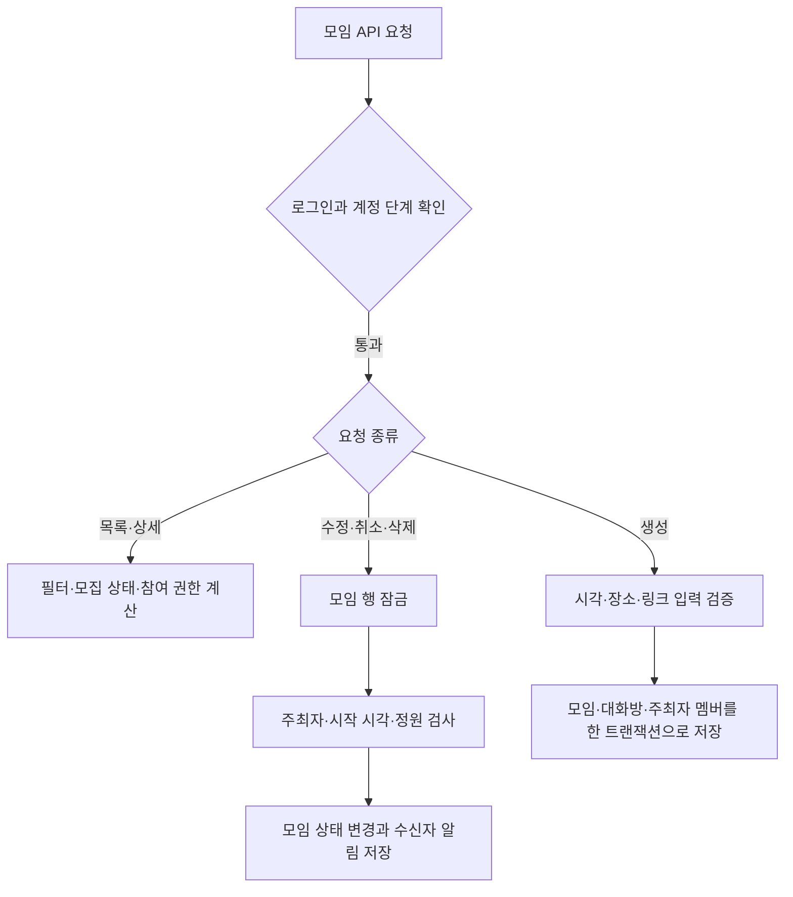
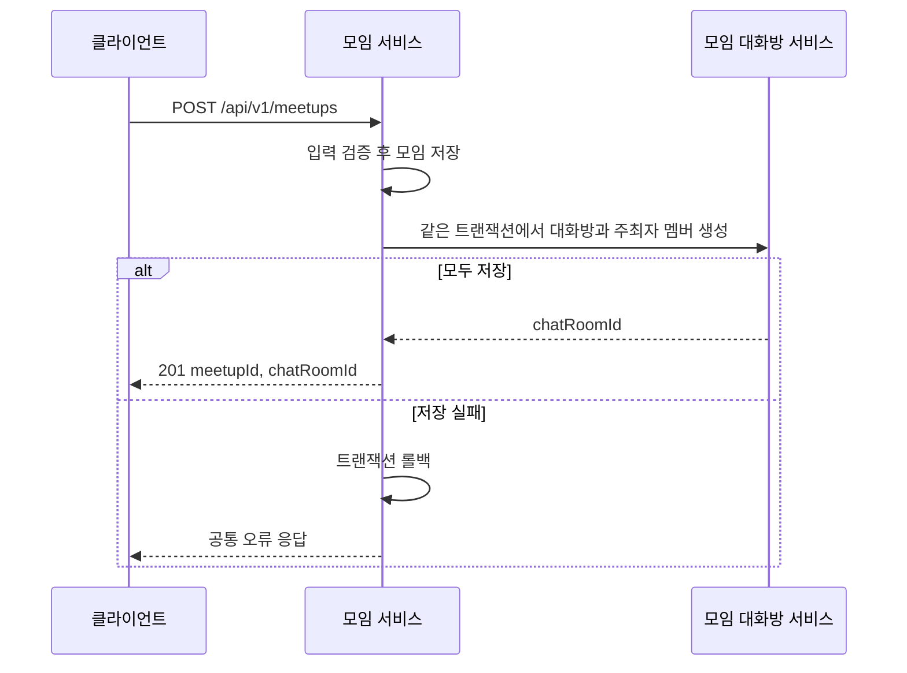
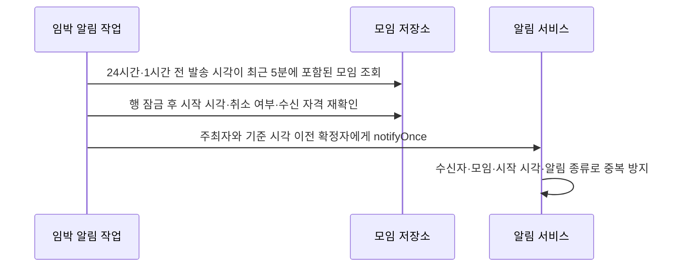
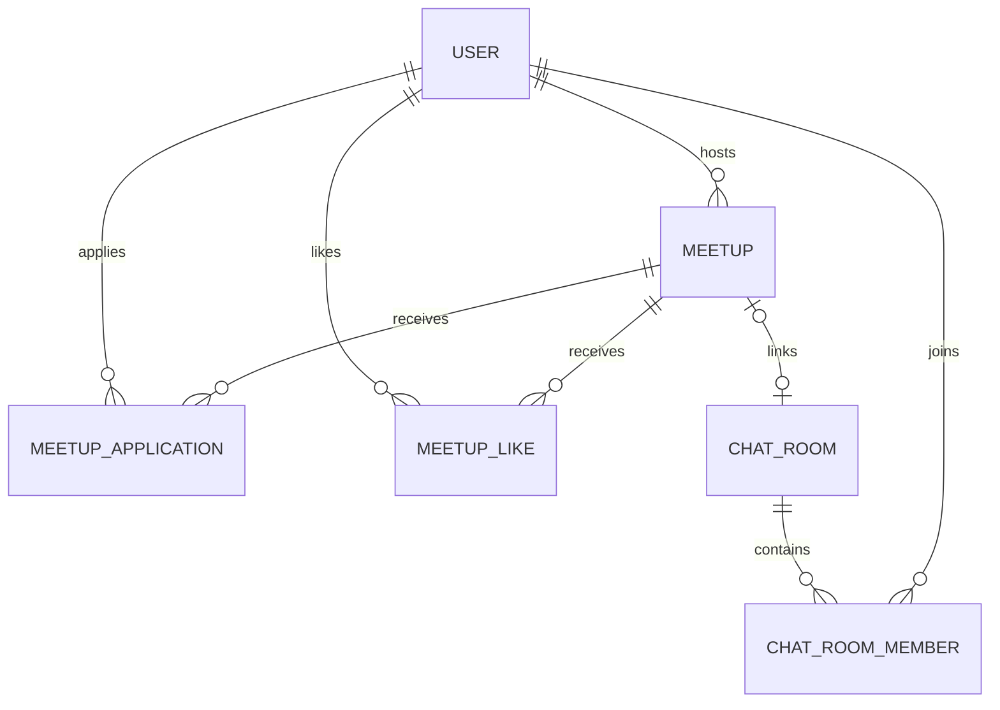

# KAN-48 [BE] 07 모임 ① – 목록 · 만들기 · 상세 · 수정 · 취소 · 삭제

- [Jira KAN-48](https://it-ting.atlassian.net/browse/KAN-48)
- 브랜치 `feature/be/KAN-48-meetup-core`

## 계획

### 목표

사용자가 모임을 찾고 상세를 볼 수 있게 한다. 주최자는 모임을 만들고 상태와 시각에 따라 수정·취소·삭제할 수 있다.

- `GET /api/v1/meetups`, `POST /api/v1/meetups`, `GET /api/v1/meetups/{meetupId}`를 추가한다. [목록·생성·상세 API](../api/07-meetup.md#get-apiv1meetups)
- `PATCH /api/v1/meetups/{meetupId}`, `POST /api/v1/meetups/{meetupId}/cancel`, `DELETE /api/v1/meetups/{meetupId}`를 추가한다. [수정·취소·삭제 API](../api/07-meetup.md#patch-apiv1meetupsmeetupid)
- 모임 생성과 대화방 연결, 수정·취소·삭제 알림, 시작 24시간·1시간 전 알림을 연결한다. [채팅 연동](../api/07-meetup.md#모임-대화방) · [임박 알림](../api/09-notification.md#모임-일정-임박-알림)

참여 신청과 주최자 신청 관리 API는 KAN-49, 찜·빈자리 알림 구독·내 모임·캘린더 API는 KAN-50, 채팅방의 메시지·공지·나가기는 KAN-56에서 만든다. [KAN-49](https://it-ting.atlassian.net/browse/KAN-49) · [KAN-50](https://it-ting.atlassian.net/browse/KAN-50) · [KAN-56](https://it-ting.atlassian.net/browse/KAN-56)

### 정한 것

| # | 무엇 | 정한 내용 | 근거 |
|---|---|---|---|
| 1 | 접근 제어 | 여섯 API 모두 로그인과 온보딩·이번 학기 선택이 필요하다. 수정·취소·삭제는 세션의 사용자 ID가 주최자와 일치해야 한다. | [API 공통 규칙](../api-convention.md#로그인), [모임 API](../api/07-meetup.md) |
| 2 | 목록과 상세 | 목록은 시작·취소·삭제 모임을 제외하고, 네 가지 정렬 모두 `OPEN`을 `CLOSED`보다 앞에 둔다. 날짜 필터는 한국 날짜 기준으로 적용한다. 상세는 지난 모임과 취소한 모임도 돌려주며, 삭제된 모임은 `404 MEETUP_NOT_FOUND`다. `joinUrl`은 주최자와 참여 확정자에게만, `chatRoomId`는 아직 대화방에 있는 요청자에게만 주고 나머지는 각 값이 `null`이다. | [목록](../api/07-meetup.md#get-apiv1meetups), [상세](../api/07-meetup.md#get-apiv1meetupsmeetupid) |
| 3 | 생성과 수정 | 생성은 모임·`MEETUP` 대화방·주최자 멤버를 한 트랜잭션에 만든 뒤 두 ID와 `201`을 반환한다. 수정은 보낼 필드가 모두 필수이고 nullable 필드는 명시적으로 `null`을 받는다. 모집 마감은 수정하지 않는다. 시작 12시간 전부터 또는 취소된 뒤에는 수정할 수 없다. 값이 같으면 저장과 알림을 건너뛴다. | [만들기](../api/07-meetup.md#post-apiv1meetups), [수정](../api/07-meetup.md#patch-apiv1meetupsmeetupid) |
| 4 | 취소와 삭제 | 시작 전 기준으로 주최자 외 확정자가 있으면 취소를, 없으면 삭제를 할 수 있다. 취소는 `canceled_at`을 채우고 대기 신청을 `MEETUP_CANCELED`로 바꾼다. 취소 재호출은 성공한다. 삭제는 `deleted_at`을 채워 이후 조회에서 제외한다. | [취소](../api/07-meetup.md#post-apiv1meetupsmeetupidcancel), [삭제](../api/07-meetup.md#delete-apiv1meetupsmeetupid), [DB 설계](../db/meetup.md) |
| 5 | 상태와 알림 | 정원에 주최자가 포함된다. 확정 인원은 주최자 1명에 확정 신청 수를 더해 계산하고, 모집 상태도 저장하지 않는다. 수정·취소는 대기자와 확정자에게, 삭제는 대기자에게 알린다. 가득 찬 모임의 정원을 늘려 마감 전에 빈자리가 생기면 구독자에게 알린다. 임박 알림 대상은 주최자와 발송 기준 시각에 이미 확정된 참여자다. | [영역 규칙](../api/07-meetup.md#영역-규칙), [알림](../api/09-notification.md#모임-일정-임박-알림), [KAN-54](KAN-54.md) |
| 6 | 채팅 테이블과 FK의 담당 | KAN-55가 `chat_room`, `chat_room_member`, `chat_message`와 `chat_room.meetup_id` 칼럼을 만든다. KAN-48은 `meetup`을 만든 뒤 별도의 채팅 영역 마이그레이션으로 `chat_room.meetup_id → meetup.id` FK를 추가한다. FK 마이그레이션 번호는 채팅 테이블과 모임 테이블을 만든 두 마이그레이션보다 뒤로 잡는다. | 사용자 (2026-11-25), [KAN-55 PR #42](https://github.com/it-ting-team/it-ting/pull/42) |

#### 이번에 정한 것 (2026-11-25 사용자 승인)

| # | 무엇 | 추천 | 다른 선택 | 까닭 |
|---|---|---|---|---|
| A | 대화방 연동 순서 | 승인 후 모임 영역을 먼저 구현하고, [KAN-55 PR #42](https://github.com/it-ting-team/it-ting/pull/42)가 병합되면 `dev`를 반영해 FK와 대화방 생성·조회를 완성한다. | KAN-55가 병합된 뒤 KAN-48의 구현 전체를 시작한다. | 모임 영역을 먼저 진행할 수 있고, 생성 API는 실제 `chatRoomId`를 반환하도록 완성한다. |
| B | 신청·찜 테이블 도입 시점 | `meetup`, `meetup_application`, `meetup_like`를 KAN-48의 모임 마이그레이션에서 함께 만든다. KAN-48은 집계·상태 조회·모임 취소에 쓰고 신청·찜 API는 후속 티켓에서 만든다. | 이번에는 `meetup`만 만든 뒤 신청·찜 조회를 임시 값으로 제공하고 각 후속 티켓에서 연결한다. | 상세의 인원·내 상태와 인기순, 수정·취소 시 수신자 및 상태 변경을 같은 계약으로 검증할 수 있다. |
| C | 일정 임박 알림 실행 | 1분마다 실행하고 예정 발송 시각이 지난 최근 5분 안에 들어오는 건을 확인한다. 모임 생성·참여 확정이 해당 기준 시각 이후면 그 사람의 해당 알림은 건너뛴다. `notifyOnce` 키로 중복을 막고, 5분을 넘겨 놓친 건은 뒤늦게 발송하지 않는다. | 장시간 중단 후에도 시작 전인 모임의 놓친 알림을 보낸다. | 짧은 실행 지연을 흡수하면서 ‘24시간 전’ 알림이 한참 늦게 오는 일을 막는다. 예를 들어 18:00에 보낼 알림은 18:04 실행에서 재확인한다. |
| D | 모집 마감 자동 미승인 | 실제 `PENDING → REJECTED` 갱신 작업과 그 알림은 신청 흐름을 만드는 KAN-49에서 구현한다. KAN-48 상세는 마감된 신청을 API 규칙대로 미승인 상태로 표시한다. | KAN-48에 모집 마감 갱신 작업까지 넣고 KAN-49가 이어받는다. | KAN-49가 신청 수락·거절·자동 미승인 알림을 맡고, 마감과 수락이 겹치는 경우를 그 작업에서 함께 검증할 수 있다. |
| E | 검색어 처리 | 앞뒤 공백을 제거하고, 남은 검색어 전체가 제목이나 소개에 연속으로 포함된 경우 찾는다. `%`와 `_`는 문자 그대로 찾는다. 예를 들어 `한강 러닝`은 `주말 한강 러닝`과 일치한다. | 공백으로 단어를 나누고 각 단어가 순서와 무관하게 들어 있으면 찾는다. | 현재 API는 제목·소개 부분 문자열 검색을 명시하고, 단어 분리 규칙은 정해져 있지 않다. |
| F | 주소 검색과 생성 횟수 제한 | API는 입력받은 장소·상세 주소를 검증해 저장한다. 주소 검색 공급자와 모임 생성 횟수 제한은 후속 결정으로 남긴다. | 이번에 주소 검색 공급자와 연결 방식을 정하거나, 모임 생성 한도와 초과 응답까지 정의한다. | 주소 찾기는 화면이 맡는 동작이고, 백엔드 계약은 장소 문자열을 받는다. 생성 한도와 초과 시 화면 동작도 현재 명세에 없다. |

### 만들 것

| 파일·영역 | 내용 |
|---|---|
| Flyway·`docs/db/meetup.md`와 `docs/db/chat.md` | 승인된 모임 테이블과 제약·인덱스를 추가한다. KAN-55 반영 뒤 별도 채팅 마이그레이션으로 FK를 연결한다. |
| `meetup` | 요청·응답 record와 영역 오류, 목록 필터·페이지·집계, 주최자와 참여자 표시, 권한별 상세를 구현한다. 수정·취소·삭제는 모임 행을 잠근 뒤 조건과 확정 인원을 검사한다. |
| `meetup` · `chat` | 대화방·주최자 멤버 생성은 채팅 쪽의 재사용 코드에 맡기고 모임 생성 트랜잭션에 참여시킨다. 상세는 대화방 멤버 상태를 읽는다. |
| `meetup` · `notification` | `NotificationService`로 변경·빈자리·임박 알림을 연결한다. `NotificationTargetReader`는 모임의 제목·시작 시각과 모임 대화방의 제목을 제공한다. |
| `docs/api/07-meetup.md`와 관련 명세 | 승인된 검색·예약 작업 기준과 KAN-49·KAN-50·KAN-56 분담을 반영한다. |

### 테스트

| API | 정상 | 실패·경계 |
|---|---|---|
| `GET /api/v1/meetups` | 검색·다중 카테고리·한국 날짜·방식·정렬·페이지와 확정 인원·찜 집계 | 잘못된 기간·정렬·페이지 크기는 `400`, 미로그인은 `401` |
| `POST /api/v1/meetups` | 오프라인·온라인 각각 `201`, 모임·대화방·주최자 멤버 동시 저장 | 시작·종료·마감의 순서 또는 방식별 필드가 어긋나면 `400`, 생성 도중 실패하면 전부 롤백 |
| `GET /api/v1/meetups/{meetupId}` | 주최자·확정자·일반 사용자별 링크와 대화방 공개 범위, 지난·취소 모임 표시 | 삭제되거나 없는 모임은 `404` |
| `PATCH /api/v1/meetups/{meetupId}` | 입력 전체 갱신, 변경이 없으면 알림 생략, 마감 전 증원과 빈자리 알림 | 비주최자 `403`, 마감 시각을 바꾸거나 확정 인원 미만 정원은 검증 규칙 확인, 시작 12시간 전 경계는 `409` |
| `POST /api/v1/meetups/{meetupId}/cancel` | 대기 신청 상태 전이와 수신자 확인, 취소 재호출에 알림 중복 없음 | 시작했거나 주최자 외 확정자가 없으면 `409` |
| `DELETE /api/v1/meetups/{meetupId}` | 대기자에게 알리고 목록·상세에서 제외 | 확정자가 있거나 시작했으면 `409`, 재삭제는 `404` |

임박 알림은 고정 시각으로 24시간·1시간의 경계, 늦게 확정된 참여자, 시작 시각 변경과 중복 방지를 확인한다. 실제 MySQL·Redis에서 `backend/gradlew.bat build`를 실행하고, PR에 Mermaid 다이어그램과 Swagger 정상·실패 호출 화면, 상태 코드, 응답 본문을 남긴다.

## 결과

### 구현한 범위

- 모임 목록·상세와 주최자의 수정·취소·삭제를 구현했다. 목록 검색은 앞뒤 공백을 제거한 부분 문자열로 처리하며, 날짜 범위는 한국 시각을 기준으로 적용한다.
- `meetup`, `meetup_application`, `meetup_like`를 만들었다. 확정 인원과 찜 상태를 조회하고 모임 취소 시 대기 신청을 닫는다.
- 변경·취소·삭제와 빈자리 알림을 연결했다. 시작 24시간·1시간 전 알림은 1분마다 최근 5분의 발송 시각을 확인한다.
- [KAN-55 PR #42](https://github.com/it-ting-team/it-ting/pull/42)가 들어온 `dev`를 반영했다. `V20261125_1137__add_chat_room_meetup_fk.sql`로 대화방 외래키를 연결했다. 모임·대화방·주최자 멤버는 함께 저장되며, 나가지 않은 멤버에게만 모임 상세에서 대화방 ID를 준다. 모임 대화방 알림에는 연결된 모임의 이름을 담고, 시작 시각은 모임으로 이동하는 알림에 담는다.

### 한눈에 보기

### 검증

- 실제 MySQL·Redis에서 `MeetupCoreApiTests`와 `NotificationReaderApiTests` 총 12개 통과. 목록 필터, 상세 공개 범위, 주최자 권한, 12시간 수정 경계, 취소 재호출, 삭제, 입력 오류, 시작 시각 변경 후 임박 알림과 중복 방지, 알림 팝업의 실제 모임 정보를 확인했다.
- 첫 백엔드 전체 빌드에서는 기존 알림 테스트의 가짜 모임 조회기 충돌과 MySQL·Redis 연결 오류가 발생했다. 조회기 충돌은 실제 모임 데이터를 쓰도록 고쳤고, 수정한 두 테스트 클래스는 단독 재실행에서 통과했다.
- KAN-55 반영 전 전체 빌드는 테스트 471개가 통과했다. 실행 시 Spring 테스트 컨텍스트 캐시를 8개로 제한해 동시에 유지되는 테스트 컨테이너 수를 줄였다.
- KAN-55 반영 후 백엔드 전체 빌드가 통과했다. 테스트 631개가 통과했고 실패와 건너뜀은 0개다. 모임·알림 통합 테스트 17개에서 정상 생성의 두 ID, 대화방 외래키, 멤버 저장 실패 시 롤백, 대화방 ID의 공개 범위, 알림 대상의 응답을 확인했다.
- 로컬 코드 리뷰에서 모임 대화방 알림은 모임 이름만 전달하도록 API 명세에 맞췄다. 해결되지 않은 P0·P1은 없다.
