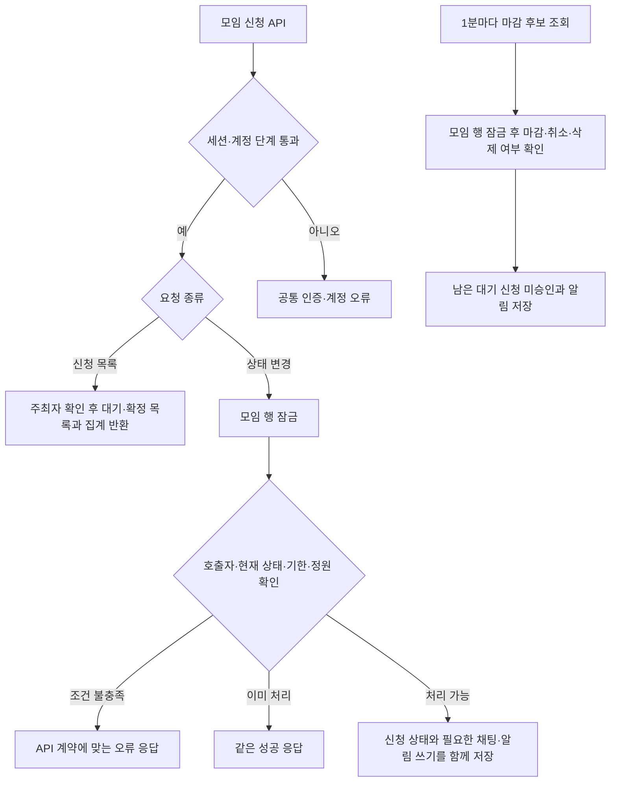
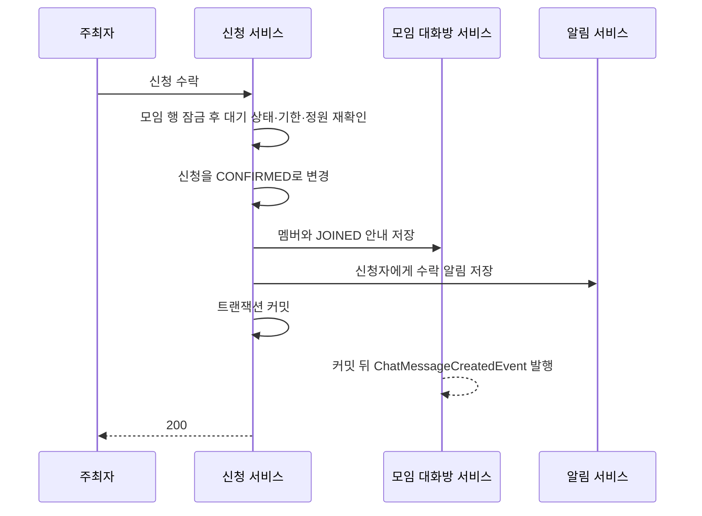

# KAN-49 [BE] 07 모임 ② 참여 신청 · 철회 · 참여 취소 · 수락 · 거절 · 내보내기

- Jira [KAN-49](https://it-ting.atlassian.net/browse/KAN-49)
- 브랜치 `feature/be/KAN-49-meetup-applications`
- 기준 `origin/dev` `593ac08`. [KAN-48 PR #46](https://github.com/it-ting-team/it-ting/pull/46) 병합 포함

## 계획

### 목표

모임 신청 상태와 주최자의 신청 관리를 구현한다. 수락·참여 취소·내보내기는 신청 기록과 대화방 멤버를 함께 바꾸고, 모집 마감과 알림 팝업에도 상태를 반영한다.

| 호출자 | API |
|---|---|
| 신청자 | [신청](../api/07-meetup.md#post-apiv1meetupsmeetupidapplications), [철회](../api/07-meetup.md#post-apiv1meetupsmeetupidwithdraw-application), [참여 취소](../api/07-meetup.md#post-apiv1meetupsmeetupidcancel-participation) |
| 주최자 | [신청 목록](../api/07-meetup.md#get-apiv1meetupsmeetupidapplications), [수락](../api/07-meetup.md#post-apiv1meetup-applicationsmeetupapplicationidaccept), [거절](../api/07-meetup.md#post-apiv1meetup-applicationsmeetupapplicationidreject), [내보내기](../api/07-meetup.md#post-apiv1meetup-applicationsmeetupapplicationidkick) |
| 서버 | [마감 시 자동 미승인](../api/07-meetup.md#서버가-스스로-하는-일), [알림 팝업 미처리 신청 수](../api/09-notification.md#알림과-요청-수) |

범위 밖에는 찜·빈자리 알림 구독·내 모임·캘린더 API(KAN-50), 채팅방 자체의 메시지·읽음·나가기 API(KAN-56), 브라우저로 실시간 소식을 보내는 일(KAN-57)이 있다.

### 정한 것

| # | 무엇 | 정한 내용 | 근거 |
|---|---|---|---|
| 1 | 로그인과 권한 | 7개 API 모두 세션과 계정 단계 완료가 필요하다. 주최자용 API는 해당 모임의 주최자만 호출할 수 있다. | [API 공통 규칙](../api-convention.md), [상태 화면](../spec/07-meetup.md#모임-상세--상태-표) |
| 2 | 신청과 정원 | 신청은 사용자당 한 줄이다. 철회한 신청만 같은 줄로 재신청한다. 주최자를 확정 인원에 포함하며 정원이 차도 이미 대기 중인 신청은 유지한다. | [신청 테이블](../db/meetup.md#meetup_application), [정원](../api/07-meetup.md#정원과-확정-인원) |
| 3 | 상태·기한·동시 처리 | 마감은 `recruit_deadline_at`, 없으면 `starts_at`이다. 마감된 대기 신청은 배치 전에도 수락·철회를 차단한다. 정책에 맞는 재호출은 같은 결과를 주고 중복 알림을 만들지 않는다. 참여 취소는 시작 24시간 전부터, 내보내기는 시작 시각부터 막는다. 모임 행을 먼저 잠근 뒤 신청 상태와 정원을 다시 확인한다. | [상태 전이](../api/07-meetup.md#신청-기록이-바뀌는-때), [DB 잠금 규칙](../db/meetup.md#모임-취소-시-대기-신청을-함께-마감하기) |
| 4 | 대화방과 소식 | 수락 시 멤버와 `JOINED` 메시지를 추가한다. 참여 취소·내보내기 시 멤버의 `left_at`과 `LEFT` 메시지를 기록한다. 신청 상태와 같은 트랜잭션으로 처리하고, `ChatMessageCreatedEvent`는 커밋 뒤에 발행한다. | [모임 대화방](../api/07-meetup.md#모임-대화방), [KAN-55](KAN-55.md) |
| 5 | 알림과 팝업 | 신청·수락·거절·자동 미승인·참여 취소·내보내기 알림을 연결한다. 철회에는 알림을 보내지 않는다. 마감 전 꽉 찼던 모임에 자리가 나면 구독자에게 알린다. 미처리 수는 취소·삭제·마감된 모임을 제외한다. | [알림 API](../api/09-notification.md#알림과-요청-수), [KAN-54](KAN-54.md) |

### 이번에 정한 것 (2026-11-25 사용자 승인)

| # | 무엇 | 추천 | 다른 선택 | 까닭 |
|---|---|---|---|---|
| A | 자동 미승인 실행 주기와 재시작 후 처리 | 1분마다 마감된 대기 신청을 조회한다. 중단 중 놓친 건도 재시작 후 처리한다. 모임별로 잠근 뒤 재확인하고, 아직 대기인 신청만 바꾼다. | 5분마다 같은 방식으로 처리한다. | 예를 들어 18:00에 마감하면 API는 18:00부터 수락·철회를 막고, 정상 운영 중 다음 1분 주기에 DB와 알림을 반영한다. 재시작 뒤에도 신청이 계속 대기 상태로 남지 않는다. |
| B | 짧은 시간 내 반복 신청 제한 | 중복 신청·재신청 상태 규칙을 적용하고 횟수 제한은 후속 결정으로 남긴다. | 이번 티켓에서 사용자별 횟수·시간 창과 초과 응답까지 정한다. | 명세에 수치·초과 응답이 없고, KAN-48에서도 모임 생성 횟수 제한은 후속으로 정했다. |
| C | 새 참여자의 대화방 읽은 위치 | `last_read_message_id`를 `NULL`로 시작한다. | 수락 직전의 마지막 메시지 ID로 시작한다. | 계약상 입장 전 메시지도 볼 수 있다. 예를 들어 입장 전 일반 메시지가 3개라면 추천안에서는 처음에 3개를 읽지 않은 것으로 센다. 다른 선택에서는 메시지는 볼 수 있고 읽지 않은 수는 0으로 시작한다. `JOINED` 안내는 집계에서 제외한다. |

### 만들 것

| 영역 | 내용 |
|---|---|
| `meetup/controller`, `dto`, `service` | 신청 API 7개, 신청 목록·권한 확인, 상태 전이와 마감 처리 |
| `meetup/repository`, `domain` | 기존 모임 행 잠금과 신청 테이블을 재사용하고 신청 쓰기·목록·마감 후보·미처리 집계를 연결한다. 현재 스키마로 시작한다. |
| `chat` | 기존 모임 대화방 서비스에 멤버·안내 메시지 변경을 연결하고 커밋 뒤에 기존 채팅 이벤트를 발행한다. |
| `notification` 연동 | 기존 `NotificationService`와 알림 타입을 사용한다. 모임 영역에 `MeetupRequestCountReader` 구현을 등록한다. |
| 명세·작업 기록 | 승인한 정책을 관련 API·DB 문서에 반영하고, 테스트 결과와 Mermaid 다이어그램을 이 문서에 남긴다. |

### 테스트

| API | 정상 | 실패·경계 |
|---|---|---|
| `POST /meetups/{id}/applications` | 첫 신청과 철회 후 재신청에 `201` 및 신청 ID, 메시지 비허용 시 비움 | 주최자 `403`, 중복·재신청 불가·모집 종료 `409` |
| `GET /meetups/{id}/applications` | 주최자가 대기·확정 목록과 집계를 조회 | 비주최자 `403`, 삭제된 모임 `404` |
| `POST /meetups/{id}/withdraw-application` | 철회와 같은 요청 재호출, 알림 없음 | 이미 확정 `409`, 마감된 신청 `404` |
| `POST /meetups/{id}/cancel-participation` | 참여 취소, 멤버 퇴장, `LEFT`와 알림 | 시작 24시간 전 경계 `409` |
| `POST /meetup-applications/{id}/accept` | 확정, 멤버 입장, `JOINED`와 알림 | 비주최자 `403`, 마감 `404`, 정원 초과 `409` |
| `POST /meetup-applications/{id}/reject` | 거절, 같은 요청 재호출, 중복 알림 없음 | 비주최자 `403`, 확정된 신청 `404` |
| `POST /meetup-applications/{id}/kick` | 내보내기, 멤버 퇴장, `LEFT`와 알림 | 시작 또는 모임 취소 이후 `409` |

테스트 주소의 공통 접두사는 `/api/v1`이다. 실제 MySQL·Redis에서 마지막 자리 동시 수락, 모집 마감과 수락·모임 취소의 경합, 중간 실패 시 롤백, 재시도 시 중복 알림 방지, 팝업 미처리 수를 추가로 확인한다. 전체 백엔드 빌드를 실행하고 API PR의 Swagger 호출 화면과 응답을 남긴다.

## 결과

### 한눈에 보기

### 바꾼 것

| 영역 | 결과 |
|---|---|
| 모임 | 신청 API 7개, 주최자 목록과 공통 권한·상태 처리 |
| 대화방 | 모임 수락·참여 취소·내보내기에 참여 상태, 안내 메시지, 커밋 후 이벤트 연결 |
| 알림 | 미승인·수락·참여 취소 등 상태별 알림과 팝업 미처리 수 연결 |
| 마감 | 1분마다 마감된 대기 신청을 확인하고 중단 중 놓친 마감도 처리 |
| DB | 기존 모임·신청·채팅·알림 테이블을 사용하며 스키마 변경은 없다 |

### 확인한 것

- 실제 MySQL·Redis에서 `MeetupApplicationApiTests` 8개, `MeetupCoreApiTests` 13개, `NotificationReaderApiTests` 4개가 통과했다. 정원 경쟁, 마감 전후 처리, 멤버·안내 메시지 저장과 롤백, 알림 중복 방지, 팝업의 미처리 수를 확인했다.
- `gradlew.bat build` 전체 검증에서 테스트 639개가 통과했다. 실패와 건너뜀은 0개다. 실행에만 Spring 테스트 컨텍스트 캐시 크기 8을 적용했다.
- PR 전 로컬 리뷰에서 권한 검사, 모임 행 잠금 순서, 채팅·신청 상태의 트랜잭션 경계, 명세의 응답을 대조했다. P0·P1 지적은 없다.

### 계획과 달라진 점

없음.

### 남은 일

- 시간당 신청 횟수와 초과 응답은 후속 결정이다.
- 찜·빈자리 알림 구독·내 모임·캘린더 API는 KAN-50, 브라우저 실시간 전달은 KAN-57에서 맡는다.

### 검토 순서

1. [모임 신청 API](../api/07-meetup.md#post-apiv1meetupsmeetupidapplications)와 [신청 DB 설계](../db/meetup.md#meetup_application)
2. 신청 컨트롤러 → 상태 전이 서비스 → 신청 저장소
3. 모임 대화방 서비스와 마감 예약 작업
4. 모임 신청·알림 통합 테스트
