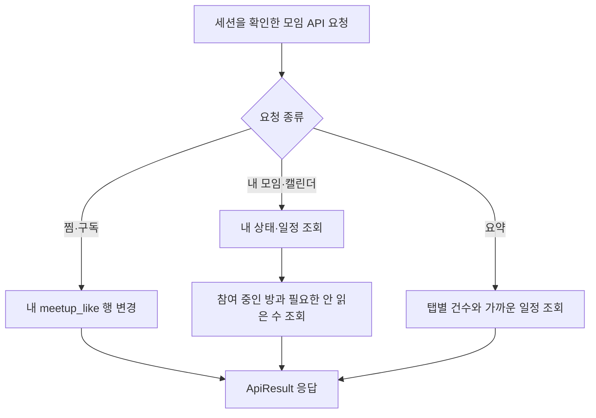
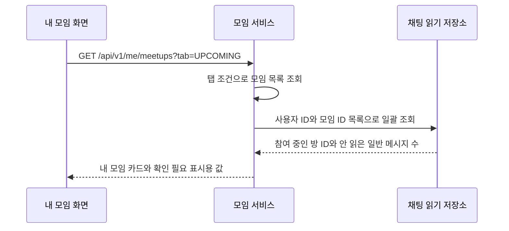

# KAN-50 [BE] 07 모임 ③ 찜 · 빈자리 알림 · 내 모임 · 캘린더

- Jira [KAN-50](https://it-ting.atlassian.net/browse/KAN-50)
- 브랜치 `feature/be/KAN-50-meetup-dashboard`
- 기준 `origin/dev` `3a6c8bb`. [KAN-48](KAN-48.md)과 [KAN-49](KAN-49.md) 병합 포함

## 계획

### 목표

사용자가 모임을 찜하고 빈자리 알림 구독을 설정할 수 있게 한다. 내 모임 화면과 캘린더에서 같은 신청 상태와 모집 상태를 보여 준다.

| API | 동작 |
|---|---|
| `PUT /api/v1/meetups/{meetupId}/like` | [찜하기](../api/07-meetup.md#put-apiv1meetupsmeetupidlike) |
| `DELETE /api/v1/meetups/{meetupId}/like` | [찜 해제](../api/07-meetup.md#delete-apiv1meetupsmeetupidlike) |
| `PUT /api/v1/meetups/{meetupId}/vacancy-alert` | [빈자리 알림 켜기](../api/07-meetup.md#put-apiv1meetupsmeetupidvacancy-alert) |
| `DELETE /api/v1/meetups/{meetupId}/vacancy-alert` | [빈자리 알림 끄기](../api/07-meetup.md#delete-apiv1meetupsmeetupidvacancy-alert) |
| `GET /api/v1/me/meetups` | [내 모임 탭](../api/07-meetup.md#get-apiv1memeetups) |
| `GET /api/v1/me/meetups/summary` | [탭 건수와 가까운 일정](../api/07-meetup.md#get-apiv1memeetupssummary) |
| `GET /api/v1/meetup-calendar` | [월별 캘린더](../api/07-meetup.md#get-apiv1meetup-calendar) |

범위 밖에는 화면 렌더링, 채팅의 메시지 조회·읽음 변경 API(KAN-56), 브라우저 실시간 전달(KAN-57)이 있다.

### 정한 것

| # | 무엇 | 정한 내용 | 근거 |
|---|---|---|---|
| 1 | 인증 | 세션과 계정 단계 완료가 필요하다. 찜과 구독은 세션 사용자 한 사람의 행을 바꾼다. | [API 공통 규칙](../api-convention.md) |
| 2 | 찜과 구독 | `meetup_like`의 복합 PK `(meetup_id, user_id)`를 사용한다. 처음 찜하면 알림은 꺼져 있고, 반복 요청은 기존 설정을 보존한다. 찜을 해제하면 구독도 삭제된다. 구독을 켜려면 찜이 필요하다. 화면의 모집 완료 표시 조건은 프론트엔드에서 적용한다. | [찜·구독 계약](../api/07-meetup.md#put-apiv1meetupsmeetupidlike), [찜 테이블](../db/meetup.md#meetup_like) |
| 3 | 빈자리 발송 | 정원이 찬 상태에서 모집 마감 전에 자리가 나면 KAN-48의 증원과 KAN-49의 참여 취소·내보내기 흐름이 기존 알림 서비스를 호출한다. KAN-50은 같은 구독 값을 읽고 쓴다. | [빈자리 알림](../api/07-meetup.md#알림), [KAN-54](KAN-54.md) |
| 4 | 탭과 요약 | 삭제된 모임을 제외한다. `UPCOMING`은 시작 전인 주최·확정이고 `PENDING`은 시작 전인 대기·미승인이다. `HOSTING`·`LIKED`에는 시작 전인 모임만 담고, 취소된 주최·확정 모임은 `PAST`에 담는다. 요약의 탭 건수는 탭과 같은 조건을 쓰며, `upcomingItems`에는 대기도 포함해 가까운 순서로 5개까지 준다. | [탭 포함·정렬 규칙](../api/07-meetup.md#get-apiv1memeetups), [요약 계약](../api/07-meetup.md#get-apiv1memeetupssummary) |
| 5 | 캘린더 | 한국 시간의 선택 월을 UTC 조회 범위로 바꾼다. 취소·삭제는 제외하고 그 달에 시작한 지난 모임은 포함한다. `MINE`은 주최·확정·대기만, `ALL`은 전체를 준다. 월간 요약은 두 보기 모두 내 모임 기준이다. | [캘린더 계약](../api/07-meetup.md#get-apiv1meetup-calendar), [화면 명세](../spec/07-meetup.md#모임--캘린더-팝업) |
| 6 | 대화방 표시 | 나가지 않은 멤버에게만 `chatRoomId`를 주고, 그 방의 마지막 읽은 ID 뒤에 남이 보낸 `TEXT`만 센다. 읽은 ID가 비어 있으면 이전 일반 메시지도 센다. 접근 가능한 방이 없으면 `unreadCount`는 0이다. | [채팅 안 읽은 수](../api/06-chat.md#안-읽은-수), [KAN-49](KAN-49.md) |
| A | 안 읽은 수 공유 | KAN-50에서 채팅 영역의 공통 조회를 추가하고 KAN-56에서 재사용한다. | 사용자 승인 2026-11-25 |
| B | 확인 필요 표시 | `pendingCount`, `unreadCount`, `myStatus`를 제공하고 화면에서 문구와 우선순위를 정한다. | 사용자 승인 2026-11-25 |
| C | 캘린더 연도 | `year`는 1000~9999, `month`는 1~12를 허용한다. 잘못된 범위는 `400 INVALID_INPUT`이다. | 사용자 승인 2026-11-25 |

### 만들 것

| 영역 | 내용 |
|---|---|
| `meetup/controller`, `dto` | 로그인 API 7개와 명세의 요청 검증·응답 |
| `meetup/service`, `repository` | 기존 `meetup_like`에 찜·구독 쓰기. 탭 목록·요약에 공통 포함 규칙을 쓰고 월별 조회에 시작 시각 범위를 적용한다. 현재 테이블과 색인으로 시작한다. |
| `chat` | 승인 방식에 따라 방 소속과 안 읽은 수를 일괄 조회한다. 목록에서 멤버십이 있는 방만 공개한다. |
| 문서 | 승인한 연도·조회 정책을 API와 DB 문서에 반영하고, 결과와 Mermaid 다이어그램을 이 문서에 남긴다. |

### 테스트

| API | 정상 | 실패·경계 |
|---|---|---|
| `PUT .../like` | 내 찜을 만들고 반복 호출 시 기존 구독 유지 | 삭제됐거나 없는 모임 `404` |
| `DELETE .../like` | 찜과 구독을 함께 해제하고 반복 호출도 성공 | 미로그인 `401` |
| `PUT .../vacancy-alert` | 찜한 모임의 구독을 켜고 반복 호출도 성공 | 찜하지 않은 모임 `409 MEETUP_NOT_LIKED`, 없는 모임 `404` |
| `DELETE .../vacancy-alert` | 찜을 유지하며 구독을 끄고 찜 행이 없어도 성공 | 미로그인 `401` |
| `GET /api/v1/me/meetups` | 탭별 상태·정렬, 주최자의 미처리 신청 수, 대화방과 이용자별 안 읽은 수 | 잘못된 탭 `400`, 퇴장한 방은 ID 없이 안 읽은 수 0 |
| `GET /api/v1/me/meetups/summary` | 다섯 탭의 건수와 대기를 포함한 가까운 일정 최대 5개 | 미로그인 `401` |
| `GET /api/v1/meetup-calendar` | 한국 시간 월 경계, `MINE`·`ALL`의 목록 차이와 동일한 내 월간 요약 | 잘못된 월·연도·보기 `400` |

실제 MySQL·Redis에서 찜·구독 재호출, 기존 빈자리 발송과의 연결, 삭제·취소·마감 경계를 확인한다. 전체 백엔드 빌드를 실행하고, API PR에는 Swagger 정상·실패 호출 화면과 응답을 남긴다.

## 결과

### 바꾼 것

- 모임 찜·빈자리 알림 구독, 내 모임 탭·요약, 월별 캘린더 API를 추가했다. 빈자리 발송은 기존 모임 수정·참여 처리 흐름이 구독 행을 조회해 처리한다.
- 채팅 저장소에 멤버십과 안 읽은 수를 조회하는 기능을 추가했다. KAN-56의 방 목록에서 재사용할 메서드와 읽음 처리 뒤의 동작을 [채팅 API 문서](../api/06-chat.md#안-읽은-수)에 적었다.
- 추가 요청으로 알림 정리 쿼리의 바인딩 이름을 `cutoff`, `batchSize`로 바꿨다. 설치된 VS Code Spring Boot 2.4.1의 MySQL 파서에서 기존 쿼리의 `before` 오류를 재현했고 수정된 쿼리가 오류 없이 파싱됨을 확인했다.

### 한눈에 보기

### 확인한 것

- Testcontainers의 MySQL 8.4와 Redis 7.4에서 `MeetupDashboardApiTests` 6개를 통과했다. 찜·구독의 재호출, 증원 시 빈자리 발송, 탭과 요약의 일치, 안 읽은 메시지 집계와 방 접근, 한국 시간 월 경계와 연도 상·하한을 검증했다.
- `NotificationServiceTests` 9개가 통과했다. 정리 작업에서 30일보다 오래된 알림만 지우는 경우를 포함한다.
- 전체 백엔드 `gradlew.bat build`에서 테스트 724개가 통과했다. 실행에만 Spring 테스트 컨텍스트 캐시 크기 8을 적용했다. 테스트 프로세스 종료 중 Redis 세션 정리 작업에서 이미 닫힌 연결을 사용했다는 로그가 남았다.

### 계획과 달라진 점

- 모임 기능에 더해 사용자가 요청한 `NotificationRepository.java`의 VS Code SQL 진단을 수정했다.

### 남은 일

- PR 단계에서 Swagger 호출 화면과 응답 본문을 남긴다.

### 검토 순서

1. [모임 API 계약](../api/07-meetup.md#get-apiv1memeetups)과 탭·캘린더 포함 조건을 대조한다.
2. [채팅 API 문서](../api/06-chat.md#안-읽은-수)와 채팅 읽기 저장소의 멤버십·집계 조건을 확인한다.
3. 찜과 실제 빈자리 발송, 알림 정리의 통합 테스트를 확인한다.
