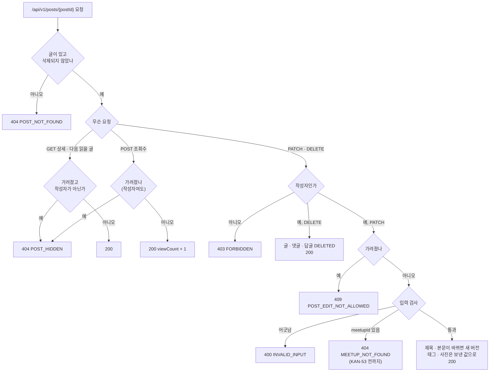
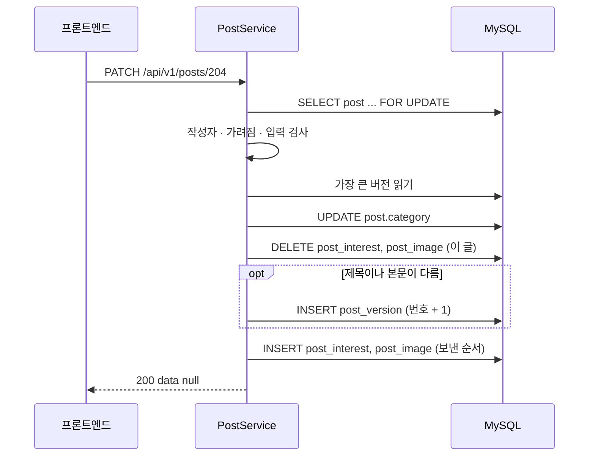
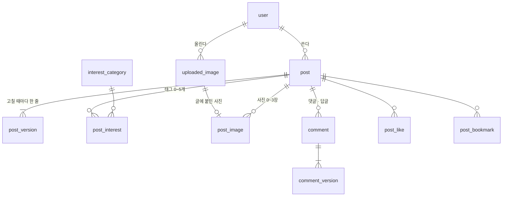

# KAN-51 [BE] 08 커뮤니티 ①: 글 목록 · 쓰기 · 상세 · 수정 · 삭제 · 조회수 · 관련 글 · 하이라이트

- Jira: [KAN-51](https://it-ting.atlassian.net/browse/KAN-51)
- 브랜치: `feature/be/KAN-51-community-posts`

## 계획

### 목표

커뮤니티 글을 읽고 쓰는 기본 API 8개와 그 밑의 테이블을 만든다.

- `GET /api/v1/posts` ([API 명세](../api/08-community.md#get-apiv1posts))
- `GET /api/v1/posts/highlights` ([API 명세](../api/08-community.md#get-apiv1postshighlights))
- `POST /api/v1/posts` ([API 명세](../api/08-community.md#post-apiv1posts))
- `GET /api/v1/posts/{postId}` ([API 명세](../api/08-community.md#get-apiv1postspostid))
- `PATCH /api/v1/posts/{postId}` ([API 명세](../api/08-community.md#patch-apiv1postspostid))
- `DELETE /api/v1/posts/{postId}` ([API 명세](../api/08-community.md#delete-apiv1postspostid))
- `POST /api/v1/posts/{postId}/views` ([API 명세](../api/08-community.md#post-apiv1postspostidviews))
- `GET /api/v1/posts/{postId}/related-posts` ([API 명세](../api/08-community.md#get-apiv1postspostidrelated-posts))

범위 밖:
- 좋아요 · 저장 · 댓글 API, `comment_like` 테이블: KAN-52
- 사진 올리기(`POST /api/v1/images`)와 사진 저장소, 신고(`report`, `report_action`), 내 활동, 연결할 모임 목록, **글에 모임 연결하기**: KAN-53 (A, B)
- 알림: 이 8개 API는 알림을 만들지 않는다(API 명세)
- 삭제 2주 뒤 버전 · 사진을 지우는 예약 작업, 붙지 않은 사진 지우기 (G)

### 정한 것

| # | 질문 | 정한 답 | 정한 사람 |
|---|---|---|---|
| 1 | 요청 · 응답 · 에러 | `docs/api/08-community.md` 그대로. 글쓰기는 `201`과 `{postId}`, 수정 · 삭제는 `data: null`, 조회수는 `{viewCount}` | API 명세 |
| 2 | 상태 | `PUBLIC` · `HIDDEN` · `DELETED`. 없는 글 · 삭제된 글은 `404 POST_NOT_FOUND`, 가려진 글은 작성자에게만 보이고 남에게는 `404 POST_HIDDEN`. 가려진 글은 고칠 수 없음(`409 POST_EDIT_NOT_ALLOWED`), 지울 수는 있음. 남의 글을 고치거나 지우면 `403 FORBIDDEN` | API 명세 |
| 3 | 버전 | 제목 · 본문은 `post_version`에 쌓고 가장 큰 번호를 보여 준다. 제목이나 본문이 바뀔 때만 새 버전, 버전이 둘 이상이면 `isEdited` | API 명세, DB 설계 |
| 4 | 글 삭제 | `post`와 그 글의 댓글 · 답글을 한 트랜잭션에서 `DELETED` + `deleted_at`. 좋아요 · 저장 줄은 지우지 않음 | API 명세 |
| 5 | 인기 점수 | 요청 시각부터 168시간 안의 `post_like` 수. 같으면 새 글이 먼저. TOP5는 0점 제외, 관심사는 최근 7일 공개 글의 태그를 대분류별로 세어 8개(같으면 id 작은 것) | API 명세 |
| 6 | 다음 읽을 글 | 태그의 대분류가 하나라도 같은 공개 글, 지금 글 빼고 3개. 태그 없는 글이면 모든 공개 글에서 | API 명세 |
| 7 | 글자 수 | 제목 1 ~ 50자, 본문 1 ~ 1,000자, 공백만은 안 됨. 코드 포인트로 센다(`@CodePointLength`, KAN-44). 미리보기도 앞 100 코드 포인트 | API 명세, KAN-44 |
| 8 | 막는 장치 | 8개 모두 로그인 필요, `@AllowDuringOnboarding` · `@AllowBeforeNewTerm`을 붙이지 않는다(목록 절 "온보딩을 마치고 이번 학기를 고른 계정만") | API 명세 |
| 9 | 마이그레이션 이름 | `V<yyyyMMdd>_<HHmm>__<설명>.sql` | KAN-42 |

### 이번에 정할 것 (2026-11-23 모두 승인)

| # | 무엇 | 제안 | 까닭 |
|---|---|---|---|
| A | 이번에 만드는 테이블 | `post`, `post_version`, `post_interest`, `uploaded_image`, `post_image`, `post_like`, `post_bookmark`, `comment`, `comment_version`을 만든다. `comment_like`는 KAN-52, `report` · `report_action`은 KAN-53에서 만든다. 그때까지 `isReportedByMe`는 늘 `false` | 이번 API의 `likeCount` · 인기순 · TOP5 · 다음 읽을 글이 `post_like`를, `isBookmarked`가 `post_bookmark`를, `commentCount` · 댓글순 · 글 삭제가 `comment`를 읽는다. 테이블이 없으면 계산을 0으로 박아 두었다가 다음 티켓에서 다시 써야 한다. 테스트는 줄을 직접 넣어 확인한다. 신고는 방명록 · 사용자 대상과 복구 이력까지 엮여 있어 신고 API와 함께 만드는 편이 낫다 |
| B | 글에 모임 연결 | `meetup` 테이블이 아직 없다(KAN-48 시작 전). 이번에는 `post.meetup_id` 칼럼을 만들지 않고, `meetupId`가 오면 연결할 모임이 없으므로 늘 `404 MEETUP_NOT_FOUND`로 답한다. `PROMOTION` · `REVIEW`인데 `meetupId`가 없으면 명세대로 `400`. 그래서 KAN-53 전까지 API로는 자유 글만 쓸 수 있다. 상세의 `meetup`은 늘 `null`. KAN-53이 칼럼 · FK · 고를 수 있는 모임 검사를 더한다. `MEETUP_NOT_FOUND`는 이번에 `CommunityErrorCode`에 두고 KAN-53에서 모임 영역의 것으로 바꾼다 | 없는 모임을 가리킬 FK를 만들 수 없다. 모임이 하나도 없는 지금은 "어떤 모임 id도 없다"가 명세와 맞는 답이다. 연결 검사(07 모임 ① 필요)는 Jira에서도 KAN-53으로 나눠 두었다 |
| C | 사진 | 이번에 `uploaded_image`(`image_url VARCHAR(500)`, 프로필 사진 칸과 같은 길이)와 `post_image`를 만들고, `imageIds` 검사(있음 · 내가 올림 · 다른 글에 안 붙음, 0 ~ 3개, 안 겹침)와 붙이기 · 떼기까지 한다. 어긋나면 명세대로 `400 INVALID_INPUT`. 글에서 뗀 사진은 `post_image` 줄만 지우고 `uploaded_image`는 남긴다(지우는 때는 KAN-53). 올리는 API가 없으니 테스트는 `uploaded_image` 줄을 직접 넣는다. 채팅 메시지에 붙은 사진 검사는 06 채팅에서 더한다 | 글을 쓰고 고치는 코드를 한 번에 끝내고, KAN-53은 올리기 · 저장소만 하면 되게 한다. URL은 저장소가 정해지지 않아도 500자면 충분하다 |
| D | 검색어 | 앞뒤 공백을 지우고 빈 문자열이면 검색하지 않는다. 남은 문자열 전체를(띄어쓰기 포함) 최신 버전의 제목 · 본문, 작성자 닉네임에서 `LIKE '%검색어%'`로 찾는다. `%` · `_`는 글자 그대로 찾는다. 영어 대소문자는 구분하지 않는다(DB 정렬 규칙). 50자 넘으면 `400` | 글 수가 적은 지금은 전문 검색 색인 없이 충분하다. 여러 낱말을 따로 찾는 방식은 쓰는 모습을 본 뒤 더한다 |
| E | 인기 점수 · 관심사 미리 계산 | 미리 계산하지 않고 요청마다 SQL로 센다. `post_like(created_at)` 색인을 둔다 | 최근 7일 좋아요 수만 세므로 가볍다. 느려지면 그때 캐시를 더한다 |
| F | 글을 너무 자주 쓰는 것 막기 | 이번에는 제한하지 않는다 | 로그인 · 온보딩을 마친 사람만 쓴다. KAN-44 닉네임 확인과 같은 판단 |
| G | 2주 뒤 지우는 예약 작업 | 이번에 만들지 않는다. 버전 · 사진을 지우는 예약 작업은 사진 저장소가 정해진 뒤(KAN-53 이후) 따로 티켓을 만든다. 남은 일에 적는다 | 사진 파일을 지우려면 저장소가 정해져야 한다. 글은 2주 동안 남아 있어야 하므로 지금 없어도 명세를 어기지 않는다 |
| H | "사용자 표시"를 만드는 곳 | `user/dto/UserDisplayResponse`와 여러 id를 한 번에 읽는 `user/service/UserDisplayService`를 만든다. KAN-45(프로필 팝업)도 같은 모양을 쓰므로, 먼저 병합되는 쪽의 것을 다른 쪽이 가져다 쓴다 | 글 작성자 · 댓글 · 모임 · 방명록이 모두 같은 모양이다. 목록 20개의 작성자를 한 번에 읽어야 쿼리가 늘지 않는다 |

### 만들 것

| 파일 | 내용 |
|---|---|
| `db/migration/V20261123_<시각>__create_community.sql` | A의 테이블 9개. `post`의 상태 · 카테고리 ENUM, `post_version UNIQUE(post_id, version)`, `post_image.image_id` UNIQUE · `sort_order` 1 ~ 3, `post_interest` 복합 PK, 목록 · 인기 집계용 색인 |
| `community/domain` | `Post`, `PostVersion`, `PostImage`, `PostInterest`, `UploadedImage`, `PostCategory`, `PostStatus`, `CommunityErrorCode`(`POST_NOT_FOUND`, `POST_HIDDEN`, `POST_EDIT_NOT_ALLOWED`, `MEETUP_NOT_FOUND`). 댓글 · 좋아요 · 저장은 이번 API가 읽기만 하므로 엔티티 없이 SQL로 센다(엔티티는 KAN-52) |
| `community/repository` | 쓰기는 JPA. 목록 · 하이라이트 · 다음 읽을 글 · 글 카드는 거르기 · 정렬이 여러 갈래라 `NamedParameterJdbcTemplate`으로 SQL을 쓴다 |
| `community/service` | `PostService`(쓰기 · 수정 · 삭제 · 조회수), `PostQueryService`(목록 · 상세 · 하이라이트 · 다음 읽을 글). 수정은 글 행을 잠가 버전 번호가 겹치지 않게 한다. 조회수는 `UPDATE ... view_count = view_count + 1` |
| `community/controller/PostController` | 8개 API |
| `community/dto` | `PostCreateRequest`, `PostUpdateRequest`(모든 값 필수: `meetupId`는 키가 빠진 것과 `null`을 구분), `PostCardResponse`, `PostListResponse`, `PostDetailResponse`, `PostHighlightsResponse`, `RelatedPostsResponse`, `PostCreateResponse`, `PostViewResponse` |
| `user/dto/UserDisplayResponse`, `user/service/UserDisplayService` | H |
| 문서 | `docs/db/community.md`(`uploaded_image.image_url` 길이, 색인, 이번에 만든 테이블), `docs/api/08-community.md`(D 검색 방법, B 모임 연결은 KAN-53까지), 필요하면 `docs/api-convention.md` |

### 테스트

| API | 정상 | 실패 |
|---|---|---|
| `GET /api/v1/posts` | 카테고리 · 내 관심사만 · 대분류 · 검색어(제목 · 본문 · 닉네임, `%` 글자 그대로)를 함께 걸기. 최신순 · 인기순(8일 전 좋아요는 안 셈) · 댓글순(삭제 댓글 안 셈, 가려진 댓글은 셈). 가려진 · 삭제된 글 빠짐. 페이지 수, 없는 페이지 → 빈 목록. 글 카드의 썸네일 · 수 · `isBookmarked` · 탈퇴한 작성자 | `size=51`, `keyword` 51자, 모르는 `sort` → `400 INVALID_INPUT`. 로그인 없이 → `401` |
| `GET /api/v1/posts/highlights` | TOP5 순서 · 0점 제외, 관심사 8개 · 같으면 id 순 · 7일 넘은 글 안 셈 | 로그인 없이 → `401` |
| `POST /api/v1/posts` | 자유 글 + 태그 + 사진 2장 → `201`, DB에 버전 1 · 태그 · 사진 순서 | 제목 51자 · 공백만 · 태그 6개 · 같은 태그 두 번 · 없는 대분류 · 남이 올린 사진 · 이미 붙은 사진 → `400`. `PROMOTION`에 `meetupId` 없음 → `400`. `meetupId` 있음 → `404 MEETUP_NOT_FOUND` |
| `GET /api/v1/posts/{postId}` | 남의 글(`isMine` false, 겹치는 관심사), 내 글(`authorSharedInterests` []), 가려진 내 글(`isHidden` true, `canEdit` false), 고친 글(`isEdited`) | 없는 글 · 삭제된 글 → `404 POST_NOT_FOUND`. 가려진 남의 글 → `404 POST_HIDDEN` |
| `PATCH /api/v1/posts/{postId}` | 제목을 바꾸면 버전 2, 태그 · 사진만 바꾸면 버전 그대로, 뺀 사진은 글에서 떨어짐 | 남의 글 → `403 FORBIDDEN`. 가려진 글 → `409 POST_EDIT_NOT_ALLOWED`. 삭제된 글 → `404`. `meetupId` 키 빠짐 → `400` |
| `DELETE /api/v1/posts/{postId}` | 글과 댓글 · 답글이 `DELETED`, 좋아요 · 저장 줄은 남음. 가려진 내 글도 지움 | 남의 글 → `403`. 이미 지운 글 → `404 POST_NOT_FOUND` |
| `POST /api/v1/posts/{postId}/views` | 두 번 부르면 2 오름, 작성자가 불러도 오름 | 삭제된 글 → `404 POST_NOT_FOUND`, 가려진 글(작성자여도) → `404 POST_HIDDEN` |
| `GET /api/v1/posts/{postId}/related-posts` | 대분류가 겹치는 글만, 지금 글 뺌, 인기 순 3개, 태그 없는 글이면 전체에서 | 없는 글 → `404 POST_NOT_FOUND`, 가려진 남의 글 → `404 POST_HIDDEN` |

## 결과

### 한눈에 보기

글 하나를 열고 고치는 요청이 갈리는 곳:

글 수정이 한 트랜잭션에서 하는 일:

새로 만든 테이블(굵은 관계)과 읽기만 하는 테이블(`user`, `user_profile`, `interest_category`, `interest`, `user_interest`):

새로 만든 테이블: `post`, `post_version`, `post_interest`, `uploaded_image`, `post_image`, `comment`, `comment_version`, `post_like`, `post_bookmark`.

### 바꾼 것

| 파일 | 내용 |
|---|---|
| `db/migration/V20261123_1545__create_community.sql` | 테이블 9개. `post_image`에 `UNIQUE(post_id, sort_order)`, 색인 `post(status, created_at)` · `post_like(created_at, post_id)` · `comment(post_id, status)` |
| `community/domain` | `Post`, `PostVersion`, `PostInterest`, `PostImage`, `UploadedImage`, `PostCategory`, `PostStatus`, `PostSort`, `PostRules`, `CommunityErrorCode` |
| `community/repository` | JPA 저장소 5개(글 잠금, 조회수 +1, 댓글 일괄 삭제, 태그 · 사진 일괄 떼기), `PostQueryRepository`(목록 · 인기 · 관심사 · 카드 값을 SQL로) |
| `community/service/PostService` | 쓰기 · 수정 · 삭제 · 조회수. 입력 검사(대분류, 사진 주인 · 붙은 곳, 카테고리와 모임)를 모아 `fields`로 |
| `community/service/PostQueryService` | 목록 · 하이라이트 · 상세 · 다음 읽을 글. 카드의 수와 내 상태를 목록 전체에 한 번에 센다 |
| `community/controller/PostController` | 8개 API |
| `community/dto` | 요청 2개(`PostUpdateRequest.meetupId`는 키가 빠진 것과 null을 구분), 응답 8개 |
| `user/dto/UserDisplayResponse`, `user/service/UserDisplayService` | 사용자 표시. 여러 계정을 쿼리 한 번으로 |
| `test/.../community/PostReadApiTests`, `PostWriteApiTests`, `support/CommunitySteps` | 통합 테스트 24개 |
| `docs/db/community.md` | `image_url` 길이, `post_image` UNIQUE, 색인, `meetup_id`는 KAN-53에서 더함 |
| `docs/api/08-community.md` | 검색어 찾는 법, 정한 것 2개, 구현 단계 항목 정리 |

### 확인한 것

- `./gradlew build` 통과. 테스트 193개(기존 169 + 새 24)
- `git merge-tree --write-tree HEAD origin/dev`: 충돌 없음(2026-11-23, dev `35d107a`)
- 로컬 코드 리뷰: P0 0건, P1 0건

### 계획과 달라진 점

- `post_image`에 계획에 없던 `UNIQUE(post_id, sort_order)`를 더했다. 한 글에 같은 순서의 사진이 둘 생기지 않게 한다. DB 문서에도 적었다.
- `PostRules`(글자 수 · 개수 상수)를 `community/domain`에 두었다. 요청 DTO 두 개와 미리보기가 함께 쓴다.
- 글 수정의 `meetupId`는 Jackson이 키가 빠진 것과 `null`을 둘 다 빈 `Optional`로 읽어, 키가 빠진 것을 알도록 전용 역직렬화기(`PostUpdateRequest.KeyRequiredLongDeserializer`)를 붙였다.
- 댓글 · 좋아요 · 저장은 이번 API가 SQL로 세기만 하므로 엔티티를 만들지 않았다(계획대로). 엔티티는 KAN-52에서 만든다.

### 남은 일

- KAN-52: 좋아요 · 저장 · 댓글 API와 `comment_like`. 댓글 · 좋아요 엔티티
- KAN-53: `post.meetup_id` 칼럼 · FK와 고를 수 있는 모임 검사(`MEETUP_NOT_FOUND`를 모임 영역 코드로 옮김), 상세의 `meetup` 카드, `report` · `report_action`과 `isReportedByMe`, 사진 올리기 · 저장소 · 붙지 않은 사진 지우기
- 06 채팅: 채팅 메시지에 붙은 사진도 "다른 곳에 붙은 사진"으로 막기
- 따로 티켓: 삭제 2주 뒤 버전 · 사진을 지우는 예약 작업(G)
- KAN-45와 맞추기: 먼저 병합되는 쪽의 `UserDisplayResponse`를 다른 쪽이 쓴다(H)

### 검토 순서

1. `docs/db/community.md`, `docs/api/08-community.md`의 바뀐 줄
2. `V20261123_1545__create_community.sql` → `community/domain`
3. `PostController` → `PostService` → `PostQueryService` → `PostQueryRepository`
4. `user/service/UserDisplayService`
5. `PostWriteApiTests`, `PostReadApiTests`
