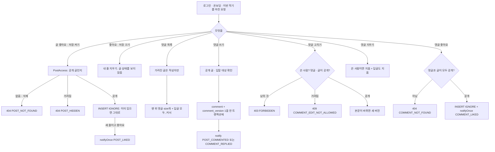
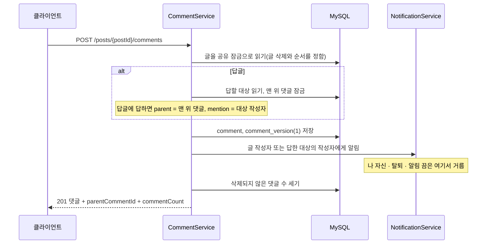
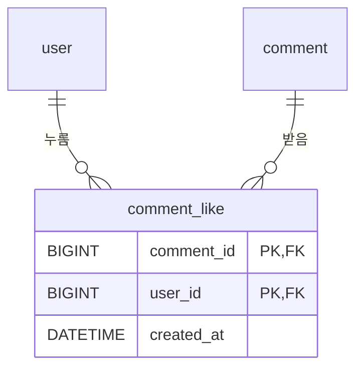

# KAN-52 [BE] 08 커뮤니티 ②: 댓글 · 좋아요 · 저장

- Jira: [KAN-52](https://it-ting.atlassian.net/browse/KAN-52)
- 브랜치: `feature/be/KAN-52-community-comments`

## 계획

### 목표

글의 좋아요 · 저장, 댓글과 답글의 목록 · 쓰기 · 수정 · 삭제, 댓글 좋아요를 만든다. 댓글 좋아요 테이블 `comment_like`를 이 작업에서 만든다. 댓글 · 좋아요 알림을 붙이고, 커뮤니티 알림에 글 제목이 나오게 한다.

- `PUT` · `DELETE /api/v1/posts/{postId}/like` ([API 명세](../api/08-community.md#put-apiv1postspostidlike))
- `PUT` · `DELETE /api/v1/posts/{postId}/bookmark` ([API 명세](../api/08-community.md#put-apiv1postspostidbookmark))
- `GET /api/v1/posts/{postId}/comments` ([API 명세](../api/08-community.md#get-apiv1postspostidcomments))
- `POST /api/v1/posts/{postId}/comments` ([API 명세](../api/08-community.md#post-apiv1postspostidcomments))
- `PATCH /api/v1/comments/{commentId}` ([API 명세](../api/08-community.md#patch-apiv1commentscommentid))
- `DELETE /api/v1/comments/{commentId}` ([API 명세](../api/08-community.md#delete-apiv1commentscommentid))
- `PUT` · `DELETE /api/v1/comments/{commentId}/like` ([API 명세](../api/08-community.md#put-apiv1commentscommentidlike))

범위 밖:
- 신고와 `isReportedByMe`: KAN-53. 그때까지 댓글의 `isReportedByMe`는 글처럼 늘 `false`다(KAN-51 A)
- 내 활동(댓글 단 글, 저장한 글 목록): KAN-53
- 삭제 2주 뒤 버전을 지우는 예약 작업: 따로 티켓(KAN-51 G)

### 정한 것

| # | 질문 | 정한 답 | 정한 사람 |
|---|---|---|---|
| 1 | 요청 · 응답 · 에러 | `docs/api/08-community.md` 그대로. 댓글 쓰기는 `201` | API 명세 |
| 2 | 막는 장치 | 10개 모두 로그인 필요, `@AllowDuringOnboarding` · `@AllowBeforeNewTerm`을 붙이지 않는다 | API 명세 "목록", KAN-51 8 |
| 3 | 글의 상태 | 없거나 삭제된 글은 `404 POST_NOT_FOUND`, 가려진 글은 `404 POST_HIDDEN`. 가려지거나 삭제된 글에는 좋아요 · 저장 · 댓글 쓰기를 할 수 없다(작성자도). 댓글 목록은 가려진 글의 작성자만 볼 수 있다 | API 명세 "글과 댓글의 상태" |
| 4 | 좋아요 · 저장 | `PUT`으로 켜고 `DELETE`로 끈다. 이미 켜져 있거나 꺼져 있어도 성공. 좋아요를 취소해도 이미 만든 알림은 지우지 않는다. 내 글도 저장할 수 있다 | API 명세 |
| 5 | 댓글 목록 | 답글이 아닌 댓글을 등록순으로 `size`개(기본 10, 1 ~ 100), 답글은 모두 붙인다. 커서 방식. `DELETED`는 빼고, `HIDDEN` 댓글은 본문 없이 자리를 지키고 답글은 그대로 | API 명세 |
| 6 | 댓글 쓰기 | 본문 1 ~ 300자, 공백만은 안 됨(코드 포인트로 센다, KAN-44). 답글은 한 단계: 답글에 답하면 같은 댓글 아래에 달고 `mention_user_id`에 그 답글의 작성자. 답할 대상이 이 글에 없거나 삭제 · 가려졌으면 `404 COMMENT_NOT_FOUND`. `comment` · `comment_version`을 한 트랜잭션으로 | API 명세 |
| 7 | 댓글 수정 · 삭제 | 쓴 사람만(아니면 `403 FORBIDDEN`). 가려진 댓글은 고칠 수 없고(`409 COMMENT_EDIT_NOT_ALLOWED`) 지울 수는 있다. 본문이 달라질 때만 새 버전. 댓글을 지우면 달린 답글도 한 트랜잭션에서 `DELETED` | API 명세 |
| 8 | 알림 | 댓글 → 글 작성자 `POST_COMMENTED`, 답글 → 답한 대상의 작성자 `COMMENT_REPLIED`(갈 곳 모두 글 id). 좋아요는 `notifyOnce`로 `POST_LIKED:<글 id>:<누른 사람 id>`, `COMMENT_LIKED:<댓글 id>:<누른 사람 id>`. 나 자신 · 탈퇴 · 알림 끔은 `NotificationService`가 거른다 | Jira 티켓, KAN-54 |
| 9 | 커뮤니티 알림의 글 제목 | `NotificationTargetReader`(갈 곳 `POST`)를 구현해 가장 큰 버전의 제목을 싣는다. 삭제한 글은 결과에서 뺀다 | Jira 티켓, KAN-54 |
| 10 | 마이그레이션 | `V<yyyyMMdd>_<HHmm>__create_comment_like.sql`. `comment_like(comment_id, user_id, created_at)`, 복합 PK, DB 설계 그대로(미정 칸 없음) | DB 설계, KAN-42 |

### 이번에 정할 것 (2026-11-24 유예린 승인)

| # | 무엇 | 제안 | 까닭 |
|---|---|---|---|
| A | 댓글을 너무 자주 쓰는 것 막기 (API 명세 "구현 단계로 넘기는 것" 4) | 이번에는 제한하지 않는다 | 글도 제한하지 않기로 했다(KAN-51 F). 로그인 · 온보딩을 마친 사람만 쓴다. 신고 기능(KAN-53)이 생긴 뒤 쓰는 모습을 보고 정한다 |
| B | 가려진 글 · 삭제된 글에 달린 댓글을 고치고 지우기, 좋아요 누르기 (명세에 없음) | **승인안(제안과 다름)**: 삭제된 글의 댓글은 함께 삭제되므로 `404 COMMENT_NOT_FOUND`. 가려진 글에 달린 내 댓글은 **지울 수만 있다**. 고치면 `409 COMMENT_EDIT_NOT_ALLOWED`, 댓글 좋아요는 `404 COMMENT_NOT_FOUND` | 가려진 글에는 좋아요 · 댓글을 할 수 없다는 규칙을 그 글의 댓글에도 맞춘다. 고치기는 수정 API의 기존 에러 코드를 써서 에러 목록을 늘리지 않는다 |
| C | 커뮤니티 알림에 **가려진 글**의 제목을 보여 줄지 | 보여 준다. 삭제한 글만 빼서 제목이 `null` | 가려진 글의 알림을 받는 사람은 글 작성자(신고로 가려짐 알림, KAN-53)와 이미 그 글에 댓글을 단 사람이다. 제목이 빠지면 작성자가 어느 글이 가려졌는지 알 수 없다 |
| D | 패키지 | 모두 `community`에 둔다. 댓글은 `CommentController` · `CommentService` · `CommentQueryService`, 좋아요 · 저장은 `PostReactionController` · `PostReactionService`, 알림 제목은 `PostTargetReader`. 에러 코드는 `CommunityErrorCode`에 `COMMENT_NOT_FOUND`, `COMMENT_EDIT_NOT_ALLOWED`를 더한다 | 글 · 댓글 · 좋아요 테이블이 모두 커뮤니티 영역이다(KAN-51과 같은 영역) |

### 만들 것

| 파일 | 내용 |
|---|---|
| `db/migration/V20261124_0210__create_comment_like.sql` | `comment_like`. FK `comment_id` → `comment`, `user_id` → `user` |
| `community/domain` | `Comment`, `CommentVersion`, `CommentStatus`, `CommentLike`, `PostLike`, `PostBookmark` 엔티티(테이블은 KAN-51에서 만듦, `comment_like`만 새로) |
| `community/repository` | 댓글 · 버전 · 좋아요 · 저장 저장소. 이미 누른 좋아요 · 저장은 겹쳐 넣지 않는다(동시에 두 번 눌러도 `500`이 나지 않게) |
| `community/service` | `PostReactionService`(글 좋아요 · 저장), `CommentService`(쓰기 · 수정 · 삭제 · 좋아요), `CommentQueryService`(목록, 커서), `PostTargetReader` |
| `community/controller` | `PostReactionController`, `CommentController` |
| `community/dto` | `PostLikeResponse`, `PostBookmarkResponse`, `CommentResponse`, `CommentListResponse`, `CommentCreateRequest` · `CommentCreateResponse`, `CommentUpdateRequest` · `CommentUpdateResponse`, `CommentDeleteResponse`, `CommentLikeResponse` |
| `docs/api/08-community.md` | B, C의 결정. "구현 단계로 넘기는 것"에 A 표시 |

### 테스트

| API | 정상 | 실패 |
|---|---|---|
| `PUT /posts/{id}/like` | 좋아요 수 +1, 다시 눌러도 그대로, 글 작성자에게 알림 한 번(취소 후 다시 눌러도 한 번) | 가려진 글 `404 POST_HIDDEN`, 없는 글 `404 POST_NOT_FOUND` |
| `DELETE /posts/{id}/like` | 좋아요 수 -1, 누르지 않았어도 성공 | 로그인 안 함 `401` |
| `PUT` · `DELETE /posts/{id}/bookmark` | 저장 · 취소, 내 글도 저장, 알림 없음 | 삭제된 글 `404 POST_NOT_FOUND` |
| `GET /posts/{id}/comments` | 등록순, 답글 붙음, 삭제 빠짐, 가려진 댓글은 본문 `null`, 커서로 이어 받기 | 가려진 글을 남이 부름 `404 POST_HIDDEN`, `size=101` `400 INVALID_INPUT` |
| `POST /posts/{id}/comments` | 댓글 · 답글 · 답글의 답글(`mentionUser`, 같은 부모), `commentCount`, 알림 | 빈 본문 · 301자 `400`, 가려진 답 대상 `404 COMMENT_NOT_FOUND`, 가려진 글 `404 POST_HIDDEN` |
| `PATCH /comments/{id}` | 본문이 바뀌면 `isEdited: true`, 같으면 버전이 늘지 않음 | 남의 댓글 `403 FORBIDDEN`, 가려진 댓글 · 가려진 글의 댓글 `409 COMMENT_EDIT_NOT_ALLOWED` |
| `DELETE /comments/{id}` | 답글까지 삭제, `commentCount`, 가려진 글의 내 댓글도 삭제 | 남의 댓글 `403`, 이미 지운 댓글 `404 COMMENT_NOT_FOUND` |
| `PUT` · `DELETE /comments/{id}/like` | 좋아요 수, 댓글 작성자에게 알림 한 번 | 가려진 댓글 · 가려진 글의 댓글 `404 COMMENT_NOT_FOUND` |
| 알림 제목 | 커뮤니티 알림에 최신 제목, 가려진 글도 제목 | 삭제된 글은 `null` |

## 결과

### 한눈에 보기

댓글 쓰기의 순서:

새로 만든 테이블:

### 바꾼 것

| 파일 | 내용 |
|---|---|
| `db/migration/V20261124_0210__create_comment_like.sql` | `comment_like`. 복합 PK, FK 두 개 |
| `community/domain` | `Comment`, `CommentVersion`, `CommentLike`, `PostLike`, `PostBookmark`, `CommentRules`(글자 수 · 목록 크기). `CommunityErrorCode`에 `COMMENT_NOT_FOUND`, `COMMENT_EDIT_NOT_ALLOWED`. `Post.isPublic()` |
| `community/repository` | 댓글 · 버전 · 좋아요 · 저장 저장소. 켜기는 `INSERT IGNORE`. `CommentQueryRepository`(목록을 한 페이지씩 모아 읽음), `PostRepository.findByIdForShare`, `PostQueryRepository.findTitles` |
| `community/service` | `PostAccess`(글 상태 규칙), `PostReactionService`, `CommentService`, `CommentQueryService`, `CommentCursor`, `PostTargetReader` |
| `community/controller` | `PostReactionController`(4), `CommentController`(6) |
| `community/dto` | 응답 · 요청 record 11개 |
| `docs/api/08-community.md` | B, C의 결정과 댓글 제한을 두지 않은 것(A) |
| 테스트 | 새 클래스 6개, 72개. `NotificationReaderApiTests`는 가짜 글 제목 리더 대신 실제 글을 쓰도록 바꿨다 |

### 확인한 것

- `./gradlew build` 통과. 테스트 375개, 실패 0. 새 테스트 72개: `CommentWriteApiTests` 22, `CommunityNotificationTests` 16, `CommentReadApiTests` 12, `PostReactionApiTests` 12, `CommentLikeApiTests` 7, `PostReactionConcurrencyTests` 3(두 스레드가 동시에 눌러도 줄 하나 · 알림 하나)
- 숫자는 Gradle 테스트 결과 XML에서 셌다
- 로컬 코드 리뷰: P0 0건, P1 0건

### 계획과 달라진 점

- 댓글 상태에 `CommentStatus`를 따로 만들지 않고 글과 같은 `PostStatus`(`PUBLIC` · `HIDDEN` · `DELETED`)를 썼다. 값이 같고 DB 칼럼도 같은 ENUM이다
- 글 상태를 확인하는 규칙을 `PostAccess` 하나에 모았다(계획에 없던 클래스)
- 동시에 같은 글이 지워지는 경우를 막으려고 댓글을 쓸 때 글을 공유 잠금으로, 답글을 쓸 때 맨 위 댓글을 잠금으로 읽는다

### 남은 일

- KAN-53: 신고와 댓글의 `isReportedByMe`(지금은 늘 `false`), 내 활동(댓글 단 글, 저장한 글)
- 따로 티켓: 삭제 2주 뒤 댓글 버전을 지우는 예약 작업(KAN-51 G)

### 검토 순서

1. `docs/api/08-community.md`의 바뀐 부분(B, C)
2. `PostAccess` → `PostReactionService` → `CommentService`(상태 · 권한 규칙)
3. `CommentQueryService` · `CommentQueryRepository`(목록과 커서)
4. 마이그레이션과 `CommunityNotificationTests`
