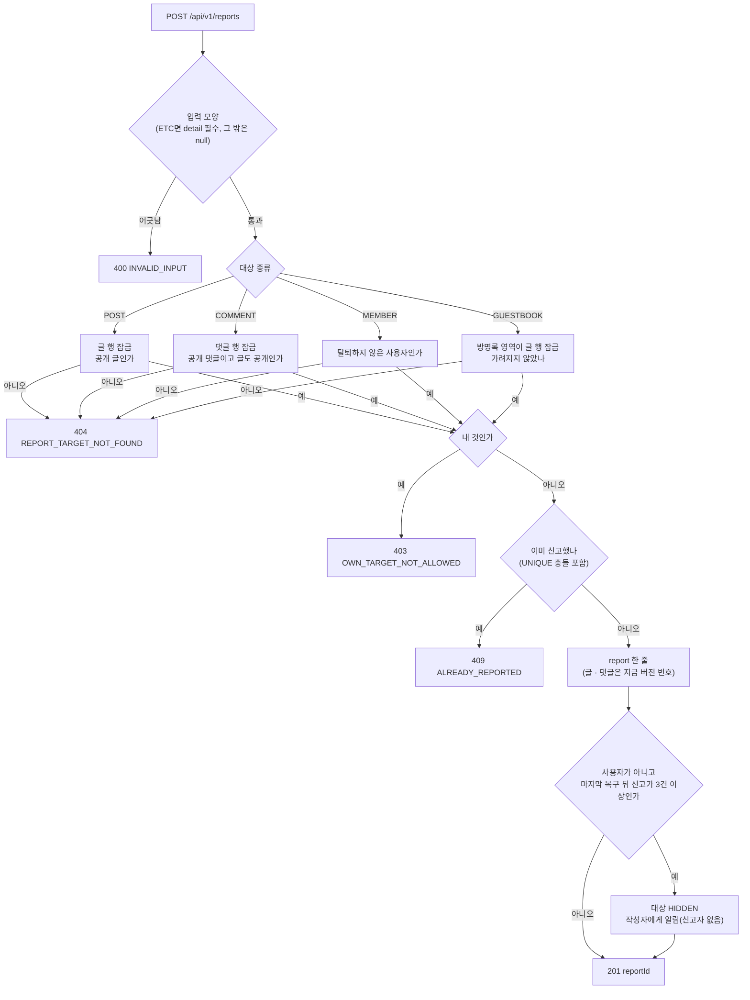
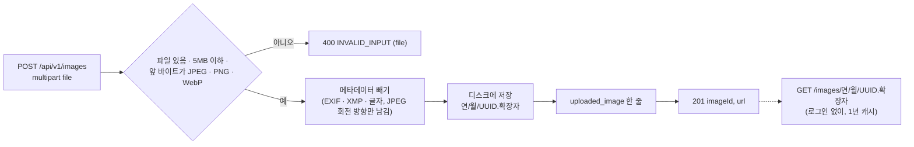
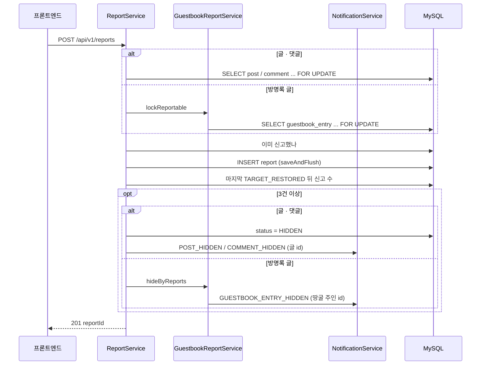
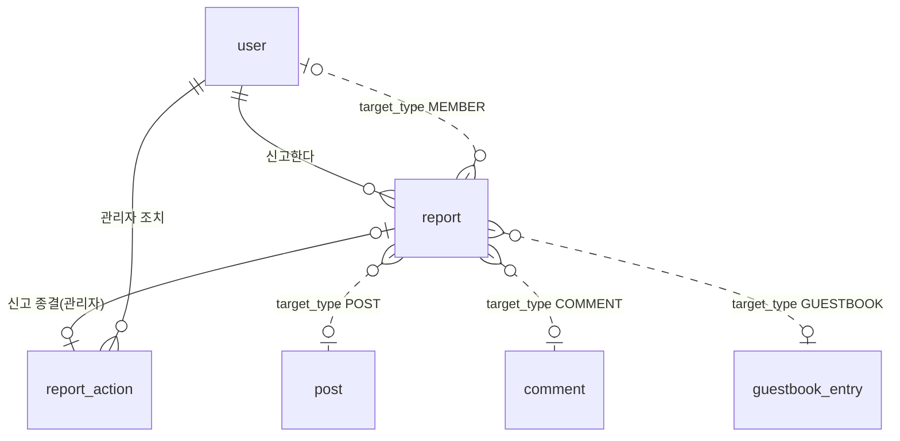

# KAN-53 [BE] 08 커뮤니티 ③: 내 활동 · 사진 올리기 · 신고 · 연결할 모임

- Jira: [KAN-53](https://it-ting.atlassian.net/browse/KAN-53)
- 브랜치: `feature/be/KAN-53-community-activity`

## 계획

### 목표

내 활동(내가 쓴 글 · 댓글 단 글 · 저장한 글과 그 개수), 사진 올리기, 신고 API와 그 밑의 테이블을 만든다. 신고 테이블이 생기므로 KAN-51 · KAN-52에서 늘 `false`로 두었던 `isReportedByMe`를 채운다.

- `GET /api/v1/me/posts` ([API 명세](../api/08-community.md#get-apiv1meposts))
- `GET /api/v1/me/posts/summary` ([API 명세](../api/08-community.md#get-apiv1mepostssummary))
- `POST /api/v1/images` ([API 명세](../api/08-community.md#post-apiv1images))
- `POST /api/v1/reports` ([API 명세](../api/08-community.md#post-apiv1reports))

범위 밖:
- `GET /api/v1/me/linkable-meetups`, `post.meetup_id` 칼럼과 글에 모임 연결하기, 상세의 `meetup` 카드: `meetup` 테이블(KAN-48, 진행 중)이 병합된 뒤 새 티켓에서 한다 (A)
- 붙지 않은 사진과 글에서 뗀 사진 지우기, 삭제 2주 뒤 버전 · 사진 지우기: 채팅 ②(KAN-56)가 `chat_message_image`를 만든 뒤 따로 티켓에서 한다 (E)
- 신고를 살피고 가려진 것을 복구하는 관리자 API: 11 관리자
- 알림 외의 실시간 소식: 06 채팅 ③

### 정한 것

| # | 질문 | 정한 답 | 정한 사람 |
|---|---|---|---|
| 1 | 요청 · 응답 · 에러 | `docs/api/08-community.md` 그대로. 사진은 `201`과 `{imageId, url}`, 신고는 `201`과 `{reportId}`. 신고 에러는 `403 OWN_TARGET_NOT_ALLOWED`, `404 REPORT_TARGET_NOT_FOUND`, `409 ALREADY_REPORTED` | API 명세 |
| 2 | 내 활동의 탭 | `WRITTEN`은 삭제되지 않은 내 글(가려진 글은 `isHidden: true`, `canEdit: false`)을 새 글부터. `COMMENTED`는 내 삭제되지 않은 댓글 · 답글이 달린 공개 글을 내가 가장 최근에 댓글 단 글부터, `myLatestComment` · `myCommentCount`와 함께. `BOOKMARKED`는 저장한 공개 글을 최근에 저장한 글부터, `bookmarkedAt`과 함께. 개수는 카테고리로 거르지 않은 세 탭의 글 수 | API 명세 |
| 3 | 사진 검사 | 파일 하나, JPEG · PNG · WebP, 5MB 이하. 형식은 파일 이름이 아니라 내용(앞 바이트)으로 본다. 어긋나면 `400 INVALID_INPUT`과 `fields[].field = "file"` | API 명세, API 공통 규칙 |
| 4 | 신고할 수 있는 대상 | `POST` · `COMMENT`는 `PUBLIC`, `MEMBER`는 탈퇴하지 않은 계정, `GUESTBOOK`은 가려지지 않은 방명록 글. 자기 것이면 `403`, 이미 신고했으면 `409` | API 명세 |
| 5 | 가려지는 때 | 글 · 댓글 · 방명록 글은 마지막 복구(`report_action`의 `TARGET_RESTORED`) 뒤에 접수된 신고의 신고자가 3명이 되는 신고에서 `HIDDEN`. 대상 행을 잠그고 신고 · 상태 변경 · 알림을 한 트랜잭션에서. 사용자 신고는 자동 조치 없음. 글 · 댓글 신고에는 지금 버전 번호를 `target_version`에 적는다 | API 명세, DB 설계 |
| 6 | 가려질 때의 알림 | 글: `notify(작성자, POST_HIDDEN, null, 글 id)`. 댓글: `notify(작성자, COMMENT_HIDDEN, null, 글 id)`. 방명록 글: `notify(쓴 사람, GUESTBOOK_ENTRY_HIDDEN, null, 땅굴 주인 id)`. 신고한 사람은 넘기지 않는다 | KAN-54, Jira 티켓 |
| 7 | 이번에 만드는 테이블 | `report`, `report_action`. `report_action`은 관리자 API가 아직 없지만 재가림 집계가 마지막 복구를 읽으므로 함께 만든다 | KAN-51 A, DB 설계 |
| 8 | 막는 장치 | 4개 모두 로그인 필요, `@AllowDuringOnboarding` · `@AllowBeforeNewTerm`을 붙이지 않는다(목록 절 "온보딩을 마치고 이번 학기를 고른 계정만") | API 명세 |
| 9 | 너무 자주 신고 · 올리기 막기 | 이번에는 제한하지 않는다 | KAN-51 F, KAN-52와 같은 판단 |
| 10 | 마이그레이션 이름 | `V<yyyyMMdd>_<HHmm>__<설명>.sql` | KAN-42 |

### 이번에 정할 것 (2026-11-25 모두 승인)

| # | 무엇 | 제안 | 까닭 |
|---|---|---|---|
| A | 연결할 모임을 나누기 | 이번에는 위 4개 API만 만든다. `GET /api/v1/me/linkable-meetups`, `post.meetup_id` 칼럼 · FK, 글쓰기 · 수정의 모임 연결 검사, `MEETUP_NOT_FOUND`를 모임 영역 코드로 옮기기, 상세의 `meetup` 카드는 KAN-48 병합 뒤 Jira에 새 티켓("[BE] 08 커뮤니티 ④: 글에 모임 연결")을 만들어 한다. 그때까지 글쓰기의 `meetupId`는 KAN-51대로 `404 MEETUP_NOT_FOUND` | `meetup` 테이블이 없어 FK와 모임 카드를 만들 수 없다. KAN-48은 다른 사람이 진행 중이라 기다리면 나머지 4개도 멈춘다. 모임 연결은 모임 테이블 모양을 그대로 따라야 해서 KAN-48 뒤에 하는 편이 겹치지 않는다 |
| B | 사진 저장소와 주소 | `ImageStorage` 인터페이스를 두고 이번에는 **서버 디스크**에 저장하는 구현 하나를 만든다. 저장 폴더는 설정값(`app.images.storage-dir`, local은 `./.local-images`, 테스트는 임시 폴더, prod는 환경 변수). 파일 이름은 `images/2026/11/<UUID>.<jpg·png·webp>`. 서버가 `GET /images/**`로 파일을 주고, 주소는 `<app.images.public-base-url>/images/2026/11/8f3a1c…webp`. GCS 같은 외부 저장소는 운영 서버를 열 때 이 인터페이스의 구현을 더한다 | 테스트 서버(KAN-63)는 VM 한 대라 디스크로 충분하고, 클라우드 키나 버킷 없이 바로 돌릴 수 있다. 외부 저장소를 지금 붙이면 KAN-63에서 정할 GCP 설정(버킷, 서비스 계정)을 먼저 정해야 한다. 인터페이스로 나눠 두면 바꿀 때 API와 DB는 그대로다 |
| C | 사진 파일을 로그인 없이 볼 수 있나 | `/images/**`는 로그인 없이 연다(지금도 `/api/**` 밖은 열려 있다). 대신 이름을 UUID로 지어 주소를 모르면 찾을 수 없게 한다 | 프론트엔드가 ``로 바로 그리고, 나중에 CDN · 외부 저장소로 옮겨도 같은 방식이다. 로그인 검사를 하려면 사진마다 서버를 거쳐야 하고 다른 도메인에서 쿠키가 따라가야 한다 |
| D | 사진의 위치 정보 | 저장하기 전에 사진에 든 메타데이터(촬영 위치가 담기는 EXIF · XMP)를 걷어낸다. JPEG는 APP1 구간, PNG는 `eXIf` · `tEXt` · `iTXt` · `zTXt` 청크, WebP는 `EXIF` · `XMP ` 청크를 빼고 그림 데이터는 그대로 둔다. 다시 인코딩하지 않는다 | 휴대폰 사진에는 찍은 곳의 GPS 좌표가 들어 있어, 글에 붙인 사진으로 다른 사용자의 집 위치가 나갈 수 있다. 다시 인코딩하면 화질이 바뀌고 WebP는 Java 기본 라이브러리로 쓸 수 없어, 메타데이터 구간만 뺀다 |
| E | 붙지 않은 사진 지우기 | 이번에는 하지 않는다. 채팅 ②(KAN-56)가 `chat_message_image`를 만든 뒤, 2주 뒤 버전 · 사진 지우기(KAN-51 G)와 함께 따로 티켓에서 한다 | 지금 지우는 작업을 만들면 아직 없는 채팅 사진 테이블을 몰라 채팅에 붙은 사진을 지울 수 있다. 붙지 않은 사진은 남아 있어도 동작은 명세와 같다 |
| F | 방명록 글을 가리는 곳 | 방명록 글의 `status`를 `HIDDEN`으로 바꾸는 일은 `guestbook` 영역의 서비스 메서드(`GuestbookEntryService.hideByReports`)가 하고, 신고 서비스는 그것을 부른다. `docs/api/08-community.md`의 신고 절에 "신고 API가 방명록 글의 상태를 바꾸는 까닭"을 적는다 | 리뷰 규칙(P1)이 "자기 영역이 아닌 데이터를 바꾸면 문서에 까닭을 적은 경우만 예외"다. 신고는 네 대상을 API 하나로 받기로 명세에서 정했으므로 바꾸는 일 자체는 피할 수 없고, 테이블은 그 영역의 코드로만 건드리게 한다 |
| G | 가려진 글에 달린 댓글의 신고 | 댓글이 `PUBLIC`이어도 그 글이 가려졌거나 삭제됐으면 `404 REPORT_TARGET_NOT_FOUND` | 가려진 글의 댓글은 다른 사람에게 보이지 않고, KAN-52가 가려진 글의 댓글에는 좋아요도 `404`로 막았다. 같은 규칙을 따른다 |
| H | 업로드 크기 한도를 넘는 요청 | `spring.servlet.multipart.max-file-size: 5MB`, `max-request-size: 6MB`로 두고, 넘으면 `GlobalExceptionHandler`가 `400 INVALID_INPUT`과 `file` 필드 메시지("5MB 이하의 사진만 올릴 수 있습니다.")로 답한다 | 지금 기본값은 1MB라 명세의 5MB를 받지 못한다. 한도를 넘는 요청은 컨트롤러에 닿기 전에 끊기므로 공통 처리기에서 응답 틀로 바꿔야 한다 |

### 만들 것

| 파일 | 내용 |
|---|---|
| `db/migration/V20261125_<시각>__create_report.sql` | `report`(`UNIQUE(reporter_id, target_type, target_id)`, 집계 색인 `(target_type, target_id, id)`), `report_action`(`report_id` UNIQUE, 복구 조회 색인 `(target_type, target_id, action_type, id)`, 조치 종류별 칼럼 조합 CHECK) |
| `community/domain` | `Report`, `ReportAction`, `ReportTargetType`, `ReportReason`, `ReportStatus`, `ReportActionType`. `CommunityErrorCode`에 `REPORT_TARGET_NOT_FOUND`, `OWN_TARGET_NOT_ALLOWED`, `ALREADY_REPORTED` |
| `community/repository` | `ReportRepository`(마지막 복구 뒤 신고자 수), `ReportActionRepository`, `MyPostQueryRepository`(세 탭과 개수를 SQL로). `PostQueryRepository` · `CommentQueryRepository`의 `isReportedByMe` 계산 |
| `community/service` | `ReportService`(대상 잠금 → 검사 → 신고 → 가림 → 알림), `MyPostQueryService`, `ImageService`(검사 → 메타데이터 빼기 → 저장 → `uploaded_image`) |
| `community/service/image` | `ImageStorage`(인터페이스), `LocalDiskImageStorage`, `ImageFormat`(앞 바이트로 형식 판별), `ImageMetadataStripper` |
| `community/controller` | `MyPostController`(2개), `ImageController`, `ReportController` |
| `community/dto` | `MyPostListResponse`, `MyPostCardResponse`, `MyPostSummaryResponse`, `ImageUploadResponse`, `ReportCreateRequest`, `ReportCreateResponse` |
| `guestbook/service/GuestbookEntryService` | `hideByReports`(F)와 신고할 대상 읽기(잠금) |
| `global/config/ImageResourceConfig` | `/images/**`를 저장 폴더에서 준다 |
| `global/error/GlobalExceptionHandler` | `MaxUploadSizeExceededException` → `400 INVALID_INPUT`(H) |
| `application*.yml` | `spring.servlet.multipart`, `app.images.storage-dir`, `app.images.public-base-url`. `.gitignore`에 `.local-images/` |
| 문서 | `docs/db/community.md`(`report` · `report_action` 색인과 제약, 사진 저장소), `docs/api/08-community.md`(B 저장소와 주소, F 까닭, G, "구현 단계로 넘기는 것" 정리), `docs/api-convention.md`("다루지 않는 것"의 저장소 줄 정리) |

### 테스트

| API | 정상 | 실패 |
|---|---|---|
| `GET /api/v1/me/posts` | `WRITTEN`: 가려진 내 글이 `isHidden` true · `canEdit` false로 나옴, 삭제한 글 빠짐, 새 글부터. `COMMENTED`: 글 하나에 한 줄, 가장 최근 내 댓글 · 개수, 내 댓글을 모두 지운 글 · 가려진 글 빠짐, 최근에 댓글 단 글부터. `BOOKMARKED`: `bookmarkedAt`, 가려진 글 빠졌다가 공개로 돌아오면 다시 나옴. `category`로 거르기, 페이지 수 | `tab` 없음 · 모르는 값, `size=51` → `400 INVALID_INPUT`. 로그인 없이 → `401` |
| `GET /api/v1/me/posts/summary` | 세 수가 각 탭의 `totalItems`와 같음(카테고리 무시) | 로그인 없이 → `401` |
| `POST /api/v1/images` | JPEG · PNG · WebP → `201`, `uploaded_image` 한 줄, 주소로 파일을 받을 수 있음. GPS가 든 JPEG의 EXIF가 저장본에서 빠짐 | 파일 없음, 확장자만 `.jpg`인 텍스트, GIF, 5MB 넘음 → `400 INVALID_INPUT`(`file`). 로그인 없이 → `401` |
| `POST /api/v1/reports` | 글 · 댓글 · 사용자 · 방명록 글 → `201`, 글 · 댓글에 `target_version`. 서로 다른 3명째 신고에서 `HIDDEN`과 작성자 알림 1건(신고자 없음), 2명까지는 `PUBLIC`. 사용자는 3명이어도 그대로. 복구 뒤 새 3명이 신고해야 다시 가려짐. 신고한 사람에게 목록 · 상세 · 댓글의 `isReportedByMe` true | `ETC`에 `detail` 없음 · 101자, 모르는 `targetType` → `400`. 내 글 · 댓글 · 나 · 내 방명록 글 → `403 OWN_TARGET_NOT_ALLOWED`. 없는 · 삭제된 · 가려진 대상, 탈퇴한 사용자, 가려진 글의 댓글 → `404 REPORT_TARGET_NOT_FOUND`. 같은 대상 두 번(동시에 두 번 포함) → `409 ALREADY_REPORTED`. 세 사람이 동시에 신고해도 알림 1건 |

## 결과

### 한눈에 보기

신고 한 건이 갈리는 곳:

사진 올리기:

세 번째 신고가 한 트랜잭션에서 하는 일:

새로 만든 테이블은 `report`, `report_action`이다. 나머지는 읽기만 하거나(`user`, `comment`) 상태만 바꾼다(`post`, `comment`, `guestbook_entry`의 `status`).

### 바꾼 것

| 파일 | 내용 |
|---|---|
| `db/migration/V20261125_1031__create_report.sql` | `report`(UNIQUE `(reporter_id, target_type, target_id)`, 색인 `(target_type, target_id, id)`, 버전 · 상세 CHECK), `report_action`(`report_id` UNIQUE, 복구 색인, 조치 종류별 칼럼 CHECK) |
| `community/domain` | `Report`, `ReportTargetType`, `ReportReason`, `ReportStatus`, `ReportRules`, `MyPostTab`, `ImageRules`. `Post` · `Comment`에 `hide()`. `CommunityErrorCode`에 신고 코드 3개 |
| `community/repository` | `ReportRepository`(마지막 복구 뒤 신고 수), `MyPostQueryRepository`(세 탭 · 개수 · 저장 시각 · 내 댓글). `PostQueryRepository` · `CommentQueryRepository`에 `findReported` |
| `community/service` | `ReportService`, `MyPostQueryService`, `ImageService`. `PostQueryService` · `CommentQueryService`가 `isReportedByMe`를 채움. `PostQueryService.cards`를 내 활동이 함께 쓰도록 같은 패키지에 열었다 |
| `community/service/image` | `ImageStorage`, `LocalDiskImageStorage`, `ImageFormat`, `ImageMetadataStripper` |
| `community/controller` | `MyPostController`, `ImageController`, `ReportController` |
| `community/dto` | `MyPostListResponse`, `MyPostCardResponse`, `MyPostSummaryResponse`, `ImageUploadResponse`, `ReportCreateRequest`, `ReportCreateResponse` |
| `guestbook` | `GuestbookReportService`(잠그고 읽기, 가리고 알리기), `GuestbookEntry.hide()`, `GuestbookEntryRepository.findByIdForUpdate` |
| `global` | `ImageProperties`, `ImageResourceConfig`(`/images/**`), `GlobalExceptionHandler`(`MaxUploadSizeExceededException` → `400 file`, 깨진 multipart → `400`) |
| `application*.yml`, `.gitignore` | multipart 5MB · 6MB, `itting.images.*`(local은 `./.local-images`, test · prod는 `ITTING_IMAGES_STORAGE_DIR` · `ITTING_IMAGES_PUBLIC_BASE_URL`), `.local-images/` |
| 테스트 | `ReportApiTests`(15), `ReportConcurrencyTests`(2), `MyPostApiTests`(8), `ImageUploadApiTests`(7), `ImageUploadSizeLimitTests`(2, 실제 서버), `ImageMetadataStripperTests`(7). `support/TestImages`, `CommunitySteps`(땅굴 · 방명록 · 신고 · 복구), `TestcontainersConfiguration`(사진 임시 폴더), `ItTingApplicationTests`(prod의 사진 주소) |
| 문서 | `docs/api/08-community.md`(사진을 두는 곳과 주소, 메타데이터, 신고가 방명록을 바꾸는 까닭, 가려진 글의 댓글, `detail` 규칙, 정한 것 · 넘기는 것), `docs/db/community.md`(색인 · CHECK, 사진 저장소, `meetup_id`), `docs/api-convention.md`(저장소 줄) |

### 확인한 것

- `./gradlew build` 통과. 테스트 503개(기존 462 + 새 41)
- `git merge-tree --write-tree`: `origin/dev`(`a0cc1e4`), 열려 있는 PR #42(KAN-55) · #44(KAN-60)의 브랜치와 모두 충돌 없음(2026-11-25)
- 로컬 코드 리뷰: P0 0건, P1 0건
- PR CI: 비밀값 검사(gitleaks)가 테스트 도우미의 가짜 위치 글자 상수(`TestImages.SECRET`)를 API 키로 잘못 잡았다. 그 줄에 `gitleaks:allow`를 달고, 이미 푸시한 커밋의 줄은 `.gitleaksignore`에 적었다(`docs/ci.md`의 "비밀값이 잡혔을 때" 4)

### 계획과 달라진 점

- 설정 이름을 계획의 `app.images.*`가 아니라 이 저장소의 앞머리인 `itting.images.*`로 했다. 이름에 하이픈이 있어 환경 변수가 자동으로 이어지지 않으므로 `application.yml`에서 `ITTING_IMAGES_*`를 직접 잇는다(푸시 키와 같은 방식). test · prod에서 값이 없으면 서버가 뜨지 않는다.
- 방명록 쪽은 계획의 `GuestbookEntryService.hideByReports` 대신 새 클래스 `GuestbookReportService`에 잠가 읽기와 가리기 · 알림을 모았다(기존 `GuestbookService`는 그대로). 신고 트랜잭션 안에서만 부르게 `MANDATORY`다.
- `ReportAction` 엔티티는 만들지 않았다. 이번 코드는 SQL로 마지막 복구만 읽고, 줄을 만드는 쪽은 관리자 API다.
- JPEG는 EXIF를 다 빼면 휴대폰 사진이 옆으로 누워 보이므로 회전 방향(Orientation) 하나만 담은 EXIF를 다시 넣었다(D를 구현하며 판단). WebP의 회전 방향은 남기지 않는다.
- `detail`을 `ETC`가 아닌 사유에 보내면 무시하지 않고 `400`으로 답했다. API 명세가 "그 밖에는 `null`"이고 DB CHECK도 그렇다. 문서에 적었다.
- 댓글 단 글의 `myLatestComment`는 신고로 가려진 내 댓글이어도 본문을 준다. 내 글이고, `myCommentCount`도 가려진 댓글을 센다(명세 "DELETED가 아닌 줄").
- 본문이 multipart가 아니면 `415 UNSUPPORTED_MEDIA_TYPE`(공통 코드), 깨진 multipart는 `400`으로 답하게 처리기를 더했다.
- MockMvc는 서블릿의 업로드 한도를 거치지 않아, 5MB 넘는 요청은 실제 서버를 띄운 테스트(`ImageUploadSizeLimitTests`)로 확인했다.
- test · prod 설정 주석의 사진 줄은 KAN-60(PR #44)이 같은 자리에 줄을 더해 충돌이 나서, 푸시 키 줄 뒤로 옮겼다.

### 남은 일

- 글에 모임 연결하기(A): KAN-48 병합 뒤 Jira에 "[BE] 08 커뮤니티 ④: 글에 모임 연결" 티켓을 만든다. `GET /api/v1/me/linkable-meetups`, `post.meetup_id`, 모임 연결 검사, `MEETUP_NOT_FOUND`를 모임 영역 코드로 옮기기, 상세의 `meetup` 카드
- 붙지 않은 사진과 2주 뒤 버전 · 사진 지우기(E, KAN-51 G): KAN-56이 `chat_message_image`를 만든 뒤 따로 티켓
- KAN-63(테스트 서버): `ITTING_IMAGES_STORAGE_DIR`(서버를 다시 띄워도 남는 볼륨)과 `ITTING_IMAGES_PUBLIC_BASE_URL`을 넣어야 서버가 뜬다
- KAN-56(채팅 ②): 메시지 사진은 이 API로 올리고, "다른 곳에 붙은 사진" 검사에 `chat_message_image`를 더한다
- 운영 서버를 열 때: 외부 저장소(GCS 등) 구현을 `ImageStorage`에 더한다

### 검토 순서

1. `docs/api/08-community.md`, `docs/db/community.md`의 바뀐 줄
2. `V20261125_1031__create_report.sql` → `Report`
3. `ReportController` → `ReportService` → `ReportRepository`, `GuestbookReportService`
4. `ImageController` → `ImageService` → `ImageMetadataStripper`, `LocalDiskImageStorage`, `ImageResourceConfig`, `GlobalExceptionHandler`
5. `MyPostController` → `MyPostQueryService` → `MyPostQueryRepository`, `PostQueryService` · `CommentQueryService`의 `isReportedByMe`
6. `ReportApiTests`, `ReportConcurrencyTests`, `MyPostApiTests`, `ImageUploadApiTests`, `ImageUploadSizeLimitTests`, `ImageMetadataStripperTests`
