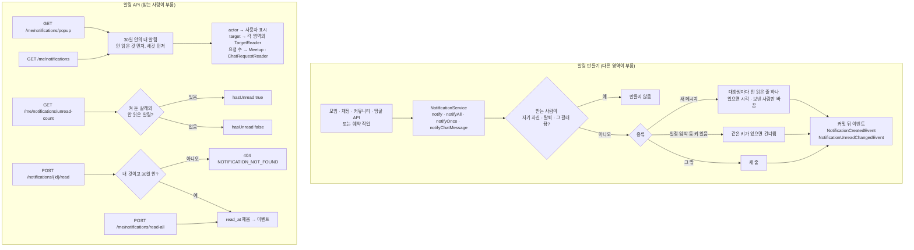
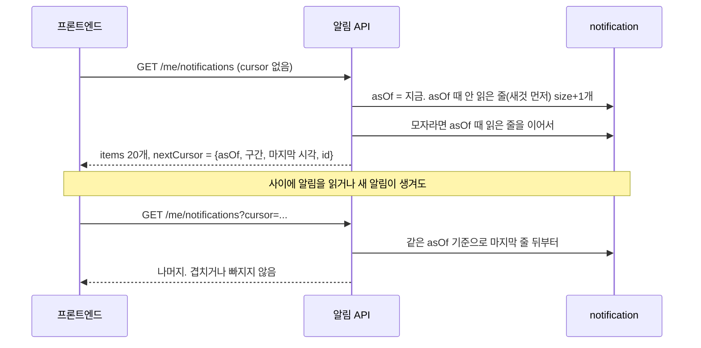
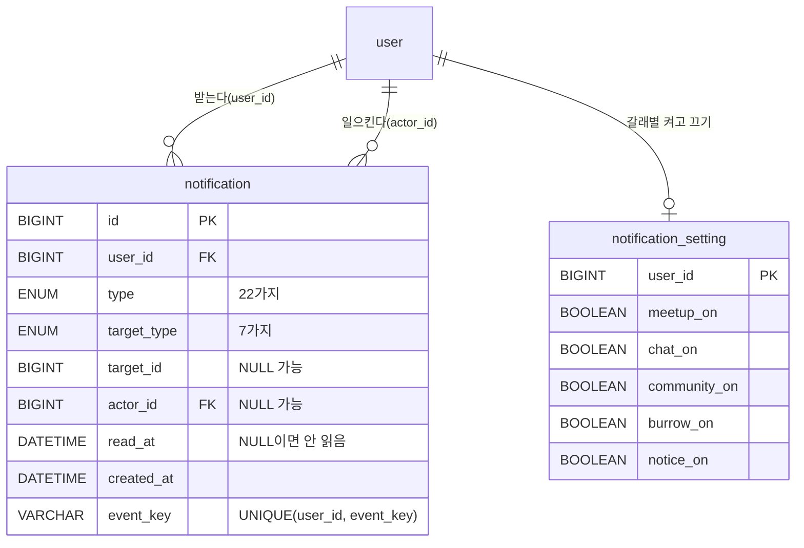

# KAN-54 [BE] 09 알림

- Jira: [KAN-54](https://it-ting.atlassian.net/browse/KAN-54)
- 브랜치: `feature/be/KAN-54-notification`

## 계획

### 목표

알림 팝업 · 목록 · 안 읽은 수 · 읽음 처리 API 다섯 개를 만들고, 다른 영역(모임, 커뮤니티, 채팅, 땅굴)이 알림을 만들 때 부를 서비스 메서드를 둔다.

- `GET /api/v1/me/notifications/popup` ([API 명세](../api/09-notification.md#get-apiv1menotificationspopup))
- `GET /api/v1/me/notifications` ([API 명세](../api/09-notification.md#get-apiv1menotifications))
- `GET /api/v1/me/notifications/unread-count` ([API 명세](../api/09-notification.md#get-apiv1menotificationsunread-count))
- `POST /api/v1/notifications/{notificationId}/read` ([API 명세](../api/09-notification.md#post-apiv1notificationsnotificationidread))
- `POST /api/v1/me/notifications/read-all` ([API 명세](../api/09-notification.md#post-apiv1menotificationsread-all))
- 다른 영역이 부를 알림 만들기 메서드([알림을 만들 때의 규칙](../api/09-notification.md#알림을-만들-때의-규칙))

범위 밖:
- 실제로 알림을 만드는 일(모임 신청, 댓글, 대화 요청 등): 각 영역 티켓(KAN-47 · 48 · 49 · 50 · 52 · 53 · 55 · 56)이 아래 B의 메서드를 부른다
- 실시간 소식 `NOTIFICATION_UNREAD_CHANGED`를 브라우저로 보내는 연결: KAN-57. 이번에는 C의 이벤트만 낸다
- 브라우저 푸시: KAN-59. 이번에는 C의 이벤트만 낸다
- 알림 설정 API(`GET/PATCH /me/notification-settings`): KAN-58. 테이블은 이번에 만든다(F)
- 모임 일정 임박 알림의 예약 작업: 모임 티켓(KAN-48 또는 49). 이번에는 같은 알림을 한 번만 만드는 메서드(`notifyOnce`)만 둔다
- 서비스 공지를 모든 사용자에게 알리기(`NOTICE_PUBLISHED`): 11 관리자에서 공지를 올리는 API와 함께
- 탈퇴할 때 받은 알림 지우기: KAN-61
- 방노트 알림: 명세에서 보류

### 정한 것

| # | 질문 | 정한 답 | 정한 사람 |
|---|---|---|---|
| 1 | 요청 · 응답 · 에러 | `docs/api/09-notification.md` 그대로. 에러는 읽음 API의 `404 NOTIFICATION_NOT_FOUND`(없음 · 남의 것 · 30일 지남)뿐 | API 명세 |
| 2 | 알림의 종류 · 갈래 · 갈 곳 | `type` 22가지, 갈래 5가지, `target.type` 7가지. 종류마다 갈래와 `target.type`이 하나로 정해져 있다 | API 명세 |
| 3 | 알림 한 줄 | `id`, `type`, `category`, `actor`(사용자 표시 또는 `null`), `target{type, id, title, startsAt}`, `isRead`, `createdAt`. 문구는 프론트엔드가 만든다 | API 명세 |
| 4 | 정렬 · 보관 | 안 읽은 것 먼저, 그 안에서 새것 먼저. 30일 안의 알림만 준다. 목록은 20개(1 ~ 50) 커서 방식, 팝업은 요청 알림 두 종류를 빼고 5개 | API 명세 |
| 5 | 안 읽은 수 · 빨간 점 | `unreadCount`는 모든 갈래, `hasUnread`는 지금 켠 갈래만. `notification_setting` 줄이 없으면 모두 켠 것 | API 명세, DB 설계 |
| 6 | 만들 때의 규칙 | 받는 사람이 그 갈래를 껐으면, 자기 자신이 한 일이면, 받는 사람이 탈퇴했으면 만들지 않는다 | API 명세 |
| 7 | 새 메시지 알림 | 대화방마다 안 읽은 줄 하나. 있으면 `created_at` · `actor_id`만 바꾼다. 대화방을 읽으면 그 줄도 읽음 | API 명세 |
| 8 | 일정 임박 중복 막기 | `event_key` + `UNIQUE(user_id, event_key)` | DB 설계 |
| 9 | 온보딩 · 새 학기 | 다섯 API 모두 표시를 붙이지 않는다(마친 계정만) | API 명세 목록 |
| 10 | 다른 영역이 알림을 만드는 것 | 알림은 그 일을 처리하는 다른 영역의 API가 만든다고 API 명세에 적혀 있다(자기 영역만 바꾼다는 규칙의 예외) | API 명세 |
| 11 | 마이그레이션 이름 | `V<yyyyMMdd>_<HHmm>__<설명>.sql` | 사용자 (KAN-42) |

### 이번에 정할 것 (2026-11-23 모두 승인)

| # | 무엇 | 제안 | 까닭 |
|---|---|---|---|
| A | 패키지 | `notification/{controller,service,repository,domain,dto}`. 에러 코드는 `NotificationErrorCode.NOTIFICATION_NOT_FOUND` | API 명세의 영역 이름 |
| B | 다른 영역이 부를 메서드 | `NotificationService`에 아래를 둔다. 모두 부른 쪽의 트랜잭션에 함께 들어간다(일이 되돌려지면 알림도 없다). 만들지 않는 경우(6)는 메서드 안에서 걸러 조용히 넘어간다. • `notify(Long receiverId, NotificationType type, Long actorId, Long targetId)`: 한 사람에게. `target.type`은 `type`에서 정해진다. `actorId` · `targetId`는 없으면 `null` • `notifyAll(Collection<Long> receiverIds, type, actorId, targetId)`: 여러 사람에게(모임 수정 · 취소 등) • `notifyOnce(receiverId, type, actorId, targetId, String eventKey)`: 같은 키가 있으면 건너뛴다. 일정 임박은 `MEETUP_START_REMINDER:{meetupId}:{startsAt 초}:{24H\|1H}` • `notifyChatMessage(receiverId, chatRoomId, senderId)`: 새 메시지 묶기(7) • `readChatRoom(userId, chatRoomId)`: 대화방을 읽을 때 | 티켓 설명이 "메서드의 모양을 계획서에 적어 07 · 08 · 06이 붙일 수 있게"라고 했다. 규칙(6)을 한곳에서 지키게 하면 각 영역이 잊을 일이 없다 |
| C | 실시간 소식 · 푸시와 잇는 법 | 알림이 생기거나 읽음이 바뀌면 커밋 뒤에 스프링 이벤트를 낸다. `NotificationUnreadChangedEvent(userId)`(KAN-57이 받아 `unreadCount` · `hasUnread`를 계산해 보낸다), `NotificationCreatedEvent(notificationId, userId)`(KAN-59가 받아 푸시). 이번에는 받는 쪽이 없다 | 알림 코드가 SSE · 푸시를 몰라도 된다. 커밋 뒤라 되돌려진 알림을 알리지 않는다 |
| D | 아직 없는 다른 영역의 값 | 요청 두 줄의 수(`meetup_application`, `chat_request`), 가장 최근 대화 요청자, 갈 곳의 이름 · 시작 시각(`meetup`, `post_version`, `notice`)은 테이블이 아직 없다. 알림 영역에 읽기용 인터페이스를 두고 다른 영역이 구현한다. • `MeetupRequestCountReader.countPending(hostId)` → KAN-49 • `ChatRequestReader.countReceivedPending(userId)`, `findLatestRequesterId(userId)` → KAN-55 • `NotificationTargetReader`(갈 곳 종류마다 하나, id 여러 개를 한 번에 읽어 `title` · `startsAt`) → KAN-48(모임 · 모임 대화방), KAN-51(글), KAN-58(공지) 구현이 없으면 수는 `0`, 요청자 · 이름 · 시작 시각은 `null`이다. 각 티켓 설명에 한 줄씩 더해 두겠다 | 지금 시작할 수 있는 티켓이라 다른 테이블을 기다리지 않는다. 응답 모양은 처음부터 명세대로이고, 값만 각 티켓이 채운다. 읽기만 하므로 자기 영역만 바꾼다는 규칙과도 맞는다 |
| E | 사용자 표시 | `user/dto/UserDisplayResponse`(`mole` 포함) + `user/service/UserDisplayService.findAll(Collection<Long> ids)` → `Map<Long, UserDisplayResponse>`. `user`, `user_profile`, `campus_floor`, `campus`를 한 번에 읽고, 탈퇴한 사람은 `id` · `isWithdrawn`만 | 00 공통의 모양이고 알림의 `actor`와 `latestChatRequester`가 쓴다. **KAN-45(프로필 팝업) · KAN-51(글 작성자)도 같은 것이 필요하다.** 먼저 병합되는 쪽 것을 나머지가 쓰도록, 지금 진행 중인 두 작업에 이 이름을 알려 주면 좋겠다 |
| F | 테이블 | `notification`: `type`은 22가지 `ENUM`, `target_type`은 7가지 `ENUM`, `event_key VARCHAR(191) NULL`, `UNIQUE(user_id, event_key)`, 인덱스 `(user_id, created_at, id)`. FK는 `user_id`, `actor_id` → `user`. `notification_setting`: 이번에 만든다. 다섯 갈래 `BOOLEAN NOT NULL DEFAULT TRUE`, `created_at` · `updated_at`. 설정 API는 KAN-58 | 빨간 점(5)과 만들 때의 규칙(6)이 설정을 읽어야 한다. 두 테이블 모두 `docs/db/notification.md`의 "알림 · 공지" 영역이다. 목록 · 수 · 정리가 모두 `user_id` + `created_at`으로 찾으므로 인덱스 하나로 된다 |
| G | 목록의 커서 | 첫 요청 시각을 `asOf`로 커서에 담아, 이어 받는 동안 "안 읽음"은 `asOf` 때의 상태로 본다(`read_at IS NULL OR read_at > asOf`), `asOf` 뒤에 생긴 알림은 빼고, 30일도 `asOf`에서 센다. 커서는 `{asOf, 안 읽음 구간인지, createdAt, id}`의 base64url JSON. 깨진 커서, 범위 밖 `size`, 없는 `category`는 `400 INVALID_INPUT` | 명세의 "이어 받는 사이에 읽음이 바뀌어도 이미 받은 알림이 다시 오지 않는다"를 지키려면 정렬 기준이 이어 받는 동안 고정되어야 한다. 새 메시지 알림은 시각이 바뀌면 `asOf` 뒤가 되어 다시 오지 않는다 |
| H | 30일이 지난 알림 지우기 | 매일 04:00(한국 시간) 예약 작업이 `created_at`이 30일 지난 줄을 1,000줄씩 지운다. `@EnableScheduling`을 켠다 | API는 이미 30일 안만 주므로 표에 쌓이는 것만 막는다. 명세(알림 8)와 DB 설계에 "자동으로 사라진다"가 있어 명세에 없는 삭제가 아니다. 이번에 하지 않으면 맡을 티켓이 없다 |
| I | 새 메시지 알림의 시각 바꾸기 | `BaseCreatedTimeEntity`의 `created_at`은 바꿀 수 없게 되어 있어, 묶을 때는 JPQL `UPDATE`로 `created_at` · `actor_id`를 바꾼다. 엔티티는 규칙대로 `BaseCreatedTimeEntity`를 상속한다 | `updated_at`이 없는 테이블이라 공통 규칙상 `BaseCreatedTimeEntity`다. 바꾸는 곳이 이 하나뿐이라 쿼리로 둔다 |
| J | 좋아요 알림 묶기(API 명세 "구현 단계로 넘기는 것") | 묶지 않는다. 좋아요를 취소했다 다시 눌러 알림이 또 생기는 것은 08 티켓이 `notifyOnce`에 `POST_LIKED:{postId}:{actorId}`를 넘겨 막을 수 있다 | 명세에 묶는다는 말이 없고, 묶으면 `actor` 하나로 보여 줄 수 없다. 넘긴 항목은 API 명세에 "정한 것"으로 옮긴다 |

### 만들 것

| 파일 | 내용 |
|---|---|
| `db/migration/V20261123_<시각>__create_notification.sql` | `notification`, `notification_setting` |
| `notification/domain` | `Notification`, `NotificationSetting`, `NotificationType`(갈래 · `target.type`을 함께 가진 enum), `NotificationCategory`, `NotificationTargetType`, `NotificationErrorCode` |
| `notification/repository` | `NotificationRepository`(목록 · 팝업 · 수 · 읽음 · 묶기 · 정리 쿼리), `NotificationSettingRepository` |
| `notification/service` | `NotificationService`(B의 만들기 메서드), `NotificationQueryService`(다섯 API), `NotificationCursor`, D의 읽기 인터페이스 셋, 이벤트 두 개(C), `NotificationCleanupJob`(H) |
| `notification/controller` | `NotificationController` 다섯 API |
| `notification/dto` | `NotificationPopupResponse`, `NotificationListResponse`, `NotificationItemResponse`, `NotificationUnreadCountResponse` |
| `user/dto/UserDisplayResponse`, `user/service/UserDisplayService` | E |
| `global/config/SchedulingConfig` | `@EnableScheduling` |
| 문서 | `docs/api/09-notification.md`(구현 단계로 넘긴 것 가운데 정한 것: 정리 작업, 좋아요 묶지 않음), `docs/db/notification.md`(인덱스, 기본값, 정리 작업) |

### 테스트

API는 테스트용 계정 두 개(나, 남)와 알림을 직접 넣어 확인한다. D의 인터페이스는 테스트에서 가짜 구현을 등록해 값이 응답에 실리는지 본다.

| API · 메서드 | 정상 | 실패 |
|---|---|---|
| `GET /me/notifications/popup` | 요청 알림 두 종류는 빠지고 5개까지, 안 읽은 것 먼저. 31일 된 알림은 빠짐. `actor` 사용자 표시, 탈퇴한 actor는 `isWithdrawn: true`. 읽기 구현이 있으면 요청 수 · 요청자 · `target.title`이 실림, 없으면 `0` · `null` | 로그인 없이 → `401`. 온보딩 중 → `403 ONBOARDING_INCOMPLETE` |
| `GET /me/notifications` | 25개 → 20개 + `hasNext`, 커서로 나머지 5개. 이어 받는 사이에 하나를 읽어도 겹치거나 빠지지 않음. `category=CHAT`이면 채팅만. 요청 알림 포함 | `size=51`, `category=FOO`, 깨진 `cursor` → `400 INVALID_INPUT`. 로그인 없이 → `401` |
| `GET /me/notifications/unread-count` | 안 읽은 수(30일 안). 채팅 알림만 안 읽었는데 채팅을 끔 → `unreadCount: 1`, `hasUnread: false` | 로그인 없이 → `401` |
| `POST /notifications/{id}/read` | 안 읽은 알림 → 읽음, 줄어든 수. 이미 읽은 알림 → `200`, 그대로. 이벤트가 커밋 뒤에 나감 | 남의 알림 · 없는 id · 31일 된 알림 → `404 NOTIFICATION_NOT_FOUND`. 로그인 없이 → `401` |
| `POST /me/notifications/read-all` | 모두 읽음, `{0, false}`. 남의 알림은 그대로 | 로그인 없이 → `401` |
| `NotificationService` | `notify`로 한 줄. `notifyOnce`를 두 번 → 한 줄. `notifyChatMessage` 두 번 → 한 줄, 시각 · actor가 새것. 읽은 뒤 다시 → 새 줄. `readChatRoom` → 읽음 | 갈래를 껐을 때, 자기 자신, 탈퇴한 받는 사람 → 만들지 않음. 부른 쪽 트랜잭션이 되돌려지면 알림도 없음 |
| 정리 작업 | 31일 된 줄만 지워짐 | |

## 결과

### 한눈에 보기

알림이 생기고 읽히는 길:

알림 목록을 이어 받는 순서(커서):

테이블(새로 만든 것: `notification`, `notification_setting` / 읽기만 하는 것: `user`, `user_profile`, `campus_floor`, `campus`):

### 바꾼 것

| 파일 | 내용 |
|---|---|
| `db/migration/V20261123_1546__create_notification.sql` | `notification`(UNIQUE `(user_id, event_key)`, 인덱스 `(user_id, created_at, id)` · `(created_at)`), `notification_setting`(기본값 켬) |
| `notification/domain` | `Notification`, `NotificationSetting`, `NotificationType`(갈래 · 갈 곳 · 일으킨 사람을 담는지), `NotificationCategory`, `NotificationTargetType`, `NotificationErrorCode` |
| `notification/repository` | `NotificationRepository`(팝업 · 목록 두 구간 · 수 · 읽음 · 대화방 읽음 · `insertIfAbsent` · `upsert` · 정리), `NotificationSettingRepository` |
| `notification/service/NotificationService` | 다른 영역이 부를 메서드 5개(B) |
| `notification/service/NotificationQueryService` | API 다섯 개. 다른 영역의 읽기 구현은 `ObjectProvider`로 받아 없으면 `0` · `null` |
| `notification/service/*Reader`, `NotificationTargetSummary` | 다른 영역이 구현할 읽기 인터페이스(D) |
| `notification/service/NotificationCursor` | 목록 커서(base64url) |
| `notification/service/Notification*Event`, `NotificationEventPublisher` | 커밋 뒤 이벤트(C) |
| `notification/service/NotificationCleanupJob`, `global/config/SchedulingConfig` | 30일 정리(H) |
| `notification/controller/NotificationController`, `notification/dto/*` | API와 응답 |
| `user/dto/UserDisplayResponse`, `user/service/UserDisplayService` | 사용자 표시. KAN-51과 같은 파일(E) |
| 테스트 | `NotificationApiTests`(13), `NotificationReaderApiTests`(3), `NotificationServiceTests`(9), `NotificationEventTests`(3), `support/NotificationSteps` |
| 문서 | `docs/api/09-notification.md`("구현하며 정한 것"), `docs/db/notification.md`(`event_key` 쓰임, 인덱스, 기본값, 정리 작업) |

### 확인한 것

- `./gradlew build` 통과(KAN-51 · 45가 병합된 dev 위). 테스트 262개(dev 234 + 새 28)
- `git merge-tree --write-tree HEAD origin/dev`: 충돌 없음
- 로컬 코드 리뷰: P0 0건, P1 0건
- Jira KAN-47 · 48 · 49 · 50 · 52 · 53 · 55 · 56 · 58 설명에 "알림(KAN-54)" 절을 더했다(부를 메서드, 구현할 읽기 인터페이스)

### 계획과 달라진 점

- **새 메시지 알림도 `event_key`를 쓴다**: 계획은 JPQL `UPDATE`로 시각을 바꾸고 없으면 넣는 것이었다(I). 메시지 두 개가 동시에 오면 줄이 둘 생길 수 있어, 안 읽은 동안 `CHAT_MESSAGE_RECEIVED:<대화방 id>` 키를 두고 MySQL `INSERT ... ON DUPLICATE KEY UPDATE`로 한 번에 넣거나 바꾼다. 읽으면(하나 읽음 · 모두 읽음 · 대화방 읽음) 키를 비운다. `docs/db/notification.md`에 적었다.
- **`notifyOnce`는 먼저 키를 찾아본 뒤 넣는다**: MySQL 드라이버가 `ON DUPLICATE KEY` 때 "찾은 줄 수"를 돌려줘 넣었는지 알 수 없어서다. 같은 키로 동시에 불리면 줄은 하나지만 이벤트가 두 번 나갈 수 있다(예약 작업이 겹칠 때만).
- **일으킨 사람을 드러내지 않는 종류는 `actor_id`를 저장하지 않는다**: 계획에 없던 안전장치. 거절 · 내보내기 · 신고로 가려짐 등에 부른 쪽이 실수로 사람을 넘겨도 응답에 나가지 않는다. 자기 자신을 빼는 데는 그 값을 쓴다.
- **사용자 표시는 KAN-51의 파일을 그대로 가져왔다**: 계획은 `UserDisplayService.findAll`이었지만, 병렬로 진행한 KAN-51이 같은 이름으로 먼저 푸시해(`getAll`) 두 파일을 바이트까지 같게 맞췄다. KAN-51(#32)과 KAN-45(#33)가 dev에 병합된 뒤에도 두 파일은 dev와 같다.
- **커서 모양**: 계획의 "base64url JSON" 대신 `asOf|U·R|createdAt|id`를 base64url로 감쌌다. 프론트엔드는 내용을 보지 않으므로 API는 같다.
- **정리 작업 인덱스 `(created_at)`을 더했다**: 모든 사용자의 오래된 줄을 지우는 쿼리가 표 전체를 읽지 않게 한다.

### 남은 일

- 각 영역 티켓이 알림을 만들고 읽기 인터페이스를 구현한다(KAN-47 · 48 · 49 · 50 · 52 · 53 · 55 · 56 · 58). 그 전까지 팝업의 요청 수는 `0`, 갈 곳의 이름은 `null`이다
- 실시간 소식 연결(KAN-57)이 `NotificationUnreadChangedEvent`를, 브라우저 푸시(KAN-59)가 `NotificationCreatedEvent`를 받는다
- 탈퇴할 때 받은 알림 지우기: KAN-61
- 확인 필요: 사용자 표시(KAN-51의 것)는 프로필이 없는 계정(관리자)도 탈퇴한 사람으로 보여 준다. 관리자가 알림을 일으키는 종류는 모두 `actor`를 담지 않아 지금은 드러나지 않는다

### 검토 순서

1. `docs/api/09-notification.md`의 "구현하며 정한 것", `docs/db/notification.md`
2. `V20261123_1546__create_notification.sql`, `notification/domain`
3. `NotificationController` → `NotificationQueryService` → `NotificationRepository`
4. `NotificationService`(다른 영역이 부를 메서드), 읽기 인터페이스, 이벤트
5. 테스트: `NotificationApiTests` → `NotificationReaderApiTests` → `NotificationServiceTests` → `NotificationEventTests`
