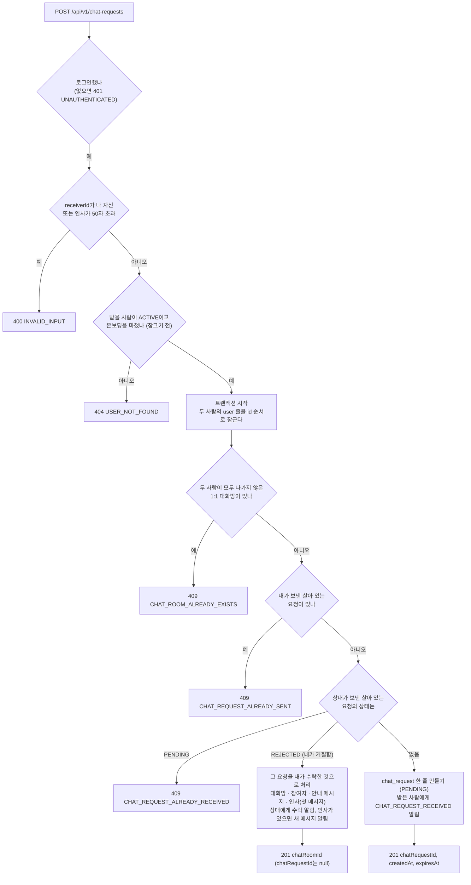
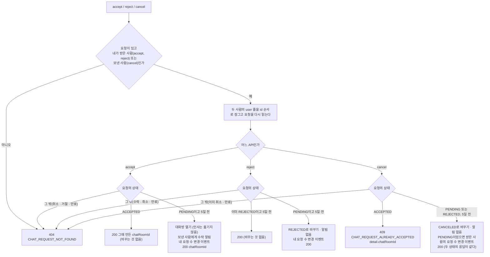
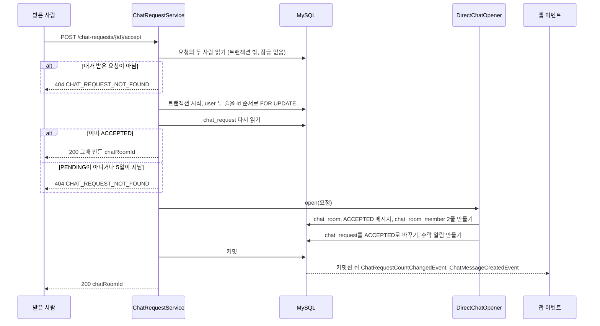
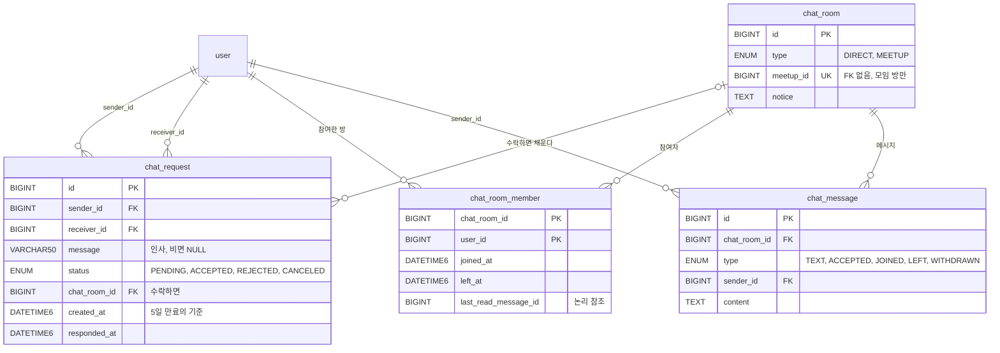

# KAN-55 [BE] 06 채팅 ①: 대화 요청 보내기 · 목록 · 수락 · 거절 · 취소

- Jira: [KAN-55](https://it-ting.atlassian.net/browse/KAN-55)
- 브랜치: `feature/be/KAN-55-chat-requests`

## 계획

### 목표

남의 땅굴에서 대화를 요청하고, 받은 요청을 수락 · 거절하고, 보낸 요청을 취소하는 API 6개를 만든다. 수락하면 1:1 대화방이 생기므로 대화방 · 참여자 · 메시지 테이블도 만든다.

- `POST /api/v1/chat-requests` ([API 명세](../api/05-explore-visit.md#post-apiv1chat-requests))
- `GET /api/v1/me/chat-requests` ([API 명세](../api/06-chat.md#get-apiv1mechat-requests))
- `GET /api/v1/me/chat-requests/count` ([API 명세](../api/06-chat.md#get-apiv1mechat-requestscount))
- `POST /api/v1/chat-requests/{chatRequestId}/accept` ([API 명세](../api/06-chat.md#post-apiv1chat-requestschatrequestidaccept))
- `POST /api/v1/chat-requests/{chatRequestId}/reject` ([API 명세](../api/06-chat.md#post-apiv1chat-requestschatrequestidreject))
- `POST /api/v1/chat-requests/{chatRequestId}/cancel` ([API 명세](../api/06-chat.md#post-apiv1chat-requestschatrequestidcancel))
- 알림 팝업의 "채팅 요청" 줄: `ChatRequestReader` 구현(KAN-54)

범위 밖:
- 대화 목록 · 대화방 · 메시지 보내기 · 읽음 · 나가기 · 공지: KAN-56(채팅 ②)
- 실시간 연결(`GET /api/v1/me/event-stream`)과 소식을 브라우저로 보내는 일: KAN-57(채팅 ③)
- 메시지 사진(`chat_message_image`): 사진 올리기(`uploaded_image`, KAN-53)가 있어야 해서 KAN-56
- 남의 땅굴 조회의 대화 버튼 상태(`chat.status`): KAN-46(탐색 ①, 서연). 이 작업은 그쪽이 읽을 수 있게 테이블만 만든다
- 탈퇴한 사람의 요청 지우기: KAN-61(회원 탈퇴)

### 정한 것

| # | 질문 | 정한 답 | 정한 사람 |
|---|---|---|---|
| 1 | 요청 · 응답 · 에러 | `docs/api/05-explore-visit.md`, `docs/api/06-chat.md` 그대로. 보내기는 늘 `201`, 나머지는 `200` | API 명세 |
| 2 | 살아 있는 요청 | 보낸 지 5일이 지나지 않았고(`now < created_at + 5일`) `PENDING`이거나 `REJECTED`. 정확히 5일이 되면 죽은 요청이다 | DB 설계 |
| 3 | 거절 숨기기 | 보낸 사람에게는 `REJECTED`도 `PENDING`과 똑같이 보이고 취소도 똑같이 성공한다 | API 명세, DB 설계 |
| 4 | 내가 거절한 사람에게 보내기 | 새 요청 없이 그 요청을 내가 수락한 것으로 처리하고 대화방을 연다. 인사는 내가 보낸 첫 메시지(`TEXT`)로 넣는다 | API 명세 |
| 5 | 동시에 들어올 때 | 두 사람의 `user` 줄을 id가 작은 것부터 잠그고(`SELECT ... FOR UPDATE`) 다시 읽은 뒤 판단한다. 서로 동시에 보내도 요청 1개, 동시에 수락해도 대화방 1개 | DB 설계 |
| 6 | 받을 사람 | `user.status`가 `ACTIVE`이고 `onboarded_at`이 있어야 한다. 아니면 `404 USER_NOT_FOUND`. 나 자신이면 `400 INVALID_INPUT` | API 명세 |
| 7 | 인사 | 50자 이하(글자 수는 코드 포인트로 센다). 빈 문자열이면 인사 없음(`NULL`) | API 명세 |
| 8 | 목록 | `direction=RECEIVED`는 살아 있는 `PENDING`만, `SENT`는 살아 있는 `PENDING` · `REJECTED`. 새것부터, 한 번에 모두. `sharedInterests`는 겹치는 것만, 상대가 고른 순서 | API 명세 |
| 9 | 수락을 두 번 | 이미 `ACCEPTED`면 같은 대화방 id를 준다. 거절을 두 번 하면 성공. 취소한 뒤 수락됐으면 `409 CHAT_REQUEST_ALREADY_ACCEPTED`와 `detail.chatRoomId` | API 명세 |
| 10 | 수락 안내 메시지 | 수락하면 `chat_message`에 `type=ACCEPTED`, `sender_id`=수락한 사람인 줄을 넣는다. 요청의 인사는 옮기지 않는다 | API 명세 |
| 11 | 알림 | 보내면 받은 사람에게 `CHAT_REQUEST_RECEIVED`(갈 곳: 요청 id), 수락하면 보낸 사람에게 `CHAT_REQUEST_ACCEPTED`(갈 곳: 대화방 id). 거절 · 취소는 알림 없음 | Jira, API 명세 |
| 12 | 막는 장치 | 6개 모두 로그인 필요. 온보딩과 새 학기 고르기를 마친 계정만(어노테이션 없음) | API 명세 |
| 13 | 패키지 | `com.itting.chat` | AGENTS.md |

### 이번에 정할 것 (2026-11-24 유예린 승인)

| # | 무엇 | 제안 | 까닭 |
|---|---|---|---|
| A | 대화방 테이블을 누가 만드나 | 이 작업이 `chat_room`, `chat_room_member`, `chat_message`를 만든다. `chat_room.meetup_id` 칸은 지금 만들되 `meetup` 테이블이 아직 없어 FK는 걸지 않는다. FK는 모임 대화방을 붙이는 작업(KAN-48 또는 KAN-56)이 새 마이그레이션으로 더한다. 서연에게 이 내용을 알린다 | 수락하면 대화방 · 참여자 · 안내 메시지가 생겨야 해 세 테이블이 다 필요하다. KAN-48(모임 ①, 서연 진행 중)이 "채팅 테이블이 없으면 채팅 ②와 맞춘다"고 적혀 있어, 먼저 만들어 두면 두 사람이 같은 테이블을 따로 만드는 일을 막는다 |
| B | 인사를 첫 메시지로 넣을 때(정한 것 4) 새 메시지 알림도 만드나 | **승인안(제안과 다름)**: 만든다. 상대에게 수락 알림(`CHAT_REQUEST_ACCEPTED`)과 새 메시지 알림(`NotificationService.notifyChatMessage`)이 함께 간다. 인사가 없으면 수락 알림만 간다 | 인사는 사람이 보낸 메시지라 다른 메시지처럼 알린다 |
| C | 실시간 소식(`CHAT_REQUEST_COUNT_CHANGED`, `CHAT_MESSAGE_CREATED`) | 이번에는 커밋 뒤에 앱 안 이벤트만 낸다(`ChatRequestCountChangedEvent(userId)`, `ChatMessageCreatedEvent(chatRoomId, messageId)`). 브라우저로 보내는 일은 KAN-57이 이 이벤트를 받아 한다 | 알림(KAN-54)이 같은 방식으로 이벤트를 먼저 내고 푸시(KAN-59)가 나중에 받았다. 소식을 낼 곳을 지금 정해 두면 KAN-57이 서비스 코드를 고치지 않아도 된다 |
| D | 읽은 자리(`last_read_message_id`)의 FK (DB 설계 "미정") | 물리 FK를 걸지 않는다(논리 참조). 인사를 첫 메시지로 넣으면 보낸 사람의 읽은 자리를 그 메시지로 옮긴다 | 대화방 · 참여자 · 메시지가 서로를 가리켜 FK를 걸면 넣는 순서가 꼬인다. 메시지는 지우지 않아 가리키는 줄이 사라질 일이 없다 |
| E | 너무 많이 보내기 막기 (API 명세 "구현 단계로 넘기는 것") | 이번에는 막지 않는다. 남은 일에 적는다 | 커뮤니티 ②(KAN-52 A)와 같은 판단이다. 살아 있는 요청은 두 사람 사이에 하나뿐이라 한 사람에게 여러 번 보낼 수는 없다 |

### 만들 것

| 파일 | 내용 |
|---|---|
| `db/migration/V20261124_1530__create_chat.sql` | `chat_request`, `chat_room`, `chat_room_member`, `chat_message`. 색인: 받은 사람 · 보낸 사람별 `(receiver_id, status, created_at)`, `(sender_id, status, created_at)`, 참여자의 `user_id` |
| `chat/domain` | `ChatRequest`, `ChatRequestStatus`, `ChatRoom`, `ChatRoomType`, `ChatRoomMember`, `ChatMessage`, `ChatMessageType`, `ChatErrorCode`(`CHAT_REQUEST_NOT_FOUND`, `CHAT_REQUEST_ALREADY_SENT`, `CHAT_REQUEST_ALREADY_RECEIVED`, `CHAT_REQUEST_ALREADY_ACCEPTED`, `CHAT_ROOM_ALREADY_EXISTS`) |
| `chat/repository` | 요청 · 대화방 · 참여자 · 메시지 저장소. 살아 있는 요청 찾기, 두 사람의 열린 1:1 대화방 찾기 |
| `chat/service/ChatRequestService` | 보내기 · 수락 · 거절 · 취소. 두 사람을 잠그고 판단, 대화방 열기는 한 곳(`DirectChatOpener`)에서 |
| `chat/service/ChatRequestQueryService` | 목록 · 수, `ChatRequestReader` 구현 |
| `chat/service/ChatEventPublisher` | 커밋 뒤 이벤트(C) |
| `chat/controller/ChatRequestController` | API 6개 |
| `chat/dto` | `ChatRequestCreateRequest`, `ChatRequestCreateResponse`, `ChatRequestListResponse`, `ChatRequestCountResponse`, `ChatRequestAcceptResponse` |
| `user/repository/UserRepository` | 두 사람을 id 순서로 잠그기(이미 있는 `findByIdForUpdate`를 순서대로 부른다) |
| 문서 | `docs/db/chat.md`의 "미정"(D), "구현 단계로 넘기는 것"에서 정한 것(A, E), `docs/api/05-explore-visit.md` 보내기의 서버가 하는 일 7에 새 메시지 알림(B) |

### 테스트

| API | 정상 | 실패 |
|---|---|---|
| `POST /chat-requests` | 새 요청 `201`과 `chatRequestId` · `expiresAt`, 받은 사람에게 알림. 내가 거절한 사람에게 보내면 `chatRoomId`, 그 요청은 `ACCEPTED`, 인사가 첫 메시지, 상대에게 수락 알림과 새 메시지 알림(인사가 없으면 수락 알림만). 취소 뒤 · 정확히 5일 뒤 다시 보내기 성공 | 나 자신 · 51자 `400`, 없는 사람 · 온보딩 안 함 `404 USER_NOT_FOUND`, 다시 보내기 `409 CHAT_REQUEST_ALREADY_SENT`, 상대가 보낸 것 있음 `409 CHAT_REQUEST_ALREADY_RECEIVED`, 대화 중 `409 CHAT_ROOM_ALREADY_EXISTS`, 로그인 안 함 `401` |
| `GET /me/chat-requests` | 받은 · 보낸 목록, 거절한 것은 받은 쪽에만 빠짐, 만료 · 취소 빠짐, 새것부터, `sharedInterests` | `direction` 없음 · 틀림 `400` |
| `GET /me/chat-requests/count` | 받은 수 · 보낸 수가 목록과 같음, 알림 팝업의 "채팅 요청" 수 · 가장 최근 요청자 | 로그인 안 함 `401` |
| `POST /accept` | 대화방 · 참여자 2명 · `ACCEPTED` 메시지, 보낸 사람에게 알림, 두 번 부르면 같은 id | 남의 요청 · 거절한 요청 · 취소된 요청 · 만료 `404 CHAT_REQUEST_NOT_FOUND` |
| `POST /reject` | `REJECTED`, 받은 목록에서 빠짐, 보낸 사람의 목록 · 수는 그대로, 알림 없음 | 남의 요청 · 수락한 요청 `404` |
| `POST /cancel` | `PENDING` · `REJECTED` 모두 같은 성공 응답, 받은 목록에서 빠짐 | 수락된 요청 `409 CHAT_REQUEST_ALREADY_ACCEPTED`와 `detail.chatRoomId`, 남의 요청 · 이미 취소 `404` |
| 동시성 | 서로 동시에 보내면 요청 1개, 수락을 동시에 두 번 하면 대화방 1개 | |
| 이벤트(C) | 보내기 · 수락 · 거절 · 취소에서 받은 사람의 수 변경 이벤트, 수락에서 메시지 이벤트가 커밋 뒤에 나옴 | 실패한 요청은 이벤트가 나오지 않음 |

## 결과

### 한눈에 보기

대화 요청 보내기의 처리 단계다. 응답이 갈리는 곳은 마름모다. 받을 사람 확인은 잠그기 전에, 나머지는 두 사람의 `user` 줄을 잠근 뒤에 한다.

수락 · 거절 · 취소는 같은 길을 쓴다. 요청의 두 사람을 잠그지 않고 읽어 내 요청인지 보고, 잠근 뒤 요청을 다시 읽어 판단한다.

수락의 순서다. 같은 요청을 동시에 두 번 수락해도 두 번째는 첫 번째가 커밋될 때까지 기다렸다가 `ACCEPTED`를 보고 같은 대화방 id를 준다.

이번에 만든 테이블은 `chat_room`, `chat_request`, `chat_room_member`, `chat_message`이고 `user`는 V3에서 만든 것을 읽기만 한다. `meetup`은 아직 없어 `chat_room.meetup_id`는 FK 없이 둔다.

### 바꾼 것

| 파일 | 내용 |
|---|---|
| `db/migration/V20261124_1544__create_chat.sql` | `chat_room`, `chat_request`, `chat_room_member`, `chat_message`. 색인 `(receiver_id, status, created_at)`, `(sender_id, status, created_at)`, `(user_id)`, `(chat_room_id, id)`. `chat_request`는 나 자신에게 못 보내는 CHECK, `chat_room`은 `type`과 `meetup_id`가 맞는 CHECK |
| `chat/domain/` | `ChatRequest`(살아 있는 요청 판단 · 상태 바꾸기), `ChatRoom`, `ChatRoomMember`(복합 키), `ChatMessage`, `ChatRequestStatus`, `ChatRequestDirection`, `ChatRoomType`, `ChatMessageType`, `ChatErrorCode` |
| `chat/repository/` | `ChatRequestRepository`(두 사람 사이의 살아 있는 요청, 받은 · 보낸 목록 · 수, 가장 최근 보낸 사람, 요청의 두 사람만 읽기), `ChatRoomRepository`(두 사람의 열린 1:1 대화방), `ChatRoomMemberRepository`, `ChatMessageRepository` |
| `chat/service/ChatRequestService` | 보내기 · 수락 · 거절 · 취소. 잠그기 전의 읽기는 트랜잭션 밖에서, 판단 · 쓰기는 `TransactionTemplate` 안에서 |
| `chat/service/DirectChatOpener` | 1:1 대화방 열기(방 · 안내 메시지 · 인사 · 참여자 · 요청 수락 · 알림 · 이벤트). 수락과 "내가 거절한 사람에게 보내기"가 함께 쓴다 |
| `chat/service/ChatRequestQueryService` | 목록 · 수, 알림 팝업의 `ChatRequestReader` 구현 |
| `chat/service/ChatEventPublisher`, `ChatRequestCountChangedEvent`, `ChatMessageCreatedEvent` | 커밋된 뒤에만 내는 앱 이벤트. 브라우저로 보내는 일은 KAN-57이 받아서 한다 |
| `chat/controller/ChatRequestController` | API 6개(Swagger 태그 `06 채팅`) |
| `chat/dto/` | `ChatRequestCreateRequest`, `ChatRequestCreateResponse`, `ChatRequestListResponse`, `ChatRequestCountResponse`, `ChatRequestAcceptResponse`, `ChatRequestAcceptedDetailResponse` |
| `user/repository/UserRepository` | `findBothForUpdate`: 두 사람을 id가 작은 것부터 잠근다 |
| `interest/repository/UserInterestRepository`, `UserSharedInterest`, `interest/service/InterestTagService` | 여러 사람의 "나와 겹치는 관심사"를 한 번에 읽는다(`findSharedInterests`, `getSharedTags`). 목록 카드마다 부르면 요청 수만큼 쿼리가 나가서다 |
| `docs/db/chat.md` | `meetup_id` 논리 참조, `last_read_message_id` 물리 FK 없음(D), 제약 · 색인, "같은 두 사람의 일을 한 번에 하나씩 처리" 절 |
| `docs/api/05-explore-visit.md` | 보내기 7에 인사가 있으면 새 메시지 알림(B), 요청을 막는 기준 항목에 KAN-55의 결정(E) |
| `docs/api/06-chat.md` | 요청을 막는 기준 항목에 KAN-55의 결정(E) |
| `test/.../notification/NotificationReaderApiTests` | 가짜 `ChatRequestReader`에 `@Primary`를 붙여 채팅의 실제 구현과 겹치지 않게 함 |
| `test/.../support/ChatSteps` | 채팅 테스트용 준비 · 확인 도구 |
| `test/.../chat/` | `ChatRequestSendApiTests`(21), `ChatRequestQueryApiTests`(13), `ChatRequestAnswerApiTests`(19), `ChatRequestPopupApiTests`(3), `ChatRequestConcurrencyTests`(6), `ChatRequestEventTests`(11) |

### 확인한 것

- `./gradlew build` 통과. 테스트 504개(기존 431 + 새 73), 실패 0
- 동시성 테스트가 실제로 잡는지 확인: `findBothForUpdate`의 잠금을 빼면 6개 가운데 5개가 실패하고, 잠그는 순서를 id 순서에서 인자 순서로 바꾸면 서로 동시에 보내는 테스트가 교착으로 실패한다. 원래대로 되돌렸다
- `git merge-tree --write-tree HEAD origin/dev`: 충돌 없음(커밋된 HEAD 기준. 아직 커밋 전이라 작업 트리는 포함하지 않는다)
- 로컬 코드 리뷰(스킬 `code-review`): 실행하지 않았다. PR을 올리기 전에 한다
- API 호출 결과(스킬 `api-evidence`: Swagger 스크린샷, 응답 텍스트): 실행하지 않았다. PR을 올리기 전에 한다

### 계획과 달라진 점

- 마이그레이션 이름이 계획의 `V20261124_1530__create_chat.sql`이 아니라 만든 시각의 `V20261124_1544__create_chat.sql`이다(규칙: 번호는 파일을 만든 시각)
- 마이그레이션에 CHECK를 더했다: `chat_request`의 `sender_id <> receiver_id`, `chat_room`의 `type`과 `meetup_id`가 맞음(`MEETUP`이면 `meetup_id` 필수, `DIRECT`이면 비어 있음). DB 설계의 규칙을 DB가 지키게 하려는 것이다
- 목록의 `sharedInterests`를 위해 관심사 영역에 여러 사람을 한 번에 읽는 메서드를 더했다(`UserInterestRepository.findSharedInterests`, `InterestTagService.getSharedTags`). 계획의 "만들 것"에는 없었다. 아직 병합되지 않은 KAN-46 브랜치(`feature/be/KAN-46-explore-fields`)도 같은 두 파일에 비슷한 일괄 읽기(`getTagsForOwners`)를 더하므로, 나중에 병합하는 쪽에서 충돌이 난다. 그때 하나로 합치면 된다
- 받을 사람 확인(없는 사람 · 탈퇴 · 온보딩 안 함)을 잠그기 전에 하고, 잠근 뒤에 한 번 더 한다. 없는 계정 id를 `FOR UPDATE`로 잠그면 id 사이의 빈 곳이 잠겨 다른 계정의 가입이 기다리기 때문이다. 잠근 뒤에 다시 보는 것은 그사이에 탈퇴한 경우를 위해서다
- 인사는 `null`이거나 빈 문자열(`""`)일 때만 "인사 없음"으로 본다. 공백만 있는 인사는 그대로 저장한다(명세가 공백을 말하지 않는다)
- `NotificationReaderApiTests`가 등록하는 가짜 `ChatRequestReader`가 채팅의 실제 구현과 겹쳐, 가짜에 `@Primary`를 붙였다(그 테스트의 의도는 그대로다)

### 남은 일

- 서연(KAN-48 모임 ①)에게 알리기: `chat_room`, `chat_room_member`, `chat_message`를 이 작업이 만들었다. `chat_room.meetup_id`에 FK가 없으니 `meetup` 테이블을 만들 때 새 마이그레이션으로 FK를 더해야 한다
- KAN-46(남의 땅굴 조회의 `chat.status`): 이 작업이 만든 테이블로 읽을 수 있다. 두 사람 사이의 열린 1:1 대화방은 `ChatRoomRepository.findOpenDirectRoomIds`, 살아 있는 요청은 `ChatRequestRepository.findAlive`가 쓰는 기준을 따른다
- KAN-56(채팅 ②): 대화 목록 · 대화방 · 메시지 · 읽음 · 나가기 · 공지, `chat_message_image`. 메시지를 보낼 때 `ChatMessageCreatedEvent`를 같은 방식으로 낸다
- KAN-57(채팅 ③): `ChatRequestCountChangedEvent`, `ChatMessageCreatedEvent`를 받아 `GET /api/v1/me/event-stream`으로 보낸다
- KAN-61(회원 탈퇴): 탈퇴한 사람이 보내거나 받은 요청 지우기, 들어 있던 방에 `WITHDRAWN` 안내 메시지 넣기
- 대화 요청을 짧은 시간에 너무 많이 보내는 것을 막는 기준: 이번에는 막지 않았다(E). 살아 있는 요청은 두 사람 사이에 하나뿐이라 한 사람에게 여러 번 보낼 수는 없지만, 여러 사람에게 보내는 것은 막지 않는다

### 검토 순서

1. `docs/db/chat.md`의 "같은 두 사람의 일을 한 번에 하나씩 처리", `docs/api/05-explore-visit.md`의 보내기, `docs/api/06-chat.md`의 "대화 요청의 상태"
2. `V20261124_1544__create_chat.sql`, `chat/domain/`
3. `ChatRequestService`(잠금 순서) → `DirectChatOpener` → `ChatRequestQueryService` → `ChatRequestController`
4. `UserRepository.findBothForUpdate`, `InterestTagService.getSharedTags`
5. 테스트: `ChatRequestConcurrencyTests`(잠금), `ChatRequestEventTests`(커밋 뒤 이벤트), `ChatRequestSendApiTests`, `ChatRequestAnswerApiTests`
