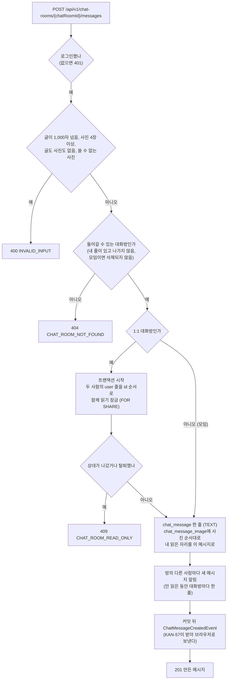
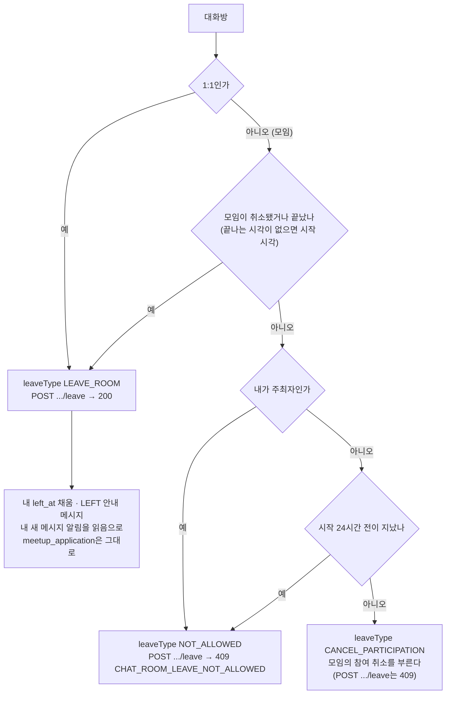
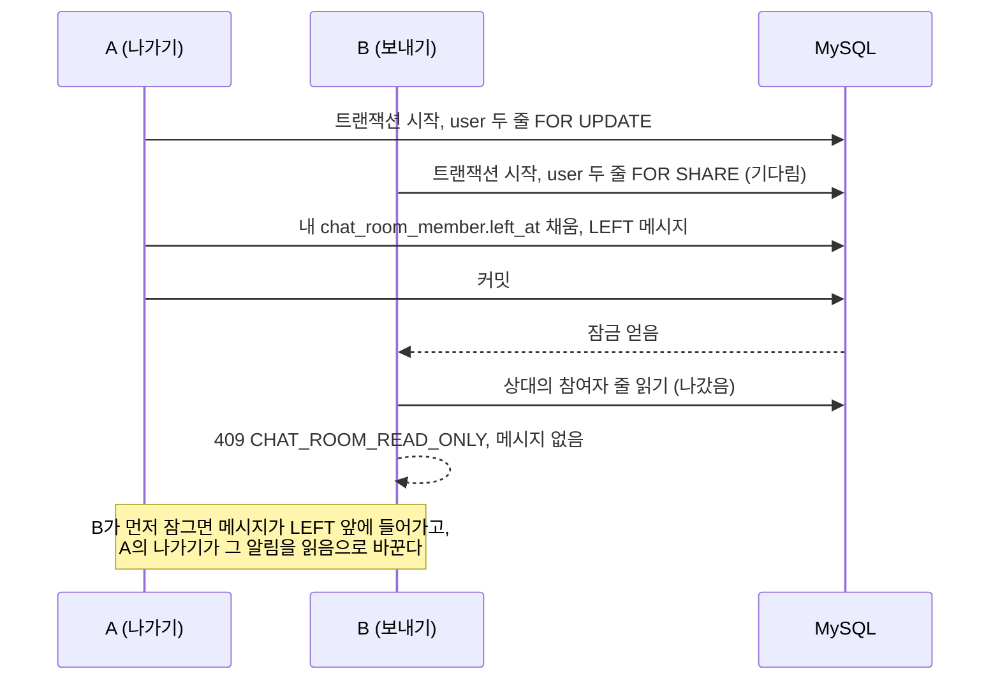
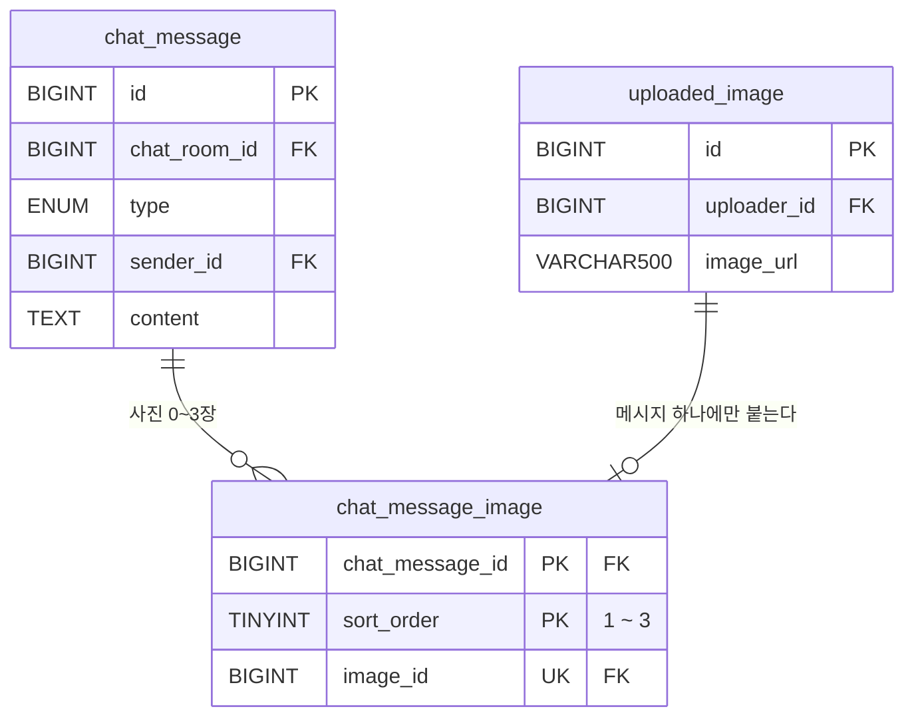

# KAN-56 [BE] 06 채팅 ②: 대화방 · 메시지 · 읽음 · 나가기 · 공지

- Jira: [KAN-56](https://it-ting.atlassian.net/browse/KAN-56)
- 브랜치: `feature/be/KAN-56-chat-rooms`

## 계획

### 목표

대화 목록과 1:1 · 모임 대화방의 메시지, 읽음, 나가기, 공지 API 8개를 만든다. 테스트 서버에서 채팅 화면이 열리지 않는 까닭이 이 API가 없어서다. 탈퇴(KAN-61)와 사진 정리(KAN-66)도 이 작업 뒤에 시작한다.

- `GET /api/v1/me/chat-rooms` ([API 명세](../api/06-chat.md#get-apiv1mechat-rooms))
- `GET /api/v1/chat-rooms/{chatRoomId}` ([API 명세](../api/06-chat.md#get-apiv1chat-roomschatroomid))
- `GET /api/v1/chat-rooms/{chatRoomId}/messages` ([API 명세](../api/06-chat.md#get-apiv1chat-roomschatroomidmessages))
- `POST /api/v1/chat-rooms/{chatRoomId}/messages` ([API 명세](../api/06-chat.md#post-apiv1chat-roomschatroomidmessages))
- `POST /api/v1/chat-rooms/{chatRoomId}/read` ([API 명세](../api/06-chat.md#post-apiv1chat-roomschatroomidread))
- `POST /api/v1/chat-rooms/{chatRoomId}/leave` ([API 명세](../api/06-chat.md#post-apiv1chat-roomschatroomidleave))
- `PUT /api/v1/chat-rooms/{chatRoomId}/notice` ([API 명세](../api/06-chat.md#put-apiv1chat-roomschatroomidnotice))
- `DELETE /api/v1/chat-rooms/{chatRoomId}/notice` ([API 명세](../api/06-chat.md#delete-apiv1chat-roomschatroomidnotice))

범위 밖:
- 실시간 연결(`GET /api/v1/me/event-stream`)과 소식을 브라우저로 보내는 일: KAN-57. 이번에는 KAN-55처럼 커밋 뒤에 앱 안 이벤트만 낸다
- 탈퇴한 사람의 `WITHDRAWN` 안내 메시지 넣기: KAN-61
- 쓰이지 않는 사진 파일 지우기: KAN-66
- 두 사람이 모두 나간 1:1 대화방과 삭제된 모임의 대화방 지우기: 지우지 않고 둔다(문서의 "구현 단계로 넘기는 것" 그대로)
- 대화가 아주 많을 때 대화 목록 나눠 주기: 명세대로 한 번에 모두 준다
- 프론트엔드 코드 고치기(아래 G)

### 정한 것

| # | 질문 | 정한 답 | 정한 사람 |
|---|---|---|---|
| 1 | 요청 · 응답 · 에러 | `docs/api/06-chat.md` 그대로. 메시지 보내기는 `201`, 나머지는 `200` | API 명세 |
| 2 | 들어갈 수 있는 대화방 | `chat_room_member`에 내 줄이 있고 `left_at`이 비어 있다. 모임 대화방은 모임이 삭제되지 않았다. 아니면 `404 CHAT_ROOM_NOT_FOUND`(없는 방과 구분하지 않는다). 8개 API가 같은 검사 하나를 쓴다 | API 명세 |
| 3 | 안 읽은 수 | 읽은 자리보다 id가 큰 메시지 가운데 `TEXT`이고 남이 보낸 것. 내가 보낸 메시지는 세지 않는다. 이미 있는 `ChatRoomReadRepository`를 쓴다. `docs/db/chat.md`의 "본인이 보낸 메시지를 제외할지는 미정"을 이 답으로 고친다 | API 명세 |
| 4 | 읽기 전용 | 1:1 대화방에서 상대가 나갔거나 탈퇴했으면 읽기 전용이고 보내면 `409 CHAT_ROOM_READ_ONLY`. 모임 대화방은 끝났거나 취소돼도 보낼 수 있다 | API 명세 |
| 5 | `leaveType` | 1:1은 `LEAVE_ROOM`. 모임은 취소됐거나 끝났으면 `LEAVE_ROOM`, 아니면 주최자는 `NOT_ALLOWED`, 참여자는 시작 24시간 전까지 `CANCEL_PARTICIPATION` 그 뒤 `NOT_ALLOWED` | API 명세 |
| 6 | 모임이 끝났는지 | 지금 시각이 `COALESCE(ends_at, starts_at)`에 닿았으면 끝난 것이다(같은 시각이면 끝남) | DB 설계 |
| 7 | 모임 카드 | 저장하지 않는다. 메시지를 줄 때 본문의 첫 모임 링크로 모임의 지금 값을 담는다. 없거나 삭제된 모임이면 `null` | API 명세 |
| 8 | 사진 | 메시지 하나에 3장까지. `chat_message_image`(`PK(chat_message_id, sort_order)`, `image_id` UNIQUE)에 `imageIds` 순서대로 1부터 넣는다 | API 명세, DB 설계 |
| 9 | 메시지 조회 | 커서 방식. `size`는 1 ~ 100이고 보내지 않으면 30. 새 것부터. 내가 들어오기 전 메시지와 안내 메시지도 준다. 조회로는 읽은 자리가 바뀌지 않는다 | API 명세 |
| 10 | 읽음 | `messageId`가 이 방의 메시지가 아니면 `400`. 읽은 자리는 뒤로만 옮긴다. 그 방의 안 읽은 새 메시지 알림을 읽음으로 바꾼다(`NotificationService.readChatRoom`) | API 명세, KAN-54 |
| 11 | 나가기 | 1:1은 두 사람의 `user` 줄을 id 순서로 잠근 뒤 한다. 내 `left_at`을 채우고 `LEFT` 안내 메시지를 넣는다. `meetup_application`은 바꾸지 않는다. 끝나지 않은 모임의 방이면 `409 CHAT_ROOM_LEAVE_NOT_ALLOWED` | API 명세, DB 설계 |
| 12 | 공지 | 1 ~ 200자, 공백만은 안 된다. 주최자가 아니거나 1:1 대화방이면 `403 FORBIDDEN`. 지우기는 공지가 없어도 성공. 실시간으로 알리지 않는다 | API 명세 |
| 13 | 알림 | 사람이 보낸 메시지마다 방의 다른 사람에게 `NotificationService.notifyChatMessage`. 안내 메시지로는 부르지 않는다. 갈 곳 `CHAT_ROOM`의 모임 이름 싣기(`MeetupChatNotificationTargetReader`)는 KAN-48에서 이미 만들어져 테스트로 확인만 한다 | Jira, KAN-54 |
| 14 | 실시간 소식 | 메시지가 생기면 커밋 뒤에 `ChatMessageCreatedEvent(chatRoomId, messageId)`를 낸다 | KAN-55 C |
| 15 | 막는 장치 | 8개 모두 로그인 필요. 온보딩과 새 학기 고르기를 마친 계정만(어노테이션 없음) | API 명세 |
| 16 | 완료 기준 | 통합 테스트와 Swagger 호출 결과에 더해, 실제 모드 프론트엔드로 채팅 화면을 끝까지 눌러 본다 | 사용자 (2026-11-26) |

### 이번에 정할 것 (2026-11-26 모두 제안대로 승인)

| # | 무엇 | 제안 | 까닭 |
|---|---|---|---|
| A | 메시지 본문에서 알아보는 모임 링크의 모양 (API 명세 "구현 단계로 넘기는 것") | `{itting.frontend-url}/meetups/{숫자}`. 본문에서 처음 나오는 것 하나만 본다. 예: 테스트 서버에서는 `https://test.diguldigul.site/meetups/12`. 다른 사이트의 주소(`https://example.com/meetups/12`)는 카드로 바꾸지 않는다 | 모임 상세의 "링크 복사"가 지금 화면의 주소를 복사한다. 모임 id는 서버마다 달라서, 다른 서버의 링크를 카드로 바꾸면 엉뚱한 모임이 보인다 |
| B | 메시지를 짧은 시간에 너무 많이 보내는 것 막기 (API 명세 "메시지는 채팅 ②에서 정한다") | 이번에는 막지 않는다. "남은 일"에 적는다 | 댓글(KAN-52)과 대화 요청(KAN-55)에서 같은 판단을 했다. 가입한 사람은 모두 SSAFY 인증을 거쳤다. 막으려면 프론트엔드가 `429`를 받아 보여 줄 화면이 필요한데 명세에 없다. 다른 방법: 한 사람이 10초에 20개를 넘기면 `429 TOO_MANY_REQUESTS` |
| C | 공백뿐인 본문 | 사진이 없으면 `400`. 사진이 있으면 본문을 `null`로 저장한다(사진만 보낸 메시지). 그 밖의 본문은 앞뒤 공백을 다듬지 않고 받은 그대로 저장한다 | 명세의 "공백만으로는 안 된다"는 사진이 없는 경우만 말한다 |
| D | 1:1 대화방에서 보내기와 상대의 나가기가 동시에 올 때 | 1:1 대화방에 보낼 때는 두 사람의 `user` 줄을 id 순서로 "함께 읽기 잠금"(`FOR SHARE`)으로 잡은 뒤 읽기 전용인지 본다. 모임 대화방은 잠그지 않는다 | 잠그지 않으면 A가 "대화 나가기"를 누르는 순간 B가 보낸 메시지가 "A님이 나갔습니다" 뒤에 들어가고, A에게 들어갈 수 없는 방의 새 메시지 알림이 간다. 잠그면 B는 `409 CHAT_ROOM_READ_ONLY`를 받는다. 함께 읽기 잠금이라 두 사람이 동시에 보내는 것은 서로 기다리지 않는다 |
| E | 다른 영역의 코드에 더하는 것(모두 읽기) | ① 커뮤니티: "쓸 수 있는 사진인지" 검사를 글과 채팅이 함께 쓰게 한 곳으로 옮기고, 채팅 메시지에 붙은 사진도 보게 한다. `PostService`는 그것을 부르게 고친다. ② 모임: 채팅이 모임의 값(대화방 조회의 `meetup`, 끝났는지, 참여 취소할 수 있는지, 모임 카드 여러 개)을 읽는 창구를 더한다 | ① `docs/api/08-community.md`가 "이미 글이나 채팅 메시지에 붙은 사진은 쓸 수 없다"고 적는데, 지금 글쓰기는 글에 붙은 사진만 본다. ② 모집 상태와 확정 인원 계산은 모임 영역의 것이라 채팅이 따로 계산하지 않는다. 두 영역의 데이터는 바꾸지 않는다. KAN-53 · KAN-48 담당자에게 PR에서 알린다 |
| F | 대화방에서 빠진 사람의 새 메시지 알림 | 방에서 빠질 때(나가기 API, 모임의 참여 취소 · 내보내기) 그 방의 안 읽은 새 메시지 알림을 읽음으로 바꾼다. 알림을 지우지는 않는다 | 나간 방의 알림을 누르면 `404`가 난다. 알림의 빨간 점이 들어갈 수 없는 방 때문에 남는 일을 막는다 |
| G | 화면을 눌러 보다가 어긋난 곳을 찾으면 | 백엔드가 `docs/api/`와 다르면 이 PR에서 고친다. 프론트엔드가 `docs/api/`와 다르면 고치지 않고 FE 티켓으로 남긴다. 문서가 모호해 두 쪽의 해석이 다르면 사용자에게 묻는다 | 프론트엔드는 담당자가 따로 있다. 이 PR은 백엔드만 바꿔 리뷰 범위를 좁게 둔다 |

G의 확인 방법: 전용 MySQL · Redis 컨테이너와 빈 포트의 백엔드, 실제 모드 프론트엔드(`NEXT_PUBLIC_API_MODE=real`, `NEXT_PUBLIC_API_MOCK_AREAS=events`)를 로컬에 띄운다. 두 계정으로 대화 요청 수락 → 대화 목록 → 메시지 · 사진 보내기 → 읽음 → 대화 나가기, 모임 대화방의 공지 쓰기 · 지우기를 눌러 본다. 실시간 소식은 KAN-57 전이라 화면을 새로 고쳐 확인한다.

### 만들 것

| 파일 | 내용 |
|---|---|
| `db/migration/V20261126_<만든 시각>__create_chat_message_image.sql` | `chat_message_image`. `PK(chat_message_id, sort_order)`, `image_id` UNIQUE, FK(`chat_message`, `uploaded_image`), `sort_order`는 1 ~ 3 CHECK |
| `chat/domain/` | `ChatMessageImage`, `ChatLeaveType`. `ChatErrorCode`에 `CHAT_ROOM_NOT_FOUND`(404), `CHAT_ROOM_READ_ONLY`(409), `CHAT_ROOM_LEAVE_NOT_ALLOWED`(409). `ChatRoom`에 공지 바꾸기, `ChatRoomMember`에 읽은 자리 옮기기 |
| `chat/repository/` | 내 대화 목록(방 · 마지막 메시지 · 상대를 한 번에), 방의 메시지 커서 조회, 방에 남은 사람, 메시지의 사진 |
| `chat/service/ChatRoomAccess` | 들어갈 수 있는 대화방 검사(정한 것 2). 8개 API가 함께 쓴다 |
| `chat/service/ChatRoomQueryService` | 대화 목록, 대화방 조회, 메시지 조회. 보낸 사람 · 사진 · 모임 카드는 메시지마다 따로 읽지 않고 한 번에 읽는다 |
| `chat/service/ChatMessageService` | 보내기(D의 잠금, 사진 붙이기, 읽은 자리, 알림, 이벤트), 읽음 |
| `chat/service/ChatRoomService` | 나가기, 공지 쓰기 · 지우기 |
| `chat/service/MeetupLinkParser` | 본문에서 첫 모임 링크의 id 꺼내기(A) |
| `chat/controller/ChatRoomController` | API 8개(Swagger 태그 `06 채팅`) |
| `chat/dto/` | `ChatRoomListResponse`, `ChatRoomDetailResponse`, `ChatMessageResponse`, `ChatMessageListResponse`, `ChatMessageSendRequest`, `ChatReadRequest`, `ChatReadResponse`, `ChatNoticeRequest`, `ChatNoticeResponse` |
| `chat/service/MeetupChatRoomService` | 참여 취소 · 내보내기로 빠질 때 새 메시지 알림을 읽음으로(F) |
| `community/service/` | 사진을 쓸 수 있는지 보는 서비스와 "붙어 있는 사진"을 알려 주는 인터페이스(글과 채팅이 각각 구현). `PostService`가 이것을 부른다(E ①). KAN-66도 이 인터페이스로 붙어 있는 사진을 본다 |
| `meetup/service/`, `meetup/domain/Meetup` | 채팅이 모임의 값을 읽는 창구, `Meetup.isEnded(now)`(E ②) |
| `user/repository/UserRepository` | 두 사람을 id 순서로 함께 읽기 잠금(D) |
| 문서 | `docs/api/06-chat.md`: A · B · C · F를 본문과 "명세에 없어 이 문서에서 정한 것"에 적고 "구현 단계로 넘기는 것"에서 뺀다. `docs/db/chat.md`: 안 읽은 수의 "미정"(정한 것 3), 보내기의 잠금(D), `chat_message_image`의 제약 |
| `test/.../support/ChatSteps` | 메시지 · 모임 대화방 · 사진 준비 도구 |

### 테스트

| API | 정상 | 실패 |
|---|---|---|
| `GET /me/chat-rooms` | 1:1과 모임 방이 마지막 메시지가 새로운 순서로, 메시지 없는 방은 만든 시각으로. `unreadCount`가 내 메시지와 안내 메시지를 세지 않음. 상대가 나갔거나 탈퇴하면 `isReadOnly`. 내가 나간 방과 삭제된 모임의 방은 빠짐. 대화가 없으면 `[]` | 로그인 안 함 `401`, 온보딩 안 함 `403 ONBOARDING_INCOMPLETE` |
| `GET /chat-rooms/{id}` | 1:1: `counterpart`, `sharedInterests`(상대가 고른 순서), `LEAVE_ROOM`. 탈퇴한 상대는 `isWithdrawn`과 `sharedInterests: []`. 모임: `meetup`의 값, `notice`, `canEditNotice`, `members`(주최자 먼저, 들어온 순서), `leaveType`의 네 경우 | 없는 방 · 남의 방 · 내가 나간 방 · 삭제된 모임의 방 `404 CHAT_ROOM_NOT_FOUND` |
| `GET /chat-rooms/{id}/messages` | 새 것부터, `cursor`로 이어 받기, `hasNext` · `nextCursor`, 안내 메시지 포함, 들어오기 전 메시지, 사진 순서, 모임 카드(우리 링크는 카드, 삭제된 모임 · 다른 사이트 링크는 `null`, 링크가 둘이면 첫 번째). 조회해도 안 읽은 수 그대로 | `size` 0 · 101, 깨진 `cursor` `400`. 들어갈 수 없는 방 `404` |
| `POST /chat-rooms/{id}/messages` | 글 · 사진만(`content: null`) · 글과 사진 `201`. 내 읽은 자리가 옮겨짐. 방의 다른 사람에게 알림이 방마다 한 줄. 커밋 뒤 이벤트. 끝난 모임의 방에도 보냄 | 본문도 사진도 없음, 공백뿐이고 사진 없음, 1,001자, 사진 4장, 남의 사진, 글에 붙은 사진, 다른 메시지에 붙은 사진, 같은 id 두 번 `400`. 들어갈 수 없는 방 `404`. 상대가 나간 1:1 `409 CHAT_ROOM_READ_ONLY` |
| `POST /chat-rooms/{id}/read` | 읽은 자리가 뒤로만 옮겨짐, `unreadCount`, 그 방의 새 메시지 알림이 읽음으로 | 다른 방의 `messageId` · 없는 `messageId` `400`. 들어갈 수 없는 방 `404` |
| `POST /chat-rooms/{id}/leave` | 1:1: 내 목록에서 빠지고 상대는 읽기 전용, `LEFT` 메시지, 그 뒤 서로 대화 요청 가능, 내 새 메시지 알림이 읽음으로(F). 끝난 모임 · 취소된 모임: 주최자도 나감, `meetup_application` 그대로 | 끝나지 않은 모임의 방 `409 CHAT_ROOM_LEAVE_NOT_ALLOWED`. 두 번째 호출 `404` |
| `PUT /chat-rooms/{id}/notice` | 주최자가 쓰기와 고치기, 대화방 조회에 보임 | 빈 값 · 공백 · 201자 `400`. 참여자 · 1:1 대화방 `403 FORBIDDEN`. 들어갈 수 없는 방 `404` |
| `DELETE /chat-rooms/{id}/notice` | 지우기, 공지가 없어도 성공 | 참여자 `403 FORBIDDEN`. 들어갈 수 없는 방 `404` |
| 동시성(D) | 1:1에서 나가기와 보내기가 동시에 와도 `LEFT` 뒤에 메시지가 없음. 같은 사진을 두 메시지에 동시에 붙이면 하나만 성공 | |
| 글의 사진 검사(E ①) | 글쓰기의 기존 테스트가 그대로 통과 | 채팅 메시지에 붙은 사진을 글에 붙이면 `400` |
| 모임의 참여 취소(F) | 참여 취소 · 내보내기로 빠진 사람의 그 방 새 메시지 알림이 읽음으로 | |

화면 연동(G)과 Swagger 호출 결과(스킬 `api-evidence`)는 구현 뒤에 확인해 "결과"에 적는다.

## 결과

### 한눈에 보기

메시지 보내기의 처리 단계다. 응답이 갈리는 곳은 마름모다. 입력과 대화방 확인은 잠그기 전에 한 번, 잠근 뒤에 한 번 더 한다.

나가기 버튼이 하는 일(`leaveType`)과 나가기 API의 응답이다.

1:1 대화방에서 한 사람의 나가기와 상대의 보내기가 동시에 올 때다. 두 요청이 같은 두 `user` 줄을 같은 순서로 잡으므로 한쪽이 끝난 뒤에 다른 쪽이 본다.

새로 만든 테이블은 `chat_message_image`다. `chat_message`(KAN-55)와 `uploaded_image`(KAN-51)는 읽기만 한다.

### 바꾼 것

| 파일 | 내용 |
|---|---|
| `db/migration/V20261126_1627__create_chat_message_image.sql` | `chat_message_image`. `PK(chat_message_id, sort_order)`, `image_id` UNIQUE, `sort_order` 1 ~ 3 CHECK, FK 둘 |
| `chat/controller/ChatRoomController` | API 8개(Swagger 태그 `06 채팅`) |
| `chat/service/ChatRoomAccess` | 들어갈 수 있는 대화방 검사. 8개 API가 함께 쓴다 |
| `chat/service/ChatRoomQueryService` | 대화 목록, 대화방 조회(`leaveType` 계산), 메시지 조회(커서) |
| `chat/service/ChatMessageService` | 보내기(1:1은 함께 읽기 잠금, 사진 붙이기, 읽은 자리, 알림, 이벤트), 읽음 |
| `chat/service/ChatRoomService` | 나가기(1:1은 두 사람 잠금, 모임은 내 참여자 줄 잠금), 공지 쓰기 · 지우기 |
| `chat/service/ChatMessageAssembler` | 저장된 메시지를 응답 모양으로. 보낸 사람 · 사진 · 모임 카드를 한 번에 읽는다 |
| `chat/service/MeetupLinkParser`, `ChatMessageCursor`, `ChatAttachedImageReader` | 모임 링크 알아보기(A), 메시지 커서, 메시지에 붙은 사진을 커뮤니티에 알려 주기 |
| `chat/service/MeetupChatRoomService` | 참여 취소 · 내보내기로 빠질 때 새 메시지 알림을 읽음으로(F) |
| `chat/repository/` | `ChatRoomReadRepository.findJoinedRooms`(대화 목록 한 번에), `ChatMessageRepository`(커서 조회), `ChatRoomMemberRepository`(참여자 줄 잠금, 읽은 자리를 뒤로만 옮기는 SQL), `ChatMessageImageRepository` |
| `chat/domain/`, `chat/dto/` | `ChatMessageImage`, `ChatLeaveType`, `ChatRules`, 에러 코드 3개, 요청 · 응답 record 9개 |
| `community/service/ImageUsageService`, `AttachedImageReader` | 사진을 쓸 수 있는지 보는 곳을 하나로(E ①). 글에 붙은 사진과 채팅 메시지에 붙은 사진을 모두 본다 |
| `community/service/PostService` | 사진 검사를 `ImageUsageService`에 맡김. 동작은 "채팅 메시지에 붙은 사진도 쓸 수 없다"만 더해졌다 |
| `meetup/service/MeetupChatInfoReader`, `meetup/domain/Meetup`, `meetup/repository/MeetupListRepository` | 채팅이 모임의 값을 읽는 창구(E ②), `Meetup.isEnded`, 모임 카드 여러 개 한 번에 읽기 |
| `user/repository/UserRepository` | `findBothForShare`: 두 사람을 id 순서로 함께 읽기 잠금(D) |
| `docs/api/06-chat.md` | 모임 링크의 모양(A), 공백뿐인 본문(C), 보내기의 잠금(D), 나갈 때 알림 읽음(F), 보내기 응답의 `images`, 메시지 빈도는 제한하지 않음(B) |
| `docs/api/07-meetup.md`, `docs/api/09-notification.md` | 대화방에서 빠질 때 새 메시지 알림을 읽음으로(F) |
| `docs/db/chat.md`, `docs/db/README.md` | 안 읽은 수의 "미정"을 정함, `chat_message_image`의 제약, 보내기 · 나가기의 잠금, `chat_message_image`는 `created_at`이 없음 |
| `test/.../chat/` | `ChatRoomListApiTests`(7), `ChatRoomDetailApiTests`(10), `ChatMessageListApiTests`(9), `ChatMessageSendApiTests`(13), `ChatRoomReadApiTests`(4), `ChatRoomLeaveApiTests`(9), `ChatRoomNoticeApiTests`(5), `ChatRoomConcurrencyTests`(3), `ChatMessageEventTests`(4) |
| `test/.../community/PostWriteApiTests`, `test/.../support/ChatSteps` | 채팅 메시지에 붙은 사진을 글에 붙이면 `400`(1). 모임 대화방 · 메시지 · 사진 · 읽은 자리 준비 도구 |

### 확인한 것

- `./gradlew build` 통과. 테스트 789개(기존 724 + 새 65), 실패 0
- 동시성 테스트가 실제로 잡는지 확인: 보내기의 함께 읽기 잠금(`findBothForShare`)을 빼면 "나가기와 상대의 보내기가 동시에 와도" 테스트가 실패한다(`LEFT` 뒤에 메시지가 들어감). 원래대로 되돌렸다
- 화면 연동(정한 것 16, G): 전용 MySQL · Redis 컨테이너와 빌드한 jar(포트 18156), 실제 모드 프론트엔드(`NEXT_PUBLIC_API_MODE=real`, `NEXT_PUBLIC_API_MOCK_AREAS=events`, 포트 3156)로 두 계정을 오가며 눌러 봤다. 끝나고 서버와 컨테이너를 지웠다

  | 눌러 본 것 | 부른 API | 결과 |
  |---|---|---|
  | 채팅에 들어감 | `GET /me/chat-rooms`, `GET /me/chat-requests/count` | 모임 방과 1:1 방이 마지막 메시지 순으로, 안 읽은 수 배지 1 · 2 |
  | 1:1 대화를 고름 | `GET /chat-rooms/1`, `GET .../messages?size=30`, `POST .../read` | 찻방에 두 두더지, 헤더의 "겹치는 관심사 2개", 수락 안내와 관심사 태그, 모임 링크가 모임 카드로("2 / 6명", "모임 보기"), 목록의 배지가 사라짐 |
  | 글 보내기 | `POST .../messages` 201, `POST .../read` | 오른쪽에 내 메시지 |
  | 사진 붙여 보내기 | `POST /images` 201, `POST .../messages` 201 | 사진이 메시지로 보이고 목록의 마지막 메시지가 "사진" |
  | 모임 대화를 고름, 모임 정보 팝업 | `GET /chat-rooms/2`, `GET .../messages` | 헤더(이름 · 2명 · 일시 · 장소), "내가 모임에 참여했어요", "주최" 표시, 팝업의 카테고리 · 일시 · 장소 · "6명 중 2명 확정" · 참여자(주최 / 나), "모임 나가기" 켜짐 |
  | 주최자로 공지 쓰기 · 지우기 | `PUT .../notice` 200, `DELETE .../notice` 200 | 공지 줄에 보이고 "고치기 · 지우기", 지우면 사라짐 |
  | 1:1 대화 나가기 | `POST /chat-rooms/1/leave` 200 | 토스트 "대화방을 나갔어요", 내 목록에서 사라짐. 상대 화면은 "상대방이 대화방을 나갔습니다"와 입력창 대신 안내 |
  | 모임 나가기(끝나지 않은 모임) | `POST /meetups/1/cancel-participation` 200 | 토스트 "모임을 나갔어요", 목록에서 사라짐. DB에서 그 방의 새 메시지 알림이 읽음 |

  화면에서 눌러 보지 않은 것: 위로 스크롤해 이어 받기(`cursor`), 끝났거나 취소된 모임에서 대화방만 나가기. 둘은 통합 테스트로만 확인했다. 실시간 소식은 KAN-57 전이라 화면을 새로 열어 확인했다
- 프론트엔드 단위 테스트(`npx vitest run`): 704개 가운데 701개 통과, 1개 실패. 실패한 `unsaved-guard.test.ts`는 Windows의 경로 구분자 때문에 `dev`에서도 같은 이유로 실패한다(이번 변경과 무관). 명세 문서를 읽는 테스트는 모두 통과했다
- `git merge-tree --write-tree HEAD origin/dev`: 충돌 없음(브랜치를 만든 뒤 `dev`가 바뀌지 않았다, `1fe3ab3`)
- 로컬 코드 리뷰(스킬 `code-review`): P0 0건, P1 1건 고침(대화 목록이 안 읽은 수를 읽는 방법이 `docs/api/06-chat.md`의 문장과 달라 문서를 맞춤). 코드를 따로 읽게 한 독립 리뷰에서도 P0 · P1은 없었고, "확인 필요"로 나온 것은 아래 "남은 일"에 적었다
- API 호출 결과(스킬 `api-evidence`)는 PR을 만들 때 남긴다

### 계획과 달라진 점

- 읽은 자리를 옮기는 일을 `ChatRoomMember`의 메서드가 아니라 저장소의 SQL 한 줄(`advanceLastRead`: 지금 값보다 클 때만 바꾼다)로 했다. 같은 사람의 읽음과 보내기가 겹쳐도 읽은 자리가 앞으로 돌아가지 않게 하려는 것이다
- 대화 목록의 안 읽은 수를 `countUnreadByRoomIds`로 따로 세지 않고 `ChatRoomReadRepository.findJoinedRooms`가 방과 함께 한 번에 읽는다. 세는 식과 "들어갈 수 있는 방" 조건은 같은 상수를 쓴다. `docs/api/06-chat.md`의 "안 읽은 수"에 적힌 문장을 이 구현에 맞게 고쳤다
- 모임 대화방에서 나갈 때 내 `chat_room_member` 줄을 잠근다(계획에는 1:1의 잠금만 있었다). 같은 나가기가 동시에 두 번 와도 `LEFT` 안내 메시지가 하나만 들어가게 하려는 것이다
- 채팅이 모임의 값을 읽는 창구를 `MeetupLinkService`(글 연결용)에 더하지 않고 `MeetupChatInfoReader` 하나로 따로 뒀다
- `chat_message_image`에 `created_at`을 두지 않았다(`docs/db/chat.md`의 표대로). `docs/db/README.md`의 공통 날짜 칼럼에서 "부모 행에 딸려 함께 생기는 테이블"에 이 테이블을 더했다
- 같은 사진을 글과 메시지가 동시에 붙이는 경우는 잠그지 않았다. 같은 사람이 자기 사진을 두 곳에 동시에 붙일 때만 생기고, 메시지끼리는 `image_id` UNIQUE가 막는다. `docs/db/chat.md`의 `chat_message_image`에 적었다
- 새 메시지 알림을 만들 때 받는 사람을 id 순서로 돈다. 같은 모임 대화방에 여러 사람이 동시에 보내도 알림 줄을 같은 순서로 잡게 하려는 것이다
- `ChatRequestController`의 Swagger 태그 설명을 새 컨트롤러와 같게 맞췄다("대화 요청 · 대화방 · 메시지 · 읽음 · 나가기 · 공지")
- 화면 연동 확인에서 `docs/api/`와 어긋난 곳은 찾지 못했다. 눈에 띈 것 하나: 프론트엔드가 대화방에서 나간 직후(1:1 나가기, 모임 나가기) 그 대화방 조회를 한 번 더 불러 `404`를 받는다. 화면은 명세대로 대화 선택 전으로 가고 콘솔에만 남는다. 문서와 다른 동작은 아니라 FE 티켓은 만들지 않았다(필요하면 만든다)

### 남은 일

- KAN-57(채팅 ③): `ChatMessageCreatedEvent`를 받아 `GET /api/v1/me/event-stream`으로 보낸다. 병합되면 `deploy/test/frontend.build.env`의 `NEXT_PUBLIC_API_MOCK_AREAS=events`를 비운다
- KAN-61(회원 탈퇴): 들어 있던 방에 `WITHDRAWN` 안내 메시지를 넣고 `left_at`을 채운다. 이 작업 뒤에 시작할 수 있다
- KAN-66(사진 정리): "붙어 있는 사진"은 `post_image`와 `AttachedImageReader`의 구현(채팅)으로 본다. 이 작업 뒤에 시작할 수 있다
- 메시지를 짧은 시간에 너무 많이 보내는 것을 막는 기준: 이번에는 막지 않았다(B). 필요해지면 `429`를 보여 줄 화면과 함께 정한다
- 두 사람이 모두 나간 1:1 대화방과 삭제된 모임의 대화방은 지우지 않고 둔다(문서의 "구현 단계로 넘기는 것" 그대로)
- 교착으로 실패한 요청을 다시 시도하는 기준(독립 리뷰의 "확인 필요", 실행해 재현하지는 않았다): 두 사람의 `user` 줄을 잠그는 일(대화 요청 보내기 · 수락 · 거절 · 취소, 1:1 대화 나가기)과, 같은 두 사람을 가리키는 줄을 id가 큰 쪽부터 넣는 다른 트랜잭션이 겹치면 MySQL이 한쪽을 되돌린다. 예: 20번이 모임 대화방에 보내며 메시지(보낸 사람 20) → 알림(받는 사람 10) 순서로 넣는 사이에 10번과 20번의 1:1 대화 나가기가 `user` 10을 잡고 20을 기다리는 경우. 되돌려진 요청은 `500`이 된다. 1:1 대화방에 보내기는 같은 순서로 먼저 잡아 해당하지 않는다. KAN-55의 잠금에서부터 있던 유형이라 이 작업에서 한 곳만 고치지 않았고, 다시 시도를 공통으로 둘지 따로 정한다
- 정원이 큰 모임 대화방의 알림: 메시지 하나에 받는 사람마다 `notifyChatMessage`를 부른다(정원 50명이면 한 트랜잭션에 쿼리 약 200개). 부하가 보이면 알림 쪽에 여러 사람을 한 번에 넣는 메서드를 더한다
- KAN-53 · KAN-48 담당자에게 알리기: 사진 검사가 `ImageUsageService`로 옮겨졌고, 모임에 `MeetupChatInfoReader` · `Meetup.isEnded` · `MeetupListRepository.findCards`가 더해졌다

### 검토 순서

1. `docs/api/06-chat.md`의 "메시지"(모임 링크), 보내기 · 나가기의 "서버가 하는 일", "명세에 없어 이 문서에서 정한 것". `docs/db/chat.md`의 `chat_message_image`와 "같은 두 사람의 일을 한 번에 하나씩 처리"
2. `V20261126_1627__create_chat_message_image.sql`, `chat/domain/ChatMessageImage`
3. `ChatRoomController` → `ChatRoomAccess` → `ChatMessageService`(잠금 순서) → `ChatRoomService` → `ChatRoomQueryService` → `ChatMessageAssembler`
4. `ChatRoomReadRepository.findJoinedRooms`, `ChatRoomMemberRepository.advanceLastRead`, `UserRepository.findBothForShare`
5. 다른 영역: `community/service/ImageUsageService`와 `PostService`, `meetup/service/MeetupChatInfoReader`, `chat/service/MeetupChatRoomService`
6. 테스트: `ChatRoomConcurrencyTests`(잠금), `ChatMessageSendApiTests`, `ChatRoomLeaveApiTests`, `ChatRoomDetailApiTests`(`leaveType`의 경계)
