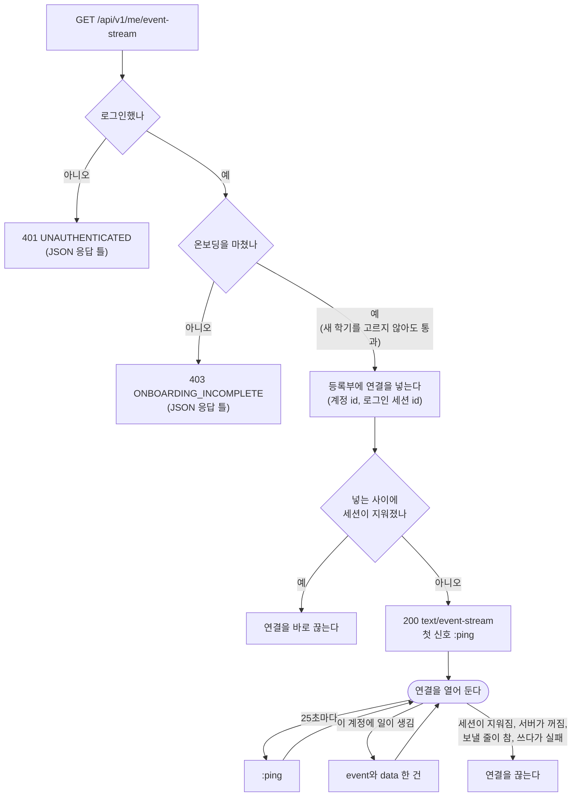
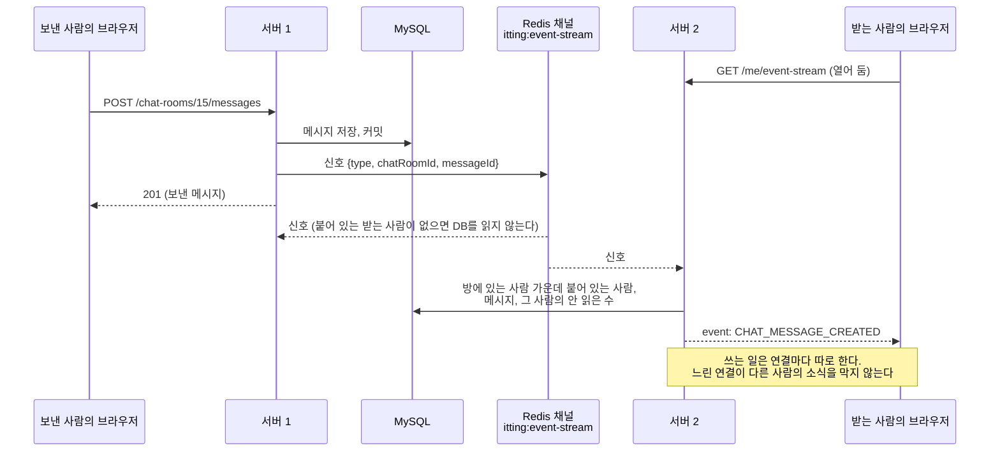

# KAN-57 [BE] 06 채팅 ③: 실시간 소식(SSE)

- Jira: [KAN-57](https://it-ting.atlassian.net/browse/KAN-57)
- 브랜치: `feature/be/KAN-57-event-stream`

## 계획

### 목표

로그인한 계정에 생긴 일(새 메시지, 받은 요청 수, 안 읽은 알림 수)을 화면을 새로 열지 않아도 받게 하는 연결을 만든다. 채팅 · 알림 서비스는 이미 커밋 뒤에 앱 안 이벤트를 내고 있다(KAN-54 · 55 · 56). 이번에는 그 이벤트를 받아 브라우저로 보내는 쪽만 만든다. 병합되면 남는 API는 탈퇴 2개(KAN-61)뿐이다.

- `GET /api/v1/me/event-stream` ([API 명세](../api/06-chat.md#get-apiv1meevent-stream), [공통 규칙](../api-convention.md#실시간-소식), [알림의 소식](../api/09-notification.md#실시간-소식))

범위 밖:
- 프론트엔드 코드 고치기. 연결하는 코드(`frontend/src/realtime/`)는 KAN-64에서 이미 만들어져 있다. 어긋난 곳을 찾으면 정한 것 12대로 한다
- 끊긴 동안의 소식 다시 보내기, 요청이 만료돼 수가 줄 때의 소식, 공지 · 보낸 요청 · 모임 정보의 실시간 반영: 명세가 하지 않기로 했다
- 탈퇴한 사람의 `WITHDRAWN` 안내 메시지: KAN-61. 그 작업이 `ChatMessageCreatedEvent`를 내면 이번에 만든 길로 그대로 간다
- 테스트 서버 배포(dev → test 병합): 개발을 마친 뒤 사용자가 한다

### 정한 것

| # | 질문 | 정한 답 | 정한 사람 |
|---|---|---|---|
| 1 | 주소와 모양 | `GET /api/v1/me/event-stream`, `Content-Type: text/event-stream`. 응답 틀(`success` · `data` · `error`)을 쓰지 않는다. 소식 한 건은 `event:` 이름과 `data:` JSON 한 줄이다 | API 명세, 공통 규칙 |
| 2 | 소식의 이름과 값 | `CHAT_MESSAGE_CREATED` `{chatRoomId, message, unreadCount}`, `CHAT_REQUEST_COUNT_CHANGED` `{receivedCount}`, `NOTIFICATION_UNREAD_CHANGED` `{unreadCount, hasUnread}` | API 명세(06, 09) |
| 3 | 받는 사람 | 메시지: 그 대화방에 지금 들어갈 수 있는 모든 사람(`left_at`이 비어 있고 모임이 삭제되지 않음). 보낸 사람도 받는다. 나간 사람은 받지 않는다. 요청 수와 알림: 그 계정 | API 명세 |
| 4 | 값을 계산하는 법 | 조회 API와 같은 코드를 쓴다. `message`는 `ChatMessageAssembler`, `unreadCount`는 받는 사람마다 `ChatRoomReadRepository.countUnreadByRoomIds`, `receivedCount`는 `ChatRequestQueryService.countReceivedPending`, 알림은 `NotificationQueryService.unreadCount` | API 명세, KAN-54 C, KAN-56 |
| 5 | 소식을 내는 곳 | 채팅 · 알림 서비스를 고치지 않는다. 커밋 뒤에 나오는 `ChatMessageCreatedEvent` · `ChatRequestCountChangedEvent` · `NotificationUnreadChangedEvent`를 받는다. 되돌려진 일은 이벤트가 없으므로 소식도 없다 | KAN-54 C, KAN-55 C, KAN-56 14 |
| 6 | 끊긴 동안의 소식 | 다시 보내지 않는다. 소식에 `id:`를 붙이지 않고 `Last-Event-ID`를 보지 않는다. 다시 연결하면 프론트엔드가 조회 API로 맞춘다 | 공통 규칙 |
| 7 | 연결을 열기 전의 실패 | 로그인하지 않았으면 `401 UNAUTHENTICATED`, 계정 상태에 걸리면 `403`. 다른 API와 같은 응답 틀(JSON)이다. 연 뒤에는 에러를 보내지 않고 끊는다 | API 명세 |
| 8 | 연결을 끊는 때 | 로그아웃, 정지, 탈퇴. 셋 모두 세션을 지우는 일이므로 "세션이 지워지면 그 세션으로 연 연결을 끊는다"로 만든다. 비밀번호 변경 · 재설정으로 지워진 다른 기기의 세션도 같다 | API 명세(06, 10) |
| 9 | 한 계정의 여러 탭 · 기기 | 연결마다 모두 받는다. 다른 탭에서 알림을 읽으면 이 탭의 빨간 점도 바뀐다 | API 명세(09) |
| 10 | 테스트 서버의 연결 켜기 | `deploy/test/frontend.build.env`의 `NEXT_PUBLIC_API_MOCK_AREAS=events` 값을 이 PR에서 비운다 | KAN-63 U |
| 11 | 완료 기준 | 통합 테스트와 호출 결과에 더해, 실제 모드 프론트엔드로 화면을 눌러 본다 | 사용자 (2026-11-26, KAN-56 16) |
| 12 | 화면을 눌러 보다 어긋난 곳을 찾으면 | 백엔드가 `docs/api/`와 다르면 이 PR에서 고친다. 프론트엔드가 다르면 고치지 않고 FE 티켓으로 남긴다. 문서가 모호하면 사용자에게 묻는다 | 사용자 (2026-11-26, KAN-56 G) |

### 이번에 정할 것 (2026-11-26 모두 제안대로 승인)

| # | 무엇 | 제안 | 까닭 |
|---|---|---|---|
| A | 서버가 여러 대일 때 소식을 전하는 법 (Jira, API 명세 "구현 단계로 넘기는 것") | 지금부터 Redis를 거친다. 이벤트가 나오면 "무슨 일이 어디서 생겼는지"만 Redis 채널 `itting:event-stream`에 싣고(예: `{"type":"CHAT_MESSAGE_CREATED","chatRoomId":15,"messageId":4104}`), 서버마다 그 채널을 들어 자기에게 붙어 있는 사람의 값만 계산해 보낸다 | Redis는 로그인 세션 때문에 이미 반드시 떠 있다. 지금은 서버가 한 대지만, 메모리로만 전하면 서버를 늘리는 날 다른 서버에 붙은 사람에게 소식이 조용히 안 간다. 에러가 나지 않아 찾기 어렵다. 다른 방법: 한 대 기준으로 만들고 늘릴 때 고친다(클래스 하나와 테스트 몇 개가 준다) |
| B | 연결을 유지하려고 보내는 신호 (API 명세 "구현 단계로 넘기는 것") | 연결하자마자 한 번, 그 뒤 25초마다 주석 줄 `: ping`을 보낸다. 간격은 설정 `itting.event-stream.heartbeat-interval`로 둔다 | 조용한 연결을 30 ~ 60초에 끊는 프록시와 통신사 망이 있다. 서버는 이 신호를 쓰다가 실패해야 끊긴 연결을 알아채고 지운다. 주석 줄은 `EventSource`가 화면 코드로 넘기지 않아 프론트엔드를 고칠 일이 없다 |
| C | 새 학기를 고르지 않은 계정의 연결 | 연결을 연다. API 명세의 로그인 칸을 "필요(새 학기를 고르기 전에도)"로 고치고 `@AllowBeforeNewTerm`을 붙인다. 온보딩을 마치지 않은 계정은 명세대로 `403 ONBOARDING_INCOMPLETE`다 | 프론트엔드는 로그인 영역(`AppShell`)에 들어오면 새 학기 안내가 떠 있어도 바로 연결한다. 명세대로 `403`을 주면 최대 30초 간격으로 계속 다시 연결하고, 새 학기를 고른 뒤에도 다음 시도까지 실시간이 안 된다. 온보딩 화면은 로그인 영역 밖이라 연결하지 않는다. 다른 방법: 명세 그대로 `403`을 주고, 새 학기를 고른 뒤에 연결하게 FE 티켓을 만든다 |
| D | 열어 둔 연결이 로그인 세션을 늘리는지 (KAN-64 18 "SSE와 세션 연장") | 늘리지 않는다. 연결할 때 한 번만 14일로 늘어난다. 14일 동안 다른 요청이 없으면 세션이 만료되고 연결도 끊긴다. 프론트엔드는 다시 연결하다 `401`을 보고 로그인 화면으로 간다 | 늘리면 탭 하나만 열어 둬도 로그인이 끝없이 유지된다. "마지막으로 쓴 뒤 14일"의 "쓴"을 API 호출로 본다. 화면을 쓰는 동안에는 다른 API 호출이 세션을 늘린다 |
| E | 한 계정이 열 수 있는 연결 수 | 이번에는 제한하지 않는다. "남은 일"에 적는다 | 메시지(KAN-56 B)와 대화 요청(KAN-55)에서 같은 판단을 했다. 가입한 사람은 모두 SSAFY 인증을 거쳤다. 끊긴 연결은 다음 신호(B) 때 지워져 쌓이지 않는다. 다른 방법: 계정마다 10개까지, 넘으면 새 연결을 `429 TOO_MANY_REQUESTS`로 거절 |
| F | PR의 호출 결과를 남기는 법 | 정상 경우는 `curl -N` 출력(응답 헤더와 흘러온 소식 세 가지)을 텍스트로 넣고, 두 브라우저 화면(한쪽이 보내면 다른 쪽에 새로 고침 없이 뜸)을 스크린샷으로 넣는다. 실패 경우(`401`)는 평소대로 Swagger 스크린샷과 응답 텍스트다 | Swagger UI의 Try it out은 응답이 끝나야 결과를 보여 준다. 이 연결은 끝나지 않아 계속 "Loading"만 보인다. AGENTS.md의 완료 기준(요청과 응답이 한 화면에)을 정상 경우에는 지킬 수 없어 대신할 방법을 정한다 |
| G | 코드를 두는 곳 | 새 패키지 `com.itting.realtime`(`controller`, `service`)에 연결과 전달을 둔다. 소식의 값을 만드는 코드는 그 소식의 영역에 둔다(`chat/service`, `notification/service`) | 연결 하나를 채팅과 알림이 함께 쓴다. 채팅 패키지에 두면 알림이 채팅에 기대게 된다. 프론트엔드도 `src/realtime/`으로 따로 뒀다. 값 계산은 영역 안의 클래스(`ChatMessageAssembler` 등)를 그대로 써야 조회 API와 같은 값이 나온다 |

### 만들 것

| 파일 | 내용 |
|---|---|
| `realtime/controller/EventStreamController` | `GET /api/v1/me/event-stream`. `SseEmitter`를 돌려준다(응답 틀을 쓰지 않는 예외, 정한 것 1). `@AllowBeforeNewTerm`(C). 응답 헤더 `Cache-Control: no-store`. Swagger 태그 `06 채팅` |
| `realtime/service/EventStreamConnections` | 이 서버에 붙어 있는 연결의 등록부(계정 id → 연결들, 연결마다 세션 id). 열기, 계정에게 보내기, 세션의 연결 끊기(정한 것 8), 신호 보내기(B), 서버가 꺼질 때 모두 끊기. 연결마다 보낼 줄을 따로 둬서 느린 연결 하나가 다른 사람의 소식을 막지 않게 한다. 줄이 차거나 쓰다 실패하면 그 연결을 끊는다(프론트엔드가 다시 연결해 조회 API로 맞춘다) |
| `realtime/service/EventStreamBus`, `EventStreamRelay` | 신호를 Redis 채널에 싣고, 채널에서 받은 신호를 영역의 전달기(`EventStreamRelay` 구현)에 넘긴다(A). 받은 순서대로 처리한다 |
| `realtime/service/EventStreamSessionListener` | Spring Session이 세션이 지워지거나 만료될 때 내는 이벤트를 받아 그 세션의 연결을 끊는다. 이 이벤트는 Redis를 거쳐 모든 서버에 온다 |
| `chat/service/ChatEventStreamRelay` | `ChatMessageCreatedEvent` · `ChatRequestCountChangedEvent`를 받아 신호를 싣는다. 신호가 오면 대화방에 들어갈 수 있는 사람 가운데 이 서버에 붙어 있는 사람에게만 값을 만들어 보낸다. 붙어 있는 사람이 없으면 메시지를 읽지 않는다 |
| `chat/dto/` | `ChatMessageCreatedEventResponse`(`chatRoomId`, `message`, `unreadCount`), `ChatRequestCountChangedEventResponse`(`receivedCount`) |
| `chat/repository/ChatRoomMemberRepository` | 대화방에 지금 들어갈 수 있는 사람의 id 조회(이미 있는 조회로 되면 그것을 쓴다) |
| `notification/service/NotificationEventStreamRelay` | `NotificationUnreadChangedEvent`를 받아 신호를 싣고, 신호가 오면 `NotificationQueryService.unreadCount`의 값을 보낸다 |
| `global/security/SecurityConfig` | 연결이 끝날 때 서블릿이 한 번 더 도는 처리(`DispatcherType.ASYNC`)를 로그인 검사에서 뺀다. 세션이 지워진 뒤 연결을 끊을 때 이미 시작한 응답에 `401`을 쓰려다 오류 로그가 남는 것을 막는다. 처음 요청의 로그인 검사는 그대로이고 `PUBLIC_API`는 바꾸지 않는다. 필요한지는 테스트로 확인하고 필요 없으면 넣지 않는다 |
| `application.yml` | `itting.event-stream.heartbeat-interval: 25s`(B) |
| `deploy/test/frontend.build.env` | `NEXT_PUBLIC_API_MOCK_AREAS` 값을 비운다(정한 것 10) |
| 문서 | `docs/api/06-chat.md`: 로그인 칸(C), 신호(B), 세션(D), 연결 수(E)를 본문과 "명세에 없어 이 문서에서 정한 것"에 적고 "구현 단계로 넘기는 것"에서 신호 간격 · 서버 여러 대 줄을 뺀다. `docs/api/02-auth.md`: "새 학기를 고르지 않은 계정"이 부를 수 있는 API에 실시간 소식을 더한다(C). `docs/infra/test-server.md`: 빌드 값 문단을 고치고, 서버를 늘려도 소식이 Redis로 전해진다는 것을 적는다(A) |
| `test/.../support/EventStreamClient` | 실제 HTTP로 연결해 흘러온 줄을 모으는 테스트 도구. 소식이 올 때까지 기다리기, 연결이 끊겼는지 보기 |

### 테스트

실제 포트로 서버를 띄우고(`RANDOM_PORT`) HTTP 클라이언트로 연결해 확인한다. MySQL과 Redis는 Testcontainers다.

| 대상 | 정상 | 실패 |
|---|---|---|
| `GET /me/event-stream` 연결 | `200`, `Content-Type: text/event-stream`, 연결하자마자 신호 한 줄. 새 학기를 고르지 않은 계정도 연결된다(C). 짧게 줄인 간격으로 신호가 되풀이해 온다(B) | 로그인 안 함 `401 UNAUTHENTICATED`(JSON 응답 틀). 온보딩 안 함 `403 ONBOARDING_INCOMPLETE` |
| `CHAT_MESSAGE_CREATED` | 1:1에서 보내면 두 사람 모두 받는다. 받는 사람의 `unreadCount`는 1, 보낸 사람은 0. `message`가 보내기 응답과 같다. 사진 · 모임 카드가 담긴다. 모임 대화방의 `JOINED` 안내 메시지도 온다. 한 계정의 연결 둘이 모두 받는다 | 대화방에 없는 사람은 받지 않는다. 나간 사람은 자기의 `LEFT` 소식을 받지 않고 남은 사람은 받는다. 삭제된 모임의 대화방은 아무도 받지 않는다 |
| `CHAT_REQUEST_COUNT_CHANGED` | 요청을 받으면 받은 사람에게 `receivedCount` 1. 보낸 사람이 취소하면 0. 수락하면 나에게 0이 오고 두 사람에게 `ACCEPTED` 메시지 소식이 온다 | 보낸 사람은 받지 않는다 |
| `NOTIFICATION_UNREAD_CHANGED` | 알림이 생기면 `unreadCount` · `hasUnread`. 읽으면 줄어든 값. 채팅 알림을 끄면 `hasUnread`가 바뀐 값 | 다른 계정은 받지 않는다 |
| 연결 끊기(정한 것 8) | 로그아웃하면 그 세션의 연결이 끊긴다. 비밀번호를 재설정하면 그 계정의 연결이 모두 끊긴다. 비밀번호를 바꾸면 다른 기기의 연결만 끊긴다 | 다른 계정의 연결은 그대로다 |
| Redis 전달(A) | 채널에 직접 실은 신호(다른 서버가 낸 것처럼)도 이 서버에 붙은 연결로 간다 | 모양이 틀린 신호는 버리고 다음 신호를 계속 처리한다 |
| 끊긴 연결 정리 | 클라이언트가 끊으면 다음 신호 때 등록부에서 지워진다 | |

화면 연동(정한 것 11): 전용 MySQL · Redis 컨테이너와 빈 포트의 백엔드, 실제 모드 프론트엔드(`NEXT_PUBLIC_API_MODE=real`, `NEXT_PUBLIC_API_MOCK_AREAS` 비움)를 로컬에 띄운다. 두 브라우저에 두 계정으로 들어가 아래를 새로 고침 없이 확인한다. 열려 있는 대화에 메시지가 뜸, 대화 목록의 안 읽은 수와 순서, 채팅의 "요청 N", 알림 아이콘의 빨간 점, 상대가 나가면 읽기 전용으로 바뀜, 로그아웃하면 연결이 끊김, 백엔드를 껐다 켜면 "다시 연결됐어요"가 뜨고 놓친 메시지가 보임. 호출 결과(F)도 같은 서버에서 남긴다.

## 결과

### 한눈에 보기

연결을 열 때의 처리 단계다. 응답이 갈리는 곳은 마름모다.

메시지 하나가 받는 사람의 브라우저까지 가는 순서다. 서버가 한 대여도 같은 길을 지난다(서버 1과 서버 2가 같은 서버다).

테이블은 만들거나 바꾸지 않았다.

### 바꾼 것

| 파일 | 내용 |
|---|---|
| `realtime/controller/EventStreamController` | `GET /api/v1/me/event-stream`. `SseEmitter`를 돌려준다. `@AllowBeforeNewTerm`(C). Swagger 태그 `06 채팅` |
| `realtime/service/EventStreamConnections` | 이 서버에 붙어 있는 연결의 등록부. 열기, 계정의 모든 연결에 보내기, 세션의 연결 끊기, 신호(B)와 그때마다 세션 다시 확인하기, 서버가 꺼질 때 모두 끊고 끝날 때까지 기다리기(5초까지) |
| `realtime/service/EventStreamConnection` | 연결 하나. 보낼 줄(256건)과 쓰는 가상 스레드를 연결마다 둔다. 줄이 차거나 쓰다 실패하면 끊는다 |
| `realtime/service/EventStreamBus`, `EventStreamSubscriber`, `EventStreamRedisConfig` | 신호를 Redis 채널 `itting:event-stream`에 싣고, 받은 순서대로 한 번에 하나씩 전달기에 넘긴다(A) |
| `realtime/service/EventStreamRelay`, `EventStreamSignal` | 영역이 구현하는 전달기와 신호의 모양 |
| `realtime/service/EventStreamSessionListener` | 세션이 지워지거나 만료되면 그 세션의 연결을 끊는다(정한 것 8) |
| `chat/service/ChatEventStreamRelay`, `chat/dto/` | `CHAT_MESSAGE_CREATED`, `CHAT_REQUEST_COUNT_CHANGED`. 값의 record 둘 |
| `chat/repository/ChatRoomMemberRepository` | `findJoinedUserIds`: 방에 지금 있는 사람의 id |
| `notification/service/NotificationEventStreamRelay` | `NOTIFICATION_UNREAD_CHANGED` |
| `auth/service/SessionService` | `isAlive`: 세션이 아직 살아 있는지 |
| `global/error/GlobalExceptionHandler`, `ApiErrorController` | 실패 응답의 `Content-Type`을 JSON으로 고정. 열어 둔 연결을 받는 쪽이 끊은 예외는 서버 오류로 남기지 않음. 이미 나가기 시작한 응답의 실패는 응답 틀을 쓰려 하지 않고 원인을 로그에 남김(아래 "계획과 달라진 점") |
| `application.yml` | `itting.event-stream.heartbeat-interval: 25s` |
| `deploy/test/frontend.build.env` | `NEXT_PUBLIC_API_MOCK_AREAS`를 비움. 테스트 서버의 프론트엔드가 실제 연결을 쓴다 |
| `docs/api/06-chat.md`, `docs/api/02-auth.md` | 로그인 칸(C), 신호(B), 연결과 세션(D), 에러 표, "명세에 없어 이 문서에서 정한 것" 다섯 줄, "구현 단계로 넘기는 것"에서 신호 · 서버 여러 대를 빼고 연결 수(E)를 더함. 새 학기를 고르지 않은 계정이 부를 수 있는 API에 이 연결을 더함 |
| `docs/infra/test-server.md` | 빌드 값 문단, 실시간 소식이 Redis에 기대는 것(Redis만 다시 띄운 경우 포함), 백엔드를 다시 띄우면 연결이 끊기는 것 |
| `test/.../realtime/EventStreamApiTests`(13), `chat/ChatEventStreamTests`(9), `notification/NotificationEventStreamTests`(3) | 연결 열기 · 끊기, 채팅의 소식, 알림의 소식 |
| `test/.../support/EventStreamClient`, `RealServer`, `EventStreamMarker` | 실제 HTTP로 연결해 소식을 모으는 도구, 실제 포트의 서버를 부르는 도구, "이 사람은 받지 않는다"를 기다리지 않고 확인하는 표시 |

### 확인한 것

- `./gradlew build` 통과. 테스트 814개(기존 789 + 새 25), 실패 0. 빌드가 끝나며 서버들이 꺼질 때의 로그에도 `WARN` · `ERROR`가 없다
- 새 테스트 세 클래스만 따로 여러 번 되풀이해 돌려 모두 통과했다(타이밍에 기대는 단언이 있는지 보려는 것). 처음에는 "신호를 한 번 받았다"를 줄 하나만 읽고 판단해 한 번 실패했고, 신호가 빈 줄까지 끝났을 때 세도록 테스트 도구를 고쳤다
- 전체 빌드가 끝날 때 로그에 남던 서버 오류 3건을 추적해 없앴다. 테스트에서만 생기는 일이었다. 원인은 `LettuceConnectionFactory has been STOPPED`였다. 스프링 7의 테스트 도구는 지금 쓰지 않는 테스트 서버를 멈춰 두는데(다시 쓸 때 `restartContextIfNecessary`로 켠다) 이때 Redis 연결도 멈춘다. 테스트가 끊고 간 연결이 서버에 남아 있다가, 빌드가 끝나 서버를 끌 때 정리되면서 멈춘 Redis를 읽어 실패했다. 멈추지 않은 서버를 끄는 경우(실제 서버와 같다)는 임시 테스트 둘로 따로 확인했고 오류가 없었다(임시 테스트는 지웠다). 이 과정에서 세 가지를 더했다(아래 "계획과 달라진 점"). 더한 뒤에는 같은 조합으로 돌려도, 전체 빌드에서도 종료 로그에 `WARN` · `ERROR`가 없다
- 세션을 다시 확인하는 테스트가 실제로 잡는지: `세션이_지워졌다는_알림을_놓쳐도_다음_신호_때_연결이_끊긴다`는 세션의 값만 지워 알림이 오지 않게 한 뒤, 신호 전에는 연결이 살아 있고 신호 뒤에는 끊기는 것을 본다
- 실제 서버에서 `curl -N`으로 확인(전용 MySQL · Redis 컨테이너, 빌드한 jar, 포트 18157)
  - 연결하면 `200`, `Content-Type: text/event-stream`, 첫 줄 `:ping`. 그 뒤 25초마다 `:ping`이 왔고 80초 넘게 끊기지 않았다
  - 메시지 보내기 · 대화 요청 · 모두 읽음을 API로 부르니 `CHAT_MESSAGE_CREATED`, `CHAT_REQUEST_COUNT_CHANGED`, `NOTIFICATION_UNREAD_CHANGED`가 순서대로 흘러왔다
  - 열어 둔 연결은 세션을 늘리지 않는다(D): Redis의 세션 남은 시간이 연결 직후 1,209,898초에서 79초 뒤 1,209,819초로 줄었다. 그 사이 신호가 세 번 갔다
  - `curl`을 강제로 끊으면 서버가 2초 안에 알아채고(`AsyncRequestNotUsableException`) 오류 로그 없이 정리한다. 두 번의 신호 주기 동안 `WARN` · `ERROR`가 없었다
  - 화면에서 로그아웃하니 같은 세션으로 `curl`이 열어 둔 연결도 끊겼고, 그 세션으로 다시 연결하면 `401`이다
- 화면 연동(정한 것 11): 실제 모드 프론트엔드(`NEXT_PUBLIC_API_MODE=real`, `NEXT_PUBLIC_API_MOCK_AREAS` 비움, 포트 3057)를 두 계정으로 따로 열어(쿠키가 섞이지 않는 브라우저 컨텍스트 둘) 눌러 봤다. 끝나고 서버와 컨테이너를 지웠다

  | 한 일 | 상대 화면에서 새로 고침 없이 바뀐 것 | 상대 화면이 부른 API |
  |---|---|---|
  | 로그인 뒤 채팅에 들어감 | 두 계정 모두 연결 상태 `open`(`GET /me/event-stream` 200) | |
  | 나가 열어 둔 대화에서 보냄 | 가(대화를 고르지 않음)의 목록에서 마지막 메시지가 바뀌고 안 읽은 수 1 | 없음 |
  | 가가 대화를 열고 답함 | 나의 열린 대화 맨 아래에 메시지가 뜸. 목록에 안 읽은 수는 안 뜸 | `POST /chat-rooms/1/read` |
  | 나가 대화를 닫은 뒤 가가 또 보냄 | 나의 목록에 마지막 메시지와 안 읽은 수 1. 알림 아이콘이 "알림 (새 알림 있음)"으로 | 없음 |
  | 다른 계정이 나에게 보낸 대화 요청을 취소했다가 다시 보냄(API) | 나의 "요청 1" → "요청 0" → "요청 1" | 없음 |
  | 백엔드를 껐다 켬 | 끈 동안 "연결이 끊겼어요. 다시 연결하는 중…", 켜지고 약 30초 안에 "다시 연결됐어요. 놓친 메시지를 받아 왔어요." | 다시 연결한 뒤 `GET /me/chat-rooms`, `/me/chat-requests/count`, `/chat-rooms/1`, `/chat-rooms/1/messages`, `/me/notifications/unread-count` |
  | 가가 대화를 나감 | 나의 열린 대화에 "상대방이 대화방을 나갔습니다"가 뜨고 입력창이 사라짐 | `POST /chat-rooms/1/read` |
  | 가가 설정에서 로그아웃 | 가는 시작 화면으로. 나의 연결은 그대로 `open` | |

  `docs/api/`와 어긋난 곳은 찾지 못했다. 화면에서 보지 않은 것: 모임 대화방의 안내 메시지(`JOINED`), 새 학기를 고르지 않은 계정의 연결. 둘은 통합 테스트로만 확인했다. 앞단 프록시(Caddy)를 거친 연결은 로컬에서 보지 않았다(아래 "남은 일")
- 프론트엔드 단위 테스트(`npx vitest run`): 704개 가운데 701개 통과, 1개 실패. 실패한 `unsaved-guard.test.ts`는 Windows의 경로 구분자 때문에 `dev`에서도 같은 이유로 실패한다(이번 변경과 무관). 명세 문서를 읽는 테스트는 모두 통과했다
- `git merge-tree --write-tree HEAD origin/dev`: 충돌 없음(브랜치를 만든 뒤 `dev`가 바뀌지 않았다, `524be9e`)
- 로컬 코드 리뷰(스킬 `code-review`): P0 0건, P1 0건. 스스로 고친 것 하나: 받는 쪽이 끊은 예외를 넓게 잡던 것을 `AsyncRequestNotUsableException` 하나로 좁혔다(넓게 잡으면 DB나 Redis와의 연결이 끊긴 서버 오류까지 조용히 지나갈 수 있었다). 코드를 따로 읽게 한 독립 리뷰에서도 P0 · P1은 없었고, 등급 밖으로 짚은 네 가지는 아래 "계획과 달라진 점"에 적은 대로 반영했다
- 호출 결과(F): 정상 경우의 `curl -N` 출력과 두 화면의 스크린샷, 실패 경우(`401`)의 Swagger 스크린샷과 응답 텍스트를 받아 두었다. PR을 만들 때 본문의 "호출 결과"에 넣는다

### 계획과 달라진 점

- `SecurityConfig`를 고치지 않았다. 계획에는 "연결이 끝날 때 한 번 더 도는 처리(`ASYNC`)를 로그인 검사에서 뺀다, 필요한지는 테스트로 확인한다"고 적었다. 로그아웃으로 세션이 지워진 뒤 연결을 끊어도 응답 뒤에 `401`이 붙지 않고 오류 로그도 없는 것을 테스트로 확인했다(`로그아웃하면_그_세션의_연결만_끊긴다`가 연결 위로 흐른 글 전체를 본다)
- `GlobalExceptionHandler`를 두 군데 고쳤다(계획에 없었다)
  - 실패 응답의 `Content-Type`을 JSON으로 고정했다. `EventSource`는 `Accept: text/event-stream`만 보내는데, 그 요청에서 온보딩을 마치지 않은 계정이 받아야 할 `403 ONBOARDING_INCOMPLETE`가 "JSON은 받을 수 없는 요청"으로 판단돼 `406`과 빈 본문으로 나갔다. 다른 API의 실패 응답은 바뀌지 않는다(지금도 JSON이다). `Accept`에 JSON이 없는 요청이 실패했을 때만 `406` 대신 원래의 상태 코드와 응답 틀이 나간다
  - 열어 둔 연결을 브라우저가 닫으면 스프링이 내는 예외(`AsyncRequestNotUsableException`)를 따로 받아 아무것도 쓰지 않는다. 그대로 두면 탭을 닫을 때마다 "처리하지 못한 예외"가 서버 오류로 남는다. 이 예외는 열어 둔 연결에서만 나온다
- `SessionService.isAlive`를 더하고, 연결을 등록한 뒤 세션이 살아 있는지 한 번 더 본다. 로그인 검사를 지난 뒤 등록하기 전에 세션이 지워지면(연결과 로그아웃이 겹침) "세션이 지워졌다"는 이벤트가 그 연결을 보지 못하고 지나가 연결이 남기 때문이다
- 신호를 싣는 쪽(`EventStreamBus`)과 듣는 쪽(`EventStreamSubscriber`)을 나눴다. 전달기가 싣는 쪽을 쓰고 듣는 쪽이 전달기를 쓰므로, 하나로 두면 서로를 기다려 빈을 만들 수 없다
- 신호를 쓰는 일을 연결마다의 가상 스레드로 했다(계획의 "연결마다 보낼 줄을 따로 둔다"를 이렇게 만들었다). 신호를 처리하는 스레드는 하나이고 DB 조회만 한다
- 응답 헤더 `Cache-Control: no-store`를 따로 넣지 않았다. Spring Security가 모든 응답에 `no-cache, no-store`를 이미 넣는다. 대신 `X-Accel-Buffering: no`를 넣었다(Nginx가 앞에 설 때 응답을 모아 두지 않게)
- 문서에 적은 신호의 모양은 `:ping`이다(계획에는 `: ping`). 스프링이 쓰는 모양 그대로 적었다. `EventSource`에게는 같은 주석 줄이다
- `docs/infra/test-server.md`의 "내 PC의 프론트엔드에서 테스트 서버 부르기" 예시에서도 `NEXT_PUBLIC_API_MOCK_AREAS=events` 줄을 뺐다
- 테스트 전용 전달기 `EventStreamMarker`를 더했다. "이 사람은 그 소식을 받지 않는다"를 시간을 정해 기다리지 않고 확인한다(표시가 도착했으면 그 앞의 소식은 모두 도착한 것이다)
- 신호의 테스트는 간격을 짧게 덮어쓰지 않고(계획) 두 가지로 나눴다. 신호를 보내는 메서드를 직접 부르는 테스트와, 아무것도 부르지 않고 기다려 예약 작업이 25초 안에 신호를 보내는지 보는 테스트(`예약된_신호가_스스로_온다`, 길게는 25초 걸린다)다. 간격을 덮어쓰면 그 테스트만을 위한 서버와 컨테이너가 하나 더 뜬다
- 독립 리뷰가 짚어 더한 것
  - 신호를 보낼 때마다 연결의 세션이 살아 있는지 다시 본다. 세션이 지워졌다는 것은 Redis의 알림 한 번으로 오는데, Redis만 다시 뜨거나 알림을 받는 연결이 잠깐 끊기면 놓친다. 놓치면 로그아웃한 세션의 연결이 그 계정의 소식을 계속 받는다. 이제 늦어도 다음 신호(25초) 때 끊긴다
  - 연결을 등록한 뒤 세션을 확인하다 Redis 오류가 나면 등록한 연결을 닫고 실패로 답한다. 닫지 않으면 응답이 시작되지 않은 연결이 등록부에 남아 보낼 것이 쌓인다
  - 예약된 신호가 끼어들면 실패하던 단언 둘("흘러온 글이 정확히 이것")을 "신호만 흘렀다"로 고쳤다
  - 신호를 처리하는 순서의 주석을 실제에 맞췄다. 순서는 Redis에 실린 순서이고, 거의 동시에 보낸 두 메시지는 id 순서와 다를 수 있다. 프론트엔드는 받은 메시지를 id로 줄 세운다(`addMessageToCache`)
- 전체 빌드의 종료 로그를 추적하다 더한 것
  - `ApiErrorController`: 이미 나가기 시작한 응답에서 난 실패는 응답 틀을 쓰지 않고 원인을 `WARN` 한 줄로 남긴다. 고치기 전에는 열어 둔 연결을 끝내다 실패하면 "응답 틀을 쓸 수 없다"는 다른 예외만 서버 오류로 남고, 진짜 원인(이번에는 멈춘 Redis)은 로그 어디에도 없었다
  - 서버가 꺼질 때 연결을 끊은 뒤, 끊는 처리가 끝날 때까지 5초까지 기다린다. 끊는 처리는 다른 스레드에서 이어지고 로그인 세션(Redis)을 읽는다. 실제 서버에서 Redis 연결이 먼저 닫히는 것을 본 것은 아니고, 그렇게 되어도 실패하지 않게 순서를 묶어 둔 것이다
  - 테스트는 끝날 때 자기가 연 연결을 끊고, 서버가 그 연결을 지울 때까지 기다린다(`EventStreamClient.closeAll`). 남겨 두면 그 테스트와 상관없는 때에 정리되면서 로그를 남긴다

### 남은 일

- 테스트 서버 배포(dev → test 병합)는 개발을 마친 뒤 사용자가 한다. 배포하면 테스트 서버의 프론트엔드가 실제 연결을 쓴다
- 한 계정이 열 수 있는 연결 수(E): 제한하지 않았다. 필요해지면 계정마다 몇 개까지 받을지와 넘었을 때의 응답(`429`)을 함께 정한다
- KAN-61(회원 탈퇴): 세션을 모두 지우면(`SessionService.endAll`) 연결이 끊기고, `WITHDRAWN` 안내 메시지를 넣으며 `ChatMessageCreatedEvent`를 내면 남은 사람에게 간다. 이 작업에서 더 할 일은 없다
- Redis의 `notify-keyspace-events`: 백엔드가 뜰 때 스스로 켠다. `compose.yaml` · `deploy/test/compose.yaml`의 Redis 명령에 `--notify-keyspace-events Egx`를 적어 두면 Redis만 다시 떠도 유지된다(독립 리뷰의 제안). 이번에는 넣지 않았다. 명령이 바뀌면 다음 배포 때 Redis 컨테이너가 다시 만들어지고, 넣지 않아도 연결은 25초 안에 끊기기 때문이다. 넣을지는 따로 정한다
- 앞단 프록시(Caddy)를 거친 연결은 테스트 서버에 배포한 뒤에 본다. 볼 것: 연결이 1분 넘게 유지되는지, 소식이 모이지 않고 바로 오는지. `deploy/edge/caddy/Caddyfile`은 `/api/*`를 압축 없이 백엔드로 넘긴다
- 신호 하나를 처리할 때 받는 사람마다 안 읽은 수를 한 번씩 센다. 정원이 큰 모임 대화방에서 부하가 보이면 한 번에 세는 조회를 더한다

### 검토 순서

1. `docs/api/06-chat.md`의 `GET /api/v1/me/event-stream`과 "명세에 없어 이 문서에서 정한 것"의 KAN-57 다섯 줄
2. `realtime/controller/EventStreamController` → `realtime/service/EventStreamConnections` → `EventStreamConnection`(줄과 쓰는 스레드, 끊는 길)
3. `EventStreamBus` → `EventStreamRedisConfig` → `EventStreamSubscriber` → `chat/service/ChatEventStreamRelay`, `notification/service/NotificationEventStreamRelay`
4. `EventStreamSessionListener`, `auth/service/SessionService.isAlive`, `global/error/GlobalExceptionHandler`, `global/error/ApiErrorController`
5. 테스트: `support/EventStreamClient` · `EventStreamMarker` → `EventStreamApiTests` → `ChatEventStreamTests` → `NotificationEventStreamTests`
6. `deploy/test/frontend.build.env`, `docs/infra/test-server.md`
