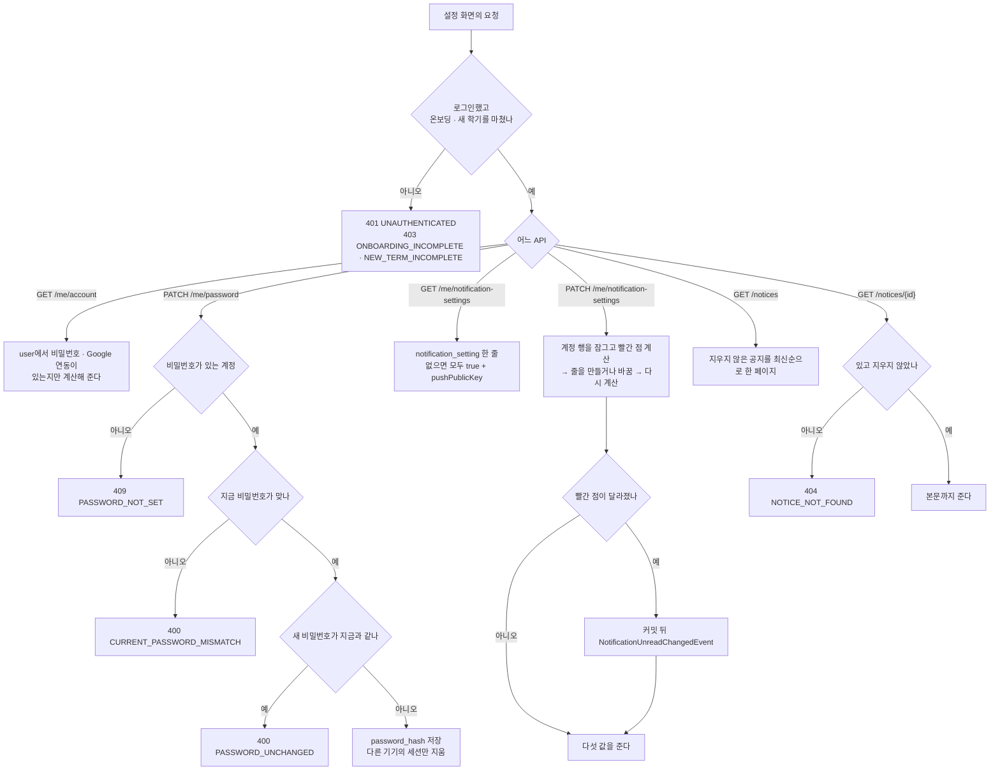
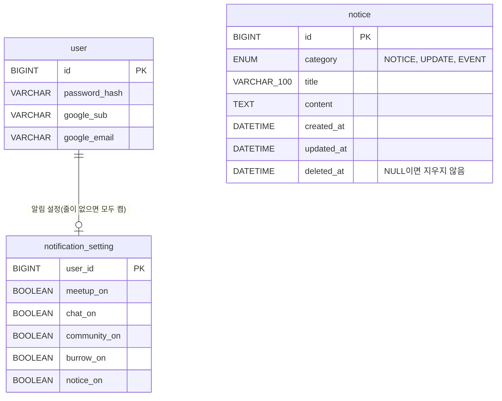

# KAN-58 [BE] 10 설정 ①: 계정 정보 · 비밀번호 변경 · 알림 설정 · 공지사항

- Jira: [KAN-58](https://it-ting.atlassian.net/browse/KAN-58)
- 브랜치: `feature/be/KAN-58-settings-account`

## 계획

### 목표

설정 화면이 쓰는 계정 정보, 비밀번호 변경, 알림 설정, 공지사항 API를 만든다. 공지 테이블 `notice`를 이 작업에서 만든다.

- `GET /api/v1/me/account` ([API 명세](../api/10-settings.md#get-apiv1meaccount))
- `PATCH /api/v1/me/password` ([API 명세](../api/10-settings.md#patch-apiv1mepassword))
- `GET /api/v1/me/notification-settings` ([API 명세](../api/10-settings.md#get-apiv1menotification-settings))
- `PATCH /api/v1/me/notification-settings` ([API 명세](../api/10-settings.md#patch-apiv1menotification-settings))
- `GET /api/v1/notices` ([API 명세](../api/10-settings.md#get-apiv1notices))
- `GET /api/v1/notices/{noticeId}` ([API 명세](../api/10-settings.md#get-apiv1noticesnoticeid))

범위 밖:
- Google 연동 · 해제, `GET /oauth/google/verify`: KAN-60
- 브라우저 푸시 등록 · 해제, 푸시 공개 키를 두는 곳: KAN-59 (아래 C)
- 회원 탈퇴: KAN-61
- 공지를 올리고 고치는 API: 11 운영 · 관리자. 이번에는 테이블과 읽는 API만 만든다

### 정한 것

| # | 질문 | 정한 답 | 정한 사람 |
|---|---|---|---|
| 1 | 요청 · 응답 · 에러 | `docs/api/10-settings.md` 그대로 | API 명세 |
| 2 | 막는 범위 | 여섯 API 모두 로그인이 필요하고, `@AllowDuringOnboarding` · `@AllowBeforeNewTerm`을 붙이지 않는다. 온보딩 중이면 `403 ONBOARDING_INCOMPLETE`, 새 학기를 고르기 전이면 `403 NEW_TERM_INCOMPLETE` | API 명세 "목록" |
| 3 | 계정 정보의 값 | `hasPassword` = `password_hash`가 있는지, `isGoogleLinked` = `google_sub`가 있는지, `googleEmail`, `canUnlinkGoogle` = 연동돼 있고 비밀번호가 있는지 | API 명세 "계정의 모양" |
| 4 | 비밀번호 변경 순서 | 입력 모양(`@ValidPassword`) → 비밀번호 없는 계정 `409 PASSWORD_NOT_SET` → 지금 비밀번호가 틀림 `400 CURRENT_PASSWORD_MISMATCH` → 같은 비밀번호 `400 PASSWORD_UNCHANGED` → 저장 → 이 계정의 다른 세션만 지운다(지금 세션은 남김) | API 명세 |
| 5 | 비밀번호 저장 | 이미 있는 `UserService.changePassword`와 BCrypt `PasswordEncoder`를 쓴다 | Jira 티켓 |
| 6 | 알림 설정 저장 | 다섯 값을 모두 받는다. 줄이 없으면 모두 켬으로 보고, 처음 바꿀 때 줄을 만든다. 받은 알림은 지우지 않는다 | API 명세, KAN-54 |
| 7 | 빨간 점 소식 | 바꾸기 전과 뒤의 안 읽은 알림 수(`NotificationQueryService.unreadCount`)가 다르면 커밋 뒤 `NotificationUnreadChangedEvent`를 낸다 | API 명세, KAN-54 |
| 8 | 공지 목록 | 삭제하지 않은 공지만, 최신순(같으면 id 큰 것), `page` 1부터, `size` 기본 10 · 1 ~ 50, 본문은 빼고 준다 | API 명세 |
| 9 | 공지 상세 | 없거나 삭제한 공지는 `404 NOTICE_NOT_FOUND`. 이전 글 · 다음 글은 주지 않는다 | API 명세 |
| 10 | 공지 알림의 제목 | `NotificationTargetReader`(갈 곳 `NOTICE`)를 구현해 알림에 공지 제목을 싣는다. 삭제한 공지는 결과에서 뺀다 | Jira 티켓, KAN-54 |
| 11 | 마이그레이션 이름 | `V<yyyyMMdd>_<HHmm>__create_notice.sql` | KAN-42 |

### 이번에 정할 것 (2026-11-23 유예린이 모두 제안대로 승인)

| # | 무엇 | 제안 | 까닭 |
|---|---|---|---|
| A | 지금 비밀번호를 여러 번 틀렸을 때 막을지 (API 명세 "구현 단계로 넘기는 것" 1) | 이번에는 막지 않는다. "남은 일"에 적는다 | 로그인한 본인만 부를 수 있는 API다. 로그인 API도 지금 틀린 횟수로 막지 않아서, 막는다면 두 곳을 같은 규칙으로 함께 정하는 것이 맞다 |
| B | 공지 제목의 길이 (`notice.title`이 `VARCHAR(길이 미정)`) | `VARCHAR(100)`. `docs/db/notification.md`에도 적는다 | 목록 예시의 제목이 20자 안팎이다. 관리자 API(11)가 생길 때 입력 검사를 이 길이에 맞춘다 |
| C | 알림 설정 응답의 `pushPublicKey` | 설정 값 `itting.push.public-key`에서 읽는다. 비어 있으면 `null`을 준다. 실제 키를 만들고 넣는 일은 KAN-59가 한다. `docs/api/10-settings.md`에 "아직 없으면 `null`"을 적는다 | 푸시 공개 키를 두는 곳은 KAN-59의 일이다. 응답 모양은 명세대로 지금 맞춰 두고, 값만 나중에 채운다 |
| D | 패키지 | 계정 정보 · 비밀번호: `user`(`MyAccountController` · `MyAccountService`, `user_*` 테이블을 바꾼다). 알림 설정: `notification`(`NotificationSettingController` · `NotificationSettingService`). 공지: 새 영역 `notice`(엔티티, 목록 · 상세, `NoticeErrorCode`, `NoticeTargetReader`). 다른 세션만 지우는 일은 `SessionService.endOthers`로 더한다 | 바꾸는 테이블의 영역에 둔다. 세션은 `SessionService`만 다룬다(AGENTS.md) |

### 만들 것

| 파일 | 내용 |
|---|---|
| `db/migration/V20261123_<시각>__create_notice.sql` | `notice`(`id`, `category ENUM('NOTICE','UPDATE','EVENT')`, `title VARCHAR(100)`, `content TEXT`, `created_at`, `updated_at`, `deleted_at`). 목록용 인덱스 `(deleted_at, created_at, id)` |
| `notice/{domain,repository,service,controller,dto}` | `Notice`(`BaseTimeEntity`), `NoticeCategory`, 목록 · 상세 API, `NoticeErrorCode.NOTICE_NOT_FOUND`, `NoticeTargetReader` |
| `user/{controller,service,dto}` | `GET /me/account`, `PATCH /me/password`, `MyAccountResponse`, `PasswordChangeRequest`, `UserErrorCode`에 `PASSWORD_NOT_SET` · `CURRENT_PASSWORD_MISMATCH` · `PASSWORD_UNCHANGED` |
| `notification/{controller,service,dto}` | `GET` · `PATCH /me/notification-settings`, `NotificationSettingResponse`, `NotificationSettingUpdateRequest`, `NotificationSetting`에 바꾸는 메서드와 만드는 메서드 |
| `auth/service/SessionService` | `endOthers(userId, request)`: 지금 요청의 세션만 남기고 지운다 |
| `application.yml` | `itting.push.public-key`(기본값 빈 값) |
| `docs/db/notification.md`, `docs/api/10-settings.md` | B, C의 결정 |

### 테스트

| API | 정상 | 실패 |
|---|---|---|
| `GET /me/account` | 이메일 가입 계정 → `hasPassword: true`, `isGoogleLinked: false`, `canUnlinkGoogle: false` | 로그인 안 함 → `401 UNAUTHENTICATED` |
| `PATCH /me/password` | 바꾼 뒤 새 비밀번호로 로그인되고, 다른 기기의 세션은 `401`, 지금 세션은 그대로 | 지금 비밀번호 틀림 → `400 CURRENT_PASSWORD_MISMATCH`, 같은 비밀번호 → `400 PASSWORD_UNCHANGED`, 비밀번호 없는 계정 → `409 PASSWORD_NOT_SET`, 규칙 위반 → `400 INVALID_INPUT` |
| `GET /me/notification-settings` | 줄이 없는 계정 → 다섯 값 모두 `true`, `pushPublicKey: null` | 로그인 안 함 → `401` |
| `PATCH /me/notification-settings` | 커뮤니티를 끄면 저장되고 다시 읽어도 `false`. 안 읽은 커뮤니티 알림이 있으면 빨간 점 소식이 나간다 | 값 하나 빠짐 → `400 INVALID_INPUT`과 `fields` |
| `GET /notices` | 삭제한 공지는 빠지고 최신순, `totalItems` · `totalPages`가 맞다 | `size=51` → `400 INVALID_INPUT` |
| `GET /notices/{noticeId}` | 본문까지 준다 | 없는 id, 삭제한 공지 → `404 NOTICE_NOT_FOUND` |
| 공지 알림 | 공지 알림의 제목이 공지 제목으로 나온다 | 삭제한 공지 → 제목 `null` |

## 결과

### 한눈에 보기

- 새로 만든 테이블: `notice`
- 줄을 만들거나 바꾸는 테이블: `notification_setting`(KAN-54에서 만듦), `user.password_hash`
- 읽기만 하는 것: `user`의 Google 연동 칼럼, `notification`(빨간 점 계산, 공지 알림의 제목)

### 바꾼 것

| 파일 | 내용 |
|---|---|
| `db/migration/V20261123_1728__create_notice.sql` | `notice` 테이블. 목록용 인덱스 `(deleted_at, created_at, id)` |
| `notice/` (새 영역) | `Notice`, `NoticeCategory`, `NoticeErrorCode.NOTICE_NOT_FOUND`, `NoticeRepository`, `NoticeService`, `NoticeController`(목록 · 상세), `NoticeListResponse`, `NoticeResponse`, `NoticeTargetReader`(공지 알림에 공지 제목) |
| `user/controller/MyAccountController`, `user/service/MyAccountService` | `GET /me/account`, `PATCH /me/password` |
| `user/dto/MyAccountResponse`, `PasswordChangeRequest` | 계정의 모양, 비밀번호 변경 본문(`@ValidPassword`) |
| `user/domain/UserErrorCode` | `PASSWORD_NOT_SET`(409), `CURRENT_PASSWORD_MISMATCH`(400), `PASSWORD_UNCHANGED`(400) |
| `auth/service/SessionService` | `endOthers`: 지금 요청의 세션만 남기고 그 계정의 세션을 지운다 |
| `notification/controller/NotificationSettingController`, `notification/service/NotificationSettingService` | `GET` · `PATCH /me/notification-settings` |
| `notification/dto/NotificationSettingResponse`, `NotificationSettingUpdateRequest`, `NotificationSettingUpdateResponse` | 조회 응답(푸시 공개 키 포함), 바꾸기 본문(다섯 값 필수), 바꾸기 응답(다섯 값) |
| `notification/service/PushProperties`, `application.yml` | `itting.push.public-key`(기본 빈 값 → 응답 `null`) |
| `notification/domain/NotificationSetting` | `create`, `update` |
| `docs/db/notification.md` | `notice.title`을 `VARCHAR(100)`으로 정함 |
| `docs/api/10-settings.md` | `pushPublicKey`가 KAN-59 전까지 `null`, "구현 단계로 넘기는 것"에 이번에 정한 것(A ~ C) 표시 |
| 테스트 | `MyAccountApiTests` 11, `NotificationSettingApiTests` 11, `NotificationSettingEventTests` 5, `PushPublicKeyTests` 2, `NoticeApiTests` 12 |

### 확인한 것

- `./gradlew build` 통과. 테스트 303개(기존 262 + 새 41), 실패 0
- `git merge-tree --write-tree HEAD origin/dev`: 충돌 없음
- 로컬 코드 리뷰: P0 0건, P1 0건
- 여섯 API 모두 로그인하지 않으면 `401`, 온보딩을 마치지 않았으면 `403 ONBOARDING_INCOMPLETE`(테스트로 확인). `PUBLIC_API`에 넣지 않았다

### 계획과 달라진 점

- `NoticeController`에 `@Validated`를 붙이지 않았다. 계획의 초안과 달리, 기존 컨트롤러(`GuestbookController`, `NotificationController`)처럼 `@RequestParam`의 `@Min` · `@Max`만 둔다. `@Validated`를 붙이면 검사 방식이 바뀌어 잘못된 `size`가 `400` 대신 `500`이 된다.
- 알림 설정 바꾸기는 계정 행을 잠그고(`UserRepository.findByIdForUpdate`) 시작한다. 처음 저장이 거의 동시에 두 번 오면 줄을 두 번 만들려다 `500`이 나기 때문이다. 겹치는 요청 테스트를 더했다.
- 바꾸기 응답은 조회 응답과 다른 record(`NotificationSettingUpdateResponse`)로 두었다. 명세의 바꾸기 응답에는 `pushPublicKey`가 없다.
- 지금 비밀번호가 72바이트를 넘으면 비교하지 않고 틀린 것(`CURRENT_PASSWORD_MISMATCH`)으로 본다. 로그인과 같은 처리다(BCrypt가 72바이트까지만 본다).
- 세션은 남았는데 계정이 없거나 탈퇴했으면, 계정 정보 · 비밀번호 변경 · 알림 설정 바꾸기가 `401 UNAUTHENTICATED`로 답한다(계정 정보 · 비밀번호 변경은 그 세션도 지운다). `GET /api/v1/me`와 같은 처리다.

### 남은 일

- 지금 비밀번호를 여러 번 틀렸을 때 막는 규칙(A): 로그인 API와 함께 정한다
- 푸시 공개 키 값 넣기: KAN-59
- 공지를 올리고 고치는 API, 본문 길이: 11 운영 · 관리자. 그 전에 로컬에서 공지를 보려면 DB에 직접 넣는다
- Swagger 호출 스크린샷과 응답 텍스트: PR을 만들 때(`api-evidence`)

### 검토 순서

1. `docs/api/10-settings.md`, `docs/db/notification.md`의 바뀐 줄
2. `V20261123_1728__create_notice.sql`, `notice/domain/Notice`
3. `MyAccountController` → `MyAccountService` → `SessionService.endOthers`
4. `NotificationSettingController` → `NotificationSettingService`
5. `NoticeController` → `NoticeService`, `NoticeTargetReader`
6. 테스트: `MyAccountApiTests`, `NotificationSettingApiTests`, `NotificationSettingEventTests`, `NoticeApiTests`
