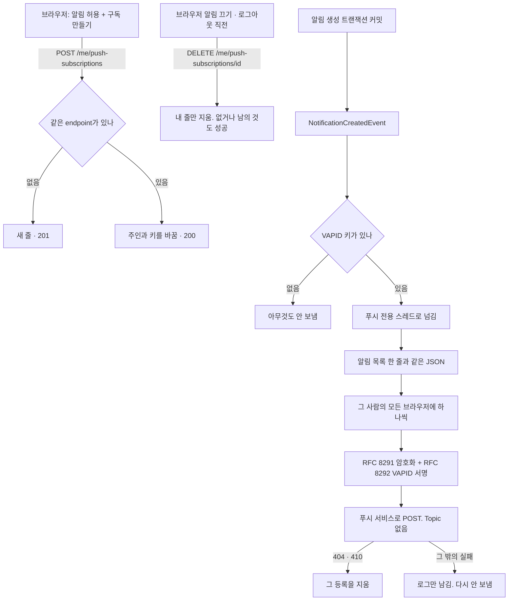
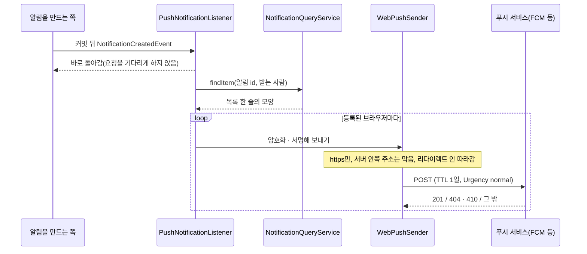
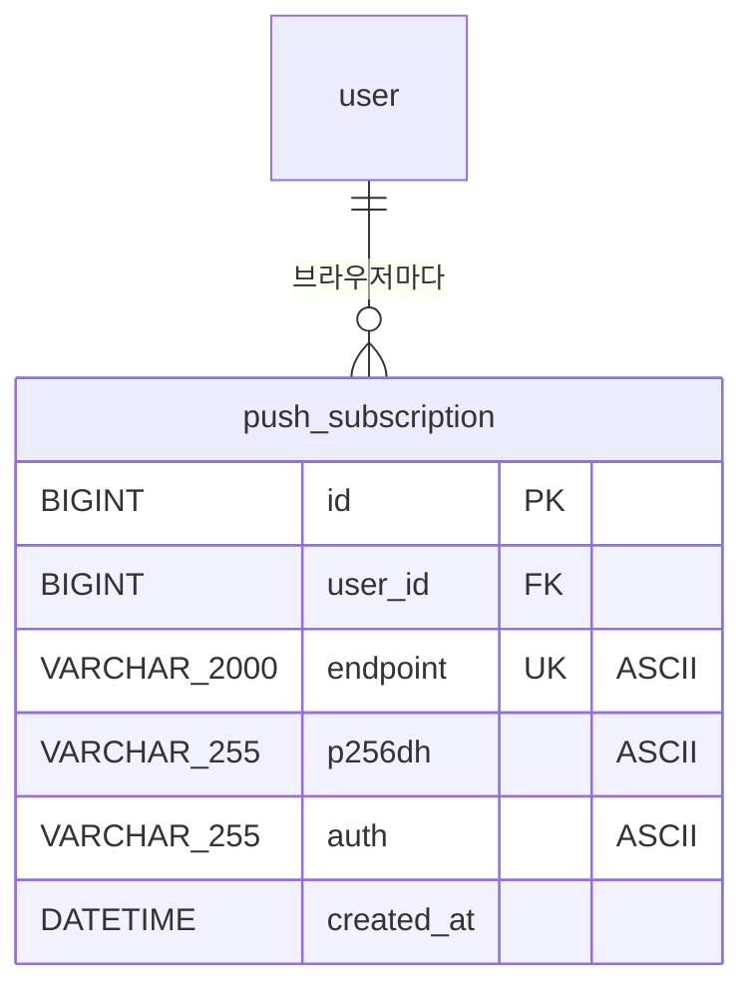

# KAN-59 [BE] 10 설정 ②: 브라우저 푸시

- Jira: [KAN-59](https://it-ting.atlassian.net/browse/KAN-59)
- 브랜치: `feature/be/KAN-59-browser-push`

## 계획

### 목표

브라우저를 푸시 받을 곳으로 등록 · 해제하는 API 2개와 `push_subscription` 테이블을 만든다. 알림이 생기면 그 사람이 등록한 모든 브라우저로 푸시를 보낸다.

- `POST /api/v1/me/push-subscriptions` ([API 명세](../api/10-settings.md#post-apiv1mepush-subscriptions))
- `DELETE /api/v1/me/push-subscriptions/{pushSubscriptionId}` ([API 명세](../api/10-settings.md#delete-apiv1mepush-subscriptionspushsubscriptionid))
- 알림이 생기면 푸시 보내기([알림 API](../api/09-notification.md#알림을-만들-때의-규칙), [브라우저 푸시](../api/10-settings.md#브라우저-푸시))

범위 밖:
- 탈퇴할 때 등록을 모두 지우기: KAN-61(회원 탈퇴)
- 화면 쪽(서비스 워커, 알림 권한 요청, 구독 만들기): 프론트엔드

### 정한 것

| # | 질문 | 정한 답 | 정한 사람 |
|---|---|---|---|
| 1 | 요청 · 응답 · 에러 | `docs/api/10-settings.md` 그대로. 등록은 새로 만들면 `201`, 이미 있던 브라우저면 `200`과 `{pushSubscriptionId}`. 해제는 없거나 남의 것이어도 성공(`data: null`) | API 명세 |
| 2 | 막는 장치 | 둘 다 로그인 필요. `@AllowDuringOnboarding` · `@AllowBeforeNewTerm`을 붙이지 않는다(명세에 "온보딩 중에도"가 없음) | API 명세 |
| 3 | 같은 브라우저를 다시 등록 | 같은 `endpoint`가 있으면 새 줄 없이 주인과 키를 바꾼다. 다른 계정이 등록해 둔 브라우저도 내 것이 된다 | API 명세, DB 설계 |
| 4 | 입력 | `endpoint`는 `https://`로 시작하고 2,000자까지. `keys.p256dh` · `keys.auth` 필수. 어긋나면 `400 INVALID_INPUT` | API 명세 |
| 5 | 누구에게 보내나 | 알림이 만들어진 사람의 모든 등록 브라우저. 끈 갈래 · 탈퇴 · 나 자신은 알림 자체가 만들어지지 않으므로 따로 거르지 않는다 | API 명세, KAN-54 |
| 6 | 언제 보내나 | 알림을 만든 트랜잭션이 커밋된 뒤 나오는 `NotificationCreatedEvent`를 받아 보낸다 | KAN-54 C |
| 7 | 없는 구독 | 브라우저 쪽이 "없는 구독"(`404` · `410`)이라고 답하면 그 줄을 지운다 | API 명세 |
| 8 | 공개 키를 두는 곳 | `itting.push.public-key`(KAN-58에서 만듦). 비어 있으면 `pushPublicKey: null` | KAN-58 C |
| 9 | 마이그레이션 | `V20261124_0443__create_push_subscription.sql` | KAN-42 |

### 이번에 정할 것 (2026-11-24 유예린 승인)

| # | 무엇 | 제안 | 까닭 |
|---|---|---|---|
| A | 푸시를 실제로 보내는 일까지 이번에 하나 | 한다. 등록 · 해제 API에 더해, 알림이 생기면 푸시를 보내고 없는 구독을 지우는 것까지 만든다 | Jira 설명은 "구독과 해제"뿐이지만, KAN-54가 "`NotificationCreatedEvent`는 KAN-59가 받아 푸시한다"고 넘겼다. 등록만 하고 보내지 않으면 기능이 동작하지 않는다 |
| B | 푸시에 담는 내용과 누르면 가는 곳 (API 명세 "구현 단계로 넘기는 것") | 서버는 알림 목록의 한 줄과 같은 모양(`notificationId`, `type`, `actor`, `target`)을 JSON으로 보낸다. 문구와 누르면 갈 주소는 프론트엔드의 서비스 워커가 정한다 | 알림 목록의 문구도 프론트엔드가 만든다. 같은 곳에서 만들어야 목록과 푸시의 글이 같아진다 |
| C | 새 메시지 푸시 묶기 (API 명세 "구현 단계로 넘기는 것") | **승인안(제안과 다름)**: 메시지마다 푸시를 하나씩 보내고 덮어쓰지 않는다(Topic을 붙이지 않음). 두 번째부터는 앞의 것 위에 쌓인다. 쌓아 보여 주는 모양은 프론트엔드(서비스 워커)와 기기가 정한다. 푸시에 메시지 내용은 담지 않는다(같은 문구가 쌓여도 된다) | 메시지가 몇 개 왔는지 푸시로 알 수 있게 한다. 내용을 담지 않으면 잠금 화면에 대화가 보이지 않고, 채팅 영역(KAN-56)과 맞출 일이 없다 |
| D | 로그인이 만료된 브라우저 (API 명세 "구현 단계로 넘기는 것") | 이번에는 하지 않는다. 로그아웃할 때 프론트엔드가 등록을 먼저 지우는 것(명세)으로 둔다. 남은 일에 적는다 | 로그인은 14일 동안 유지된다. 만료를 다루려면 프론트엔드가 열 때마다 다시 등록하는 약속이 더 필요해 범위가 커진다 |
| E | 보내는 방법 | 라이브러리 없이 Java 기본 기능으로 표준(RFC 8291 암호화, RFC 8292 VAPID)을 따라 만든다. 표준 문서의 예시 값으로 암호화가 맞는지 테스트한다 | 자바 웹 푸시 라이브러리는 몇 년째 새 버전이 없고 다른 라이브러리를 여럿 끌고 온다. Java 25에 필요한 기능(ECDH, HKDF, AES-GCM, ES256)이 다 있다 |
| F | 저장 형식 (DB 설계 "미정") | `endpoint VARCHAR(2000)`(ASCII, UNIQUE), `push_keys` 대신 `p256dh VARCHAR(255)`, `auth VARCHAR(255)` 두 칸, `created_at`. `docs/db/notification.md`도 고친다 | 주소는 영문 URL이라 ASCII로 두면 2,000자에도 UNIQUE 색인을 걸 수 있다. 키 두 개를 한 칸에 JSON으로 넣는 것보다 칸을 나누는 편이 검사와 읽기가 쉽다 |
| G | 키 설정과 만들기 | 서버 설정에 `itting.push.public-key`, `itting.push.private-key`, `itting.push.subject`(연락처 `mailto:`)를 두고 `.env`에서 읽는다. 키를 만드는 Gradle 명령 `./gradlew vapidKeys`를 더한다. 키가 비어 있으면 서버는 정상으로 뜨고 푸시만 보내지 않는다 | 개인 키는 비밀값이라 사용자가 만들어 `.env`에 넣는다(Jira). 키 없이도 다른 기능 개발 · 테스트가 돌아야 한다 |
| H | 보내다 실패하면 | 요청을 기다리게 하지 않도록 따로 돌려 보낸다. `404` · `410`은 줄을 지우고, 그 밖의 실패는 로그만 남기고 다시 보내지 않는다. 푸시 유효 시간(TTL)은 하루 | 푸시는 알림 목록을 보충하는 것이라, 놓쳐도 알림 목록에는 남는다 |

### 만들 것

| 파일 | 내용 |
|---|---|
| `db/migration/V20261124_0443__create_push_subscription.sql` | `push_subscription`. FK `user_id` → `user`, `endpoint` UNIQUE, `user_id` 색인 |
| `notification/domain/PushSubscription` | 엔티티(`BaseCreatedTimeEntity`) |
| `notification/repository/PushSubscriptionRepository` | `endpoint`로 찾기(잠금), 내 것 지우기, 사용자의 등록 목록 |
| `notification/service/PushSubscriptionService` | 등록(같은 주소면 주인 · 키 바꾸기) · 해제 |
| `notification/service/WebPushSender` · `WebPushEncryption` · `VapidSigner` | 표준대로 암호화하고 서명해 보낸다 |
| `notification/service/PushNotificationListener` | `NotificationCreatedEvent`를 받아 내용을 만들고 모든 등록 브라우저로 보낸다 |
| `notification/controller/PushSubscriptionController` | API 2개 |
| `notification/dto` | `PushSubscriptionRequest`, `PushSubscriptionResponse` |
| `PushProperties` · `application.yml` · `.env.example` | 개인 키 · 연락처 설정 칸(값 없음) |
| `backend/build.gradle` | `vapidKeys` 명령 |
| 문서 | `docs/db/notification.md`(F), `docs/api/10-settings.md` · `09-notification.md`의 "구현 단계로 넘기는 것"(B ~ D) |

### 테스트

| 대상 | 정상 | 실패 |
|---|---|---|
| `POST /me/push-subscriptions` | 새 브라우저 `201`, 같은 브라우저 다시 `200`과 같은 id, 다른 계정이 등록하면 주인이 바뀜 | `http://` 주소 · 2,001자 · 키 없음 `400`, 로그인 안 함 `401` |
| `DELETE /me/push-subscriptions/{id}` | 내 것 지움, 없는 id도 성공 | 남의 것은 지워지지 않음(성공으로 답하되 줄은 남음), 로그인 안 함 `401` |
| 암호화 · 서명 | RFC 8291 예시 값과 같은 결과, VAPID 서명이 공개 키로 검증됨 | |
| 보내기 | 알림이 생기면 그 사람의 모든 브라우저로 감(테스트용 가짜 푸시 서버), Topic 헤더가 없음, 새 메시지 알림은 메시지마다 한 번씩 감 | 가짜 서버가 `410`이면 줄이 지워짐, `500`이면 줄이 남음, 키가 없으면 보내지 않음 |

## 결과

### 한눈에 보기

푸시를 보내는 순서:

새로 만든 테이블:

### 바꾼 것

| 파일 | 내용 |
|---|---|
| `db/migration/V20261124_0443__create_push_subscription.sql` | `push_subscription`. `endpoint` UNIQUE(ASCII), `user_id` 색인 · FK |
| `notification/domain/PushSubscription` | 엔티티 |
| `notification/repository/PushSubscriptionRepository` | 주소로 찾기, 사용자의 모든 등록, 내 것 지우기, 없는 구독 지우기 |
| `notification/service/PushSubscriptionService` | 등록(같은 주소면 주인 · 키 바꾸기, 동시에 들어오면 새 트랜잭션에서 다시) · 해제 |
| `notification/service/WebPushEncryption` · `VapidSigner` · `WebPushKeys` · `WebPushSender` | 라이브러리 없이 Java 기본 기능으로 암호화 · 서명 · 보내기 |
| `notification/service/PushNotificationListener` | 알림 이벤트를 받아 모든 브라우저로 보내기(전용 스레드 4개, 대기 1,000개) |
| `notification/service/NotificationQueryService` | `findItem`(알림 하나를 목록 한 줄 모양으로) |
| `notification/service/VapidKeyGenerator` · `backend/build.gradle` | `./gradlew -q vapidKeys`로 `.env`에 붙일 두 줄을 출력 |
| `notification/controller/PushSubscriptionController` · `dto` | API 2개 |
| `PushProperties` · `application*.yml` · `.env.example` · `README.md` | 개인 키 · 연락처 설정 칸(값 없음), 키 만드는 법 |
| `docs/db/notification.md`, `docs/api/10-settings.md`, `docs/api/09-notification.md` | 저장 형식(F), 푸시 내용 · 채팅 푸시(B, C), 아직 남은 것(D) |

### 확인한 것

- `./gradlew build` 통과. 테스트 430개, 실패 0. 새 테스트 54개와 기존 클래스에 1개: `PushSubscriptionApiTests` 24, `PushDeliveryTests` 11, `WebPushEncryptionTests` 9(RFC 8291 예시 값과 같음), `VapidSignerTests` 8, `PushSubscriptionConcurrencyTests` 2, `PushPublicKeyTests` 2 → 3
- 숫자는 Gradle 테스트 결과 XML에서 셌다
- 보내기 테스트는 테스트 안의 가짜 푸시 서버로 받고, 받은 내용을 브라우저 쪽 키로 풀어 JSON과 서명을 확인했다
- 테스트가 실제로 잡는지: 동시 등록의 재시도 횟수를 1로, 없는 구독 코드를 `411`로 잠깐 바꾸면 해당 테스트가 실패했다(되돌림)
- 로컬 코드 리뷰: P0 0건, P1 0건
- Codex 리뷰 P1 2건 고침(테스트 431개, 실패 0. `PushPublicKeyTests` 3 → 4)
  - 운영 · 테스트 프로필에서 `ITTING_PUSH_PUBLIC_KEY` · `ITTING_PUSH_PRIVATE_KEY`가 설정에 이어지지 않았다(이름의 하이픈 때문에 자동 연결 안 됨). `application.yml`에서 세 환경 변수를 직접 잇고 `application-local.yml`의 같은 줄은 지웠다. 공통 설정만 바꾸면 새 테스트가 실패하는 것도 확인했다(되돌림)
  - 공개 키만 있고 개인 키나 연락처가 없어도 알림 설정이 `pushPublicKey`를 줬다. 이제 `WebPushSender`가 보낼 수 있을 때만 공개 키를 준다(키가 틀려도 `null`). `docs/api/10-settings.md`도 맞췄다
- 실제 FCM 등 진짜 푸시 서비스로는 보내 보지 않았다(키와 프론트엔드가 있어야 한다)

### 계획과 달라진 점

- 등록이 동시에 들어올 때 DB 잠금 대신, UNIQUE에 걸리면 새 트랜잭션에서 다시 하는 방식(최대 3번)으로 막았다. 없는 줄은 잠글 수 없어 잠금 방식은 교착이 날 수 있다
- 푸시 주소는 사용자가 보낸 값이라, 서버가 아무 곳으로나 요청을 보내지 않게 `https`만, 서버 안쪽 주소(내 PC, 사설망, 클라우드 메타데이터 주소)는 막고 리다이렉트는 따라가지 않는다. 테스트만 `itting.push.allow-local-endpoints`로 푼다(기본 꺼짐)
- 입력 검사를 조금 더 엄격히 했다. 주소는 ASCII만, 키는 base64url 글만 받는다(어긋나면 `400 INVALID_INPUT`)
- 탈퇴한 계정의 세션이 남아 있으면 등록이 `401 UNAUTHENTICATED`다

### 남은 일

- 로그인이 만료된 브라우저에 푸시가 계속 가지 않게 하기(D)
- 탈퇴하면 등록을 모두 지우기: KAN-61
- 실제 키를 `.env`와 운영 서버 환경 변수에 넣기: 사람이 한다(`./gradlew -q vapidKeys`)
- 프론트엔드: 서비스 워커에서 문구 · 누르면 갈 주소 만들기, 같은 대화방 푸시를 쌓아 보여 주기

### 검토 순서

1. `docs/api/10-settings.md` · `docs/db/notification.md`의 바뀐 부분
2. `PushSubscriptionService`, `PushSubscriptionController`(등록 · 해제 규칙)
3. `PushNotificationListener` → `WebPushSender`(보내는 흐름, 막는 주소)
4. `WebPushEncryption` · `VapidSigner`와 그 테스트(표준 예시 값)
