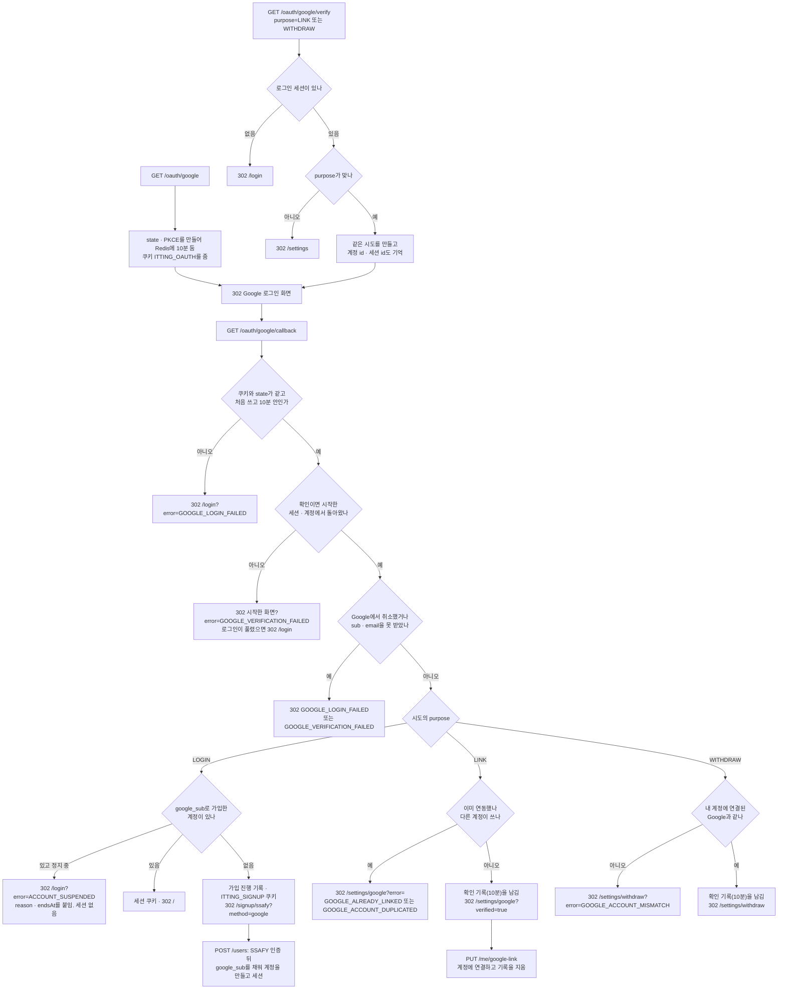
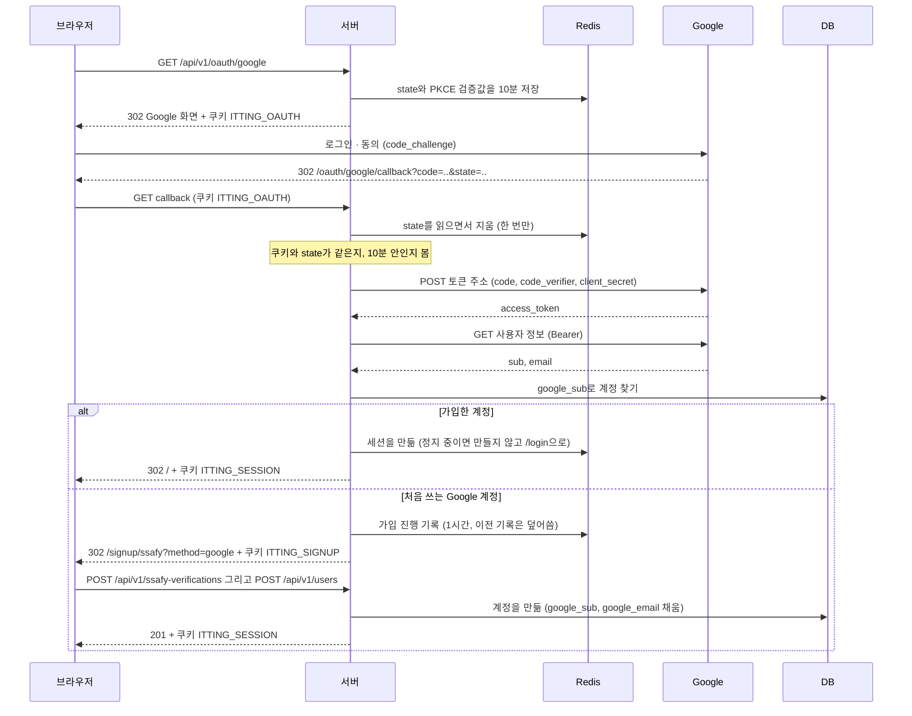
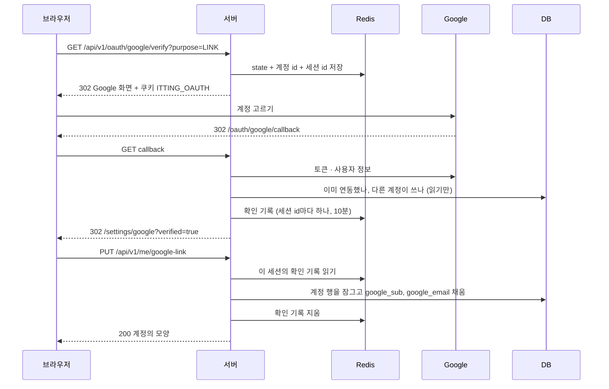

# KAN-60 [BE] 02 ④ Google 로그인 + 10 Google 연동

- Jira: [KAN-60](https://it-ting.atlassian.net/browse/KAN-60)
- 브랜치: `feature/be/KAN-60-google-login`

## 계획

### 목표

Google 계정으로 로그인 · 가입하고, 설정에서 Google 계정을 연동 · 해제한다. 탈퇴 전 Google 본인 확인(`WITHDRAW`)의 확인 기록도 이번에 만든다.

- `GET /api/v1/oauth/google` ([API 명세](../api/02-auth.md#get-apiv1oauthgoogle))
- `GET /api/v1/oauth/google/callback` ([API 명세](../api/02-auth.md#get-apiv1oauthgooglecallback))
- `GET /api/v1/oauth/google/verify` ([API 명세](../api/10-settings.md#get-apiv1oauthgoogleverify))
- `PUT /api/v1/me/google-link` ([API 명세](../api/10-settings.md#put-apiv1megoogle-link))
- `DELETE /api/v1/me/google-link` ([API 명세](../api/10-settings.md#delete-apiv1megoogle-link))
- `POST /api/v1/users`의 Google 가입 분기 (지금은 `IllegalStateException`을 던지는 자리)

범위 밖:
- `WITHDRAW` 확인 기록을 읽는 `GET /me/withdrawal-check`, `POST /me/withdraw`: KAN-61. 이번에는 기록을 만들고 읽는 메서드까지만 둔다
- 실제 Google Cloud OAuth 클라이언트 만들기: 사람이 한다(티켓의 "시작 조건"). 테스트는 가짜 Google 서버로 한다
- 프론트엔드 화면: 아직 `frontend/`가 없다. 돌아갈 주소(아래 A)만 정해 문서에 적는다

### 정한 것

| # | 질문 | 정한 답 | 정한 사람 |
|---|---|---|---|
| 1 | 다섯 API의 동작 · 에러 | `docs/api/02-auth.md`, `docs/api/10-settings.md` 그대로 | API 명세 |
| 2 | 로그인 필요 여부 | `oauth/google`, `oauth/google/callback`은 로그인 불필요(`PUBLIC_API`). `verify`는 로그인이 필요하다. 로그인하지 않았으면 로그인 검사가 JSON `401` 대신 로그인 화면으로 `302`를 준다(아래 "계획과 달라진 점"). `PUT` · `DELETE /me/google-link`는 로그인 필요 | API 명세 "목록", "서버가 하는 일" 1 |
| 3 | 처음 쓰는 Google 계정 | 계정을 만들지 않고 가입 진행 기록(`method=GOOGLE`, Google 식별자, Google 이메일)을 만들고 `ITTING_SIGNUP` 쿠키를 준다. 이전 기록은 덮어쓴다 | API 명세 02 "가입 진행" |
| 4 | 정지된 계정 | 세션을 만들지 않고 로그인 화면으로 `error=ACCOUNT_SUSPENDED` | API 명세 02 |
| 5 | Google 확인 기록 | `purpose`, Google 식별자, Google 이메일. 로그인 세션에 묶음, 10분, 다시 받으면 덮어씀, 쓰면 지움. 콜백은 DB를 바꾸지 않음 | API 명세 10 "Google 확인" |
| 6 | 확인 검사 | `LINK`: 이미 연동 → `GOOGLE_ALREADY_LINKED`, 다른 계정이 씀 → `GOOGLE_ACCOUNT_DUPLICATED`. `WITHDRAW`: 연결된 계정과 다름 → `GOOGLE_ACCOUNT_MISMATCH`. 취소 · 실패 → `GOOGLE_VERIFICATION_FAILED` | API 명세 10 |
| 7 | 연동 · 해제 | `PUT`: 기록 없음 + 이미 연동 → 그대로 성공, 기록 없음 + 미연동 → `409 GOOGLE_VERIFICATION_REQUIRED`, 겹치면 `409 GOOGLE_ACCOUNT_DUPLICATED`. `DELETE`: 미연동 → 그대로 성공, 비밀번호 없음 → `409 GOOGLE_UNLINK_NOT_ALLOWED`, 세션은 지우지 않음. 둘 다 [계정의 모양](../api/10-settings.md#계정의-모양)으로 답함 | API 명세 10 |
| 8 | Google 가입 계정 만들기 | `user.google_sub`, `google_email`을 채우고 `email`, `password_hash`는 비움. `uk_user_google_sub`에 걸리면 `409 GOOGLE_ACCOUNT_DUPLICATED`(이미 있는 `UserService` 변환) | API 명세 02 |
| 9 | 가짜 Google 서버 | `FakeMattermost`, `FakePushServer`처럼 JDK `HttpServer`로 토큰 · 사용자 정보 주소를 흉내 낸다 | Jira 티켓, 기존 테스트 |

### 이번에 정할 것 (2026-11-25 유예린이 답함: A ~ D, F, J 제안대로 승인. E, G, H, I 보류)

| # | 무엇 | 제안 | 까닭 |
|---|---|---|---|
| A | 콜백이 보내는 프론트엔드 주소 (API 명세 02 "구현 단계로 넘기는 것" 1) | `itting.frontend-url` 뒤에 붙인다. · 로그인됨: `/` · 처음 쓰는 Google 계정: `/signup/ssafy?method=google` · 로그인 실패: `/login?error=<code>` · `LINK` 확인됨: `/settings/google?verified=true`, 실패: `/settings/google?error=<code>` · `WITHDRAW` 확인됨: `/settings/withdraw`, 실패: `/settings/withdraw?error=<code>` · `verify`에서 로그인이 풀림: `/login`, `purpose`가 틀림: `/settings` | 프론트엔드가 아직 없어 경로를 서버가 먼저 정해 문서에 적는다. 로그인됨은 프론트엔드가 `GET /me`의 `nextStep`으로 갈 곳을 정하므로 첫 화면 하나면 된다 |
| B | 정지된 계정이 Google로 로그인했을 때 사유와 기간을 전하는 방법 (같은 곳 2) | 주소에 붙인다: `/login?error=ACCOUNT_SUSPENDED&reason=<사유>&endsAt=<ISO-8601 UTC>`. 이메일 로그인의 `error.detail`(`reason`, `endsAt`)과 같은 이름 | 로그인 전이라 프론트엔드가 다른 API로 물어볼 방법이 없다. 사유는 그 사람 본인의 정보이고, Google 로그인을 마친 본인의 브라우저로만 간다. 따로 조회 API를 두면 명세에 없는 API가 하나 늘어난다 |
| C | 로그인 실패 코드 | Google에서 취소했거나, `state`가 틀렸거나, Google과 통신하지 못하면 `error=GOOGLE_LOGIN_FAILED` 하나 | 프론트엔드가 보여 줄 문구가 "Google 로그인을 마치지 못했어요" 하나다. 설정의 `GOOGLE_VERIFICATION_FAILED`와 짝을 맞춘다 |
| D | 시도 기록(`state`)을 두는 모양 (10 "구현 단계로 넘기는 것" 2의 뒷부분) | Redis `oauth:google:<state>`에 `purpose`(`LOGIN`/`LINK`/`WITHDRAW`), `verify`면 계정 id와 세션 id를 10분 둔다. 콜백에서 한 번 읽고 바로 지운다. 같은 `state`를 `HttpOnly` 쿠키 `ITTING_OAUTH`(`SameSite=Lax`, `Path=/api/v1/oauth/google`, 10분)로도 주고 콜백에서 둘이 같은지 본다. PKCE(`S256`)도 붙인다 | 쿠키로 브라우저에 묶지 않으면 남이 시작한 로그인 주소를 내 브라우저가 열었을 때 남의 계정으로 로그인된다(로그인 CSRF). 확인 기록은 세션 id에 묶어 "그 브라우저에서만"을 지킨다 |
| E (보류) | Google 확인을 시작할 때 계정을 다시 고르게 하는 방법 (같은 곳 앞부분) | `verify`는 `prompt=select_account`를 붙인다. 로그인은 붙이지 않는다 | 연동 · 본인 확인은 지금 Google에 로그인된 계정이 아닌 다른 계정을 고를 수 있어야 한다. 로그인은 Google이 기본으로 계정이 여럿이면 고르게 한다 |
| F | Google에서 받는 값 | 토큰 주소에서 받은 액세스 토큰으로 사용자 정보 주소(`openidconnect.googleapis.com/v1/userinfo`)를 불러 `sub`, `email`을 받는다. 범위는 `openid email` | ID 토큰 서명을 검사하는 라이브러리가 필요 없고, 가짜 서버로 흉내 내기 쉽다 |
| G (보류) | 같은 이메일의 Google 계정과 이메일 계정 (`docs/db/account.md` "구현 단계로 넘기는 것") | 이메일로 묶지 않는다. 연결하지 않은 Google 계정은 이메일이 같아도 "처음 쓰는 Google 계정"이다. 한 사람이 두 계정을 만들려 하면 SSAFY 인증에서 `MATTERMOST_ID_DUPLICATED`로 막힌다 | 명세가 연동을 설정에서 본인 확인을 거쳐서만 하게 한다. 이메일만 같다고 묶으면 남의 Google 계정이 내 계정에 로그인할 수 있다 |
| H (보류) | Google 가입인데 `password`를 보낸 경우 | 규칙 검사만 하고(명세 1) 저장하지 않는다 | 명세가 "Google 가입이면 보내지 않는다"고만 해 막을 근거가 없다 |
| I (보류) | 설정 값 | `itting.google.client-id`, `client-secret`, `redirect-uri`(콜백의 전체 주소), 주소 셋(`authorization-uri`, `token-uri`, `userinfo-uri`, 기본값은 Google). `.env` · 환경 변수 `ITTING_GOOGLE_CLIENT_ID` 등. 비어 있으면 서버는 뜨고, `oauth/google`은 `/login?error=GOOGLE_LOGIN_FAILED`, `verify`는 시작한 화면으로 `error=GOOGLE_VERIFICATION_FAILED` | 푸시 키(KAN-59)처럼 키가 없는 PC에서도 서버가 떠야 다른 사람이 개발할 수 있다 |
| J | 패키지 | 로그인 · 콜백 · 확인 시작: `auth`(`GoogleOAuthController`, `GoogleOAuthService`, `GoogleClient`, `GoogleVerificationRepository`). 연동 · 해제: `user`(`MyAccountController`에 더하고 `MyAccountService`가 한다). 새 에러 코드 `GOOGLE_*`는 `AuthErrorCode`에 둔다(`GOOGLE_ACCOUNT_DUPLICATED`가 이미 거기 있다) | 바꾸는 테이블의 영역에 둔다. 세션은 `SessionService`만 다룬다 |

### 만들 것

| 파일 | 내용 |
|---|---|
| `auth/controller/GoogleOAuthController` | `GET /oauth/google`, `/oauth/google/callback`, `/oauth/google/verify`. `302`만 주고 응답 틀을 쓰지 않는다. Swagger에 `302`를 적는다 |
| `auth/service/GoogleOAuthService` | 시작(D, E), 콜백의 세 갈래(로그인 · 가입 진행 · 확인), 돌아갈 주소(A ~ C) |
| `auth/service/GoogleClient`, `GoogleProperties` | 토큰 교환, 사용자 정보(F). `RestClient`, 시간 제한. 설정 I |
| `auth/repository/GoogleOAuthStateRepository`, `GoogleVerificationRepository` | `state`(D), 확인 기록(정한 것 5). Redis |
| `auth/repository/SignupRepository`, `domain/SignupRecord` | Google 가입 기록 만들기, `googleSub` · `googleEmail` 필드 |
| `auth/service/SignupService`, `user/service/UserService` | Google 가입 분기(`createGoogleUser`) |
| `user/controller/MyAccountController`, `user/service/MyAccountService` | `PUT` · `DELETE /me/google-link` |
| `auth/domain/AuthErrorCode` | `GOOGLE_ALREADY_LINKED`, `GOOGLE_ACCOUNT_MISMATCH`, `GOOGLE_VERIFICATION_FAILED`, `GOOGLE_VERIFICATION_REQUIRED`, `GOOGLE_UNLINK_NOT_ALLOWED`, `GOOGLE_LOGIN_FAILED`(주소의 `error`로만 쓴다) |
| `global/security/SecurityConfig` | `PUBLIC_API`에 `oauth/google`, `oauth/google/callback` |
| `application.yml`, `.env.example` | 설정 I. 비밀값은 적지 않는다 |
| `docs/api/02-auth.md`, `docs/api/10-settings.md`, `docs/db/account.md` | A ~ D, G의 결정을 "구현하며 정한 것"에 적고 "구현 단계로 넘기는 것"에서 뺀다 |

### 테스트

가짜 Google 서버로 콜백까지 이어서 부른다. 시간은 고정 `Clock`으로 넘긴다.

| API | 정상 | 실패 |
|---|---|---|
| `GET /oauth/google` | `302`, `Location`이 Google 주소이고 `state` · `code_challenge`가 붙음, `ITTING_OAUTH` 쿠키 | 늘 `302`라 실패 응답이 없다. 실패는 콜백에서 본다 |
| `GET /oauth/google/callback` (로그인) | 가입한 계정 → 세션 쿠키, `/`로. 처음 쓰는 계정 → `ITTING_SIGNUP` 쿠키, `/signup/ssafy?method=google`로, DB에 `user` 없음 | 정지 → `error=ACCOUNT_SUSPENDED&reason&endsAt`, 세션 없음. `state` 쿠키 없음 · 다름 · 이미 씀 → `GOOGLE_LOGIN_FAILED`. Google에서 취소(`error=access_denied`) → `GOOGLE_LOGIN_FAILED`. Google이 `500` → `GOOGLE_LOGIN_FAILED` |
| `POST /users` (Google 가입) | 콜백 뒤 SSAFY 인증 → 계정 생성, `google_sub` 채움, `password_hash` 비움, 세션 | 그 사이 같은 Google 계정이 가입함 → `409 GOOGLE_ACCOUNT_DUPLICATED` |
| `GET /oauth/google/verify` | `LINK` → `302` Google 주소. 콜백 → `/settings/google?verified=true`, DB 그대로. `WITHDRAW` 같은 계정 → `/settings/withdraw` | 로그인 안 함 → `/login`. `purpose` 틀림 → `/settings`. 콜백에서 `LINK`인데 이미 연동 → `GOOGLE_ALREADY_LINKED`, 다른 계정이 씀 → `GOOGLE_ACCOUNT_DUPLICATED`. `WITHDRAW` 다른 계정 → `GOOGLE_ACCOUNT_MISMATCH`. 다른 세션에서 콜백 → 기록 없음 |
| `PUT /me/google-link` | 확인 뒤 → `200`, `isGoogleLinked=true`, 기록 지워짐. 이미 연동 + 기록 없음 → 그대로 `200` | 기록 없음 → `409 GOOGLE_VERIFICATION_REQUIRED`. 10분 지남 → 같은 코드. 확인 뒤 다른 계정이 그 Google로 가입 → `409 GOOGLE_ACCOUNT_DUPLICATED`. 로그인 안 함 → `401` |
| `DELETE /me/google-link` | 연동된 이메일 계정 → `200`, `isGoogleLinked=false`, 세션 남음. 미연동 → 그대로 `200` | Google로만 가입 → `409 GOOGLE_UNLINK_NOT_ALLOWED`. 로그인 안 함 → `401` |

### 보류한 것과 그동안의 동작

정하지 않은 채로 두고, 따로 코드를 넣지 않는다. 명세의 "구현 단계로 넘기는 것"에 남긴다.

| # | 그동안의 동작 |
|---|---|
| E | Google 주소에 `prompt`를 붙이지 않는다. Google의 기본 동작을 따른다 |
| G | Google 계정은 Google 식별자(`google_sub`)로만 찾는다. 이메일이 같아도 묶지 않는다 |
| H | `password`는 지금처럼 규칙 검사만 하고, Google 가입에서는 쓰지 않는다 |
| I | 설정 값을 빈 값 기본값으로 둔다. 비어 있으면 서버는 뜨고 Google이 거절해 `GOOGLE_LOGIN_FAILED` · `GOOGLE_VERIFICATION_FAILED`로 돌아온다. 설정 값을 따로 검사하지 않는다 |

## 결과

### 한눈에 보기

로그인과 가입이 이어지는 순서:

설정에서 Google 계정을 연결하는 순서:

테이블은 만들지 않았고 바꾸지도 않았다(`user.google_sub`, `google_email`, `uk_user_google_sub`는 V3에 이미 있다). 그래서 ERD는 없다.

### 바꾼 것

| 파일 | 내용 |
|---|---|
| `auth/controller/GoogleOAuthController` | `GET /oauth/google`, `/callback`, `/verify`. `302`와 `Location`만 준다. Swagger에 `302`를 적었다. 시작과 콜백에는 `@AllowDuringOnboarding` · `@AllowBeforeNewTerm`을 붙였고 `verify`에는 붙이지 않았다 |
| `auth/service/GoogleOAuthService` | 시작(로그인 · 확인), 콜백(로그인 · 가입 진행 · `LINK` · `WITHDRAW`), `state` 확인, PKCE `S256` |
| `auth/service/GoogleClient`, `GoogleProperties`, `GoogleClientException` | 토큰 교환과 사용자 정보. `RestClient`, 연결 3초 · 읽기 5초. 토큰과 응답 본문은 로그에 남기지 않는다 |
| `auth/service/GoogleRedirectUrls` | 돌아갈 프론트엔드 주소를 만든다(A ~ C). 값은 인코딩한다 |
| `auth/service/GoogleOAuthCookieService` | `ITTING_OAUTH` 쿠키를 쓰고 지운다 |
| `auth/service/GoogleVerificationService` | 확인 기록을 저장 · 조회 · 삭제한다. 유효 10분은 시계로 본다. KAN-61이 `WITHDRAW`를 읽을 때 쓴다 |
| `auth/repository/GoogleOAuthStateRepository`, `GoogleVerificationRepository` | Redis. `state`는 읽으면서 지운다(`GETDEL`). 확인 기록은 세션 id마다 하나 |
| `auth/domain/GoogleAccount`, `GoogleOAuthPurpose`, `GoogleOAuthState`, `GoogleVerification` | 값 클래스 |
| `auth/domain/AuthErrorCode` | `GOOGLE_ALREADY_LINKED`, `GOOGLE_ACCOUNT_MISMATCH`, `GOOGLE_VERIFICATION_FAILED`, `GOOGLE_VERIFICATION_REQUIRED`, `GOOGLE_UNLINK_NOT_ALLOWED`, `GOOGLE_LOGIN_FAILED` |
| `auth/domain/SignupRecord`, `auth/repository/SignupRepository` | Google 가입 진행 기록(`googleSub`, `googleEmail`)을 만들고 읽는다 |
| `auth/service/SignupService`, `auth/controller/SignupController` | Google 가입 분기(`IllegalStateException` 자리). 비밀번호 필수 검사는 이메일 가입만 |
| `auth/service/LoginService` | 정지 기록 조회를 `findSuspension`으로 꺼내 이메일 로그인과 Google 로그인이 같이 쓴다 |
| `user/domain/User`, `user/repository/UserRepository` | `createByGoogle`, `linkGoogle`, `unlinkGoogle`, `findByGoogleSub`, `existsByGoogleSub` |
| `user/service/UserService` | `createGoogleUser`, `linkGoogle`(행 잠금, 겹침 검사, 제약 변환), `unlinkGoogle` |
| `user/controller/MyAccountController`, `user/service/MyAccountService` | `PUT` · `DELETE /me/google-link` |
| `global/security/SecurityConfig` | `PUBLIC_API`에 `oauth/google`, `oauth/google/callback`(GET). `verify`에 로그인하지 않고 오면 `401` 대신 `/login`으로 `302` |
| `application.yml`, `application-prod.yml`, `application-test.yml`, `.env.example`, `README.md` | `itting.google.*`와 환경 변수 여섯 개(비밀값 없음), "Google 로그인 설정" 절 |
| `docs/api/02-auth.md`, `docs/api/10-settings.md`, `docs/db/account.md` | "구현하며 정한 것"에 A ~ D, F와 만들면서 정한 것을 (KAN-60)으로 적고, 풀린 "구현 단계로 넘기는 것"을 뺐다. 보류한 E, H, I는 넘기는 것에 남기고 G는 `docs/db/account.md`에 지금 동작을 덧붙였다 |
| `test/.../support/FakeGoogle`, `GoogleSteps` | JDK `HttpServer`로 만든 가짜 Google(토큰 · 사용자 정보, 코드 한 번만, PKCE · 클라이언트 · `redirect_uri` 확인)과 시작 → 콜백 단계 |
| `test/.../support/TestcontainersConfiguration`, `TestUsers` | 가짜 Google 빈과 설정 주입, `googleSub` · `linkGoogle` |
| `test/.../auth/GoogleLoginApiTests`, `GoogleSignupApiTests`, `GoogleVerifyApiTests`, `user/GoogleLinkApiTests`, `GoogleLinkConcurrencyTests`, `auth/service/GoogleSettingsTests` | 아래 "확인한 것" |

### 확인한 것

- 새 테스트 80개를 골라 돌려 모두 통과했다(실패 0, 오류 0, 건너뜀 0): `GoogleLoginApiTests` 23, `GoogleSignupApiTests` 10, `GoogleVerifyApiTests` 21, `GoogleLinkApiTests` 22, `GoogleLinkConcurrencyTests` 1, `GoogleSettingsTests` 3. 숫자는 Gradle 테스트 결과 XML에서 셌다
- `./gradlew build` 통과. 테스트 544개, 실패 0(Gradle 결과 XML에서 셈. Codex 지적을 고친 뒤 다시 돌린 결과)
- 계획의 "테스트" 표의 모든 줄을 테스트한다. 시간은 고정 `Clock`으로 넘겨 10분 직전(통과)과 10분(실패)을 모두 본다
- 가짜 Google이 실제 Google처럼 클라이언트 id · 비밀, `redirect_uri`, 일회용 코드, PKCE를 확인하므로 콜백이 보내는 요청의 모양도 함께 확인한다
- 테스트가 실제로 잡는지: 아래를 잠깐 바꾸면 해당 테스트가 실패했다(되돌리고 같은지 확인)
  - `state`를 `GETDEL` 대신 `GET`으로 읽기 → 같은 시도 두 번 · 취소 뒤 재사용 테스트 실패
  - 쿠키와 `state` 비교를 빼기 → 쿠키 불일치 테스트 실패
  - `linkGoogle`의 UNIQUE 위반 변환을 빼기 → 동시 연동 테스트 실패
  - 확인 기록의 10분 검사를 빼기 → `GoogleVerifyApiTests`와 `GoogleLinkApiTests`의 10분 테스트 실패
  - `application.yml`의 `ITTING_GOOGLE_CLIENT_ID` 이름을 틀리게 바꾸기 → `GoogleSettingsTests` 실패
- `git merge-tree --write-tree HEAD origin/dev`: 충돌 없음
- 로컬 코드 리뷰(스킬 `code-review`): P0 0건, P1 0건. 확인 필요로 남긴 것: 정지 사유가 주소에 남는 것(결정 B대로), userinfo의 `email_verified`를 보지 않는 것(이메일로 계정을 묶는 기능을 만들면 검사해야 함, 보류 G), 두 탭에서 연달아 시작하면 앞 탭이 `GOOGLE_LOGIN_FAILED`로 끝나는 것(안전한 쪽)
- Codex 리뷰 P1 1건 고침: 비밀번호 변경이 잠그지 않고 읽은 계정을 연동 해제 뒤에 저장하면, 해제한 `google_sub` · `google_email`이 되살아났다. `UserService.changePassword`가 연동 · 해제와 같은 계정 행 잠금(`findByIdForUpdate`)을 잡고, `User`에 `@DynamicUpdate`를 붙여 바꾼 칼럼만 UPDATE한다. `PasswordChangeGoogleUnlinkRaceTests` 2개를 더했고, `@DynamicUpdate`를 빼면 첫 테스트가 실패하는 것(되살아남)을 확인했다
- 진짜 Google로는 호출해 보지 않았다(Google Cloud OAuth 클라이언트가 없다)

### 계획과 달라진 점

- Redis 키에 `itting:`를 붙였다: `itting:oauth:google:<state>`, `itting:google-verification:<세션 id>`. 다른 키와 접두어를 맞췄다(계획은 `oauth:google:<state>`)
- 시도는 `purpose|계정 id|세션 id|PKCE 검증값|끝나는 시각`을 한 문자열로 둔다. PKCE 검증값은 서버만 알아야 해서 쿠키에 두지 않고 시도에 둔다. `state`는 서버가 만든 모양(영문 · 숫자 · `_` · `-` 43자)이 아니면 Redis를 보지 않고 거절한다
- 10분은 Redis 만료에만 맡기지 않고 시계로도 본다(시도의 끝나는 시각, 확인 기록의 끝나는 시각). 고정 `Clock`으로 테스트하려는 것이다
- `verify`에 "온보딩 중에도"를 붙이지 않았다. 명세에 없어서 온보딩을 마치지 않은 계정은 `403 ONBOARDING_INCOMPLETE` JSON을 받는다. 시작과 콜백은 로그인 없이 부르는 API라 두 표시를 모두 붙였다
- `verify`를 계획(정한 것 2)과 달리 `PUBLIC_API`에 넣지 않았다. 로그인이 필요한 API를 `PUBLIC_API`에 두면 코드 리뷰 규칙의 P0라서, 대신 로그인 검사(`SecurityConfig`의 인증 실패 처리)가 이 주소만 JSON `401` 대신 `/login`으로 `302`를 준다. 동작은 같다
- 돌아가는 주소로만 쓰는 `GOOGLE_ACCOUNT_MISMATCH`, `GOOGLE_VERIFICATION_FAILED`, `GOOGLE_LOGIN_FAILED`도 `ErrorCode`라 HTTP 상태를 정해야 해서 `409`, `400`, `401`을 임의로 줬다. HTTP로는 나가지 않는다
- `PUT /me/google-link`는 이미 그 Google 계정이 연결된 계정이면 바꾸지 않고 성공한다(`GOOGLE_ALREADY_LINKED`는 다른 Google 계정일 때만). 확인 기록은 연결했든 겹쳐서 못 했든 지운다. 명세에 없어 문서에 적었다
- `UserService.linkGoogle`은 행을 잠그고, UNIQUE에 걸리기 전에 `existsByGoogleSub`로 먼저 본 뒤 `saveAndFlush`한다. 동시에 들어와 UNIQUE에 걸리는 경우만 제약 이름으로 `GOOGLE_ACCOUNT_DUPLICATED`로 바꾼다. 테스트 트랜잭션 안에서 실패한 flush가 이어지는 문제를 피하려는 것이다. `unlinkGoogle`도 `saveAndFlush`한다
- Google이 `sub`와 `email`을 모두 주고 길이(255, 254자)가 DB 칸에 들어갈 때만 성공으로 본다. 둘 중 하나라도 없으면 실패다
- `LoginService.findSuspension`을 `public`으로 꺼냈다. 이메일 로그인의 동작은 그대로다
- `state` 검사에 실패하면 시작한 화면을 알 수 없어, 확인 시도여도 `/login?error=GOOGLE_LOGIN_FAILED`로 보낸다. 쿠키는 어떤 결과든 지운다
- 확인을 시작한 세션이 아닌 곳(다른 세션 · 다른 계정)으로 돌아오면 Google에서 계정 정보를 받지 않고 `GOOGLE_VERIFICATION_FAILED`로 보낸다. 로그인이 풀려 있으면 `/login`이다
- `GoogleVerificationService`를 따로 두었다(계획의 `GoogleVerificationRepository`만으로 끝내지 않았다). `MyAccountService`와 KAN-61이 같은 유효 시간 · 목적 검사를 쓰게 하려는 것이다
- `README.md`에 "Google 로그인 설정" 절을 더하고 `.env.example`에 로컬 예시 `ITTING_GOOGLE_REDIRECT_URI=http://localhost:8080/api/v1/oauth/google/callback`을 적었다. 계획의 "만들 것"에 `README.md`는 없었다. 클라이언트 id · 비밀은 비워 뒀다
- `docs/api/10-settings.md`에는 "구현하며 정한 것" 절이 없어 같은 역할의 "명세에 없어 이 문서에서 정한 것"에 적었다
- 인증된 요청의 응답에는 같은 세션 쿠키가 다시 실려 온다(세션 만료를 14일로 늘림, KAN-38). 그래서 테스트는 "세션을 바꾸지 않았다"를 "쿠키가 없다"가 아니라 "있으면 같은 세션이다"로 확인한다
- `FakeGoogle`의 가짜 클라이언트 비밀에는 gitleaks 허용 주석을 달았다(실제 값이 아니다)

### 남은 일

- 전체 `./gradlew build`를 다시 돌려 통과를 확인하고 이 문서의 "확인한 것"에 전체 테스트 수를 적는다(Docker가 켜져 있어야 한다)
- 보류한 것(코드는 넣지 않았다. 지금 동작은 위 "계획"의 "보류한 것과 그동안의 동작" 표와 문서의 "구현 단계로 넘기는 것"에 적었다)
  - E: 확인을 시작할 때 `prompt=select_account`를 붙일지. 지금은 붙이지 않는다
  - G: 같은 이메일의 Google 계정과 이메일 계정의 관계. 지금은 `google_sub`로만 찾는다
  - H: Google 가입에서 `password`를 보낸 경우. 지금은 규칙만 검사하고 저장하지 않는다
  - I: Google 설정이 비었을 때. 지금은 검사하지 않아 서버는 뜨고, `client_id`가 비면 Google이 요청을 거절하는 화면을 보여 줄 뿐 우리 서버로 돌아오지 않을 수 있다(계획은 `GOOGLE_LOGIN_FAILED`로 돌아온다고 했으나 Google 쪽 동작이라 확인하지 못했다)
- KAN-61: `GET /me/withdrawal-check`와 `POST /me/withdraw`가 `GoogleVerificationService`로 `WITHDRAW` 기록을 읽고 지운다
- 사람이 해야 하는 것: Google Cloud 콘솔에서 OAuth 클라이언트를 만들고 "승인된 리디렉션 URI"를 `.env`의 `ITTING_GOOGLE_REDIRECT_URI`와 같게 등록한 뒤 `ITTING_GOOGLE_CLIENT_ID` · `ITTING_GOOGLE_CLIENT_SECRET`을 `.env`와 운영 서버 환경 변수에 넣는다(방법은 `README.md`)
- 프론트엔드: 돌아가는 주소(`/signup/ssafy?method=google`, `/login?error=...`, `/settings/google`, `/settings/withdraw` 등)를 이 경로로 맞춰 화면을 만든다
- `api-evidence`: Swagger UI의 Try it out은 `302`를 따라가지 못해 호출 결과를 어떻게 보일지 정해야 한다

### 검토 순서

1. `docs/api/02-auth.md` · `docs/api/10-settings.md`의 `(KAN-60)` 항목과 넘기는 것
2. `GoogleOAuthController` → `GoogleOAuthService`(시작 · `state` 확인 · 콜백의 세 갈래) → `GoogleClient`, `GoogleRedirectUrls`
3. `GoogleOAuthStateRepository` · `GoogleVerificationRepository` · `GoogleVerificationService`(Redis에 두는 모양과 유효 시간)
4. `SignupService`(Google 가입 분기) → `UserService`(`createGoogleUser`, `linkGoogle`, `unlinkGoogle`) → `MyAccountController` · `MyAccountService`
5. `SecurityConfig`의 `PUBLIC_API`, 설정(`application.yml`, `.env.example`, `README.md`)
6. 테스트: `FakeGoogle` · `GoogleSteps` → `GoogleLoginApiTests` → `GoogleVerifyApiTests` → `GoogleLinkApiTests` → `GoogleSignupApiTests` → `GoogleLinkConcurrencyTests` → `GoogleSettingsTests`
