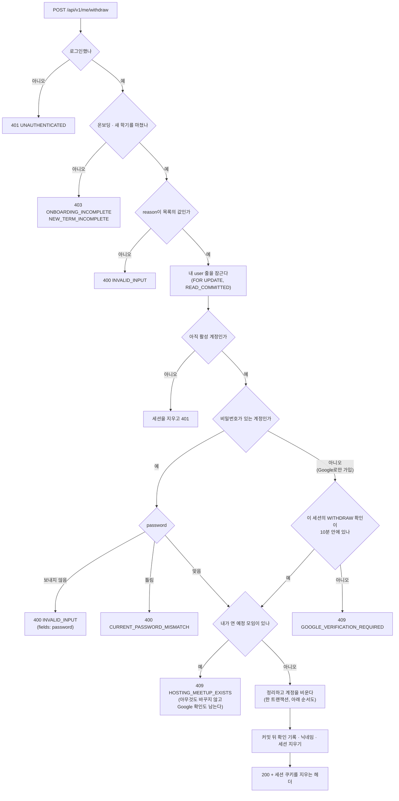
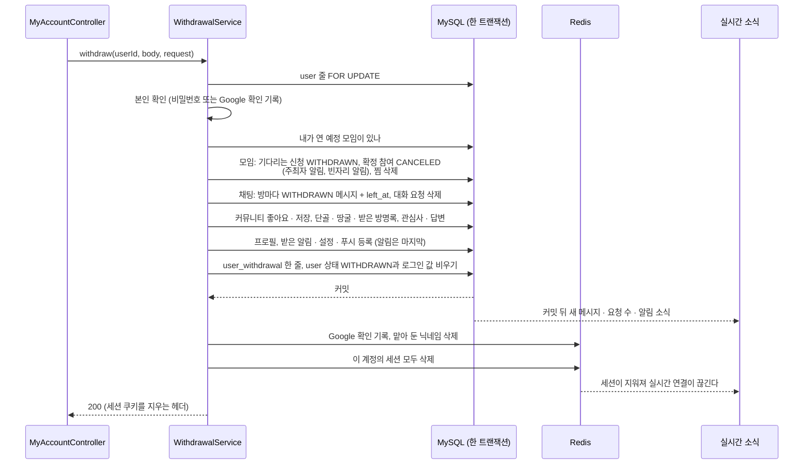
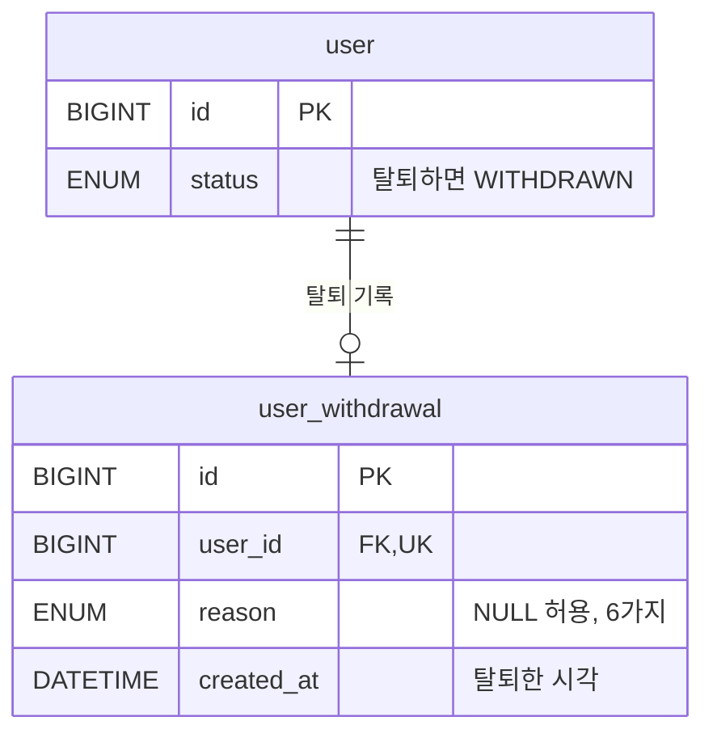

# KAN-61 [BE] 10 설정 ③: 회원 탈퇴

- Jira: [KAN-61](https://it-ting.atlassian.net/browse/KAN-61)
- 브랜치: `feature/be/KAN-61-withdrawal`

## 계획

### 목표

탈퇴 전 확인과 회원 탈퇴를 만든다. 탈퇴는 여러 영역의 데이터를 한 트랜잭션으로 정리한다. 탈퇴 기록 테이블 `user_withdrawal`을 이 작업에서 만든다.

- `GET /api/v1/me/withdrawal-check` ([API 명세](../api/10-settings.md#get-apiv1mewithdrawal-check))
- `POST /api/v1/me/withdraw` ([API 명세](../api/10-settings.md#post-apiv1mewithdraw))

범위 밖:
- 탈퇴한 사람의 프로필 사진 파일을 저장소에서 지우는 일: 파일 저장소가 아직 없다. 사진 · 삭제한 글 정리 예약 작업(KAN-66)에서 정한다(아래 D)
- 지금 비밀번호를 여러 번 틀렸을 때 막는 것: 로그인 API와 같은 규칙으로 따로 정한다(KAN-58 A와 같음)

### 시작 조건 (선행 작업)

탈퇴가 정리하는 테이블과 알림 · 실시간 소식이 모두 있어야 구현할 수 있다. 티켓의 시작 조건("04 ~ 09가 모두 병합된 뒤")을 이 작업에 필요한 것만 추리면 아래와 같다. 2026-11-27 모두 dev에 병합됐다.

| 필요한 것 | 티켓 | 지금 |
|---|---|---|
| `user`, `user_profile`, `user_interest`, `user_answer`, Google 확인 기록(`WITHDRAW`) | KAN-38 · 43 · 60 | ✅ dev |
| `burrow`, `burrow_entrance`, `guestbook_entry`, `regular_burrow` | KAN-45 · 46 · 47 | ✅ dev |
| `post_like`, `comment_like`, `post_bookmark` | KAN-51 · 52 | ✅ dev |
| `notification`, `notification_setting`, `push_subscription` | KAN-54 · 58 · 59 | ✅ dev |
| `chat_request`, `chat_room_member`, `chat_message`(`WITHDRAWN`), 요청 수 실시간 소식 | KAN-55 | ✅ dev |
| 읽기 전용 1:1 대화방, 대화방 실시간 소식 | KAN-56 · 57 | ✅ dev (2026-11-26 병합) |
| `meetup`(내가 연 예정 모임), `meetup_application` | KAN-48 · 49 | ✅ dev (2026-11-25 병합) |
| 참여 취소 · 빈자리 알림 만들기 | KAN-49 · 50 | ✅ dev (2026-11-25 병합) |
| `meetup_like` | KAN-50 | ✅ dev (2026-11-25 병합) |
| 실시간 소식 연결 끊기 | KAN-57 | ✅ dev (2026-11-26 병합) |

### 정한 것

| # | 질문 | 정한 답 | 정한 사람 |
|---|---|---|---|
| 1 | 두 API의 요청 · 응답 · 에러 · 순서 | `docs/api/10-settings.md` 그대로. 입력 모양 → 본인 확인 → 예정 모임 → 정리(3 ~ 8을 한 트랜잭션) → 세션 | API 명세 |
| 2 | 막는 범위 | 두 API 모두 로그인 필요, `@AllowDuringOnboarding` · `@AllowBeforeNewTerm` 없음 | API 명세 "목록" |
| 3 | 바꾸는 것 · 지우는 것 · 남기는 것 | API 명세 "탈퇴할 때 하는 일"의 세 표 그대로 | API 명세 |
| 4 | 다른 영역을 바꾸는 까닭 | API 명세에 적혀 있다(탈퇴 API는 `AGENTS.md` P1의 예외) | API 명세, `AGENTS.md` |
| 5 | `user_withdrawal` | `id`, `user_id`(UNIQUE, FK), `reason` ENUM 6개 NULL 허용, `created_at`. `BaseCreatedTimeEntity` | `docs/db/account.md` |
| 6 | 본인 확인 | 비밀번호 계정은 `password`(없으면 `400 INVALID_INPUT`, 틀리면 `400 CURRENT_PASSWORD_MISMATCH`). Google로만 가입한 계정은 이 세션의 `WITHDRAW` 확인 기록(10분, `GoogleVerificationService`), 없으면 `409 GOOGLE_VERIFICATION_REQUIRED` | API 명세, KAN-60 |
| 7 | 세션 | 성공하면 `SessionService.endAll`로 모든 세션을 지우고 세션 쿠키를 지운다 | Jira 티켓, API 명세 |
| 8 | 재가입 | 같은 Mattermost 계정으로 다시 가입하면 새 계정. `mattermost_id`를 비워 UNIQUE가 걸리지 않는다 | `docs/db/account.md` |
| 9 | 채팅 메시지의 사진(`chat_message_image`) | 지우지 않는다. 채팅 메시지를 남기므로 메시지에 붙은 사진 줄도 남는다 | API 명세 "남기는 것"의 채팅 메시지 |
| 10 | 오늘의 추천 기록(`daily_recommendation`, `daily_recommendation_member`) | 지우지 않는다. 명세의 지우는 표에 없고, 추천 횟수를 세려고 지난 결과를 남긴다. 추천 목록은 활동 중이고 땅굴이 있는 회원만 읽으므로(`DailyRecommendationMemberRepository.findVisibleMembers`) 탈퇴한 사람은 다시 나오지 않는다 | `docs/db/burrow.md`, API 명세 "지우는 것" |
| 11 | 실시간 소식 연결 끊기 | 따로 정리 클래스를 두지 않는다. 세션을 모두 지우면 `EventStreamSessionListener`가 그 세션의 연결을 끊는다 | KAN-57 "남은 일" |
| 12 | 모임 대화방의 안내 | `LEFT`(나갔습니다) 없이 `WITHDRAWN`(탈퇴했습니다) 하나만 넣는다. 모임 쪽 정리가 대화방을 나가지 않고 채팅 쪽 정리가 한다 | API 명세 "탈퇴할 때 하는 일"의 대화방 줄 |
| 13 | 올린 사진(`uploaded_image`), 정지 기록(`user_suspension`) | 지우지 않는다. 사진은 남는 글 · 메시지에 붙어 있을 수 있고, 정지 기록은 이력이다. 명세의 지우는 표에 없다 | API 명세 "지우는 것" |

### 이번에 정할 것 (2026-11-25 유예린이 A ~ G 모두 제안대로 승인)

| # | 무엇 | 제안 | 까닭 |
|---|---|---|---|
| A | 언제 구현하나 | 계획만 승인받고, 위 "시작 조건"이 모두 dev에 들어온 뒤 구현한다. 그 전에 부분만 만들어 병합하지 않는다(2026-11-27 모두 병합돼 구현했다) | 일부만 정리하는 탈퇴가 먼저 병합되면, 그 사이 탈퇴한 계정의 대화방 · 모임 신청이 정리되지 않은 채 남는다. 되돌릴 수 없는 API라 나중에 고칠 수 없다 |
| B | 코드 구조 | `user/service/WithdrawalService`가 순서를 잡고 한 트랜잭션을 연다. 다른 영역의 정리는 그 영역 패키지에 `<영역>WithdrawalCleaner`(예: `chat/service/ChatWithdrawalCleaner`)를 두어 그 영역의 저장소만 쓰게 한다. 커밋 뒤 실시간 소식은 각 영역이 이미 쓰는 방식(`TransactionSynchronization`)으로 낸다 | 영역의 테이블은 그 영역 코드만 다룬다는 규칙을 탈퇴에서도 지킨다. 새 영역이 생기면 정리 클래스 하나만 더하면 된다 |
| C | 동시에 일어나는 일과의 순서 | 탈퇴는 맨 먼저 내 `user` 행을 `SELECT ... FOR UPDATE`로 잠그고, 잠근 뒤 다시 읽어 아직 활성인지 본다. 대화 요청(KAN-55, 두 계정을 id 순서로 잠금), Google 연동 · 비밀번호 변경(KAN-60)과 같은 잠금이다 | 탈퇴하는 사이 들어온 대화 요청 · 수락이 탈퇴한 계정에 새 줄을 만들지 못하게 한다. 같은 잠금을 쓰면 한쪽이 끝난 뒤 다른 쪽이 본다 |
| D | 프로필 사진 파일 (API 명세 "구현 단계로 넘기는 것") | 이번에는 `user_profile` 줄만 지우고 파일은 지우지 않는다. 사진 정리 예약 작업 KAN-66(KAN-56 병합 뒤 시작)에서 "탈퇴한 사람의 사진을 언제 지우는지"를 함께 정하도록 그 티켓에 적어 둔다 | 지금은 사진을 올리는 기능과 저장소가 없어 지울 파일이 없다 |
| E | Google 확인 기록을 지우는 때 | 탈퇴가 성공했을 때만 지운다. `HOSTING_MEETUP_EXISTS`처럼 실패하면 남겨, 모임을 정리하고 10분 안에 다시 누를 수 있게 한다 | API 명세는 "쓰고 나면 지운다"만 적었다. 실패한 시도는 "쓴" 것이 아니다 |
| F | 그 밖에 지울 임시 저장소 값 | 내가 맡아 둔 닉네임(`itting:nickname-hold*`)을 지운다 | 프로필을 지우므로 맡아 둔 닉네임도 남길 까닭이 없다. 남겨도 5분 뒤 사라지지만 그 사이 다른 사람이 못 쓴다 |
| G | 관리자 계정의 탈퇴 | 일반 계정과 똑같이 받는다 | 명세에 다른 말이 없다. 관리자 권한은 DB에서 직접 주는 것이라 API로 막을 까닭이 없다 |

### 만들 것

| 파일 | 내용 |
|---|---|
| `db/migration/V<만든 시각>__create_user_withdrawal.sql` | `user_withdrawal` (정한 것 5) |
| `user/domain/UserWithdrawal`, `WithdrawalReason` | 엔티티, enum 6개 |
| `user/controller/MyAccountController` | `GET /me/withdrawal-check`, `POST /me/withdraw` |
| `user/service/WithdrawalService` | 본인 확인, 잠금(C), 각 영역 정리 호출, 기록, 세션(정한 것 7) |
| `user/dto/WithdrawalCheckResponse`, `WithdrawRequest` | 응답 · 요청 |
| `<영역>/service/<영역>WithdrawalCleaner` | `burrow`, `guestbook`, `community`, `notification`, `chat`, `meetup`, `interest`, `question`의 정리(B) |
| `meetup` 쪽 | 내가 연 예정 모임 목록(check, 막기), 신청 `WITHDRAWN` · 참여 `CANCELED`, 참여 취소 · 빈자리 알림 (KAN-49 · 50의 코드를 쓴다) |
| `chat` 쪽 | 대화방마다 `WITHDRAWN` 메시지와 `left_at`, 대화 요청 삭제와 요청 수 실시간 소식, 실시간 연결 끊기(KAN-57) |
| `user/domain/UserErrorCode` 또는 `meetup`의 에러 코드 | `HOSTING_MEETUP_EXISTS` |
| `docs/db/account.md`, `docs/api/10-settings.md` | 정한 값, D는 "구현 단계로 넘기는 것"에 남김 |

### 테스트

| API | 정상 | 실패 |
|---|---|---|
| `GET /me/withdrawal-check` | 예정 모임 없음 → `canWithdraw=true`, 빈 목록. 연 모임 둘 → 시작이 가까운 순, `canWithdraw=false`. 지난 · 취소 · 삭제 모임은 빠짐. Google 확인 뒤 `isGoogleVerified=true`, 10분 지나면 `false`, 비밀번호 계정은 늘 `false` | 로그인 안 함 → `401` |
| `POST /me/withdraw` | 비밀번호 계정 탈퇴 → `200`, 세션 · 쿠키 없어짐, `user` 탈퇴 상태와 빈 값, `user_withdrawal` 한 줄. 지우는 표의 모든 테이블에서 내 줄이 사라지고, 남기는 것(글, 댓글, 쓴 방명록, 채팅 메시지, 남이 받은 내 알림, 신고)은 그대로. 대화방마다 `WITHDRAWN` 메시지 · `left_at`. 기다리던 신청 `WITHDRAWN`, 확정 참여 `CANCELED`와 주최자 알림, 정원이 찼던 모임의 빈자리 알림. Google 계정은 확인 뒤 탈퇴. 탈퇴 뒤 같은 Mattermost ID로 새 가입 가능 | `reason` 틀림 → `400 INVALID_INPUT`. 비밀번호 없음 → `400 INVALID_INPUT`, 틀림 → `400 CURRENT_PASSWORD_MISMATCH`. Google 확인 없음 · 10분 지남 → `409 GOOGLE_VERIFICATION_REQUIRED`. 예정 모임 있음 → `409 HOSTING_MEETUP_EXISTS`, 아무것도 안 바뀜. 정리 도중 실패 → 모두 되돌림. 로그인 안 함 → `401` |
| 동시성 | 탈퇴와 그 계정에게 오는 대화 요청이 겹쳐도 탈퇴한 계정에 요청 줄이 남지 않는다(C) | |

## 결과

### 한눈에 보기

`POST /api/v1/me/withdraw`가 지나가는 길이다. 응답이 갈리는 곳은 마름모다. 입력 모양 검사(`reason`)는 컨트롤러에 닿을 때 이미 끝나 있다.

한 트랜잭션 안의 순서와, 커밋 뒤에 하는 일이다. 서비스는 순서만 잡고, 각 영역의 테이블은 그 영역의 `<영역>WithdrawalCleaner`가 다룬다.

테이블은 `user_withdrawal` 하나를 새로 만들었다. 다른 테이블은 모양을 바꾸지 않고 줄을 지우거나 상태만 바꾼다.

### 바꾼 것

| 파일 | 내용 |
|---|---|
| `db/migration/V20261127_0810__create_user_withdrawal.sql` | `user_withdrawal`(`user_id` UNIQUE · FK, `reason` ENUM 6개 NULL 허용, `created_at`) |
| `user/domain/UserWithdrawal`, `WithdrawalReason`, `user/repository/UserWithdrawalRepository` | 탈퇴 기록 엔티티(`BaseCreatedTimeEntity`), 사유 enum, 저장소 |
| `user/domain/User`, `UserErrorCode` | `User.withdraw()`(상태 `WITHDRAWN`, 로그인 값 · Mattermost ID 비움), `HOSTING_MEETUP_EXISTS`(409) |
| `user/controller/MyAccountController` | `GET /me/withdrawal-check`, `POST /me/withdraw`. 둘 다 로그인 필요이고 `@AllowDuringOnboarding` · `@AllowBeforeNewTerm`이 없다. 본문이 없어도 받는다 |
| `user/dto/WithdrawRequest`, `WithdrawalCheckResponse` | 요청 · 응답 record |
| `user/service/WithdrawalService` | 확인(`check`)과 탈퇴(`withdraw`). 첫 SQL로 `user` 줄을 `FOR UPDATE`로 잠그고, 본인 확인 → 예정 모임 확인 → 영역별 정리 → 기록과 계정 비우기를 `READ_COMMITTED` 트랜잭션 하나로 한다. 커밋 뒤에 Google 확인 기록, 맡은 닉네임, 세션을 지운다 |
| `meetup/service/MeetupWithdrawalCleaner` | 내가 연 예정 모임 찾기, 기다리는 신청 `WITHDRAWN`, 확정 참여 `CANCELED`와 주최자 알림 · 빈자리 알림(참여 취소 API와 같은 조건, 탈퇴하는 사람은 뺀다), 찜 삭제. 모임은 id 순서로 하나씩 잠근다 |
| `chat/service/ChatWithdrawalCleaner`, `chat/domain/ChatMessage.withdrawn` | 들어 있는 모든 대화방에 `WITHDRAWN` 메시지와 `left_at`, 보내거나 받은 대화 요청 삭제, 내 요청을 받아 둔 사람에게 요청 수 소식. 상대의 `user` 줄은 잠그지 않는다(아래 "계획과 달라진 점") |
| `community/service/CommunityWithdrawalCleaner`, `burrow/service/BurrowWithdrawalCleaner`, `guestbook/service/GuestbookWithdrawalCleaner`, `interest/service/InterestWithdrawalCleaner`, `question/service/QuestionWithdrawalCleaner`, `notification/service/NotificationWithdrawalCleaner` | 각 영역의 정리. 땅굴은 단골 → 입구 → 받은 방명록 → 땅굴 순서(FK)이고, 알림은 다른 정리가 만든 알림이 섞이지 않게 맨 마지막이다 |
| 각 영역의 `repository/`(17개 파일) | 일괄 삭제 쿼리(`@Modifying(flushAutomatically, clearAutomatically)`), `MeetupRepository.findHostingUpcoming`, `MeetupParticipationRepository.findUpcomingWithOpenApplication`, `MeetupLikeRepository.deleteAllByUser`, `ChatRoomMemberRepository.findJoinedRoomIds`, `ChatRequestRepository.deleteAllByParty` |
| `auth/service/GoogleVerificationService` | 설명 글만 고쳤다(탈퇴가 읽는다) |
| `docs/api/10-settings.md` | "명세에 없어 이 문서에서 정한 것"에 KAN-61 네 줄, "구현 단계로 넘기는 것"에 프로필 사진 파일(KAN-66)과 동시 요청 한 줄 |
| `test/.../user/WithdrawalApiTests`(19), `WithdrawalConcurrencyTests`(3) | 아래 "확인한 것" |

### 확인한 것

- `backend/`에서 `./gradlew build`: `BUILD SUCCESSFUL in 24m 27s`(2026-11-27, Docker의 MySQL · Redis로 돌렸다). Gradle이 `build/test-results/test/`에 남긴 보고서를 모두 더하면 테스트 클래스 96개, 테스트 836개, 실패 0 · 오류 0 · 건너뜀 0이다. 이 가운데 이번에 더한 것이 `WithdrawalApiTests` 19개, `WithdrawalConcurrencyTests` 3개다
- 새 테스트가 실제로 잡는지: 구현을 일부러 망가뜨려 해당 테스트가 실패하는 것을 봤다. 아래 표에서 `user` 줄 잠금을 뺀 일곱 줄은 한 번에 함께 망가뜨리고 실패한 테스트와 단언 메시지로 짝을 지었다. 테스트가 첫 실패에서 멈춰 가려진 닉네임과 `endAll`은 단언을 더하고 순서를 바꿔 다시 돌려 잡히는 것을 봤다. `user` 줄 잠금은 따로 돌렸다. 끝난 뒤 모두 되돌려 파일이 바이트까지 같은 것을 확인했다

  | 망가뜨린 것 | 실패한 테스트 |
  |---|---|
  | 내가 연 예정 모임 검사를 뺌 | `내가_연_예정_모임이_있으면_409_...`, `모임_때문에_막혀도_Google_확인은_남아_...` |
  | 대화 요청 삭제(`deleteAllByParty`)를 뺌 | `탈퇴하면_보내고_받은_대화_요청을_모두_지우고_...`, 큰 정상 테스트의 `chat_request` 단언 |
  | 빈자리 알림을 뺌 | `탈퇴하면_예정_모임의_신청을_정리하고_...` |
  | Google 확인 기록 삭제를 뺌 | `Google로만_가입한_계정은_확인을_받은_뒤_...` |
  | 맡은 닉네임 풀기를 뺌 | `비밀번호_계정이_탈퇴하면_...`의 닉네임 단언 |
  | `endAll`(모든 세션 지우기)을 뺌 | `비밀번호_계정이_탈퇴하면_...`의 세션 저장소 단언. 탈퇴한 계정은 세션이 있어도 요청이 막히고 그때 세션이 지워지므로, 쿠키로 다시 불러 보는 것만으로는 잡히지 않는다. 그래서 요청을 보내기 전에 `SessionService.isAlive`로 본다 |
  | 맨 먼저 `user` 줄을 잠그는 것(`findByIdForUpdate`)을 `findById`로 | `탈퇴와_그_계정이_보내는_대화_요청이_겹쳐도_...`(요청이 남음). 받는 쪽 겨루기는 이 변경으로 잡히지 않았다(겹치는 창이 좁다) |
  | 시작한 모임을 찾는 조건(`starts_at > :now`)을 뺌 | 실패하지 않았다. 모임을 잠근 뒤 `isStarted`로 한 번 더 거르므로 두 겹이다 |
- 정리 도중 실패하면 모두 되돌려지는지: 탈퇴 기록(맨 마지막 단계)이 UNIQUE에 걸려 실패하게 만들어, 그 앞의 모임 · 채팅 · 알림 · 프로필 정리가 모두 되돌려지고 원인을 고친 뒤 다시 하면 탈퇴되는 것을 봤다(`WithdrawalConcurrencyTests`)
- `git merge-tree --write-tree HEAD origin/dev`: 충돌 없음(`origin/dev`가 이 브랜치의 시작과 같은 `34dd1c6`). 커밋하지 않은 변경은 이 검사에 들어가지 않으므로 푸시 전에 다시 한다
- 로컬 코드 리뷰(스킬 `code-review`): P0 0건, P1 1건 고침. 비밀번호를 보내지 않았을 때 `400 INVALID_INPUT`에 `fields`가 비어 있었다(`docs/api-convention.md`는 입력 오류에 `fields`를 채우라고 한다). `fields`에 `password`를 담도록 고치고 테스트에 단언을 더했다
- Swagger 호출 결과(스킬 `api-evidence`): `local` 프로필로 띄워 네 경우를 호출했다. 확인 정상 200, 탈퇴 정상 200, 비밀번호 틀림 400 `CURRENT_PASSWORD_MISMATCH`, 로그인 안 함 401 `UNAUTHENTICATED`. 스크린샷과 응답은 PR #65 본문의 "호출 결과"에 있다

### 계획과 달라진 점

- 계획의 "실시간 연결 끊기(KAN-57)"를 따로 만들지 않았다. 세션을 모두 지우면 `EventStreamSessionListener`가 연결을 끊는다(정한 것 11)
- 기다리는 신청은 모집이 끝나 곧 미승인으로 바뀔 신청도 `WITHDRAWN`으로 바꾼다. 명세는 "기다리는 신청"이라고만 적었다. 그대로 두면 탈퇴한 사람에게 미승인 알림이 가고, 마감 작업이 탈퇴한 사람의 신청을 `REJECTED`로 바꾼다
- 빈자리 알림은 참여 취소 API와 같은 조건(정원이 차 있었고 모집 중)으로 만들되 탈퇴하는 사람 자신은 받는 쪽에서 뺀다(어차피 받은 알림은 지운다)
- 대화 정리는 상대 계정의 `user` 줄을 잠그지 않는다. 탈퇴 트랜잭션이 이미 내 줄을 잡은 채로 id가 더 작은 상대를 잠그면, 두 줄을 id 순서로 잠그는 대화 요청 · 나가기와 서로 기다리게 된다. 상대의 요청은 내 줄에서 기다렸다가 탈퇴한 뒤의 상태를 본다
- 비밀번호를 보내지 않은 `400 INVALID_INPUT`에 `fields`(`password`)를 담았다. 명세는 `INVALID_INPUT`만 적었고 `docs/api-convention.md`의 규칙을 따랐다
- 본문이 아예 없는 요청도 받는다(`@RequestBody(required = false)`). Google로만 가입한 계정은 보낼 것이 없다
- `docs/api/10-settings.md`에 이번에 정한 것(신청의 범위, 남기는 것에 더한 것, 끝나는 때, 겹치는 요청)을 적었다. 나머지 요청 · 응답 · 에러는 명세 그대로라 고치지 않았다
- `docs/db/account.md`는 고치지 않았다. `user_withdrawal`이 이미 마이그레이션과 같고 "미정"인 칸이 없다

### 남은 일

- 탈퇴하는 사이 같은 계정이 보낸 모임 만들기 · 신청은 막지 못한다. 두 API가 `user` 줄을 잠그지 않아, 겹치면 탈퇴한 계정의 모임이나 기다리는 신청이 남을 수 있다. 같은 사람이 탈퇴하면서 동시에 다른 요청을 보낸 경우에만 생긴다. 고치려면 모임 영역의 두 API가 `user` 줄을 `FOR SHARE`로 잠그게 하는 것이 필요해 이번 작업(탈퇴)의 범위를 넘는다
- 확인하지 못한 것: 두 계정이 같은 순간 서로 탈퇴하는 경우. 둘이 나눈 대화 요청 줄을 서로 지우다 MySQL이 교착을 알아채 한쪽을 되돌리고 `500`을 줄 수 있다고 본다(테스트하지 않았다). 되돌려지므로 데이터는 어긋나지 않고 다시 누르면 된다
- 탈퇴한 사람의 프로필 사진 파일을 저장소에서 지우는 때: 사진 정리 예약 작업 KAN-66에서 정한다(결정 D). 이번에는 `user_profile` 줄만 지운다

### 검토 순서

1. `docs/api/10-settings.md`의 "탈퇴할 때 하는 일", `GET /me/withdrawal-check`, `POST /me/withdraw`, "명세에 없어 이 문서에서 정한 것"의 KAN-61 네 줄
2. `V20261127_0810__create_user_withdrawal.sql`, `user/domain/UserWithdrawal`, `User.withdraw`
3. `user/controller/MyAccountController` → `user/service/WithdrawalService`(잠금, 순서, 커밋 뒤 일)
4. 영역별 정리: `MeetupWithdrawalCleaner` → `ChatWithdrawalCleaner` → 나머지 `*WithdrawalCleaner`와 각 저장소의 일괄 삭제
5. 테스트: `WithdrawalApiTests`(확인 API → 정상 → 실패 순) → `WithdrawalConcurrencyTests`
