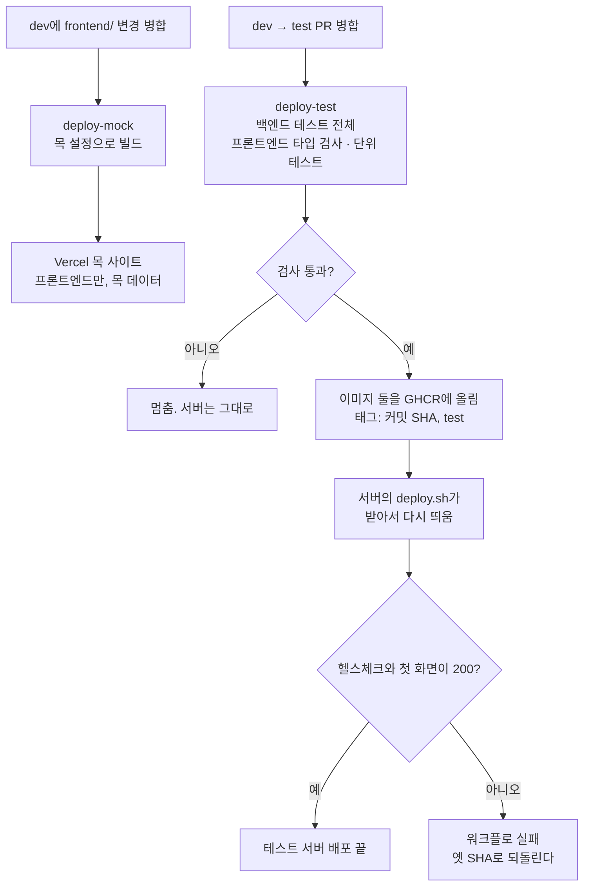
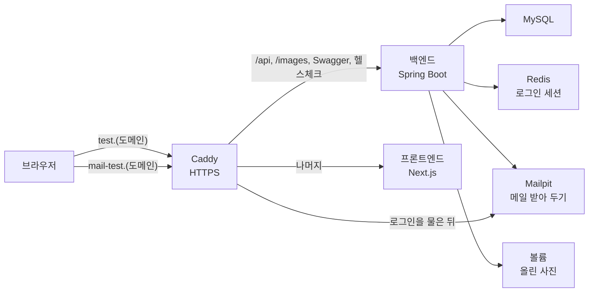
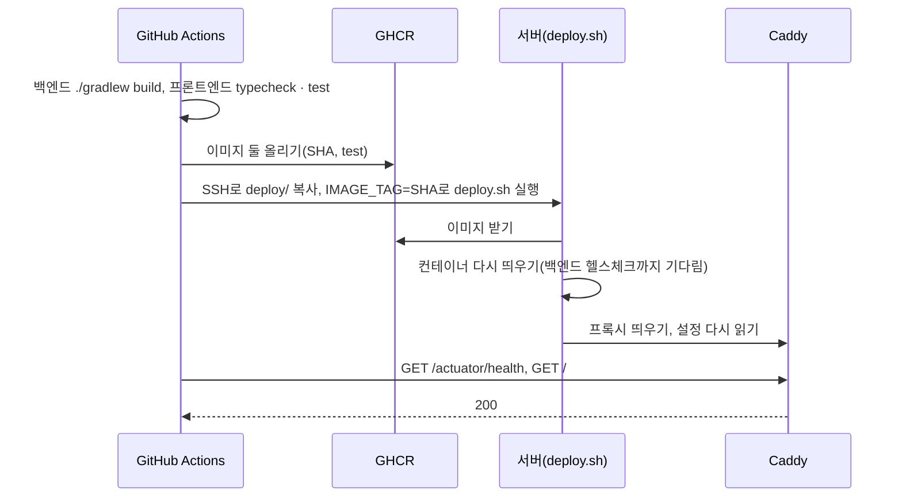

# KAN-63 테스트 서버 배포 (GCP 실제 서버 + Vercel 목 사이트)

- Jira: [KAN-63](https://it-ting.atlassian.net/browse/KAN-63)
- 브랜치: `chore/infra/KAN-63-test-server`

## 계획

### 목표

배포를 둘로 나눈다.

- **GCP 실제 서버**: 프론트엔드(Next.js)와 백엔드(Spring Boot)를 VM 한 대에 함께 띄운다. 팀이 `https://test.<도메인>` 하나로 화면과 실제 API를 같이 확인한다. `test` 브랜치에 병합하면 GitHub Actions가 검사를 돌린 뒤 둘을 자동으로 배포한다.
- **Vercel 목 사이트**: 프론트엔드만 목 데이터로 띄운다. 화면과 디자인, 아직 API가 없는 화면을 확인한다. `dev`에 `frontend/` 변경이 병합되면 GitHub Actions가 다시 올린다.

범위 밖:
- 운영 서버(`main`) 배포: 서비스를 열 때 따로 한다. 같은 VM에 붙일 수 있게 Caddy만 공용으로 만들어 둔다(정한 것 10, 11)
- 프론트엔드 화면과 실제 API가 안 맞는 곳 고치기: 실제 서버를 띄운 뒤 드러나는 것은 영역별 티켓으로 따로 만든다
- 아직 만들지 않은 API(07 모임, 06 채팅 ② · ③, 10 탈퇴 등): 각 티켓에서 만든다. 병합되기 전까지 실제 서버의 그 화면은 오류로 보인다(정한 것 19)
- PR마다 빌드 · 테스트를 돌리는 CI: KAN-26에서 끝남(PR #39). 이번에는 Docker 이미지 빌드 검사만 `ci.yml`에 더한다

### 정한 것

| # | 질문 | 정한 답 | 정한 사람 |
|---|---|---|---|
| 1 | 클라우드 | GCP(남은 크레딧 약 17만 원) | 사용자 (2026-11-23) |
| 2 | 범위 | 테스트 서버 먼저 | 사용자 (2026-11-23) |
| 3 | 도메인 | `diguldigul.site`(가비아에서 등록). 테스트 서버는 `test.diguldigul.site`, 메일 화면은 `mail-test.diguldigul.site`. DNS A 레코드 `test`, `mail-test`를 VM 고정 IP로 건다 | 사용자 (2026-11-25) |
| 4 | 실제 서버의 스프링 프로필 | `test`. `application-test.yml`이 이미 테스트 서버용이고 Swagger는 `prod`에서만 닫힌다 | 이전 작업(KAN-23) |
| 5 | HTTPS | 필요. 세션 쿠키가 `Secure`라 HTTP로는 로그인이 유지되지 않는다 | `docs/api-convention.md` 로그인 |
| 6 | 프론트엔드와 API의 주소 | 같은 사이트(같은 주 도메인)에 둔다 | `docs/api-convention.md` 로그인 |
| 7 | `test` 브랜치 보호 | 규칙 세트 `protect-main-dev`에 더한다(GitHub 설정은 사용자가 한다) | `docs/branch-strategy.md` |
| 8 | 비밀값 | 서버의 `.env`와 GitHub 시크릿에 사용자가 넣는다. 저장소에는 이름만 적는다 | `AGENTS.md` |
| 9 | VM 크기와 비용 | `e2-medium`(4GB)으로 시작한다(한 달 약 5 ~ 6만 원, 어림). 프론트엔드가 같은 VM에 더해져 11월 23일에 고른 `e2-small`(2GB)을 바꿨다. 12월 10일까지는 크레딧, 그 뒤 비용은 팀이 낸다. 금액은 VM을 만들기 전에 GCP 가격 계산기로 다시 확인한다 | 사용자 (2026-11-25) |
| 10 | 운영 서버의 자리 | 나중에 같은 VM에 운영 서버를 함께 둔다. 그때 VM 크기를 다시 본다. 테스트와 운영의 DB · Redis는 컨테이너를 나눈다 | 사용자 (2026-11-23) |
| 11 | HTTPS 프록시 | Caddy를 테스트 서버 Compose에 넣지 않고 공용(`deploy/edge`)으로 따로 띄운다. 운영 서버를 붙일 때 주소 몇 줄만 더한다 | 사용자 (2026-11-23) |
| 12 | 메일 | 서버의 Mailpit이 받아 두고 실제로 보내지 않는다. 받은 메일은 `mail-test.<도메인>`에서 기본 인증을 넣고 본다 | 사용자 (2026-11-23) |
| 13 | 이미지 저장소 | GHCR, 공개. Actions가 `GITHUB_TOKEN`으로 올리고 커밋 SHA와 `test` 태그를 붙인다. 서버는 로그인 없이 받는다. SSH는 서버에 "받아서 다시 띄워라"를 시킬 때만 쓴다. 저장소가 공개라 이미지도 공개로 두고, 비밀값은 이미지에 넣지 않는다(`.dockerignore`로 `.env` 차단). 되돌리기는 옛 SHA 태그로 한다. 이미지는 `ghcr.io/it-ting-team/it-ting-backend`와 `…/it-ting-frontend` 둘이다 | 사용자 (2026-11-23), 프론트엔드 이미지는 16에 따라 더함 |
| 14 | GCP 계정 | 사용자의 GCP 계정과 결제 계정으로 만든다(사용자 PC의 `gcloud`에 로그인돼 있다) | 사용자 (2026-11-24) |
| 15 | `test` 브랜치 | KAN-26 병합 뒤 `dev`에서 만들어 두었다. 규칙 세트에 더하는 것은 사용자가 한다 | KAN-26 (2026-11-24) |
| 16 | 프론트엔드 배포 | 이번에 백엔드와 함께 배포한다. 통합 배포 책임자는 사용자다 | 사용자 (2026-11-25) |
| 17 | 프론트엔드가 API를 부르는 주소 | 같은 출처의 `/api/v1`. 앞단 프록시가 `/api`를 Spring으로 바로 넘긴다(실시간 소식 SSE가 Next를 거치면 모여서 늦게 온다) | `frontend/README.md`, `frontend/next.config.ts` (KAN-64) |
| 18 | 배포를 나누는 방식 | 목 데이터로 도는 화면은 Vercel, 실제 데이터로 도는 화면과 API는 GCP 서버에 둔다 | 사용자 (2026-11-25) |
| 19 | 실제 서버의 프론트엔드 | 모든 영역을 실제 백엔드로 부른다(`NEXT_PUBLIC_API_MODE=real`). 아직 없는 API의 화면은 병합될 때까지 오류로 보이고, 그 화면은 목 사이트에서 본다 | 사용자 (2026-11-25) |
| 20 | 목 사이트가 따라가는 브랜치 | `dev`. `frontend/` 변경이 병합될 때마다 다시 배포한다 | 사용자 (2026-11-25) |
| 21 | GCP 자원을 만드는 사람 | Claude가 `gcloud` 명령을 단계별로 준비하고 사용자가 실행한다(`! gcloud ...`). 예산 알림도 함께 건다 | 사용자 (2026-11-25) |

### 이번에 정할 것 (확인 부탁)

아래 표 전체를 제안대로 하기로 사용자가 승인했다(2026-11-25).

| # | 무엇 | 제안 | 까닭 |
|---|---|---|---|
| A | 실제 서버 구성 | Compute Engine VM 1대(서울 `asia-northeast3`)에 Docker Compose로 띄운다. 공용 `edge`(Caddy, HTTPS)와 `test`(프론트엔드 · 백엔드 · MySQL · Redis · Mailpit) 두 묶음을 Docker 네트워크 하나로 잇는다 | Cloud Run + Cloud SQL + Memorystore는 관리형이라 편하지만 Memorystore(Redis)만으로 크레딧이 빨리 준다. 테스트 서버는 VM 1대로 충분하다 |
| H | 실제 서버의 주소 | 주소 하나 `test.<도메인>`. Caddy가 `/api/*`, `/swagger-ui*`, `/v3/api-docs*`, `/actuator/health`는 백엔드로, 나머지는 프론트엔드로 보낸다. `ITTING_FRONTEND_URL`과 CORS 허용 출처는 `https://test.<도메인>` | 정한 것 17. 같은 출처라 CORS와 쿠키 설정이 필요 없다. 전에 예로 든 `api-test.<도메인>`은 만들지 않는다. 팀원이 로컬 프론트엔드에서 실제 서버를 부를 때는 `API_PROXY_TARGET=https://test.<도메인>`으로 Next 프록시를 쓴다고 운영 문서에 적는다 |
| B | 메모리 나누기(4GB) | 백엔드 JVM 최대 힙 1GB, MySQL 버퍼 512MB, Redis 최대 256MB, Next 512MB 상한 | VM 안에 함께 들어가게 컨테이너마다 상한을 둔다 |
| P | 프론트엔드 빌드 값을 두는 곳 | 저장소의 파일 둘(비밀값 아님). 실제 서버 `deploy/test/frontend.build.env`: `NEXT_PUBLIC_API_MODE=real`, `NEXT_PUBLIC_API_MOCK_AREAS=events`, 실험실 끔. 목 사이트 `deploy/mock/frontend.build.env`: `NEXT_PUBLIC_API_MODE=mock`, `NEXT_PUBLIC_LABS=1`, `API_PROXY_TARGET=off`, 로그인 검사는 명세대로(`NEXT_PUBLIC_LOGIN_FREE` 비움) | `NEXT_PUBLIC_*`는 빌드할 때 박히는 공개 값이다. 파일로 두면 바뀐 이력이 PR에 남는다. 실험실은 목 사이트에서만 켜서 목 손잡이(느림 · 실패 · 빈 목록)로 화면 상태를 본다 |
| U | 실제 서버의 실시간 소식 연결 | `events`만 꺼 둔다(위 `MOCK_AREAS=events`). KAN-57이 병합되면 그 줄을 지운다 | SSE API가 아직 없어 켜 두면 없는 주소로 계속 다시 연결한다. 다른 영역이 모두 실제라 목 연결로는 아무 소식도 흐르지 않는다(가짜 데이터가 섞이지 않는다). 구현하면서 화면에 "연결 끊김" 표시가 뜨지 않는지 확인한다 |
| Q | Next를 띄우는 방식(실제 서버) | Docker 이미지에서만 `output: 'standalone'`으로 빌드해 `node server.js`로 띄운다. `next.config.ts`에 환경 변수 `NEXT_OUTPUT=standalone`일 때만 켜지는 한 줄을 더한다. `/api` rewrites는 이미지에서 끈다(`API_PROXY_TARGET=off`) | 이미지가 작고 `node_modules` 전체를 싣지 않는다. 로컬의 `npm run start` · `npm run smoke`와 Vercel 빌드는 그대로다. `/api`는 Caddy가 넘기므로 Next의 rewrites가 필요 없다 |
| S | 목 사이트를 올리는 방식 | GitHub Actions가 Vercel CLI로 올린다(`vercel build` → `vercel deploy --prebuilt --prod`). Vercel이 저장소를 직접 보게 연결하지 않는다. 주소는 `<프로젝트 이름>.vercel.app` | 무료 요금제(Hobby)의 조직 저장소 연결은 Vercel 문서와 커뮤니티 안내가 엇갈린다(공개 저장소는 된다는 글과 조직 저장소는 안 된다는 한도 문서). Actions로 올리면 요금제와 상관없이 되고 배포 기록이 한곳에 모인다. PR마다 미리 보기 주소는 생기지 않는다 |
| T | Vercel 프로젝트 | 사용자 계정으로 프로젝트를 하나 만들고(Root Directory `frontend`, Node 24), 토큰과 프로젝트 id를 GitHub 시크릿 `VERCEL_TOKEN`, `VERCEL_ORG_ID`, `VERCEL_PROJECT_ID`에 넣는다. 화면 위치는 운영 문서에 적는다 | 계정과 토큰이 걸린 일이라 사용자가 한다 |
| D | 배포 전 확인(실제 서버) | Actions에서 백엔드 `./gradlew build`(테스트 전체), 프론트엔드 `npm run typecheck` · `npm test`를 통과해야 이미지를 만들고 배포한다 | PR CI(KAN-26)는 아직 필수 검사가 아니라 실패한 채 병합될 수 있다. 배포 직전에 한 번 더 막는다. 5분쯤 더 걸린다 |
| F | SSAFY 인증(Mattermost) | 로컬과 같은 웹후크를 서버 `.env`에 사용자가 넣는다 | 없으면 SSAFY 인증이 503이라 가입을 끝낼 수 없다 |
| R | Google 로그인 · 브라우저 푸시 | 값(`ITTING_GOOGLE_*`, `ITTING_PUSH_*`)은 서버 `.env`에 사용자가 넣을 때 켜진다. Google은 콘솔의 "승인된 리디렉션 URI"에 `https://test.<도메인>/api/v1/oauth/google/callback`도 더해야 한다. 비워 두면 서버는 뜨고 그 기능만 실패한다 | `application.yml`이 이미 그렇게 동작한다. 첫 배포를 이 값 때문에 미루지 않는다 |
| G | Swagger | 실제 서버에서는 연다(`https://test.<도메인>/swagger-ui.html`) | 프론트엔드가 보면서 붙인다. `test` 프로필은 지금도 열려 있고, 비밀값이나 스택 트레이스는 나가지 않는다 |
| I | `test`에 반영하는 때 | 필요할 때 사람이 `dev` → `test` PR을 만들어 병합한다. Actions 화면에서 다시 배포하는 버튼(`workflow_dispatch`)도 둔다 | 브랜치 전략(`dev` → `test` → `main`)을 그대로 따른다 |
| J | DB 백업 | 하지 않는다 | 테스트 데이터라 잃어도 된다. 디스크 스냅샷은 비용이 든다 |
| L | GCP 프로젝트 | 새 프로젝트를 만든다. 이름 `it-ting`, ID `it-ting-server`(이미 있으면 뒤에 숫자). 운영 서버도 나중에 여기에 둔다 | 사용자의 기존 프로젝트와 비용 · 권한을 섞지 않는다 |

### 만들 것

| 파일 | 내용 |
|---|---|
| `backend/Dockerfile`, `backend/.dockerignore` | Java 25 JRE 이미지에 Actions가 만든 jar를 넣는다. 메모리 상한(`-XX:MaxRAMPercentage`) |
| `frontend/Dockerfile`, `frontend/.dockerignore` | Node 24. `npm ci` → `next build`(standalone) → 실행 단계는 `node server.js`만. `NEXT_PUBLIC_*`는 빌드 인자로 받는다 |
| `frontend/next.config.ts` | `NEXT_OUTPUT=standalone`일 때만 `output: 'standalone'`(Q). 다른 동작은 그대로 |
| `deploy/edge/compose.yaml`, `deploy/edge/Caddyfile` | 공용 Caddy. 밖으로 여는 포트는 80 · 443뿐이다. `test.<도메인>`의 `/api/*` 등 → 백엔드, 나머지 → 프론트엔드, `mail-test.<도메인>` → Mailpit(기본 인증). HTTPS 인증서는 Let's Encrypt로 자동. 응답 압축은 Caddy가 하고 SSE는 모으지 않고 바로 흘린다. 운영 서버는 나중에 여기에 주소를 더한다 |
| `deploy/test/compose.yaml` | 프론트엔드 · 백엔드 · MySQL 8.4 · Redis 7.4 · Mailpit. 포트를 밖으로 열지 않고 `edge`와 같은 Docker 네트워크로만 받는다. 메모리 상한은 B |
| `deploy/test/.env.example` | 서버 `.env`에 넣을 이름 목록(값 없음) |
| `deploy/test/frontend.build.env`, `deploy/mock/frontend.build.env` | 프론트엔드 빌드 값(P). 비밀값을 넣지 않는다 |
| `.github/workflows/deploy-test.yml` | `test` 푸시 또는 수동 실행 → 백엔드 `./gradlew build`, 프론트엔드 `typecheck` · `test` → 이미지 둘을 GHCR에 올림(SHA · `test` 태그) → `deploy/`를 서버로 복사 → SSH로 `docker compose pull` · `up -d` → `/actuator/health`와 첫 화면 확인. 수동 실행 때 SHA를 주면 그 이미지로 되돌린다 |
| `.github/workflows/deploy-mock.yml` | `dev` 푸시(`frontend/`나 `deploy/mock/`이 바뀔 때) 또는 수동 실행 → 목 설정으로 `vercel build` → `vercel deploy --prebuilt --prod`(S) |
| `backend/src/main/resources/application-test.yml` | 프록시 뒤에서 HTTPS를 알아보도록 `server.forward-headers-strategy`, 메일 · 주소 설명 정리 |
| `docs/infra/test-server.md` | 실제 서버: GCP 자원 만들기(명령), 도메인 연결, `.env` · 시크릿 넣기, 배포 · 로그 · 재시작 · 되돌리기, 로컬 프론트엔드에서 실제 서버 부르기, 비용 확인. 목 사이트: Vercel 프로젝트 만들기, 시크릿, 다시 배포 |
| `.github/workflows/ci.yml` | Docker 이미지 빌드 검사 job(Dockerfile이나 `deploy/`가 바뀐 PR, 올리지는 않음) |
| `docs/ci.md` | 검사 목록에 Docker 이미지 |
| `AGENTS.md`, `README.md` | 저장소 지도에 `deploy/`, 실제 서버와 목 사이트 주소 |

사용자님이 하실 일(문서에 순서를 적는다): 도메인 이름 알려 주기, GCP 프로젝트 · VM · 고정 IP · 방화벽 만들기와 예산 알림, DNS A 레코드 둘, 서버 `.env`, Vercel 프로젝트와 토큰, GitHub 시크릿(서버 SSH 키 · 주소, Vercel 토큰 · id), `test` 브랜치 보호 규칙(KAN-26에서 안내함), 첫 `dev` → `test` PR 병합, 첫 배포 뒤 GHCR 패키지 둘을 공개로 바꾸기.

### 테스트

API를 바꾸지 않으므로 통합 테스트는 늘지 않는다. 아래로 확인한다.

| 확인 | 방법 | 기대 |
|---|---|---|
| 백엔드 이미지 | 로컬에서 `docker build` 후 `test` 프로필로 실행 | 서버가 뜨고 Flyway가 돈다 |
| 프론트엔드 이미지 | 로컬에서 실제 서버 값으로 `docker build` 후 실행 | 첫 화면 200, 실험실 주소 404 |
| Compose 전체 | 로컬에서 `deploy/edge`와 `deploy/test`를 `localhost` 인증서로 띄움 | `https://localhost/` 첫 화면, `https://localhost/actuator/health` 200, Swagger 열림, 가입 → 로그인 → `GET /api/v1/me` 200(쿠키 유지), MySQL · Redis 포트가 밖에서 안 열림, 컨테이너 메모리 합이 VM 안 |
| 목 설정 빌드 | 로컬 `frontend/`에서 `deploy/mock/frontend.build.env` 값으로 `npm run build && npm run start` | 백엔드 없이 화면이 열리고 실험실 배지가 보인다 |
| 실제 서버 | `test`에 처음 배포한 뒤 | `https://test.<도메인>/`가 열리고 로그인이 유지된다. `GET /api/v1/campuses` 200. `mail-test.<도메인>`은 기본 인증 뒤에 열린다 |
| 목 사이트 | `dev`에 병합된 뒤 | `<프로젝트 이름>.vercel.app`이 열리고 목 데이터로 화면이 돈다 |
| 실패 시 | 테스트가 깨진 커밋을 수동 배포 | Actions가 검사 단계에서 멈추고 서버는 그대로 |
| 기존 빌드 | `backend/`에서 `./gradlew build`, `frontend/`에서 `npm run typecheck && npm run lint && npm test && npm run build` | 통과 |

## 결과

### 한눈에 보기

배포가 가는 길. 목 사이트는 `dev`를, 테스트 서버는 `test`를 따라간다.

테스트 서버에서 요청이 가는 길. 밖으로 열린 포트는 Caddy의 80 · 443뿐이다.

테스트 서버에 배포하는 순서.

### 바꾼 것

| 파일 | 내용 |
|---|---|
| `backend/Dockerfile`, `backend/.dockerignore` | Java 25 JRE 이미지에 `build/libs/app.jar`만 넣는다. root가 아닌 사용자로 실행, 힙은 컨테이너 상한의 70%. 올린 사진 폴더를 그 사용자의 것으로 미리 만든다 |
| `backend/build.gradle` | 실행 jar의 이름을 `app.jar`로 고정 |
| `backend/src/main/resources/application-test.yml` | `server.forward-headers-strategy: framework`(프록시 뒤에서 원래 주소와 https를 알아봄) |
| `frontend/Dockerfile`, `frontend/.dockerignore` | Node 24.18. `npm ci` → `next build`(standalone) → `node server.js`. 빌드 값은 `deploy/<환경>/frontend.build.env`를 `.env.production.local`로 넣어 준다 |
| `frontend/next.config.ts` | `NEXT_OUTPUT=standalone`일 때만 `output: 'standalone'` |
| `frontend/.gitignore`, `frontend/README.md` | `.vercel/` 무시, 환경 변수 표에 `NEXT_OUTPUT`과 배포용 값의 위치 |
| `deploy/edge/compose.yaml`, `deploy/edge/caddy/Caddyfile` | 공용 Caddy. 주소 하나로 `/api` · `/images` 등은 백엔드, 나머지는 프론트엔드. 메일 화면 주소. 검색에 잡히지 않게 하는 헤더 |
| `deploy/test/compose.yaml` | 프론트엔드 · 백엔드 · MySQL · Redis · Mailpit. 포트를 밖으로 열지 않고 메모리 상한을 둔다. 올린 사진은 볼륨 `images-data`에 둔다 |
| `deploy/test/.env.example` | 서버 `.env`의 이름 목록(값 없음) |
| `deploy/test/frontend.build.env`, `deploy/mock/frontend.build.env` | 프론트엔드 빌드 값. 테스트 서버는 모든 영역 실제 + `events`만 끔, 목 사이트는 모든 영역 목 + 실험실 켬 |
| `deploy/deploy.sh` | 서버에서 이미지를 받아 다시 띄우고 프록시 설정을 다시 읽는다 |
| `deploy/setup-server.sh` | 새 서버를 처음 준비한다: Docker, 배포 사용자 `deploy`, 배포 폴더, `.env`(주소를 채우고 DB · 메일 화면 비밀번호를 서버에서 무작위로 만듦) |
| `.github/workflows/deploy-test.yml` | `test` 푸시 · 수동 실행 → 검사 → 이미지 → 서버 배포 → 주소 확인. `image_tag`로 되돌리기 |
| `.github/workflows/deploy-mock.yml` | `dev`의 `frontend/` 변경 · 수동 실행 → Vercel CLI로 빌드해 올리기 |
| `.github/workflows/ci.yml` | job `docker`(이미지 둘 빌드, Compose 설정, Caddyfile, 스크립트 문법). 요약 `ci`에 더함 |
| `docs/infra/test-server.md` | 구성, 배포, 되돌리기, 운영 명령, 처음 한 번 하는 일(GCP · DNS · 서버 · 시크릿 · Vercel), 비용 |
| `docs/ci.md`, `AGENTS.md`, `README.md` | 검사 목록에 Docker 이미지, 저장소 지도에 `deploy/` · `docs/infra/`, README에 배포 절 |

### 확인한 것

로컬에서 확인한 것(2026-11-25). 사용자가 띄워 둔 로컬 컨테이너와 겹치지 않게 다른 이름과 포트(18443)로 띄웠고, 끝나고 모두 지웠다. 작업 중에 dev에 PR 다섯 개(#45 ~ #49)가 병합돼 브랜치를 최신 dev(`3a6c8bb`)로 올린 뒤 이미지와 Compose 전체, 가입 → 로그인, 사진을 다시 확인했다.

- 백엔드 이미지: `./gradlew bootJar` → `docker build backend` 통과
- 프론트엔드 이미지: `docker build --build-context buildenv=deploy/test frontend` 통과. 빌드 결과에 실험실 주소가 없고 `/api` 프록시(rewrites)가 비어 있다
- Compose 전체: `deploy/deploy.sh`로 `edge`와 `test`를 띄움. 컨테이너 여섯이 모두 뜨고 백엔드 헬스체크가 통과했다. 밖으로 열린 포트는 Caddy뿐이다
- 프록시를 거친 요청: `/actuator/health` 200, 첫 화면 200(zstd 압축), `/login` 200, `/lab/style` 404, `GET /api/v1/campuses` 200, Swagger 302 → 200(https 주소 유지), `/v3/api-docs` 200, 로그인 없는 `GET /api/v1/me` 401, `/actuator/env` 404, http → https 308
- 가입 → 로그인: 이메일 인증(메일이 Mailpit에 들어옴, 메일 화면은 로그인 없이 401) → SSAFY 인증(웹후크는 로컬 가짜 수신기) → 계정 만들기 201 → `GET /me` 200 → 로그아웃 → 로그인 201 → `GET /me` 200 → 백엔드 재시작 뒤에도 `GET /me` 200(세션이 Redis에 남음). 세션 쿠키는 `Secure; HttpOnly; SameSite=Lax`
- 사진: 온보딩을 마친 계정으로 `POST /api/v1/images` 201 → 받은 주소를 프록시로 `GET` 200(`image/png`, 오래 캐시) → 백엔드 컨테이너를 새로 만든 뒤에도 200(볼륨에 남음). `GET /api/v1/meetups` 200
- 출처 검사: 같은 주소와 `http://localhost:3000`의 POST는 받고, 다른 출처의 POST는 403
- 화면: 브라우저로 실제 프론트엔드에 로그인하니 온보딩 화면이 열렸다. `POST /sessions` 201, `GET /me` · `/interest-categories` · `/intro-questions` 200. 실시간 소식 연결 요청과 "연결 끊김" 표시는 없다
- 메모리: 띄운 직후 합계 약 1GB(백엔드 409MB, MySQL 493MB, 프론트엔드 40MB, Caddy 16MB, Mailpit 10MB, Redis 4MB)
- 목 사이트 빌드 값: `deploy/mock` 값으로 만든 이미지에서 첫 화면 200, 실험실 주소 200, `/api` 404(프록시 꺼짐)
- 프론트엔드: `npm run typecheck` 통과, `npm run lint` 오류 0(경고 55는 전부터 있던 것), `npm test` 699개 통과
- 백엔드: `./gradlew build` 통과. 옛 dev(`ff6240a`) 위에서 테스트 617개. 최신 dev(`3a6c8bb`) 위에서 다시 돌려 718개 통과(새 테스트 없음, 늘어난 것은 dev에 병합된 PR의 테스트)
- 워크플로 셋: `actionlint` 통과. Compose 파일 둘 `docker compose config` 통과, Caddyfile `caddy validate` 통과, `bash -n deploy/deploy.sh` 통과

확인하지 못한 것(계정과 시크릿이 있어야 한다):

- `gcloud` 명령과 실제 VM에서의 배포, Let's Encrypt 인증서 발급
- `deploy-test.yml`, `deploy-mock.yml`의 실제 실행(GHCR에 올리기, SSH, Vercel CLI)
- Vercel에서의 빌드와 주소

### 계획과 달라진 점

- 올린 사진을 배포 설정에 더했다. 계획을 승인받은 뒤 dev에 사진 올리기(KAN-53)가 병합되면서 `test` 프로필에 필수 값 `ITTING_IMAGES_STORAGE_DIR` · `ITTING_IMAGES_PUBLIC_BASE_URL`이 생겼다. 없으면 서버가 뜨지 않으므로 볼륨 `images-data`, 프록시의 `/images/*`, 두 환경 변수를 더했다.
- 실행 jar의 이름을 `app.jar`로 고정했다(`backend/build.gradle`). 계획의 "만들 것"에 없던 변경이다. Dockerfile이 버전과 상관없이 같은 이름으로 가져가게 하려는 것이다.
- Caddyfile을 `deploy/edge/caddy/Caddyfile`에 두었다(계획은 `deploy/edge/Caddyfile`). 파일 하나를 컨테이너에 붙이면 배포가 파일을 바꿔도 컨테이너가 옛 파일을 보기 때문에 폴더를 붙인다.
- `deploy/deploy.sh`를 더했다. 계획은 워크플로가 SSH로 `docker compose pull` · `up -d`를 직접 부르는 것이었다. 서버에서 손으로도 같은 명령 하나로 다시 띄울 수 있게 스크립트로 뺐다.
- 메일 화면의 로그인을 Caddy 기본 인증이 아니라 Mailpit의 로그인(`MAILPIT_UI_AUTH`)으로 했다. 보는 사람에게는 같다. `.env`에 비밀번호 해시 대신 `아이디:비밀번호`를 적으면 돼서 넣기 쉽다.
- 프론트엔드 빌드 값을 빌드 인자로 하나씩 넘기지 않고, 파일을 통째로 `.env.production.local`로 넣는다. 테스트 서버(Docker)와 목 사이트(Vercel)가 같은 방식이다.
- `deploy/setup-server.sh`를 더했다(2026-11-25, 서버를 준비하는 단계에서). 계획은 서버 안에서 명령을 하나씩 치는 것이었다. 명령 하나로 끝나고 결과를 바로 볼 수 있게 스크립트로 묶었다. 서버의 `.env`도 이 스크립트가 만들고 DB · 메일 화면의 비밀번호를 서버에서 무작위로 만든다(값은 화면에 찍지 않는다). 사람이 넣는 것은 Mattermost 웹후크 같은 나머지 값이다. 깨끗한 Debian 12 컨테이너에서 돌려 확인했다(Docker 설치 단계만 가짜 명령으로 대신함).
- 테스트 서버의 CORS 허용 출처에 `http://localhost:3000`을 더했다. 계획 H의 "팀원이 로컬 프론트엔드에서 테스트 서버를 부른다"가 되려면 필요하다(Next의 `/api` 프록시가 보내는 출처다). 로컬 프로필과 같은 값이다.
- 서버 주소는 GitHub 시크릿이 아니라 변수 `TEST_HOST`로 받는다. 비밀값이 아니고 배포 뒤 확인에도 쓴다.
- 테스트 서버 주소에 `X-Robots-Tag: noindex, nofollow` 헤더를 붙였다. 계획에 없던 것이다.
- 예산 알림 금액을 7만 원으로 적었다(`docs/infra/test-server.md`). 전에 말한 3만 원은 `e2-small` 기준이었다. 사용자가 바꿀 수 있다.
- 메모리 어림(2.0 ~ 2.2GB)은 실제보다 컸다. 로컬에서 띄운 직후 합계는 약 1GB였다. 부하가 걸렸을 때는 재 보지 않았다. `e2-small`(2GB)로도 뜰 수 있으므로 VM을 만들기 전에 크기를 다시 정해도 된다.
- 계획의 "목 설정 빌드"는 `frontend/`에서 `npm run build && npm run start`로 볼 생각이었으나, 내 PC에 의존성을 깔지 않고 Docker 이미지로 대신 확인했다.

### 남은 일

사용자가 할 일(순서와 명령은 `docs/infra/test-server.md`):

- ~~DNS A 레코드 둘(`test`, `mail-test`)~~ 2026-11-25에 가비아 DNS에 넣음. 둘 다 `34.64.221.129`로 답한다
- ~~GCP 프로젝트 · VM · 고정 IP · 방화벽~~ 2026-11-25에 만듦: 프로젝트 `it-ting-server`, VM `it-ting-test`(`e2-medium`, 디스크는 사용자가 50GB로 정함), 고정 IP `34.64.221.129`, 방화벽 `it-ting-allow-web`
- ~~서버에 Docker와 `deploy` 사용자, 서버의 `.env`~~ 2026-11-25에 `deploy/setup-server.sh`로 끝냄: Docker 29.10.1 · Compose v5.8.0, 디스크 49GB, 메모리 4GB, `/opt/it-ting/test/.env` 만듦(빈 값: Mattermost 웹후크, 푸시 키, Google 클라이언트)
- 예산 알림
- 서버 `.env`의 Mattermost 웹후크(없으면 가입을 끝낼 수 없다)
- ~~GitHub 변수 `TEST_HOST`, 시크릿 `TEST_SSH_USER` · `TEST_SSH_KEY` · `TEST_SSH_KNOWN_HOSTS`~~ 2026-11-25에 넣음. 배포 키로 `deploy` 접속과 서버의 Compose v5.8.0이 설정 파일 둘을 읽는 것도 확인함
- Vercel 프로젝트와 시크릿 `VERCEL_TOKEN` · `VERCEL_ORG_ID` · `VERCEL_PROJECT_ID`
- 규칙 세트에 `test` 더하기. 필수 검사 `ci`는 "늦어도 KAN-63 전"에 걸기로 했었다(`docs/ci.md`)
- 첫 `dev` → `test` PR 병합, GHCR 패키지 둘을 공개로 바꾸기

그 뒤에 할 일:

- 첫 배포 뒤 `README.md`의 배포 표에 두 주소를 적는다
- 실시간 소식 API(KAN-57)가 병합되면 `deploy/test/frontend.build.env`의 `NEXT_PUBLIC_API_MOCK_AREAS` 값을 비운다
- 테스트 서버에서 드러나는 프론트엔드와 백엔드의 어긋남은 영역별 티켓으로 만든다
- Jira KAN-63의 설명은 아직 "프론트엔드 배포는 범위 밖"으로 적혀 있다. 이 문서의 범위로 고친다

### 검토 순서

1. `docs/infra/test-server.md`: 구성과 사람이 할 일
2. `deploy/test/compose.yaml`, `deploy/edge/`, `deploy/deploy.sh`
3. `backend/Dockerfile`, `frontend/Dockerfile`, `frontend/next.config.ts`, `backend/build.gradle`, `application-test.yml`
4. `.github/workflows/deploy-test.yml`, `deploy-mock.yml`, `ci.yml`의 job `docker`
5. `docs/ci.md`, `AGENTS.md`, `README.md`
