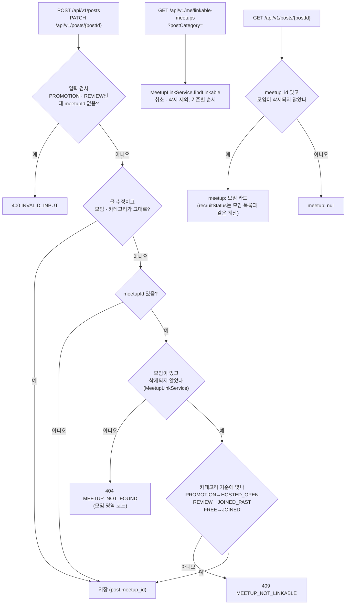
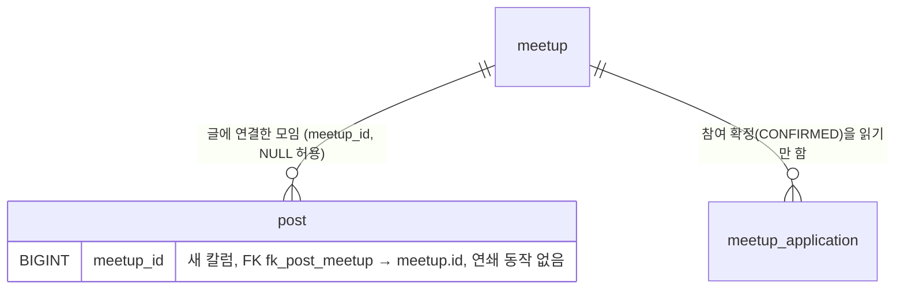

# KAN-65 [BE] 08 커뮤니티 ④: 글에 모임 연결

- Jira: [KAN-65](https://it-ting.atlassian.net/browse/KAN-65)
- 브랜치: `feature/be/KAN-65-post-meetup-link`

## 계획

### 목표

글쓰기 · 글 수정에서 모임을 연결하고, 글 상세에 연결한 모임 카드를 보여 준다. KAN-51(B)과 KAN-53(A)에서 `meetup` 테이블이 없어 미뤄 둔 부분이다. 07 모임 ①(KAN-48)이 병합돼 `meetup`, `meetup_application`이 생겼다.

- `GET /api/v1/me/linkable-meetups` ([API 명세](../api/08-community.md#get-apiv1melinkable-meetups)) — 새로 만든다
- `POST /api/v1/posts`, `PATCH /api/v1/posts/{postId}` — `meetupId` 검사를 명세대로 바꾼다. 지금은 `meetupId`가 오면 늘 `404 MEETUP_NOT_FOUND`
- `GET /api/v1/posts/{postId}` — `meetup` 카드를 채운다. 지금은 늘 `null`

범위 밖:
- 글 목록 카드에 모임을 싣는 것: 명세에 없다
- 모임이 삭제 · 취소될 때 글을 바꾸는 것: 명세대로 연결은 그대로 두고 카드만 바뀐다

### 정한 것

| # | 질문 | 정한 답 | 정한 사람 |
|---|---|---|---|
| 1 | 카테고리별 고를 수 있는 모임 | `PROMOTION`: 내가 연 모임 중 모집 중(`OPEN`). `REVIEW`: 내가 열었거나 참여가 확정된(`CONFIRMED`) 지난 모임(`PAST`). `FREE`: 내가 열었거나 참여가 확정된 모임(지난 것 포함). 셋 다 취소 · 삭제된 모임 제외 | [글에 연결하는 모임](../api/08-community.md#글에-연결하는-모임) |
| 2 | 목록 순서 | `PROMOTION`은 시작이 가까운 것부터, `REVIEW` · `FREE`는 시작이 최근인 것부터. 나누지 않고 한 번에 | [API 명세](../api/08-community.md#get-apiv1melinkable-meetups) |
| 3 | 글쓰기 검사 순서와 에러 | 입력 검사(`PROMOTION` · `REVIEW`인데 `meetupId` 없음 → `400`) → 없거나 삭제된 모임 `404 MEETUP_NOT_FOUND` → 고를 수 없는 모임 `409 MEETUP_NOT_LINKABLE` | API 명세 `POST /api/v1/posts` |
| 4 | 글 수정의 재검사 | `meetupId`나 `category`가 지금 값과 다를 때만 검사한다. 둘 다 그대로면 그사이 모집 완료가 됐어도 통과 | API 명세 `PATCH` 5 |
| 5 | 상세의 카드 | [모임 카드](../api/07-meetup.md#모임-카드) 모양. 연결하지 않았거나 모임이 삭제됐으면 `null`. 취소 · 모집 완료면 카드의 `recruitStatus`만 바뀐다 | API 명세 |
| 6 | 칼럼 | `post.meetup_id BIGINT NULL`, FK → `meetup.id`. 마이그레이션 시각은 `meetup`(`V20261125_0903`)보다 뒤 | `docs/db/community.md`, `AGENTS.md` |
| 7 | 에러 코드 | `MEETUP_NOT_FOUND`를 `CommunityErrorCode`에서 빼고 `MeetupErrorCode.MEETUP_NOT_FOUND`(이미 있음)를 쓴다. 응답 `code`는 그대로, `message`는 "없거나 삭제된 모임입니다." → "없는 모임입니다."로 바뀐다. `MEETUP_NOT_LINKABLE`은 글쓰기에서만 쓰는 코드라 `CommunityErrorCode`에 둔다 | Jira 티켓, KAN-53 A |
| 8 | 모임 카드의 값 | `confirmedCount`(주최자 포함)와 `recruitStatus`는 모임 목록과 같은 기준(`Meetup.recruitStatus`, 모집 마감 · 정원)으로 계산한다 | KAN-48 |

### 이번에 정할 것 (2026-11-25 유예린이 A ~ D 모두 제안대로 승인)

| # | 무엇 | 제안 | 까닭 |
|---|---|---|---|
| A | KAN-53(현민구, PR 열림)과 겹치는 파일 | 지금 구현한다. KAN-53이 먼저 병합되면 dev를 이 브랜치에 병합해 충돌을 풀고, 아니면 KAN-53 쪽이 풀게 된다. 겹치는 곳은 `CommunityErrorCode`, `Post`, `PostQueryService`의 몇 줄이다 | 겹치는 곳이 작아 기다릴 만큼은 아니다. 기다리면 KAN-61(탈퇴)과 KAN-66 같은 뒤 작업도 늦어진다 |
| B | 커뮤니티가 모임을 읽는 방법 | `meetup/service/MeetupLinkService`(모임 영역)에 세 가지를 둔다: 고를 수 있는 모임 목록, 이 모임을 고를 수 있는지, 모임 카드 하나. 커뮤니티는 이 서비스를 부르고, 글 카테고리를 모임 쪽 기준(`HOSTED_OPEN`, `JOINED_PAST`, `JOINED`)으로 바꿔 넘긴다 | 모집 상태 · 확정 인원 계산이 모임 영역 한 곳에만 있게 한다. 모임 영역이 커뮤니티의 `PostCategory`를 몰라도 된다. 땅굴이 관심사 서비스를 부르는 것과 같은 방식이다 |
| C | 시작 시각이 같은 모임의 순서 | `PROMOTION`은 id 오름차순, `REVIEW` · `FREE`는 id 내림차순 | 명세에 없다. 시각 순서와 같은 방향으로 맞춘다 |
| D | 검사와 저장 사이에 모임이 바뀌면 | 잠그지 않는다. 검사 뒤 저장 전에 모임이 모집 완료 · 취소되어도 그대로 연결한다. 그사이 삭제되면 카드가 `null`이 된다 | 명세가 "글을 쓴 뒤 모임 상태가 바뀌어도 연결은 그대로"라 결과가 같다. 모임 행을 잠그면 모임 수정 · 신청과 서로 기다리게 된다 |

### 만들 것

| 파일 | 내용 |
|---|---|
| `db/migration/V<만든 시각>__add_post_meetup_id.sql` | `post.meetup_id`와 FK (정한 것 6) |
| `meetup/service/MeetupLinkService`, `meetup/domain/MeetupLinkScope` | B. 목록 · 검사 · 카드 |
| `meetup/repository/MeetupListRepository` | 연결할 모임 목록 SQL(카드와 같은 계산) |
| `community/domain/Post` | `meetupId` 필드 |
| `community/domain/CommunityErrorCode` | `MEETUP_NOT_FOUND` 빼고 `MEETUP_NOT_LINKABLE` 더함 |
| `community/service/PostService` | 글쓰기 · 수정 검사(정한 것 3 · 4), 저장 |
| `community/service/PostQueryService`, `community/dto/PostDetailResponse` | 상세의 `meetup`을 `MeetupCardResponse`로 |
| `community/controller` | `GET /me/linkable-meetups` |
| `docs/api/08-community.md` | C, D를 "이 문서에서 정한 것"에. `MEETUP_NOT_FOUND`가 모임 영역 코드인 것 |
| `docs/db/community.md` | `meetup_id`를 더한 티켓을 KAN-53 → KAN-65로 고침 |

### 테스트

| API | 정상 | 실패 |
|---|---|---|
| `GET /me/linkable-meetups` | `PROMOTION`: 내가 연 모집 중만, 가까운 순(모집 완료 · 지난 · 취소 · 삭제 · 남의 모임 빠짐). `REVIEW`: 내가 연 · 확정 참여한 지난 모임만, 최근 순(예정 · 취소 · 신청 대기 · 참여 취소 빠짐). `FREE`: 예정 + 지난, 취소 빠짐 | `postCategory` 없음 · 틀림 → `400 INVALID_INPUT`. 로그인 안 함 → `401` |
| `POST /posts` | 홍보 글에 내 모집 중 모임 → `201`, `meetup_id` 저장. 후기 · 자유도 각각 | 없는 · 삭제된 모임 → `404 MEETUP_NOT_FOUND`. 남의 모임 · 모집 완료 · 예정 모임에 후기 · 취소된 모임 → `409 MEETUP_NOT_LINKABLE`. `PROMOTION`인데 `meetupId` 없음 → `400`(지금과 같음) |
| `PATCH /posts/{postId}` | 모임 · 카테고리 그대로면 그사이 모집 완료가 됐어도 `200`. 연결을 `null`로(자유 글) | 자유 → 후기로 바꾸는데 예정 모임 → `409`. 새 모임이 없음 → `404` |
| `GET /posts/{postId}` | 연결한 모임의 카드. 취소되면 `recruitStatus` `CANCELED`. 연결 안 함 → `null` | 모임이 삭제됨 → `meetup` `null`(글은 200) |

## 결과

### 한눈에 보기

`post.meetup_id`만 새로 더했다. `meetup`, `meetup_application`은 읽기만 한다.

### 바꾼 것

| 파일 | 내용 |
|---|---|
| `V20261125_1421__add_post_meetup_id.sql` | `post.meetup_id BIGINT NULL`, FK `fk_post_meetup` → `meetup(id)`. 연쇄 동작 없음(모임은 소프트 삭제) |
| `meetup/domain/MeetupLinkScope` | `HOSTED_OPEN`, `JOINED_PAST`, `JOINED` |
| `meetup/service/MeetupLinkService` | 고를 수 있는 모임 목록, 이 모임을 고를 수 있는지(없거나 삭제면 `MEETUP_NOT_FOUND`), 모임 카드 하나 |
| `meetup/repository/MeetupListRepository` | 위 세 가지 SQL. 확정 인원(주최자 포함)과 모집 상태는 모임 목록 · `Meetup.recruitStatus`와 같은 순서 · 경계 |
| `community/domain/Post`, `PostCategory`, `CommunityErrorCode` | `meetupId`, 카테고리 → 기준(`linkScope()`), `MEETUP_NOT_FOUND` 빼고 `MEETUP_NOT_LINKABLE` 더함 |
| `community/service/PostService` | 글쓰기 검사, 글 수정은 모임이나 카테고리가 바뀔 때만 다시 검사 |
| `community/service/PostQueryService`, `PostQueryRepository`, `dto/PostDetailResponse` | 상세의 `meetup`을 모임 카드로, 연결할 모임 목록 |
| `community/controller/LinkableMeetupController`, `dto/LinkableMeetupsResponse` | `GET /api/v1/me/linkable-meetups` |
| `docs/api/08-community.md` | C, D와 에러 코드의 영역을 "이 문서에서 정한 것"에 |
| `docs/db/community.md` | `meetup_id`를 더한 티켓 · 마이그레이션 · FK |
| 테스트 | 새 `PostMeetupLinkApiTests`, `CommunitySteps`에 모임 · 신청 도우미, `PostWriteApiTests`의 없는 모임 id를 999999로 |

### 확인한 것

- `./gradlew build`(KAN-53이 병합된 dev 위) 통과: 테스트 710개, 실패 0
- 새 `PostMeetupLinkApiTests` 24개 통과
- 새 테스트가 실제로 잡는지: 글 수정의 재검사를 늘 하게 바꾸거나 지난 모임의 경계를 `<=`에서 `<`로 바꾸면 해당 테스트가 실패한다. 되돌린 뒤 통과
- 모집 상태 계산을 `Meetup.recruitStatus`와 비교: 취소 → 시작함 → 마감 · 정원 순서와 "같거나 뒤" 경계가 같다
- 새 API는 `PUBLIC_API`에 없다(로그인 필요). 명세에 "온보딩 중에도"가 없어 `@AllowDuringOnboarding` · `@AllowBeforeNewTerm`을 붙이지 않았다

### 계획과 달라진 점

- 카테고리를 모임 쪽 기준으로 바꾸는 일은 커뮤니티의 `PostCategory.linkScope()`가 한다. 모임 영역은 `PostCategory`를 모른다
- 연결할 모임 목록은 새 서비스 없이 `PostQueryService.getLinkableMeetups`가 `MeetupLinkService`를 불러 준다
- 모집 상태는 `Meetup.recruitStatus`를 부르지 않고 SQL로 계산한다. `meetup_application`에 엔티티가 없고, 모임 목록(`search`)도 SQL로 계산한다. 같은 규칙임을 테스트가 모임 목록의 카드와 비교해 확인한다
- 작업 중 KAN-53이 dev에 병합돼 `CommunityErrorCode`, `PostQueryService`, `CommunitySteps`, `docs/db/community.md`의 충돌을 풀었다. KAN-53의 신고 코드와 도우미는 그대로 두었다

### 남은 일

- 병합된 마이그레이션 `V20261123_1545__create_community.sql`의 주석은 `meetup_id`를 "08 커뮤니티 ③"에서 더한다고 적혀 있다. 병합된 마이그레이션은 고치지 않는 규칙이라 그대로 두었다

### 검토 순서

1. `meetup/repository/MeetupListRepository`의 `findLinkable` · `findCard`: 기준과 모집 상태
2. `community/service/PostService`: 글쓰기 · 수정 검사
3. `community/service/PostQueryService`, `LinkableMeetupController`
4. `PostMeetupLinkApiTests`
