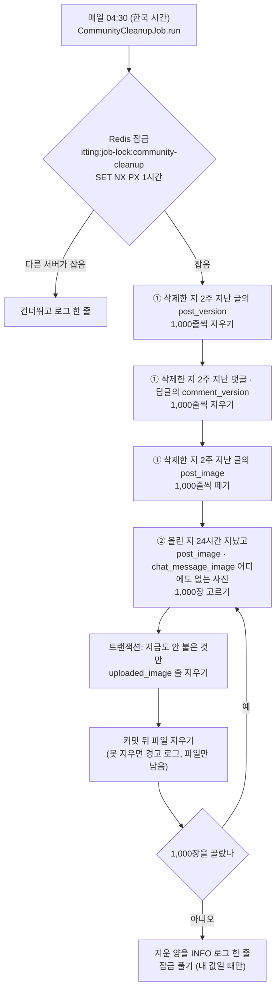

# KAN-66 사진 · 삭제한 글 정리 예약 작업

- Jira: [KAN-66](https://it-ting.atlassian.net/browse/KAN-66)
- 브랜치: `feature/be/KAN-66-image-cleanup`

## 계획

### 목표

서버가 스스로 하는 정리 작업 두 가지를 만든다. KAN-51(G), KAN-53(E)에서 미뤄 둔 일이다. 부르는 API는 없다([API 명세의 서버가 스스로 하는 일](../api/08-community.md#서버가-스스로-하는-일)).

1. 삭제한 지 2주가 지난 글 · 댓글의 모든 버전(`post_version`, `comment_version`)을 지운다. 글이면 사진도 지운다. `post` · `comment` 줄은 남긴다([DB 설계](../db/community.md#삭제한-글과-댓글을-2주-뒤에-완전히-지우기)).
2. 어디에도 붙지 않은 사진(올려 두고 붙이지 않은 것, 글에서 뗀 것)의 `uploaded_image` 줄과 저장소의 파일을 지운다. "붙어 있다"는 글(`post_image`)이나 채팅 메시지(`chat_message_image`)에 줄이 있는 것이다.

범위 밖:
- 탈퇴한 사람의 프로필 사진 파일: 아래 E
- 가려진(`HIDDEN`) 글 · 댓글: 지우지 않는다. 명세는 삭제한 것만 지운다
- 신고(`report`)의 버전 번호: 그대로 둔다. 버전 줄을 FK로 가리키지 않는다

### 정한 것

| # | 질문 | 정한 답 | 정한 사람 |
|---|---|---|---|
| 1 | 삭제한 글 · 댓글을 지우는 때 | `deleted_at`에서 2주 뒤. 모든 버전과 글의 사진을 지우고 `post` · `comment` 줄은 `DELETED`로 남긴다 | 명세(DB 설계 C6) |
| 2 | 붙어 있는 사진을 보는 곳 | `post_image`, `chat_message_image` 둘 다 | KAN-66 티켓 |
| 3 | 채팅 메시지의 사진 | 지우지 않는다. 메시지를 고치거나 지우지 않으므로 붙은 사진은 계속 붙어 있다 | [채팅 DB](../db/chat.md#chat_message_image) |
| 4 | 삭제한 글 · 댓글의 내용을 읽는 곳 | 없다. 목록 · 상세 · 신고 모두 `DELETED`를 거른다(코드 확인). 버전을 지워도 화면이 바뀌지 않는다 | 코드 확인 (2026-11-27) |
| 5 | 예약 작업을 쓰는 방법 | 기존 `NotificationCleanupJob`과 같이 `@Scheduled(cron, zone = "Asia/Seoul")`, `TransactionTemplate`으로 1,000줄씩 나눠 지운다 | 이전 작업(KAN-58) |
| 6 | 붙지 않은 사진을 지우는 때 | 올린 지(`uploaded_image.created_at`) **24시간**이 지났는데 `post_image` · `chat_message_image` 어디에도 없으면 지운다. 글에서 뗀 사진도 같은 규칙이다(올린 지 24시간이 지났으므로 다음 실행 때 지워진다) | 사용자 (2026-11-27) |
| 7 | 여러 서버에서 겹쳐 돌지 않게 하기 | **Redis 잠금**. 작업을 시작할 때 `SET itting:job-lock:<작업 이름> NX PX <제한 시간>`으로 잡은 서버만 돌고, 끝나면 푼다. 작은 도구 `global/scheduling/JobLock`을 만들어 **이번 작업에만** 쓴다 | 사용자 (2026-11-27) |
| 8 | 언제 도나 | 매일 **04:30**(한국 시간) 한 번. 순서는 ① 2주 지난 글 · 댓글의 버전과 글의 `post_image` 줄을 지우고 ② 붙지 않은 사진을 지운다. ①에서 뗀 사진은 ②에서 함께 지워진다 | 사용자 (2026-11-27) |
| 9 | DB 줄과 파일을 지우는 순서 | 1,000줄씩 `uploaded_image` 줄을 지우고 커밋한 **뒤에** 파일을 지운다. 파일을 못 지우면 경고 로그만 남기고 다음으로 넘어간다(파일만 남는다). 지우는 쿼리에도 "어디에도 붙지 않음" 조건을 다시 넣어, 고른 뒤 붙은 사진은 지우지 않는다. 글 쓰기 · 메시지 보내기와 겹치는 경우는 막지 않는다: 글 쓰기가 사진을 확인한 직후 작업이 그 사진을 지우면 글 쓰기가 FK 오류로 `500`이 되고, 다시 보내면 `400 INVALID_INPUT`(`imageIds`)이다 | 사용자 (2026-11-27) |
| 10 | 탈퇴한 사람의 프로필 사진(KAN-61 D) | **이번에 하지 않는다.** 지금은 프로필 사진을 올리는 API가 없어 `user_profile.profile_image_url`이 늘 비어 있고 지울 파일이 없다. 프로필 사진을 올리는 API를 만드는 작업에서 함께 정한다. 그때 사진을 `uploaded_image`로 올리게 하면 이번 규칙(A)이 그대로 지운다. KAN-61의 `docs/api/10-settings.md` "구현 단계로 넘기는 것"(지금 "KAN-66에서 정한다")은 KAN-61과 KAN-66 가운데 나중에 병합되는 쪽에서 "프로필 사진을 올리는 API를 만드는 작업에서 함께 정한다"로 고친다. `docs/work/KAN-61.md`는 작업 기록이라 그대로 둔다 | 사용자 (2026-11-27) |
| 11 | 한 번에 지우는 양과 기록 | 1,000줄씩 나눠 끝까지 지우고, 끝나면 지운 버전 · 사진 · 파일 수를 `INFO` 로그 한 줄로 남긴다 | 사용자 (2026-11-27) |

### 이번에 정할 것 (확인 부탁)

모두 제안대로 정했다(사용자, 2026-11-27). 위 "정한 것" 6~11로 옮겼고, 제안과 까닭은 아래에 남긴다.

| # | 무엇 | 제안 | 까닭 |
|---|---|---|---|
| A | 붙지 않은 사진을 지우는 때 | 올린 지(`uploaded_image.created_at`) **24시간**이 지났는데 `post_image` · `chat_message_image` 어디에도 없으면 지운다. 글에서 뗀 사진도 같은 규칙이다(올린 지 24시간이 지났으므로 다음 실행 때 지워진다) | 사진은 글을 쓰기 직전에 올린다. 글을 오래 쓰다 올려도 하루면 넉넉하다. 뗀 시각을 따로 기록하지 않아도 되어 테이블을 바꾸지 않는다. 다른 안: 1시간(너무 짧아 글을 쓰던 중 사진이 사라질 수 있다), 7일(디스크에 오래 남는다) |
| B | 여러 서버에서 겹쳐 돌지 않게 하기 | **Redis 잠금**. 작업을 시작할 때 `SET itting:job-lock:<작업 이름> NX PX <제한 시간>`으로 잡은 서버만 돌고, 끝나면 푼다. 작은 도구 `global/scheduling/JobLock`을 만들어 **이번 작업에만** 쓴다 | Redis는 이미 쓰고 있어 새 라이브러리(ShedLock 등)나 테이블이 필요 없다. 지금 서버는 한 대지만 실시간 소식도 여러 대를 전제로 만들었다. 이번 작업은 겹쳐 돌아도 같은 줄을 두 번 지울 뿐이라 깨지지는 않는다. 기존 작업 3개(알림 정리, 모임 마감, 모임 알림)는 겹치면 알림이 두 번 갈 수 있지만 다른 영역이라 따로 맡긴다(아래 "남은 일") |
| C | 언제 도나 | 매일 **04:30**(한국 시간) 한 번. 순서는 ① 2주 지난 글 · 댓글의 버전과 글의 `post_image` 줄을 지우고 ② 붙지 않은 사진을 지운다. ①에서 뗀 사진은 ②에서 함께 지워진다 | 알림 정리(04:00)와 겹치지 않는 새벽. 파일을 지우는 곳을 ② 한 군데로 모아, 글의 사진도 같은 길로 지운다 |
| D | DB 줄과 파일을 지우는 순서 | 1,000줄씩 `uploaded_image` 줄을 지우고 커밋한 **뒤에** 파일을 지운다. 파일을 못 지우면 경고 로그만 남기고 다음으로 넘어간다(파일만 남는다). 지우는 쿼리에도 "어디에도 붙지 않음" 조건을 다시 넣어, 고른 뒤 붙은 사진은 지우지 않는다. 글 쓰기 · 메시지 보내기와 겹치는 경우는 막지 않는다: 글 쓰기가 사진을 확인한 직후 작업이 그 사진을 지우면 글 쓰기가 FK 오류로 `500`이 되고, 다시 보내면 `400 INVALID_INPUT`(`imageIds`)이다 | 파일을 먼저 지우면 DB가 실패했을 때 주소는 있는데 파일이 없는 사진이 된다. 반대로 파일만 남는 쪽은 사용자에게 보이지 않는다. 올린 지 24시간이 지난 사진을 새벽 4시 반 그 순간에 붙이는 일은 드물어, 막으려고 글 · 채팅 코드에 잠금을 더하지 않는다 |
| E | 탈퇴한 사람의 프로필 사진(KAN-61 D) | **이번에 하지 않는다.** 지금은 프로필 사진을 올리는 API가 없어 `user_profile.profile_image_url`이 늘 비어 있고 지울 파일이 없다. 프로필 사진을 올리는 API를 만드는 작업에서 함께 정한다. 그때 사진을 `uploaded_image`로 올리게 하면 이번 규칙(A)이 그대로 지운다. KAN-61의 `docs/api/10-settings.md` "구현 단계로 넘기는 것"(지금 "KAN-66에서 정한다")은 KAN-61과 KAN-66 가운데 나중에 병합되는 쪽에서 "프로필 사진을 올리는 API를 만드는 작업에서 함께 정한다"로 고친다. `docs/work/KAN-61.md`는 작업 기록이라 그대로 둔다 | 지울 것이 생기기 전에 규칙을 정하면 올리는 방법에 따라 다시 바꿔야 한다. dev에서 `profile_image_url`을 쓰는 코드는 엔티티 getter와 `UserDisplayService`의 조회뿐이라, 탈퇴가 `user_profile` 줄만 지워도 빠지는 것이 없다(KAN-61 확인, 2026-11-27) |
| F | 한 번에 지우는 양과 기록 | 1,000줄씩 나눠 끝까지 지우고, 끝나면 지운 버전 · 사진 · 파일 수를 `INFO` 로그 한 줄로 남긴다 | 알림 정리와 같은 방식이다. 오래 잠그지 않는다 |

### 만들 것

| 파일 | 내용 |
|---|---|
| `community/service/image/ImageStorage` | `delete(String imageUrl)` 더하기. 우리 주소가 아니거나 파일이 없으면 아무것도 하지 않는다 |
| `community/service/image/LocalDiskImageStorage` | `delete` 구현. 주소에서 `<연>/<월>/<UUID>.<확장자>`를 꺼내 `root` 밖을 가리키지 않는지 확인하고 `deleteIfExists` |
| `community/repository/PostVersionRepository`, `CommentVersionRepository`, `PostImageRepository` | `deleted_at`이 기준보다 앞인 글 · 댓글의 버전 · 사진 줄을 N줄씩 지우는 쿼리 |
| `community/repository/UploadedImageRepository` | 기준보다 앞에 올렸고 `post_image` · `chat_message_image`에 없는 사진 N개 고르기, 고른 줄 지우기 |
| `community/service/CommunityCleanupJob` | 매일 04:30. C의 ①, ② 순서로 돈다. B의 잠금을 잡은 서버만 돈다 |
| `global/scheduling/JobLock` | Redis 잠금 잡기 · 풀기(B). 자기가 잡은 잠금만 푼다 |
| `docs/db/community.md` | `uploaded_image`의 "미정"을 A, D로 채우고, "남은 일"의 예약 작업 줄을 지운다 |
| `docs/api/08-community.md` | "서버가 스스로 하는 일"에 지우는 때를 적고, "구현 단계로 넘기는 것"에서 두 줄을 지운다 |

테이블은 바꾸지 않는다(마이그레이션 없음). 찾는 데 쓸 색인이 모자라면 그때 새 마이그레이션으로 더하고 결과에 적는다.

### 테스트

API가 없어 작업 메서드를 직접 부르는 통합 테스트(Testcontainers MySQL · Redis, 임시 폴더 저장소)로 확인한다. 시각은 고정한 `Clock`으로 움직인다.

| 무엇 | 지우는 경우 | 남기는 경우 |
|---|---|---|
| 삭제한 글 | `deleted_at`이 2주 + 1분 전 → 버전 · `post_image` · 사진 줄 · 파일이 모두 없고, `post` 줄은 `DELETED`로 남는다 | 2주 - 1분 전 → 모두 남는다. 가려진 글, 공개 글 → 남는다 |
| 삭제한 댓글 · 답글 | 2주 지남 → 버전이 없고 `comment` 줄은 남는다 | 2주 안 → 남는다 |
| 붙지 않은 사진 | 올린 지 24시간 + 1분, 어디에도 안 붙음 → 줄과 파일이 없다. 글을 고쳐 뗀 사진도 같다 | 24시간 안 → 남는다. 글에 붙은 사진, 채팅 메시지에 붙은 사진 → 오래돼도 남는다 |
| 파일 삭제 실패 | 파일이 이미 없음 → 줄은 지워지고 작업은 계속된다 | — |
| 잠금 | — | 다른 서버가 잠금을 잡고 있으면(Redis에 키를 미리 넣어 둠) 아무것도 지우지 않는다 |
| 1,000줄 넘게 | 1,001개를 만들어 한 번에 모두 지워진다 | — |
| 저장소 `delete` | 우리 주소 → 파일이 없어진다 | `root` 밖을 가리키는 주소(`../`), 다른 서버의 주소 → 아무것도 지우지 않는다 |

## 결과

### 한눈에 보기

테이블은 바꾸지 않았다. 지우는 테이블은 `post_version`, `comment_version`, `post_image`, `uploaded_image`이고, `post` · `comment`(상태와 `deleted_at`)와 `chat_message_image`는 읽기만 한다.

### 바꾼 것

| 파일 | 내용 |
|---|---|
| `community/service/image/ImageStorage` | `delete(String imageUrl)` 더함 |
| `community/service/image/LocalDiskImageStorage` | `delete` 구현. `<publicBaseUrl>/images/`로 시작하고 `root` 안의 보통 파일일 때만 지운다. `../`, 폴더, 다른 주소는 건드리지 않는다 |
| `community/repository/CommunityCleanupRepository` (새) | 정리 쿼리 6개. 지우는 쿼리마다 `LIMIT`, 사진 지우기는 "지금도 안 붙음" 조건을 다시 건다 |
| `community/service/CommunityCleanupJob` (새) | 매일 04:30. ①, ② 순서로 돌고, 지운 양을 로그로 남긴다 |
| `global/scheduling/JobLock` (새) | Redis 잠금. `SET NX PX`로 잡고, Lua로 내 값일 때만 푼다 |
| `test/.../community/CommunityCleanupJobTests` (새, 10개) | 아래 "확인한 것" |
| `docs/db/community.md` | `uploaded_image`의 "미정"을 채우고, 2주 정리에 실행 시각을 적고, "남은 일"에서 한 줄 지움 |
| `docs/api/08-community.md` | "서버가 스스로 하는 일"에 지우는 때 · 시각 · 잠금 · 겹칠 때의 `500`을 적고, "구현 단계로 넘기는 것"에서 두 줄 지움 |
| `docs/api/10-settings.md` | "구현 단계로 넘기는 것"의 탈퇴한 사람 프로필 사진 줄을 "프로필 사진을 올리는 API를 만드는 작업에서 함께 정한다"로 고침. KAN-61이 먼저 병합되어 이 PR에서 고쳤다(E) |

### 확인한 것

- `CommunityCleanupJobTests` 10개 통과
  - 삭제한 지 2주 + 1분 된 글: 버전 · `post_image` · 사진 줄 · 파일이 모두 없고 `post`는 `DELETED`로 남음
  - 2주 - 1분 된 삭제 글, 가려진 글, 공개 글: 버전과 사진이 남음
  - 삭제한 지 2주 지난 댓글 · 답글: 버전만 지워지고 `comment` 줄은 남음. 2주 안의 댓글, 공개 댓글은 남음
  - 붙지 않은 사진: 24시간 + 1분이면 지워지고 24시간 - 1분이면 남음
  - 글에서 뗀 사진은 지워지고, 글에 붙은 사진과 채팅 메시지에 붙은 사진은 30일이 지나도 남음
  - 파일이 이미 없어도 줄은 지워지고 다음 사진으로 넘어감
  - 다른 서버의 잠금이 있으면 아무것도 지우지 않고 그 잠금도 그대로 둠. 끝나면 잠금이 풀려 다음 실행이 돎
  - 1,001장을 한 번에 모두 지움(1,000장씩 나눠 끝까지)
  - 저장소 `delete`: 자기 주소만 지우고 `../`로 밖을 가리키는 주소, 폴더, 빈 경로, 다른 서버 주소는 지우지 않음
- 테스트가 실제로 잡는지: 사진 고르는 쿼리에서 `chat_message_image` 조건을 빼면 "채팅 메시지에 붙은 사진" 테스트가 실패함을 확인하고 되돌림
- `./gradlew build` 통과(최신 dev `2626356` 위, KAN-61 포함). 테스트 846개(기존 836 + 새 10), 실패 0
- `git merge-tree --write-tree HEAD origin/dev`: 충돌 없음 (2026-11-27)
- 로컬 코드 리뷰(스킬 `code-review`): P0 0건, P1 0건

### 계획과 달라진 점

- 쿼리를 `PostVersionRepository` · `CommentVersionRepository` · `PostImageRepository` · `UploadedImageRepository`에 나눠 넣지 않고 `CommunityCleanupRepository` 하나에 모았다. 다른 쿼리 저장소(`CommentQueryRepository`)처럼 SQL로 쓰는 쿼리이고, 정리 작업만 쓰기 때문이다
- 글의 사진을 떼는 일(①)을 버전 지우기 뒤에 따로 1,000줄씩 돌게 했다. 계획의 순서(① → ②)는 그대로다
- 테스트 이름의 "채팅 메시지의 사진"은 사진 전용 메시지 종류가 없어 `TEXT` 메시지에 사진을 붙여 만들었다
- 색인은 더하지 않았다. `post.deleted_at`, `comment.deleted_at`, `uploaded_image.created_at`에 색인이 없어 하루 한 번 표 전체를 훑는다. 지금 양에서는 문제가 없고, 느려지면 새 마이그레이션으로 더한다

### 남은 일

- 기존 예약 작업 3개(`NotificationCleanupJob`, `MeetupApplicationDeadlineJob`, `MeetupReminderJob`)에도 `JobLock`을 붙이기. 서버를 여러 대로 늘리기 전에 한다(B)
- 정리 대상이 많아지면 `post.deleted_at`, `comment.deleted_at`, `uploaded_image.created_at` 색인

### 검토 순서

1. `docs/api/08-community.md`의 "서버가 스스로 하는 일", `docs/db/community.md`의 `uploaded_image`
2. `global/scheduling/JobLock`
3. `community/service/CommunityCleanupJob` → `community/repository/CommunityCleanupRepository`
4. `community/service/image/LocalDiskImageStorage#delete`
5. `test/.../community/CommunityCleanupJobTests`
