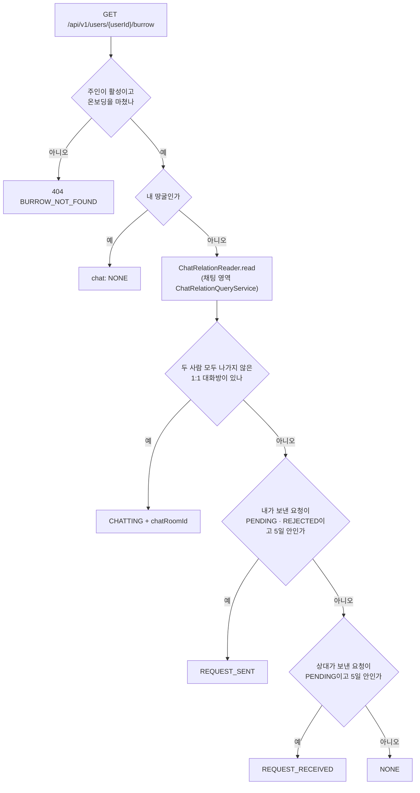

# KAN-67 [BE] 05 방문: 남의 땅굴의 대화 버튼 상태 연결

- Jira: [KAN-67](https://it-ting.atlassian.net/browse/KAN-67)
- 브랜치: `feature/be/KAN-67-burrow-chat-status`

## 계획

### 목표

`GET /api/v1/users/{userId}/burrow`의 `chat`을 실제 관계로 채운다. 지금은 늘 `{"status":"NONE","chatRoomId":null}`이다(KAN-46). 06 채팅 ①(KAN-55)이 병합돼 대화 요청과 1:1 대화방이 저장된다.

범위 밖:
- 들판 목록(`GET /api/v1/fields/...`)의 입구 카드: 대화 상태를 주지 않는다(API 명세)
- 주인이 나간 대화방이 읽기 전용이 되는 것: 06 채팅 ②(KAN-56)

### 정한 것

| # | 질문 | 정한 답 | 정한 사람 |
|---|---|---|---|
| 1 | 상태와 보는 순서 | 위에서부터: 두 사람 모두 나가지 않은 1:1 대화방이 있으면 `CHATTING`(그 방 id), 내가 보낸 살아 있는 요청(`PENDING` · `REJECTED`, 5일 안)이 있으면 `REQUEST_SENT`, 상대가 보낸 `PENDING` 요청이 5일 안이면 `REQUEST_RECEIVED`, 아니면 `NONE` | [대화 버튼의 상태](../api/05-explore-visit.md#대화-버튼의-상태) |
| 2 | 내가 거절한 요청 | `NONE` | 위 문서 |
| 3 | 자기 땅굴 | `NONE`, 채팅을 읽지 않는다 | 위 문서, KAN-46 |
| 4 | 살아 있는 요청 · 열린 대화방의 기준 | 대화 요청 보내기와 같은 쿼리(`ChatRequest.aliveAfter`, `ChatRoomRepository.findOpenDirectRoomIds`, `ChatRequestRepository.findAlive`)를 쓴다 | KAN-55 |
| A | 땅굴이 채팅을 읽는 방법 | `burrow/service/ChatRelationReader` 인터페이스를 두고 `chat/service`가 구현한다(알림의 `ChatRequestReader`와 같은 모양) | 유예린, 2026-11-25 |

### 이번에 정할 것

없음. A는 위 "정한 것"으로 옮겼다.

### 만들 것

| 파일 | 내용 |
|---|---|
| `burrow/service/ChatRelationReader` | 인터페이스. 응답의 `chat`(`BurrowVisitResponse.ChatResponse`)을 그대로 돌려준다 |
| `chat/service/ChatRelationQueryService` | 구현. 정한 것 1 · 4 |
| `burrow/service/BurrowExploreService` | `visit`이 남의 땅굴이면 읽어서 `chat`을 채운다 |
| `docs/api/05-explore-visit.md` | "연결되기 전까지 `NONE`" 문장을 지운다 |

API의 주소, 요청, 응답 모양, 에러는 바뀌지 않는다.

### 테스트

새 `BurrowVisitChatStatusApiTests`에 둔다.

| 경우 | 기대 |
|---|---|
| 관계 없음 | `NONE`, `chatRoomId` `null` |
| 내가 보낸 `PENDING` 요청 | `REQUEST_SENT` |
| 내가 보낸 요청을 상대가 거절 | `REQUEST_SENT` (거절을 드러내지 않음) |
| 내가 보낸 요청이 5일 지남 | `NONE` |
| 상대가 보낸 `PENDING` 요청 | `REQUEST_RECEIVED` |
| 상대가 보낸 요청을 내가 거절 | `NONE` |
| 수락해 대화방이 열림 | `CHATTING`, 그 대화방 id |
| 대화방이 있고 요청도 살아 있음 | `CHATTING` |
| 한 사람이 대화방을 나감 | 대화방으로 보지 않음 → 요청 기준으로 |
| 자기 땅굴 | `NONE` |
| 없는 사람 (실패) | `404 BURROW_NOT_FOUND` (지금과 같음) |

## 결과

### 한눈에 보기

### 바꾼 것

| 파일 | 내용 |
|---|---|
| `burrow/service/ChatRelationReader` | 새 인터페이스. 두 사람 사이의 `chat` 값을 돌려준다 |
| `chat/service/ChatRelationQueryService` | 구현. 대화 요청 보내기와 같은 쿼리(`findOpenDirectRoomIds`, `findAlive`, `ChatRequest.aliveAfter`)로 위에서부터 본다 |
| `burrow/service/BurrowExploreService` | `visit`이 남의 땅굴이면 위 값을 쓴다. 내 땅굴은 그대로 `NONE` |
| `burrow/dto/BurrowVisitResponse` | Swagger 설명에서 "채팅 기능이 연결되기 전까지 NONE"을 "내 땅굴이면 NONE"으로 |
| `docs/api/05-explore-visit.md` | "연결되기 전까지 `NONE`" 문장을 지우고 대화 버튼의 상태로 연결 |
| `BurrowVisitChatStatusApiTests` | 새 통합 테스트 13개 |

API의 주소, 요청, 응답 모양, 에러는 바뀌지 않았다.

### 확인한 것

- `./gradlew build` 통과: 테스트 630개, 실패 0
- 새 테스트가 실제로 잡는지: 거절된 내 요청을 `SENT`에서 빼고 대화방 확인을 끈 코드로 돌리면 13개 가운데 3개가 실패한다. 되돌린 뒤 모두 통과
- 로컬 코드 리뷰: P0 0건, P1 0건
- `git merge-tree --write-tree HEAD origin/dev`: 충돌 없음

### 계획과 달라진 점

- 인터페이스가 따로 `ChatRelation` 레코드를 두지 않고 응답의 `BurrowVisitResponse.ChatResponse`를 그대로 돌려준다. 같은 두 값을 옮겨 담는 타입이 하나 더 생기지 않게 했다
- 테스트는 기존 `BurrowExploreApiTests`에 더하지 않고 새 클래스로 뒀다. 시각을 바꾸는 `MutableClockConfiguration`이 필요해서다

### 남은 일

- 주인이 나간 1:1 대화방을 읽기 전용으로 보여 주는 것은 06 채팅 ②(KAN-56)

### 검토 순서

1. `chat/service/ChatRelationQueryService`: 순서와 기준
2. `burrow/service/BurrowExploreService.visit`: 내 땅굴 분기
3. `BurrowVisitChatStatusApiTests`
