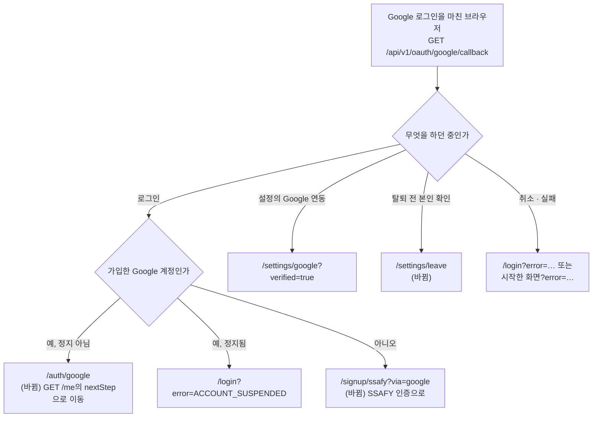

# KAN-68 [BE] Google 로그인 돌아오는 주소를 프론트엔드 화면에 맞추기

- Jira: [KAN-68](https://it-ting.atlassian.net/browse/KAN-68)
- 브랜치: `fix/be/KAN-68-google-return-urls`

## 계획

### 목표

테스트 서버에서 Google 로그인이 끝까지 되게 한다. Google에 다녀온 브라우저를 서버가 돌려보내는 화면 주소가 프론트엔드의 실제 화면 주소와 세 군데 달랐다. 테스트 서버 첫 배포(KAN-63)의 Codex 리뷰(PR #52)에서 드러났다.

| 상황 | 서버가 보내던 주소 | 프론트엔드의 화면 | 생기던 일 |
|---|---|---|---|
| Google 로그인 성공 | `/` | `/auth/google` | 로그인은 되지만 첫 화면에 머묾. `/`는 로그인 확인 없이 첫 화면만 보여 준다 |
| 처음 쓰는 Google 계정 | `/signup/ssafy?method=google` | `/signup/ssafy?via=google` | Google로 가입할 수 없음. 화면이 `via=google`만 알아봐 가입 첫 화면으로 되돌린다 |
| 탈퇴 전 Google 확인 뒤 | `/settings/withdraw` | `/settings/leave` | 없는 화면(404) |

범위 밖:
- 프론트엔드 화면: 바꾸지 않는다
- 탈퇴 API(KAN-61): 아직 없다. 주소만 맞춰 둔다

### 정한 것

| # | 질문 | 정한 답 | 정한 사람 |
|---|---|---|---|
| 1 | 어느 쪽에 맞추나 | 백엔드와 API 문서를 프론트엔드의 화면 주소에 맞춘다. 화면 주소는 프론트엔드가 정하는 것이고, 돌아온 뒤를 처리하는 화면(`/auth/google`)이 이미 있다. 고칠 곳도 적다 | 사용자 (2026-11-25) |
| 2 | 반영하는 길 | `fix/…` 브랜치 → `dev` → `test`. 저장소의 `hotfix/*`는 `main`에서 따는 운영 긴급 수정인데 `main`에는 아직 코드가 없다 | 사용자 (2026-11-25, "핫픽스로 반영") |

## 결과

### 한눈에 보기

Google에 다녀온 브라우저가 가는 화면. 굵게 표시한 셋이 이번에 바뀐 주소다.

### 바꾼 것

| 파일 | 내용 |
|---|---|
| `auth/service/GoogleRedirectUrls` | 로그인됨 `/` → `/auth/google`, 처음 쓰는 계정 `method=google` → `via=google`, 탈퇴 확인 `/settings/withdraw` → `/settings/leave`. 프론트엔드의 `GOOGLE_RETURN`과 같아야 한다는 설명을 더함 |
| `auth/service/GoogleOAuthService` | `home()` → `loggedIn()`(이름만) |
| `auth/controller/GoogleOAuthController` | Swagger 설명의 주소 |
| `docs/api/02-auth.md`, `docs/api/10-settings.md` | "구현하며 정한 것"의 돌아오는 주소 |
| 통합 테스트 넷(`GoogleLoginApiTests`, `GoogleSignupApiTests`, `GoogleVerifyApiTests`, `GoogleLinkApiTests`) | 기대 주소 16곳 |

### 확인한 것

- `./gradlew build` 통과. 테스트 724개(새 테스트 없음, Google 관련 82개의 기대 주소를 바꿈)
- 프론트엔드와 대조: `frontend/src/api/auth/google.ts`의 `GOOGLE_RETURN` 일곱 주소와 서버의 주소가 모두 같다. `/login?error=<code>`는 화면이 모르는 코드도 기본 문구로 받는다
- 옛 주소가 코드, 테스트, API 문서에 남지 않았다(`git grep`)
- 로컬 코드 리뷰: P0 0건, P1 0건
- 확인하지 못한 것: 실제 Google 계정으로 로그인 · 가입. 테스트 서버에 배포한 뒤 사람이 확인한다

### 계획과 달라진 점

없음.

### 남은 일

- 테스트 서버에서 Google로 가입 · 로그인해 보기
- `frontend/src/api/auth/google.ts`의 주석("백엔드에 알려 줄 것")은 그대로다. 프론트엔드를 고칠 때 "서버와 같다"로 바꾼다

### 검토 순서

1. `docs/api/02-auth.md`, `docs/api/10-settings.md`의 주소
2. `GoogleRedirectUrls`
3. 테스트의 기대 주소
