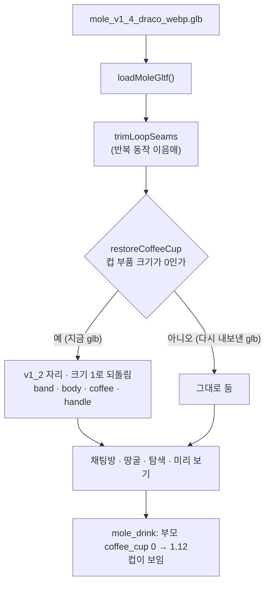
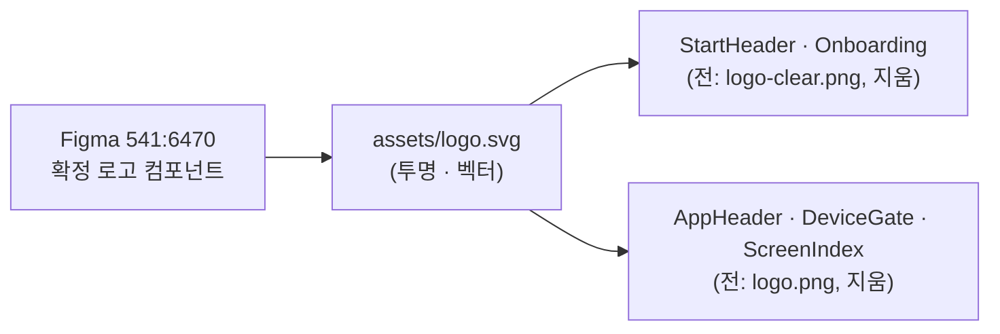

# KAN-69 [FE] 로고 투명 배경 · 채팅 3D 커피 컵 수정

- Jira: [KAN-69](https://it-ting.atlassian.net/browse/KAN-69)
- 브랜치: `fix/fe/KAN-69-logo-and-coffee-cup`

## 계획

### 목표

디자인 확인에서 나온 프론트엔드 버그 두 가지를 고친다.

| 버그 | 생기던 일 | 원인 |
|---|---|---|
| 로고 누끼 | 시작 화면 · 온보딩의 어두운 배경에서 로고 글자 가장자리에 크림색 테두리가 보이고 흐림 | `logo-clear.png`는 크림색 배경에서 잘라 낸 92×48 PNG라 가장자리 픽셀에 크림색이 섞여 있음. 시작 화면은 이걸 104px로 늘려 씀. 헤더용 `logo.png`는 크림색 배경이 이미지에 들어 있음 |
| 커피 컵 | 모임 · 1:1 채팅 3D 장면에서 두더지가 컵 없이 커피 마시는 동작을 함. 땅굴의 ☕ 커피도 같음 | `mole_v1_4_draco_webp.glb` 안의 컵 부품 4개(`coffee_cup_band` · `_body` · `_coffee` · `_handle`)가 크기 0 · 위치 (0, 0, 2)로 저장됨. `mole_drink`는 부모 `coffee_cup`의 크기만 0 → 1.12로 키우므로 부품이 계속 안 보임 |

컵 부품은 핸드오프 v1_3부터 이렇게 저장돼 있고, v1_2까지는 정상이었다(부모 크기 0.0001, 부품은 크기 1). 부품 모양(정점 범위)과 `mole_drink`의 컵 키 값은 v1_2와 같다. Blender에서 부모의 기본 크기가 정확히 0(핸드오프 문서 `animation_list_v1_4.md`는 0.0001)이라 내보낼 때 부품의 상대 위치 계산이 깨진 것으로 보인다.

범위 밖:
- 3D 모델 다시 내보내기: 3D 담당이 컵 기본 크기를 0.0001로 바꿔 다시 내보내면 이번 코드는 아무것도 하지 않는다(크기가 0인 부품만 고침)
- Figma 03 회원가입 화면 2곳의 옛 로고 이미지: 디자인 쪽에서 따로 바꾼다

### 정한 것

| # | 질문 | 정한 답 | 정한 사람 |
|---|---|---|---|
| 1 | 새 로고의 원본 | Figma 확정 로고 컴포넌트 `Logo / 디굴디굴 (확정 · 헤더)`(01 Foundations, 541:6470)를 SVG로 내보낸 것. 벡터라 배경이 투명하고 크기를 키워도 선명하다 | 사용자 (2026-11-26) |
| 2 | 바꿀 곳 | 로고를 쓰는 5곳 모두(`StartHeader` · `Onboarding` · `AppHeader` · `DeviceGate` · `ScreenIndex`). 안 쓰게 된 `logo.png` · `logo-clear.png`는 지운다 | 사용자 (2026-11-26) |
| 3 | 컵을 고치는 곳 | 모델 파일은 그대로 두고 `three/moleModel.ts`의 `loadMoleGltf`에서 불러온 뒤 고친다. 채팅방 · 땅굴 · 탐색 · 미리 보기가 모두 이 함수로 두더지를 불러온다 | 사용자 (2026-11-26) |
| 4 | 티켓 · PR | 티켓 하나, PR 하나. 커밋은 목적별로 나눈다 | 사용자 (2026-11-26) |

## 결과

### 한눈에 보기

### 바꾼 것

| 파일 | 내용 |
|---|---|
| `frontend/src/assets/logo.svg` | 새 로고. Figma 541:6470을 SVG로 내보냄(85×39) |
| `frontend/src/assets/logo.png`, `logo-clear.png` | 지움 |
| `frontend/src/screens/start/StartHeader.tsx`, `screens/onboarding/Onboarding.tsx`, `components/AppHeader.tsx`, `components/DeviceGate.tsx`, `screens/ScreenIndex.tsx` | 로고 import를 `logo.svg`로 |
| `frontend/src/three/moleModel.ts` | `restoreCoffeeCup` 추가, `loadMoleGltf`에서 부름 |
| `frontend/src/tests/mole-v1-4.test.ts` | 컵 부품 시험 3개 |

### 확인한 것

- `npm run typecheck` 통과, `npm run lint` 오류 0건(경고 55건은 이번에 바꾸지 않은 줄), `npm test` 통과. 테스트 702개(기존 699 + 새 3)
- `npm run build` 통과, `npm run smoke` 화면 106개 모두 OK. 시작 · 로그인 · 온보딩 · 채팅 화면의 로고를 스크린샷으로 확인(어두운 배경에서 테두리 없음)
- 빌드한 앱을 띄워 모임 대화(`/chat/g-m1`)와 1:1 대화(`/chat/r-yerin`)를 30초씩 연속으로 찍음: 커피 마시는 두더지의 손에 컵이 보임
- 컵 크기를 움직이는 동작 16개 가운데 컵을 키우는 것은 `mole_drink` 하나(최대 1.12). 나머지 15개는 컵 크기 0을 유지해 다른 동작에서 컵이 나타나지 않음
- 두더지를 불러오는 곳(채팅방 · 땅굴 · 탐색 · 미리 보기)은 모두 `loadMoleGltf`를 거침. `loadGlb`가 같은 파일을 한 번만 불러오고, 고치는 함수는 두 번 불러도 결과가 같음
- `git merge-tree --write-tree HEAD origin/dev`: 충돌 없음
- 로컬 코드 리뷰: P0 0건, P1 0건

### 계획과 달라진 점

없음.

### 남은 일

- 3D 담당: `mole_master.blend`에서 `coffee_cup`의 기본 크기를 0 → 0.0001로 바꿔 다시 내보내기. 그러면 `restoreCoffeeCup`은 지워도 된다
- 디자인: Figma 03 회원가입 화면 2곳의 옛 로고 이미지(`Logo / 디굴디굴`)를 확정 로고로 바꾸기

### 검토 순서

1. `frontend/src/three/moleModel.ts`의 `restoreCoffeeCup`
2. `frontend/src/tests/mole-v1-4.test.ts`의 컵 시험
3. 로고 import 5곳과 `logo.svg`
