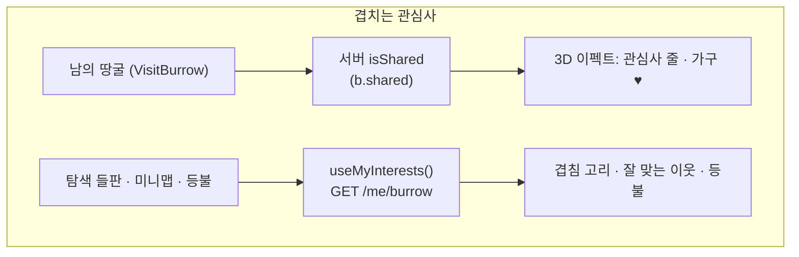
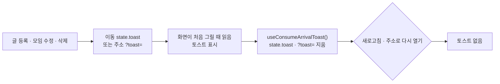
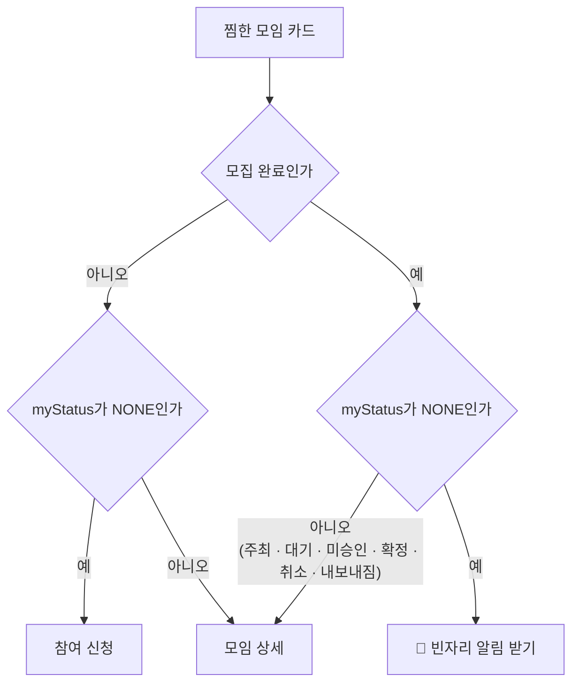

# KAN-71 [FE] 겹치는 관심사 목 데이터 사용 · 완료 토스트 반복 · 빈자리 알림 버튼 수정

- Jira: [KAN-71](https://it-ting.atlassian.net/browse/KAN-71)
- 브랜치: `fix/fe/KAN-71-shared-interests-toast-vacancy`

## 계획

### 목표

프론트엔드를 실제 백엔드(`NEXT_PUBLIC_API_MODE=real`)에 붙여 구현된 API를 명세와 맞춰 보다가 찾은 문제 세 가지를 고친다.

| 문제 | 생기던 일 | 원인 |
|---|---|---|
| 겹치는 관심사 | 남의 땅굴 3D 이펙트(관심사 줄 "♥ 나와 N개 겹쳐요", 같은 관심사 가구의 ♥), 탐색 들판의 겹침 고리 · 잘 맞는 이웃, 미니맵, 등불의 "내 관심사"가 로그인한 사용자와 상관없는 값으로 나옴. 같은 화면의 방노트 · 대화 요청 팝업(서버 `isShared`)과 숫자가 다름 | `VisitBurrow`가 목 사용자 `USERS[ME_ID]`의 관심사를, `ExploreBurrow` · `Minimap`이 `data/field.ts`의 `me()`(목 사용자)를 "내 관심사"로 씀 |
| 완료 토스트 | 글을 등록한 뒤 글 상세를 새로 고치거나 주소로 다시 열면 "게시글이 등록되었어요"가 또 뜸. 모임의 `?toast=edited` · `?toast=deleted`도 같음 | 이동 state는 주소별로 sessionStorage에 남고(`lib/nav.tsx`), `?toast=`는 주소에 남음 |
| 빈자리 알림 버튼 | 찜한 모임 탭에서 이미 참여가 확정된 모임에도 "빈자리 알림 받기"가 보임 | 버튼 조건이 "모집 완료"뿐. 명세 07 찜한 모임 5도 "모집 완료된 모임에만 보인다"고만 적음 |

범위 밖:
- Figma 기능 명세 패널의 글 고치기: 저장소 명세(`docs/spec/`)를 먼저 고치고 Figma는 팀원이 맞춘다(아래 "남은 일")
- 빈자리 알림을 이미 켜 둔 참여 확정자에게 알림이 가는 경우(백엔드는 내 상태를 보지 않음): 버튼을 숨겨 새로 켜는 길만 막는다

### 정한 것

| # | 질문 | 정한 답 | 정한 사람 |
|---|---|---|---|
| 1 | 겹치는 관심사를 무엇으로 계산하나 | 방문자 뷰는 서버가 준 `isShared`를 그대로 쓴다. 들판 · 미니맵 · 등불은 `GET /me/burrow`의 내 관심사를 쓴다(앱 전체에서 이미 부르고 있어 요청이 늘지 않음). 받기 전에는 빈 목록 | 사용자 (2026-11-26) |
| 2 | 완료 토스트를 다시 띄우나 | 끝난 직후 한 번만 띄운다. 새로 고치거나 주소로 다시 열 때는 띄우지 않는다. 명세 00 공통 16에 적는다 | 사용자 (2026-11-26) |
| 3 | 빈자리 알림 버튼은 누구에게 보이나 | 모집 완료이고 아직 신청하지 않은 모임(`myStatus`가 `NONE`)에만. 그 밖에는 "모임 상세"를 둔다. 명세 07 찜한 모임 5와 API 명세 07에 적는다 | 사용자 (2026-11-26) |
| 4 | 티켓 · PR | 회원가입 수정(KAN-70)과 나눠 이 티켓 하나, PR 하나. 커밋은 목적별로 나눈다 | 사용자 (2026-11-26) |

## 결과

### 한눈에 보기

### 바꾼 것

| 파일 | 내용 |
|---|---|
| `frontend/src/api/burrow/queries.ts` | `useMyInterests()` 추가. `GET /me/burrow`의 내 관심사, 받기 전에는 빈 목록 |
| `frontend/src/screens/burrow/VisitBurrow.tsx` | 3D 이펙트의 `viewer`를 목 사용자 관심사 대신 서버 `isShared`(`b.shared`)로 |
| `frontend/src/screens/burrow/ExploreBurrow.tsx`, `Minimap.tsx` | 들판 이펙트 · 등불 · 미니맵의 "내 관심사"를 `me()` 대신 `useMyInterests()`로 |
| `frontend/src/lib/nav.tsx` | `useConsumeArrivalToast()` 추가. 이동 state의 `toast`만 지우고(다른 값은 둠), 주소의 `?toast=`는 `history.replaceState`로 지움 |
| `frontend/src/screens/board/parts.tsx`(`useArrivalToast`), `start/Auth.tsx`(로그인), `meetups/MeetupDetail.tsx`, `meetups/MeetupList.tsx`(내 모임), `burrow/VisitBurrow.tsx` | 토스트를 읽은 화면에서 위 훅을 부름 |
| `frontend/src/screens/meetups/MeetupList.tsx` | 찜한 모임 카드: 빈자리 알림 버튼과 "자리가 나면 알려드릴게요"를 `myStatus`가 `NONE`일 때만 |
| `docs/spec/00-common.md` | 16 완료 토스트: 한 번만 뜬다 |
| `docs/spec/07-meetup.md` | 찜한 모임 5: 미신청 모임에만 보이고 그 밖에는 "모임 상세" |
| `docs/api/07-meetup.md` | 프론트엔드가 할 일 표와 `PUT …/vacancy-alert`의 버튼 조건 |

### 확인한 것

- `npm run typecheck` 통과(커밋마다 따로 확인), `npm run lint` 오류 0건(경고 55건은 이번에 바꾸지 않은 줄), `npm run build` 통과
- `npm test`: 704개 가운데 701개 통과, 1개 실패. 실패한 `unsaved-guard.test.ts`는 Windows에서 경로 구분자(`burrow\MyBurrow.tsx`) 때문에 지금 `dev`에서도 같은 이유로 실패한다(이번 변경과 무관)
- 로컬 백엔드(`dev`)와 실제 모드 프론트엔드를 띄우고, 고치기 전(지금 `dev`)과 나란히 비교함
  - 겹치는 관심사: 알파(맛집탐방 · 카페/커피 · 요리/레시피)가 베타(맛집탐방 · 카페/커피 · 주류)의 땅굴에서 `?fx=all` → 고치기 전 "나와 겹치는 것 1개", 고친 뒤 "♥ 나와 2개 겹쳐요"와 두 가구 모두 "나도 좋아함". 등불의 "내 관심사"가 목 사용자 관심사 → 맛집탐방 1집 · 카페/커피 1집 · 요리/레시피 0집
  - 완료 토스트: 글 등록 뒤 새로고침 · 주소로 다시 열기에서 토스트 안 뜸. `/meetups/2?toast=edited` → 토스트가 뜨고 주소가 `/meetups/2`로 바뀌며 새로고침해도 안 뜸
  - 빈자리 알림: 정원이 찬 모임을 찜한 참여 확정자는 "모임 상세", 미신청자는 "🔔 빈자리 알림 받기"
- `git merge-tree --write-tree HEAD origin/dev`: 충돌 없음

### 계획과 달라진 점

- 빈자리 알림 버튼을 참여 확정자만이 아니라 빈자리가 나도 할 수 있는 일이 없는 상태(주최자, 신청 대기, 미승인, 참여 취소, 내보내짐) 모두에서 숨겼다

### 남은 일

- Figma "it-ting 스켈레톤" › "02. 스켈레톤 기능 명세"의 00 공통(797:3920) 16, 모임 – 내 모임 · 찜한 모임(1075:11830) 5의 글을 이번 명세에 맞춘다(팀원)
- `data/field.ts`의 `me()`는 목 모드의 들판 데이터에만 쓰인다. 실제 모드 화면에서 새로 쓰지 않는다

### 검토 순서

1. `docs/spec/00-common.md`, `docs/spec/07-meetup.md`, `docs/api/07-meetup.md`
2. `frontend/src/api/burrow/queries.ts` → `screens/burrow/VisitBurrow.tsx` → `ExploreBurrow.tsx` → `Minimap.tsx`
3. `frontend/src/lib/nav.tsx` → 토스트를 읽는 화면들
4. `frontend/src/screens/meetups/MeetupList.tsx`
