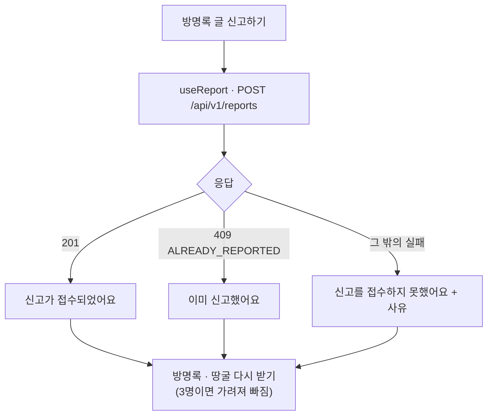
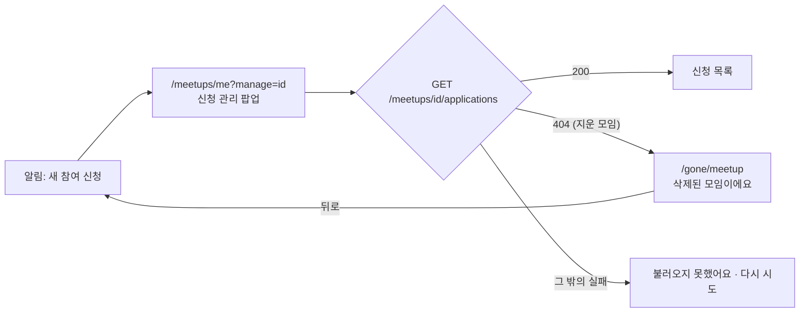

# KAN-73 [FE] 방명록 신고 실패에도 완료 토스트 · 삭제된 모임 신청 관리 오류 수정

- Jira: [KAN-73](https://it-ting.atlassian.net/browse/KAN-73)
- 브랜치: `fix/fe/KAN-73-guestbook-report-deleted-meetup`

## 계획

### 목표

실제 백엔드에 붙여 프론트엔드를 2차로 검증하다 찾은 P1 두 건을 고친다.

| 문제 | 생기던 일 | 원인 |
|---|---|---|
| 방명록 신고 토스트 | 같은 방명록 글을 두 번 신고하면(409 `ALREADY_REPORTED`) 실패 토스트와 "신고가 접수되었어요"가 함께 뜬다. 실패 문구로 "이 방명록은 지울 수 없어요"(삭제 문구)가 나올 수 있다 | `GuestbookModal`이 신고 요청의 결과를 기다리지 않고 완료 토스트를 띄움. 두 화면이 `BURROW_ERRORS`(삭제 문구)로 신고 오류를 보임 |
| 삭제된 모임의 신청 관리 | 삭제된 모임의 "새 참여 신청" 알림을 누르면 신청 관리 팝업에 "신청 목록을 불러오지 못했어요 · 다시 시도". 다시 시도해도 같다(404 `MEETUP_NOT_FOUND`) | 신청 관리 팝업이 404를 다른 오류와 나누지 않음 |

범위 밖:
- 2차 검증의 P2(캘린더 고른 날, "내 모임" 위젯 숫자, 신고 팝업 제목, 소속 표기 순서 등): 따로 정한다

### 정한 것

| # | 질문 | 정한 답 | 정한 사람 |
|---|---|---|---|
| 1 | 신고 토스트 | 접수됐을 때만 "신고가 접수되었어요"(00 공통 16). 같은 대상을 다시 신고하면 "이미 신고했어요"(08 신고 팝업 1). 글 · 댓글 신고와 같은 훅 `useReport`를 쓴다 | 명세 |
| 2 | 원본이 사라진 알림 | "삭제된 모임이에요" 안내 화면(09 알림 – 팝업 6, 00 공통 21). 알림용으로 이미 있는 `/gone/meetup`으로 바꿔 가서 뒤로 가면 알림 화면 | 명세, 지금 코드 |

## 결과

### 한눈에 보기

### 바꾼 것

| 파일 | 내용 |
|---|---|
| `frontend/src/screens/burrow/GuestbookModal.tsx` | `onReport`에 결과 알림(`onReported` · `onAlready`)을 넘기고, 그때 완료 · 이미 신고함 토스트를 띄움 |
| `frontend/src/screens/burrow/MyBurrow.tsx`, `VisitBurrow.tsx` | 방명록 신고를 `useReport`(글 · 댓글과 같은 훅)로. 끝나면 방명록 · 땅굴 캐시를 만료시키는 것은 그대로 |
| `frontend/src/components/Feedback.tsx`, `screens/board/parts.tsx` | "이미 신고했어요" 토스트를 공통 문구(`TOAST.alreadyReported`)로. 게시판도 같은 것을 씀 |
| `frontend/src/screens/meetups/parts.tsx` | 신청 관리 팝업이 404면 `/gone/meetup`으로 바꿔 감 |
| `frontend/src/tests/guestbook-report-refresh.test.ts` | 캐시 만료 검사를 새 코드에 맞추고, 토스트 순서 검사를 더함 |
| `frontend/src/tests/meetup-manage-gone.test.ts` | 새 시험: 404를 "없는 대상"으로 보는지, 안내 화면으로 바꿔 가는지 |

### 확인한 것

- `npx tsc --noEmit` 통과, ESLint 오류 0건(경고 9건은 이번에 바꾸지 않은 줄)
- `npx vitest run`: 707개 가운데 704개 통과, 2개 todo, 1개 실패. 실패한 `unsaved-guard.test.ts`는 Windows 경로 구분자 때문에 지금 `dev`에서도 같은 이유로 실패한다(이번 변경과 무관)
- 로컬 백엔드(`dev`)와 실제 모드 프론트엔드에서 확인
  - 알파의 방명록 글을 신고 → 201 → "신고가 접수되었어요". 같은 글을 다시 신고 → 409 → "이미 신고했어요"만 뜨고 오류 토스트 없음
  - 알파가 모임을 만들고 엡실론이 신청 → 알파가 모임 삭제 → 알파가 "새 참여 신청" 알림을 누름 → `/gone/meetup` "삭제된 모임이에요". 뒤로 가면 `/notifications`
  - 아직 있는 모임의 신청 관리는 그대로 열림
- `git merge-tree --write-tree HEAD origin/dev`: 충돌 없음
- 로컬 코드 리뷰: P0 0건, P1 0건

### 계획과 달라진 점

없음.

### 남은 일

- 2차 검증의 P2(따로 정한다)
  - 캘린더에서 달을 넘기면 지난달에 고른 날이 "모임 0개"로 남음
  - 모임 리스트 "내 모임" 위젯 숫자가 5에서 멈춤
  - 방명록 신고 팝업 제목("이 방명록 글을 신고할까요?"와 다름)
  - 소속 표기 순서가 화면마다 다름
  - 모임 카드 색이 카테고리 색을 따르지 않음(디자인 확인 필요)
  - `favicon.ico` 404
  - 알림 팝업 "모임 참여 요청"이 모임 하나여도 탭까지만 감(API에 모임 id 없음)
  - 모임 리스트 필터 · 정렬 · 페이지가 상세에 다녀오면 초기화됨
