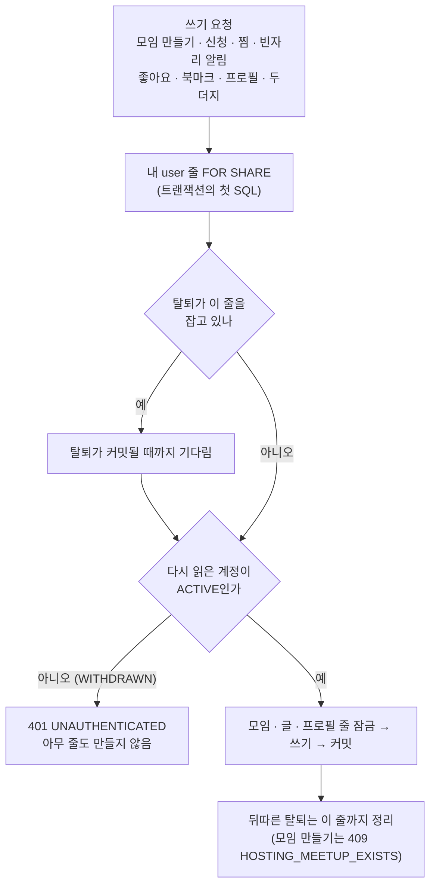
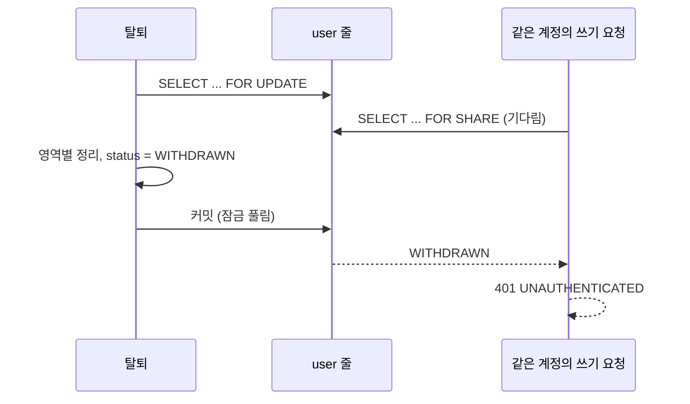

# KAN-74 [BE] 모임 만들기 · 신청이 탈퇴와 겹치지 않게 계정 확인

- Jira: [KAN-74](https://it-ting.atlassian.net/browse/KAN-74)
- 브랜치: `feature/be/KAN-74-meetup-withdrawal-lock`

## 계획

### 목표

같은 계정이 탈퇴하는 사이에 보낸 쓰기 요청이 탈퇴 정리에서 빠져, `WITHDRAWN` 계정에 줄이 남지 않게 한다. KAN-61 "남은 일"과 KAN-61 PR의 Codex 리뷰(P2)에서 넘긴 일이다. 모임 영역에 더해, 같은 틈이 있는 커뮤니티 · 프로필 쓰기도 이번에 고친다(결정 C).

- `POST /api/v1/meetups` ([API 명세](../api/07-meetup.md#post-apiv1meetups))
- `POST /api/v1/meetups/{meetupId}/applications` ([API 명세](../api/07-meetup.md#post-apiv1meetupsmeetupidapplications))
- `PUT /api/v1/meetups/{meetupId}/like`, 빈자리 알림 켜기 ([API 명세](../api/07-meetup.md#put-apiv1meetupsmeetupidlike))
- `PUT /api/v1/posts/{postId}/like`, `PUT /api/v1/posts/{postId}/bookmark`, `PUT /api/v1/comments/{commentId}/like` ([API 명세](../api/08-community.md#put-apiv1postspostidlike))
- `PATCH /api/v1/me/profile` ([API 명세](../api/04-my-burrow.md#patch-apiv1meprofile))

생기는 상황(지금):

1. 탈퇴(`WithdrawalService`)가 내 `user` 줄을 `FOR UPDATE`로 잠그고, 내가 연 예정 모임이 없는 것을 확인한 뒤 영역마다 정리한다.
2. 그 사이 같은 계정의 위 요청은 `user` 줄을 보지 않으므로 기다리지 않고 새 줄을 만든다.
3. 정리가 이미 지나간 줄은 남는다. 탈퇴한 계정이 연 예정 모임, 주최자에게 보이는 기다리는 신청, 빈자리 알림이 켜진 찜, 좋아요 · 북마크, 관심사 · 질문 답이 남는다.
4. 프로필 저장은 탈퇴가 먼저 커밋되면 지워진 `user_profile`을 못 찾아 `500`이 난다.

범위 밖: 없음. 아래 "확인한 다른 쓰기 경로"에서 필요 없다고 본 것은 고치지 않는다.

### 정한 것

| # | 질문 | 정한 답 | 정한 사람 |
|---|---|---|---|
| 1 | 무엇으로 막나 | 쓰기 전에 내 `user` 줄을 잠그고 다시 읽어 활성 계정인지 본다. 탈퇴(KAN-61 결정 C)와 같은 줄을 잡아, 겹치면 한쪽이 끝난 뒤 다른 쪽이 본다 | Jira KAN-74 "할 일" |
| 2 | 잠그는 순서 | 탈퇴와 같게 `user`를 맨 먼저 잡는다. 계정 줄을 트랜잭션의 첫 SQL로 잡는다. `apply`, 찜은 지금 모임 줄을, 프로필 저장은 `user_profile` 줄을 먼저 잠그므로 순서를 바꾼다. 프로필 저장을 바꾸지 않으면 탈퇴(`user` → … → `user_profile` 삭제)와 거꾸로 잡아 교착한다 | Jira KAN-74 "할 일" |
| 3 | 잠금 종류 | 공유 잠금 `FOR SHARE`(`UserRepository.findByIdForShare`). 같은 사람의 요청끼리는 서로 기다리지 않고 탈퇴(`FOR UPDATE`)만 기다린다. 땅굴(`BurrowService.lockForInteraction`), 오늘의 추천과 같다 | KAN-61 "남은 일", 기존 코드 |
| 4 | 테스트 | `WithdrawalConcurrencyTests`처럼 탈퇴와 각 API를 여러 번 겨루게 해, 어느 쪽이 먼저든 탈퇴한 계정에 줄이 남지 않는지 본다 | Jira KAN-74 "완료 기준" |
| A | 탈퇴한 계정이 부르면 줄 응답 | `401 UNAUTHENTICATED`. 세션은 여기서 지우지 않는다. 땅굴 · 오늘의 추천과 같고, 세션은 탈퇴가 커밋 직후 모두 지운다(`sessionService.endAll`) | 유예린 (2026-11-27) |
| B | 찜 · 빈자리 알림 켜기도 막나 | 막는다. `like`, `enableAlert`도 계정 줄을 먼저 잡는다 | 유예린 (2026-11-27) |
| C | 다른 영역(커뮤니티 좋아요 · 북마크, 프로필 관심사 · 질문 답) | 이번에 같이 고친다 | 유예린 (2026-11-27) |
| D | 잠그는 코드를 어디에 두나 | 각 서비스가 `UserRepository.findByIdForShare(userId).filter(User::isActive)`를 직접 부르고, 서비스 안의 작은 메서드(`lockActiveUser`)로 묶는다. 땅굴 · 오늘의 추천과 같은 방식이다. 읽기 잠금만 하고 `user`를 바꾸지 않으므로 영역 규칙을 어기지 않는다 | 유예린 (2026-11-27) |
| E | API 명세 | 고친 API의 에러 표에 "탈퇴하는 중 겹친 요청은 `401 UNAUTHENTICATED`" 한 줄을 더한다 | 유예린 (2026-11-27) |

겹쳤을 때 결과:

| 먼저 잠근 쪽 | 결과 |
|---|---|
| 탈퇴 | 다른 요청은 탈퇴가 커밋될 때까지 기다린 뒤 `WITHDRAWN`을 보고 `401 UNAUTHENTICATED`로 거절된다 |
| 모임 만들기 | 탈퇴가 기다린 뒤 새 모임을 보고 `409 HOSTING_MEETUP_EXISTS`로 거절된다. 모임은 남지만 계정은 활성이다 |
| 그 밖의 요청 | 탈퇴가 기다린 뒤 새 줄까지 정리한다 |

확인한 다른 쓰기 경로:

| 경로 | 탈퇴가 정리하나 | 지금 | 이번에 |
|---|---|---|---|
| 모임 만들기 `MeetupService.create` | 막는다(예정 모임) | 잠그지 않음 | 고친다 |
| 참여 신청 `MeetupApplicationService.apply` | 정리한다 | 모임 줄만 잠금 | 고친다 |
| 찜 · 빈자리 알림 켜기 `MeetupLikeService.like` · `enableAlert` | 찜을 지운다 | 모임 줄만 잠금 | 고친다(B) |
| 글 좋아요 · 북마크 `PostReactionService.like` · `bookmark`, 댓글 좋아요 `CommentService.like` | 지운다 | 잠그지 않음 | 고친다(C) |
| 프로필 저장 `MyProfileService.changeProfile`(관심사 · 질문 답) | 지운다 | `user_profile` 줄만 잠금 | 고친다(C) |
| 두더지 바꾸기 `MyProfileService.changeMole` | `user_profile`을 지운다 | `user_profile` 줄 잠금 | 필요 없음. 탈퇴가 먼저면 줄이 없고, 바꾸기가 먼저면 탈퇴가 기다린 뒤 지운다. 남는 줄이 없다 |
| 신청 취소 · 참여 취소 · 찜 풀기 · 알림 끄기 · 좋아요 취소 · 북마크 취소 | 정리한다 | 줄을 줄이기만 한다 | 필요 없음. 어느 쪽이 먼저든 끝에 정리된 상태다 |
| 주최자의 수락 · 거절 · 내보내기, 모임 수정 · 취소 · 삭제 | 정리한다 | 모임 줄 잠금 | 필요 없음. 탈퇴하는 사람의 요청이 아니고, 탈퇴는 모임 줄을 잠근 뒤 신청을 다시 읽는다. 내가 연 예정 모임이 있으면 탈퇴가 막힌다 |
| 글 · 댓글 쓰기 | 지우지 않는다(남긴다) | | 필요 없음 |
| 대화 요청 · 수락 · 나가기, 1:1 메시지 | 정리한다 | 계정 줄 잠금(KAN-55, KAN-61) | 필요 없음 |
| 단골 땅굴, 오늘의 추천 | 정리한다 | 계정 줄 공유 잠금 | 필요 없음 |
| 알림 설정, 온보딩, Google 연동 · 비밀번호 | | 계정 줄 잠금 | 필요 없음 |

### 만들 것

| 파일 | 내용 |
|---|---|
| `meetup/service/MeetupService.java` | `create`가 맨 먼저 계정 줄을 공유 잠금으로 잡고 활성인지 본다 |
| `meetup/service/MeetupApplicationService.java` | `apply`가 모임 줄보다 먼저 계정 줄을 잡는다 |
| `meetup/service/MeetupLikeService.java` | `like`, `enableAlert`가 모임 줄보다 먼저 계정 줄을 잡는다 |
| `community/service/PostReactionService.java` | `like`, `bookmark`가 맨 먼저 계정 줄을 잡는다 |
| `community/service/CommentService.java` | `like`가 맨 먼저 계정 줄을 잡는다 |
| `user/service/MyProfileService.java` | `save`가 `user_profile`보다 먼저 계정 줄을 잡는다 |
| `docs/api/07-meetup.md`, `08-community.md`, `04-my-burrow.md` | (E) 고친 API의 에러 표 |
| `docs/work/KAN-61.md` | "남은 일" 첫 줄에 KAN-74에서 고쳤다고 적는다 |
| `test/.../user/WithdrawalWriteRaceTests.java` | 아래 테스트. 여러 영역을 겨루므로 탈퇴 쪽에 둔다 |

DB 마이그레이션은 없다.

### 테스트

| 대상 | 정상 | 실패 |
|---|---|---|
| 탈퇴 ↔ 모임 만들기 (10번 겨루기) | 탈퇴가 먼저면 만들기가 `UNAUTHENTICATED`, 모임이 없다. 만들기가 먼저면 탈퇴가 `HOSTING_MEETUP_EXISTS`, 계정은 `ACTIVE`다. 탈퇴한 계정의 예정 모임은 남지 않는다 | 비즈니스 에러 말고 다른 예외(교착 등)가 나면 실패 |
| 탈퇴 ↔ 참여 신청 (10번) | 탈퇴는 늘 성공하고, 그 계정의 `PENDING` 신청이 남지 않는다 | 위와 같다 |
| 탈퇴 ↔ 찜 · 알림 켜기 (10번) | 탈퇴는 늘 성공하고 `meetup_like` 줄이 남지 않는다 | 위와 같다 |
| 탈퇴 ↔ 글 좋아요 · 북마크 · 댓글 좋아요 (10번) | 탈퇴는 늘 성공하고 `post_like` · `post_bookmark` · `comment_like` 줄이 남지 않는다 | 위와 같다 |
| 탈퇴 ↔ 프로필 저장 (10번) | 탈퇴는 늘 성공하고 `user_interest` · `user_answer` 줄이 남지 않는다. `500`이 나지 않는다 | 위와 같다 |
| 고친 API마다 | 기존 통합 테스트가 그대로 통과한다 | 탈퇴한 계정(세션은 남김)이 부르면 `401 UNAUTHENTICATED` |

## 결과

### 한눈에 보기

### 바꾼 것

| 파일 | 내용 |
|---|---|
| `meetup/service/MeetupService.java` | `create`가 맨 먼저 계정 줄을 공유 잠금으로 잡고 활성인지 본다 |
| `meetup/service/MeetupApplicationService.java` | `apply`가 모임 줄보다 먼저 계정 줄을 잡는다 |
| `meetup/service/MeetupLikeService.java` | `like`, `enableAlert`가 모임 줄보다 먼저 계정 줄을 잡는다 |
| `community/service/PostReactionService.java` | `like`, `bookmark`가 맨 먼저 계정 줄을 잡는다 |
| `community/service/CommentService.java` | `like`가 맨 먼저 계정 줄을 잡는다 |
| `user/service/MyProfileService.java` | `save`(내 정보 저장), `changeMole`이 `user_profile`보다 먼저 계정 줄을 잡는다 |
| `docs/api/07-meetup.md`, `08-community.md`, `04-my-burrow.md` | 고친 API 9개의 에러 표에 `401 UNAUTHENTICATED` 한 줄 |
| `docs/work/KAN-61.md` | "남은 일" 첫 줄에 KAN-74에서 고쳤다고 적음 |
| `test/.../user/WithdrawalWriteRaceTests.java` | 새 테스트 6개 |

### 확인한 것

- `WithdrawalWriteRaceTests` 6개 통과. 서비스 코드를 되돌리고 돌리면 6개 모두 실패한다(만들기 겨루기는 시작을 늦추는 장치를 넣은 뒤 실패를 확인했다)
- `./gradlew build` 통과. 테스트 852개(기존 846 + 새 6), 실패 0
- `git merge-tree --write-tree HEAD origin/dev`: 충돌 없음
- 로컬 코드 리뷰(스킬 `code-review`): P0 0건, P1 0건. `MyProfileService`에서 주석 위치만 바로잡았다
- Swagger 호출 결과(스킬 `api-evidence`): `local` 프로필로 띄워 고친 서비스마다 정상 호출 하나씩, 6개를 호출했다. 모임 만들기 201, 신청 201, 모임 찜 200, 글 좋아요 200, 댓글 좋아요 200, 내 정보 저장 200. 탈퇴와 겹친 `401`은 탈퇴가 세션을 모두 지워 Swagger로 재현할 수 없어 `WithdrawalWriteRaceTests`로 확인했다. 스크린샷과 응답은 PR 본문의 "호출 결과"에 있다

### 계획과 달라진 점

- 두더지 바꾸기(`PATCH /api/v1/me/mole`)도 계정 줄을 먼저 잡는다. 계획에서는 "남는 줄이 없어 필요 없음"으로 봤지만, 탈퇴가 먼저 프로필을 지우면 `IllegalStateException`으로 `500`이 난다. 프로필 저장과 같게 `401`로 답하게 했다
- 모임 만들기 겨루기는 만들기가 짧아 10번 모두 먼저 잠가, 탈퇴가 먼저인 순서가 나오지 않았다. 만들기의 시작을 겨루기마다 15ms씩 늦춰 두 순서가 모두 나오게 했다
- 테스트는 API가 아닌 서비스를 바로 부른다. 겨루기가 두 스레드에서 실제로 겹쳐야 해서 `WithdrawalConcurrencyTests`와 같은 방식을 따랐다. 탈퇴한 계정이 부르는 경우도 같은 클래스에서 서비스로 확인했다

### 남은 일

- 없음

### 검토 순서

1. 이 문서의 "정한 것", "확인한 다른 쓰기 경로"
2. `docs/api/`의 401 줄
3. 서비스 6개의 `lockActiveUser`와 부르는 위치(잠그는 순서)
4. `WithdrawalWriteRaceTests`
