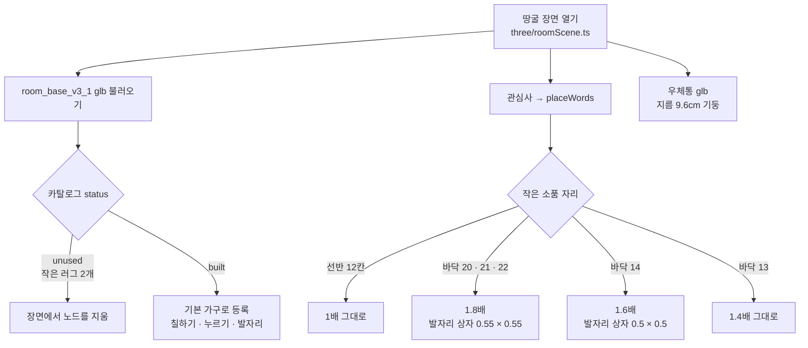
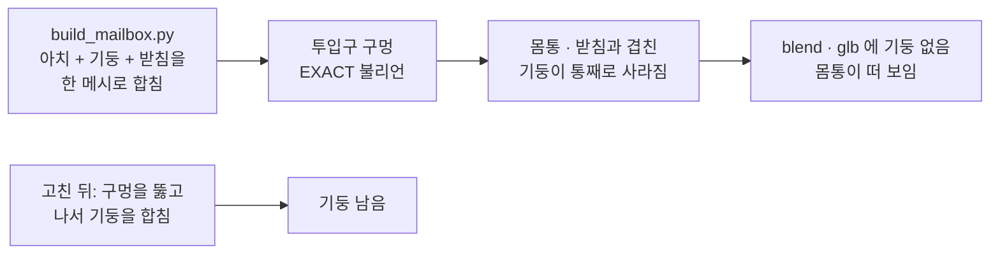

# KAN-75 [FE] 땅굴 작은 러그 빼기 · 바닥 소품 크기 키우기 · 우체통 기둥

- Jira: [KAN-75](https://it-ting.atlassian.net/browse/KAN-75)
- 브랜치: `fix/fe/KAN-75-room-rugs-props-mailbox`

## 계획

### 목표

테스트 중 땅굴 3D 방(온보딩 "땅굴 만들기" · 내 땅굴 · 방문)에서 나온 디자인 피드백 세 가지를 고친다.

| # | 생기는 일 | 원인 |
|---|---|---|
| 1 | 바닥에 과녁처럼 보이는 동그라미 2개 | 고정 장식 `rug_front_oval`(앞쪽 타원 0.9×0.6m) · `rug_right_small`(오른쪽 앞 0.5×0.35m). 동심원 무늬 텍스처라 과녁처럼 보임. 관심사와 상관없이 모든 땅굴에 깔림 |
| 2 | 관심사 소품이 장난감처럼 작음 | 작은 소품 134개는 모두 선반 칸(0.3×0.28×0.35m)에 맞춘 크기(키 0.12~0.35m). 바닥 칸에서도 1.4배까지만 키움. 두더지 키는 0.98m |
| 3 | 우체통 몸통이 받침 위에 떠 있음 | 만드는 스크립트(`it-ting3D/scripts/build_mailbox.py`)에는 받침과 몸통을 잇는 기둥이 있는데, Blender 원본 `mailbox_work.blend`의 `Mailbox_Body`에 이미 없음. 받침(바닥~4cm)과 몸통(13cm부터) 사이가 비어 있음 |

미리 보기(로컬 목 앱, 사용자 관심사 10개)로 러그 빼기 · 바닥 1.8배 · 선반 1.2배 · 기둥(지름 15cm, 9.6cm)을 비교해 보고 정했다.

범위 밖:
- 선반 소품을 책상 · 책장으로 옮기기, 관심사 · 가구 추가: 회의 뒤 3D 다음 버전에서 자리(slots)와 함께 다시 잡는다
- 방석 술(꾸미기 "술: 네 귀퉁이"): 그대로 둔다

### 정한 것

| # | 질문 | 정한 답 | 정한 사람 |
|---|---|---|---|
| 1 | 작은 러그 2개 | 방에서 뺀다 | 사용자 (2026-11-26) |
| 2 | 소품 크기 | 미리 보기 A안(바닥 1.8배 · 선반 1.2배)을 기준으로. 칸마다 조정한 값은 5 · 6 · 7 | 사용자 (2026-11-26) |
| 3 | 우체통 기둥 굵기 | 투입구 구멍과 같은 지름 9.6cm(반지름 0.048m) | 사용자 (2026-11-26) |
| 4 | 진행 순서 | 앱 쪽 작은 작업은 지금, 책상 · 책장 · 관심사 추가는 회의 뒤 | 사용자 (2026-11-27) |
| 5 | 선반 소품 배율 | **1배 그대로**. 1.2배면 134개 중 48개가 칸 폭 0.3m를 넘어 옆 칸 소품과 닿을 수 있다(최대 0.36m). 깊이도 칸(0.28m)을 넘어 벽 쪽으로 나간다. 미리 보기에서도 1.35~1.7m 높이 벽 선반이라 차이가 거의 안 보였다. 책상 · 책장으로 옮길 때 다시 정한다 | 사용자 (2026-11-27) |
| 6 | 바닥 칸별 배율 | 앞 · 왼쪽 3칸(`prop_slot_20` · `21` · `22`, 바닥 소품이 먼저 가는 칸) **1.8배**, 오른쪽 `prop_slot_14`(5번째) **1.6배**, 왼쪽 벽 `prop_slot_13`(4번째) **1.4배 그대로**. 20 · 21 · 22는 1.8배에서도 가장 가까운 것과 6cm 이상 떨어진다. 13은 1.8배면 7개 모델이 큰 가구 자리 `furniture_slot_08` 상자와 최대 5.6cm 겹친다(2cm 띄우는 최대 1.44배). 14는 1.8배면 5개가 `furniture_slot_19`와 0.4cm 겹친다(최대 1.64배) | 사용자 (2026-11-27) |
| 7 | 3D 배치 규칙 "카메라 앞쪽 양옆은 0.5m 이하"(`it-ting3D/docs/room_spec.md`) | **앞 칸(20 · 21) 소품은 0.65m까지 허용**. 1.8배면 17개 모델이 0.5m를 넘는다(캐리어 · 메트로놈 · 지구본 등, 최대 0.63m). 두 칸은 원탁에서 양옆으로 0.8m 떨어져 있어 카메라 → 두더지 시선 밖이다. 구현할 때 키 큰 모델을 앞 칸에 놓고 두더지를 가리는지 화면으로 확인한다 | 사용자 (2026-11-27) |
| 8 | 우체통 원본 고치는 법 | `mailbox_work.blend`를 `mailbox_work_before_post.blend`로 복사해 두고, `Mailbox_Body`에 기둥(반지름 0.048m, 높이 0.01~0.13m, 몸통 재질)을 붙여 저장한다. `build_mailbox.py`의 기둥 반지름도 0.048로 맞춘다. 내보내기는 `export_mailbox.py`와 같은 설정 + `patch_glb_emissive.py`. `export_mailbox.py`의 `ROOT`는 옛 폴더 경로라, 같은 설정으로 `it-ting3D/exports/`에 내보낸다 | 사용자 (2026-11-27) |

소품 134개는 Blender로 모두 재고, 칸마다 배율을 곱해 놓았을 때 주변 자리 상자 · 고정 장식 · 원탁 둘레 · 두더지 시작점과의 거리를 계산했다.

### 만들 것

| 파일 | 내용 |
|---|---|
| `frontend/src/data/furnitureCatalog.json` | `rug_front_oval` · `rug_right_small`의 `status`를 `unused`로, 까닭을 `note`에 |
| `frontend/src/three/roomScene.ts` | 기본 가구 glb를 불러온 뒤 `status: unused`인 행의 노드를 장면에서 뺌(칠하기 · 누르기 대상에서도 빠짐) |
| `frontend/src/data/slots.json` | 바닥 소품 칸 배율(정한 것 6)과, 배율을 곱한 상자 `max_m`(두더지가 피해 걷는 발자리로 씀). 20 · 21 · 22: 0.54×0.504×0.63, 14: 0.48×0.45×0.56 |
| `frontend/src/data/roomPlanV38.ts`, `three/roomScene.ts` | 배율 설명 주석(1.4배 → 칸별 값) |
| `frontend/src/assets/models/room/mailbox_draco_webp.glb` | 기둥을 붙여 다시 내보낸 우체통 |
| `frontend/src/tests/room-plan-v38.test.ts`, `data-json.test.ts` | 바뀐 배율 · 상자, 러그 `unused` |
| (3D 프로젝트) `it-ting3D/blend/mailbox_work.blend`, `scripts/build_mailbox.py`, `exports/mailbox*.glb` | 정한 것 8 |

### 테스트

| 무엇 | 확인 |
|---|---|
| 배치 | 바닥 칸 배율이 20 · 21 · 22 = 1.8, 13 = 1.4, 14 = 1.6, 선반 = 1. 작은 소품 행의 크기 = 칸 상자 |
| 카탈로그 | 러그 2개는 `unused`, 나머지 기본 가구 7개는 그대로 |
| 우체통 glb | 노드 4개 · 클립 `FlagUp` · 재질 3개 · 발광 값이 그대로이고, 높이 0.06 ~ 0.12m 단면에 지름 9.6cm 기둥이 있음 |
| 화면 | 목 앱 온보딩 "땅굴 만들기"에서 러그 없음 · 바닥 소품 크기 · 우체통 기둥 스크린샷. 키 큰 소품(캐리어 · 지구본 등)을 앞 칸에 놓아 두더지를 가리지 않는지 |
| 전체 | `npm run typecheck` · `lint` · `test` · `build` · `smoke` |

## 결과

### 한눈에 보기

우체통 기둥이 빠졌던 까닭:

### 바꾼 것

| 파일 | 내용 |
|---|---|
| `frontend/src/data/furnitureCatalog.json` | `rug_front_oval` · `rug_right_small`을 `status: unused`로, 까닭을 `note`에 |
| `frontend/src/three/roomScene.ts` | `unused` 행은 기본 가구 목록에서 빼고, 같은 glb를 불러온 뒤 그 노드를 장면에서 지움. 배율 주석 |
| `frontend/src/data/slots.json` | `prop_slot_20` · `21` · `22`: 배율 1.4 → 1.8, 상자 0.45×0.45×0.5 → 0.55×0.55×0.63. `prop_slot_14`: 1.4 → 1.6, 상자 → 0.5×0.5×0.56. 13은 그대로. 칸마다 까닭을 `note_kan75`에 |
| `frontend/src/data/roomPlanV38.ts`, `roomPlan.ts` | 배율 주석 |
| `frontend/src/assets/models/room/mailbox_draco_webp.glb` | 기둥(반지름 0.048m, 높이 0.01 ~ 0.13m, 몸통 재질)을 붙여 다시 내보낸 우체통 |
| `frontend/src/tests/room-plan-v38.test.ts` | 칸별 배율 · 상자. 새 시험: 바닥 소품 칸의 상자 ≥ 선반 칸 상자 × 배율 |
| `frontend/src/tests/data-json.test.ts` | 러그 2개는 `unused`. 새 시험: `unused` 행은 러그 2개뿐 |
| (3D 프로젝트) `it-ting3D/blend/mailbox_work.blend` | 기둥을 붙여 저장. 이전 파일은 `mailbox_work_before_post.blend` |
| (3D 프로젝트) `it-ting3D/scripts/build_mailbox.py` | 기둥 반지름 0.075 → 0.048, 기둥을 투입구 불리언 뒤에 합치게 순서를 바꿈 |
| (3D 프로젝트) `it-ting3D/exports/mailbox.glb` · `mailbox_draco_webp.glb` | 다시 내보내고 `patch_glb_emissive.py` 적용 |

### 확인한 것

- `npm run typecheck` 통과, `lint` 오류 0(경고 55개는 `dev`와 같음)
- `npm test`: 59개 파일, 707개 통과(새 2개) · 2개 todo
- `npm run build` 통과, `npm run smoke`: 화면 106개 모두 OK
- 화면(목 모드 빌드, 온보딩 "땅굴 만들기"):
  - 사용자 관심사 10개: 러그 2개가 없고, 바닥 소품 5개가 커짐, 우체통 기둥이 보임
  - 키 큰 소품을 앞 칸에 둠(20 지구본 0.63m, 21 라디오 0.61m, 22 캐리어): 두더지를 가리지 않음
- 소품 134개를 Blender로 재고 칸마다 배율을 곱해 놓았을 때 가장 가까운 것과의 거리: 20(1.8배) 8.5cm · 21 6.2cm · 22 8.1cm, 14(1.6배) 2.5cm, 13(1.4배 그대로) 2.9cm
- 우체통 glb: 노드 4개 · `FlagUp` 클립 · 재질 3개 · 발광 값 · 경계 상자가 이전 파일과 같음. 높이 0.05 ~ 0.12m 단면에 반지름 0.048m 기둥(32점)
- `build_mailbox.py`를 임시 폴더에서 다시 돌려 봄: 반지름만 바꾸면 기둥이 여전히 빠지고, 합치는 순서를 바꾸면 남음
- 로컬 코드 리뷰: P0 0건, P1 0건
- 저사양 기기가 구워 둔 방 그림(IndexedDB)은 저장 키에 빌드 표시가 붙어 있어 배포하면 새로 구움(`three/stills.ts`)

### 계획과 달라진 점

- `build_mailbox.py`: 계획은 기둥 반지름만 바꾸는 것이었는데, 그것만으로는 다시 만들어도 기둥이 빠졌다. 원인이 합치는 순서(위 그림)라서 순서도 바꿨다.
- `slots.json` 상자: 계획은 선반 칸 × 1.8(0.54×0.504×0.63)이었는데, 실제 소품 깊이가 칸(0.28m)보다 큰 것이 있어(최대 0.296m) 소품 134개의 최대 크기 × 배율을 올림해 0.55×0.55×0.63(14: 0.5×0.5×0.56)으로 했다.
- 3D 원본을 저장할 때 Blender 자동 백업(`.blend1`)을 만들지 않게 해서, 원래 있던 `mailbox_work.blend1`(11/14)은 그대로 두었다.

### 남은 일

- 3D 다음 핸드오프(회의 뒤): 앱 `slots.json`만 바뀌었으므로 `it-ting3D/docs/v3_8_1/slots_v3_8_1.json`(또는 다음 판)에도 배율 · 상자를 반영. 3D 배치 규칙(`room_spec.md`)에 "앞 칸 소품 0.65m까지" 예외를 적기
- 미리 찍은 정지 그림 `src/assets/stills/room.webp` · `visit.webp`(3D가 뜨기 전 · WebGL이 없을 때 보임)에 작은 러그와 기둥 없는 우체통이 남아 있음. 이번 작업 전부터 지금 방과 다른 옛 그림이고, 만드는 스크립트(`explore/gpu/make-stills.mjs`)가 저장소에 없어 이번에는 다시 찍지 않음
- `it-ting3D/scripts/export_mailbox.py` · `build_mailbox.py`의 `ROOT`가 옛 폴더 경로(`~/Desktop/SSAFY 16/...`)
- 선반 소품을 책상 · 책장으로 옮기기, 관심사 · 가구 추가(회의 뒤)

### 검토 순서

1. `docs/work/KAN-75.md`
2. `frontend/src/data/slots.json`, `furnitureCatalog.json`
3. `frontend/src/three/roomScene.ts`
4. `frontend/src/tests/room-plan-v38.test.ts`, `data-json.test.ts`
5. `frontend/src/assets/models/room/mailbox_draco_webp.glb`
