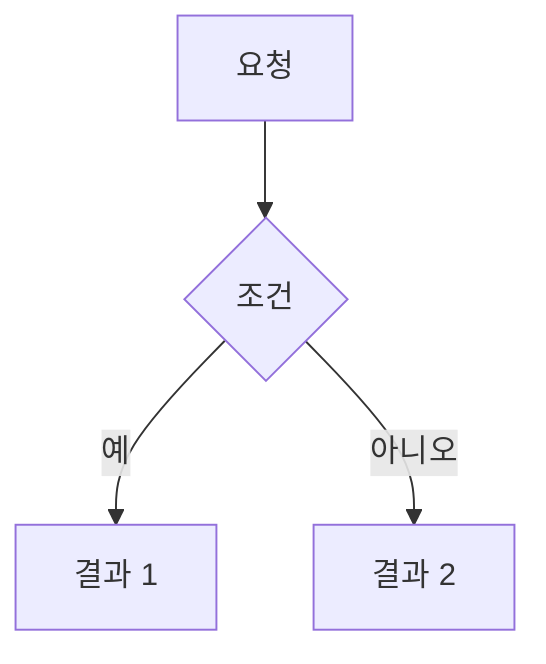

<!--
작업 계획서 · 완료 보고서 템플릿. 이 파일을 docs/work/KAN-<번호>.md로 복사해 쓴다.
절차는 스킬 work-plan을 따른다. 사례: KAN-38.md(API), KAN-35.md(문서 · 스킬).
"계획"은 코드를 바꾸기 전에 쓰고 사용자 승인을 받는다. "결과"는 작업을 마치면 채운다.
해당하지 않는 절은 지운다. 이 주석도 지운다.
-->

# KAN-<번호> <티켓 제목>

- Jira: [KAN-<번호>](https://it-ting.atlassian.net/browse/KAN-<번호>)
- 브랜치: `<유형>/<영역>/KAN-<번호>-<설명>`

## 계획

### 목표

<무엇을 왜 만드는지 한두 문장. API면 주소와 API 명세 링크를 목록으로>

- `POST /api/v1/...` ([API 명세](../api/<번호>-<영역>.md#...))

범위 밖:
- <이번에 하지 않는 것과 언제 하는지>

### 정한 것

<명세 · 이전 작업 · 대화에서 이미 정해진 것. 다시 묻지 않는다>

| # | 질문 | 정한 답 | 정한 사람 |
|---|---|---|---|
| 1 | <무엇> | <답> | 사용자 (YYYY-MM-DD) |

### 이번에 정할 것 (확인 부탁)

<명세에 없거나 "미정"인 것을 시작 전에 한꺼번에 모은다. 제안과 까닭을 적고 승인을 받는다>

| # | 무엇 | 제안 | 까닭 |
|---|---|---|---|
| A | <무엇> | <제안> | <까닭> |

### 만들 것

| 파일 | 내용 |
|---|---|
| `<경로>` | <내용> |

### 테스트

<API 작업이면 API마다 정상과 실패. 문서 작업이면 확인 방법>

| API | 정상 | 실패 |
|---|---|---|
| `<메서드> <주소>` | <상황 → 결과> | <상황 → 상태 코드와 code> |

## 결과

### 한눈에 보기

<!--
Mermaid 다이어그램. PR 본문 맨 위에도 같은 것을 넣는다.
- 흐름도(flowchart)는 늘 넣는다. 요청이 지나가는 길이나 처리 단계를 그리고, 응답이 갈리는 곳은 마름모로 그린다.
- 순서가 중요한 처리(로그인, 가입처럼 여러 단계)는 시퀀스(sequenceDiagram)를 넣는다.
- 테이블을 만들거나 바꾸면 ERD(erDiagram)를 넣는다. 새로 만든 테이블과 읽기만 하는 테이블은 글로 구분한다.
- 문서 · 설정만 바꾼 작업은 흐름도 하나면 된다.
- 넣은 뒤 GitHub에서 그림으로 그려지는지 확인한다.
-->

### 바꾼 것

| 파일 | 내용 |
|---|---|
| `<경로>` | <무엇을 바꿨나> |

### 확인한 것

- `./gradlew build` 통과. 테스트 <N>개(기존 <N> + 새 <N>)
- `git merge-tree --write-tree HEAD origin/dev`: 충돌 없음
- 로컬 코드 리뷰: P0 <N>건, P1 <N>건

### 계획과 달라진 점

<계획에 없던 것, 혼자 판단한 것을 모두 적는다. 없으면 "없음">

### 남은 일

- <다음 작업으로 넘긴 것>

### 검토 순서

1. <문서>
2. <마이그레이션 · 엔티티>
3. <컨트롤러 → 서비스 → 저장소>
4. <테스트>
